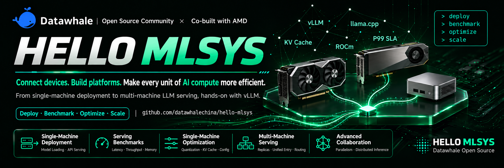

<div align="center">
  
  <p><strong>Connect devices, build platforms, make every unit of AI compute more efficient 🚀</strong></p>
</div>

<div align="center">

*Single-machine deployment · Serving benchmarks · Single-machine optimization · Multi-machine serving · Advanced collaboration*

<p align="center">
  <a href="./README_en.md"></a>
  <a href="./README.md"></a>
</p>

</div>

<div align="center">

<a href="https://datawhalechina.github.io/hello-mlsys/"></a> | <a href="https://datawhalechina.github.io/hello-mlsys/curriculum/"></a> | <a href="https://github.com/datawhalechina/hello-rocm"></a> | <a href="https://github.com/datawhalechina/hello-gpu"></a>

</div>

<p align="center">
  
  &nbsp;&nbsp;&nbsp;&nbsp;
  
</p>

> [!CAUTION]
> ⚠️ Alpha preview: this is an early internal build. It is incomplete and may contain errors. Issues with bug reports or suggestions are welcome.
>
> The tutorial body is currently written in Chinese; this English README gives an overview of the project.

&emsp;&emsp;🎓 **Learn MLSys together with students at the National University of Singapore (NUS)!** This project is co-built by NUS students, who are learning it together with more of their classmates. Join us and go from serving a model on one machine to a multi-user LLM serving platform on AMD devices.

&emsp;&emsp;Once a model runs, the next step is usually turning it into a service everyone can use: How many concurrent requests can one machine sustain? Are time to first token and generation speed good enough for the application? How should you choose precision and quantization, batching, KV cache, and framework settings? And how do you connect the few AMD machines in your lab into one stable LLM service shared by many users?

&emsp;&emsp;However, **getting a model to run is not the same as running a good service**. These questions involve trade-offs among model, hardware, framework configuration, workload, and service targets. Trial and error is slow and expensive; framework documentation alone does not explain why a setting works or whether it still holds on a different machine.

&emsp;&emsp;**hello-mlsys** is built for exactly this path. Based on AMD hardware and using open-source inference frameworks such as **vLLM and llama.cpp** as hands-on vehicles (vLLM for the main line on Linux, llama.cpp for comparison experiments and for edge devices such as the Ryzen AI MAX+ 395), it takes you from **single-machine deployment** to **multi-machine LLM serving**: through performance benchmarking, precision and quantization choices, framework tuning, and resource allocation, you build your own efficient model serving platform. The whole book answers one question:

> **Given the devices, tasks, and service targets, how do you choose model precision, inference framework, and resource configuration to make the whole service more efficient?**

&emsp;&emsp;To back every choice with evidence, the tutorial follows a **predict first, then measure** approach: before tuning anything, use the **[mlsys-simulator](https://github.com/eyuansu62/mlsys-simulator)** to estimate performance, memory, and capacity boundaries, then validate a small number of informative configurations on real AMD hardware, explain the deviations, calibrate the model, and make the configuration decision.

&emsp;&emsp;**This is not a user manual for inference frameworks. It aims to build engineering skills for LLM serving systems: deploy, benchmark, optimize, and scale. Anyone is welcome to open an issue or submit a PR to help build and maintain this project.**

### The AMD Hello Series

&emsp;&emsp;From getting started with AI and building applications, to GPU compute optimization, to building LLM serving platforms: a shared foundation for industry applications, research practice, and talent development. The three projects can be studied independently or connected through the same model: train, fine-tune, and use a model in hello-rocm; understand and optimize its computation in hello-gpu; and deploy it as an efficient shared service in hello-mlsys.

| Project | Slogan | Focus |
| ---- | ---- | ---- |
| [**hello-rocm**](https://github.com/datawhalechina/hello-rocm) | The first hands-on stop for every AI beginner, starting from zero. | A hands-on guide to AI and agentic AI on AMD platforms |
| [**hello-gpu**](https://github.com/datawhalechina/hello-gpu) | Understand the GPU and optimize every computation yourself. | Starting from the data types and GEMM optimization of a small model you trained, learn GPU programming and agent-assisted optimization |
| **hello-mlsys** (this project) | Connect devices, build platforms, make every unit of AI compute more efficient. | Using vLLM and other open-source inference frameworks as case studies, learn LLM serving deployment, performance optimization, and multi-machine serving |

&emsp;&emsp;For environment setup, getting started with AI, and fine-tuning, see hello-rocm; for GPU programming and kernel optimization, see hello-gpu. This tutorial does not repeat either topic.

> &emsp;&emsp;***Study tip: the chapter order is the recommended learning order. Start with [Chapter 0: Protocol and Paper Drill](https://datawhalechina.github.io/hello-mlsys/part0-intro/chapter0/) to align on measurement units such as tokens, GB/GiB, and latency; Chapters 1 and 2 build the Roofline and profiling methods for performance analysis and calibration; Chapters 3–8 cover memory, precision and quantization, communication, parallelism, serving benchmarks, and inference framework trade-offs in turn; finally, the projects in Part 2 apply these methods to edge, single-machine, and cluster design. No AMD GPU at hand? The Roofline predictions in Chapter 1 and the memory ledger in Chapter 3 can be done on CPU alone.***

## Why This Project

&emsp;&emsp;What is MLSys?

> MLSys (Machine Learning Systems) studies how to run machine learning models efficiently, reliably, and economically on real hardware under real workloads. For LLMs, it is not only about how fast a single request runs, but about how much useful work a service can reliably deliver on given devices and service targets.

&emsp;&emsp;Models keep growing and inference keeps getting more expensive. Once a model runs, the next questions are whether it holds up under load, whether it is worth the cost, and whether everyone can use it. Precision and quantization, batching, KV cache, framework settings, service replicas, and request routing each affect latency, throughput, memory, and cost. Yet most material either stops at "how to launch framework X" or at paper formulas: the former tells you how to run something but not why it is configured that way; the latter gives you a model but not how far it is from real hardware.

&emsp;&emsp;This project covers several kinds of AMD hardware: desktop GPUs such as the **Radeon RX 9070 XT and RX 7900 XTX** are affordable enough for students and small labs to run real-hardware experiments; edge devices such as the **Ryzen AI MAX+ 395** bring large unified memory to personal computers and suit on-device deployment and resource-constrained scenarios (support in progress); and **multiple W7900D 48 GB GPUs** are planned for multi-GPU and cluster experiments. Serving benchmark methods, memory ledgers, communication models, and queueing theory hold on any platform; switching hardware only means switching the parameter table.

&emsp;&emsp;Along this path, the tutorial sticks to three principles:

| Principle | Meaning | How you practice it |
| ---- | ---- | ---- |
| **Service as the goal** | The end point is a usable LLM service, not a single inference | Go from a single-machine API service to a serving platform shared by many users |
| **Benchmarks as evidence** | Every optimization needs measurements under unified conventions | Fix the model and task, and measure input/output length, concurrency, latency, throughput, and memory |
| **Predict, then measure** | Use the simulator to narrow the search, and let real hardware decide | Record predictions before measuring, measure only the few most informative configurations, explain errors, and calibrate |

&emsp;&emsp;The tutorial focuses on **LLM inference serving**. For getting started with AI, training, and fine-tuning, see hello-rocm; for GPU programming and kernel optimization, see hello-gpu.

&emsp;&emsp;***We hope every learner can connect the devices at hand, build their own serving platform, and make every unit of AI compute count.***

## Who This Is For

&emsp;&emsp;This project is for:

* Developers who can already run a model locally and want to deploy it as a stable service for applications or their team;
* Students and engineers whose lab or team has a few AMD machines and wants to build a shared LLM serving platform;
* Learners who want to enter MLSys / AI Infra / inference optimization and master serving benchmarks, performance optimization, and multi-machine deployment;
* Developers who need to do capacity planning, quantization selection, or framework selection for inference services but lack measured evidence;
* Learners who want to understand LLM serving systems in the AMD GPU / ROCm ecosystem.

> &emsp;&emsp;You do not need kernel development experience, but you should be comfortable with Python, PyTorch, Linux, and reading English documentation; the basics of using and fine-tuning models can be picked up in hello-rocm first.

## Roadmap and Progress

### Chapters and Experiment Coverage

> ✅ means the chapter text already includes that type of result (simulator prediction or real-hardware measurement); 🚧 means planned or in progress. Only completed experiments are counted; Chapters 4 and 5 also include RX 7900 XTX measurements.

| Part / Chapter | Core experiment / topic | Simulator | RX 9070 XT | W7900D | Ryzen AI MAX+ 395 | Status |
| ---- | ---- | :----: | :----: | :----: | :----: | :----: |
| [Part 0 Introduction](https://datawhalechina.github.io/hello-mlsys/part0-intro/chapter0/) | Positioning, hardware map, unified measurement protocol, paper calculation | | | | | 🚧 |
| [Ch 1](https://datawhalechina.github.io/hello-mlsys/part1-modeling/chapter1/) | Estimating time with a simulator, Roofline, and bottlenecks | ✅ | ✅ | 🚧 | | 🚧 |
| [Ch 2](https://datawhalechina.github.io/hello-mlsys/part1-modeling/chapter2/) | First end-to-end profile and calibration with real samples | ✅ | ✅ | 🚧 | 🚧 | 🚧 |
| [Ch 3](https://datawhalechina.github.io/hello-mlsys/part1-modeling/chapter3/) | Memory estimation: model weights and KV cache | ✅ | ✅ | 🚧 | 🚧 | 🚧 |
| [Ch 4](https://datawhalechina.github.io/hello-mlsys/part1-modeling/chapter4/) | Precision, quantization, and error budgets | ✅ | ✅ | 🚧 | 🚧 | 🚧 |
| [Ch 5](https://datawhalechina.github.io/hello-mlsys/part1-modeling/chapter5/) | Communication cost models and scale-in / scale-up | ✅ | 🚧 | 🚧 | | 🚧 |
| [Ch 6](https://datawhalechina.github.io/hello-mlsys/part1-modeling/chapter6/) | Model parallelism and memory / compute partitioning | ✅ | ✅ (behavior check) | 🚧 | 🚧 | 🚧 |
| [Ch 7](https://datawhalechina.github.io/hello-mlsys/part1-modeling/chapter7/) | Serving, queueing, and SLA; load generation and stress testing | ✅ | ✅ | 🚧 | 🚧 | 🚧 |
| [Ch 8](https://datawhalechina.github.io/hello-mlsys/part1-modeling/chapter8/) | Inference framework trade-offs, profiling, and performance analysis | 🚧 | 🚧 | 🚧 | 🚧 | 🚧 |
| [Ch 9.1](https://datawhalechina.github.io/hello-mlsys/part2-ai-design/chapter9-1/) | Designing with AI: on-device deployment assistant | 🚧 | 🚧 | 🚧 | 🚧 | 🚧 |
| [Ch 9.2](https://datawhalechina.github.io/hello-mlsys/part2-ai-design/chapter9-2/) | Designing with AI: meeting an SLA on a single machine | 🚧 | 🚧 | 🚧 | 🚧 | 🚧 |
| [Ch 9.3](https://datawhalechina.github.io/hello-mlsys/part2-ai-design/chapter9-3/) | Designing with AI: multi-GPU long-context, multi-subagent request handling | 🚧 | | 🚧 | | 🚧 |
| [Part 3](https://datawhalechina.github.io/hello-mlsys/part3-electives/) | Electives and case library: priority electives and extended case cards | 🚧 | 🚧 | 🚧 | 🚧 | 🚧 |
| [Appendices](https://datawhalechina.github.io/hello-mlsys/curriculum/) | Hardware parameters, model cards, glossary, references, community, common failure modes and troubleshooting | | | | | 🚧 |

### Repository Layout

```
hello-mlsys/
├── docs/                      # VitePress tutorial site sources
│   ├── part0-intro/           # Part 0: Introduction
│   ├── part1-modeling/        # Part 1: Modeling and Calibration
│   ├── part2-ai-design/       # Part 2: Designing with AI
│   ├── part3-electives/       # Part 3: Electives and Case Library
│   ├── appendix/              # Appendices A–F
│   ├── curriculum/            # Full curriculum (generated from the outline)
│   └── .vitepress/            # Site config and book outline (outline.mjs)
├── code/                      # Per-chapter experiment code, measurement records, and plotting scripts
├── notebooks/                 # Hands-on notebooks
└── scripts/                   # Environment setup, build, and check scripts
```

## Contents

> The chapter order is the recommended learning order. The book covers five modules: single-machine deployment, serving benchmarks, single-machine optimization, multi-machine serving, and advanced collaboration; "single-machine deployment" and "multi-machine serving" are being written and will be inserted at the appropriate places. vLLM carries the main line, with llama.cpp for comparison and edge devices; conclusions about multi-GPU tensor parallelism on Radeon (Chapters 5 and 6) rely on our own measurements. Chapter links point to the Chinese text.

| Chapter | Summary | Module | Status |
| ---- | ---- | ---- | ---- |
| **Part 0: Introduction** | | | |
| [Chapter 0 Protocol and Paper Drill](./docs/part0-intro/chapter0/index.md) | Tutorial positioning, hardware map, unified measurement protocol, simulator toolchain and its limits | Performance-analysis foundations | 🚧 |
| **Part 1: Modeling and Calibration** | | | |
| [Chapter 1 Simulator Estimates, Roofline, and Bottlenecks](./docs/part1-modeling/chapter1/index.md) · [code](./code/part1-modeling/chapter1) | Roofline, arithmetic intensity, compute-bound / memory-bound classification, order-of-magnitude time estimates | Performance-analysis foundations | 🚧 |
| [Chapter 2 First Real-Hardware Profile and Performance Calibration](./docs/part1-modeling/chapter2/index.md) · [code](./code/part1-modeling/chapter2) | Hardware readiness checks, minimal profiling, error attribution, calibration and holdout sets | Performance-analysis foundations | 🚧 |
| [Chapter 3 Memory Estimation: Model Weights and KV Cache](./docs/part1-modeling/chapter3/index.md) · [code](./code/part1-modeling/chapter3) | Weight memory, KV cache, activation and fragmentation overhead, maximum servable context and concurrency | Single-machine optimization | 🚧 |
| [Chapter 4 Precision, Quantization, and Error Budgets](./docs/part1-modeling/chapter4/index.md) · [code](./code/part1-modeling/chapter4) | Numeric formats, precision / latency / memory trade-offs, error budget allocation | Single-machine optimization | 🚧 |
| [Chapter 5 Communication Cost Models and Scale-in / Scale-up](./docs/part1-modeling/chapter5/index.md) · [code](./code/part1-modeling/chapter5) | Intra-node and inter-node interconnects, collective communication primitives, α–β cost model | Advanced collaboration | 🚧 |
| [Chapter 6 Model Parallelism and Memory / Compute Partitioning](./docs/part1-modeling/chapter6/index.md) · [code](./code/part1-modeling/chapter6) | DP / FSDP, TP, PP, and when communication eats the gains from partitioning | Advanced collaboration | 🚧 |
| [Chapter 7 Serving, Queueing, and SLA](./docs/part1-modeling/chapter7/index.md) · [code](./code/part1-modeling/chapter7) | TTFT, TPOT / ITL, latency percentiles, concurrency and throughput, queueing knee, load generation and stress testing | Serving benchmarks | 🚧 |
| [Chapter 8 Inference Framework Trade-offs, Profiling, and Performance Analysis](./docs/part1-modeling/chapter8/index.md) | Framework-level trade-offs, framework-level profiling, configuration-space prediction and failure modes | Single-machine optimization | 🚧 |
| **Part 2: Designing with AI** | | | |
| [Chapter 9.1 On-Device Deployment Assistant](./docs/part2-ai-design/chapter9-1/index.md) | Choosing model, precision, context, and KV configuration under tight resource limits | Single-machine optimization | 🚧 |
| [Chapter 9.2 Meeting an SLA on a Single Machine](./docs/part2-ai-design/chapter9-2/index.md) | Single-GPU capacity planning: memory and queueing upper bounds, measured knee, holdout validation | Single-machine optimization | 🚧 |
| [Chapter 9.3 Workload-Driven Inference Cluster Design](./docs/part2-ai-design/chapter9-3/index.md) | Minimizing total wall-clock time on a frozen deep-research trace: 32B/7B model collaboration and multiple parallel strategies, screened in simulation and then measured on a multi-GPU W7900D 48 GB cluster | Advanced collaboration | 🚧 |
| **Part 3: Electives and Case Library** | | | |
| [Electives and Case Library](./docs/part3-electives/index.md) | Priority electives and extended case cards | Electives | 🚧 |
| **Appendices** | | | |
| [Appendix A Hardware Parameters](./docs/appendix/appendix-a-hardware/index.md) | Coming soon | —— | 🚧 |
| [Appendix B Model Cards](./docs/appendix/appendix-b-model-cards/index.md) | Coming soon | —— | 🚧 |
| [Appendix C Glossary](./docs/appendix/appendix-c-glossary/index.md) | Coming soon | —— | 🚧 |
| [Appendix D References](./docs/appendix/appendix-d-references/index.md) | Coming soon | —— | 🚧 |
| [Appendix E Community](./docs/appendix/appendix-e-community/index.md) | Coming soon | —— | 🚧 |
| [Appendix F Common Failure Modes and Troubleshooting Checklist](./docs/appendix/appendix-f-troubleshooting/index.md) | Coming soon | —— | 🚧 |

## Contributors

### Core Contributors

- Yao Lu - Faculty Advisor & Project Lead (Assistant Professor, School of Computing, National University of Singapore)
- [yuzhou - Project Lead](https://github.com/youyoulyz) (PhD student, ShanghaiTech University)
- [Bowen Qin - Project Member](https://github.com/eyuansu62) (PhD student, National University of Singapore; builds and calibrates [mlsys-simulator](https://github.com/eyuansu62/mlsys-simulator))
- [Jiahang Pan - Project Member](https://github.com/amdjiahangpan) (Software Engineer, AMD)
- [Weihong Liu - Project Member](https://github.com/Weihong-Liu) (Datawhale member)
- yanhui - Project Member (MComp student, National University of Singapore)
- [Jiyan Zheng - Project Member](https://github.com/Keyan0412) (MComp student, National University of Singapore)

> Note: more contributors are welcome!

### Others

- If you have any ideas, feel free to contact us, and please open issues
- Special thanks to everyone who has contributed to the tutorial!
- Thanks to the AMD University Program for supporting this project!

<div align="center">
  <a href="https://github.com/datawhalechina/hello-mlsys/graphs/contributors">
    
  </a>
</div>

## Contributing

&emsp;&emsp;All kinds of contributions are welcome, for example:

* Improving existing chapters or adding new ones
* Fixing errors and bugs
* Re-running experiments on other AMD devices and adding measurement and calibration data
* Sharing your experience deploying and optimizing LLM services on AMD devices
* Sharing suggestions and ideas

&emsp;&emsp;Before contributing, please read the **[Contributing Guide CONTRIBUTING_en.md](./CONTRIBUTING_en.md)**. It covers where content belongs, chapter and measurement-record conventions, local preview, and the PR workflow.

- If you find a problem, please open an issue;
- If you would like to contribute, please open a pull request and we will review it as soon as possible.

## License

<a rel="license" href="http://creativecommons.org/licenses/by-nc-sa/4.0/"></a><br />This work is licensed under a <a rel="license" href="http://creativecommons.org/licenses/by-nc-sa/4.0/">Creative Commons Attribution-NonCommercial-ShareAlike 4.0 International License</a>.

---

<div align="center">

**Let's connect devices, build platforms, and make every unit of AI compute more efficient!** 💪

Made with ❤️ by the hello-mlsys community

</div>
