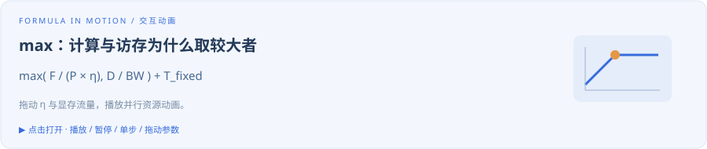
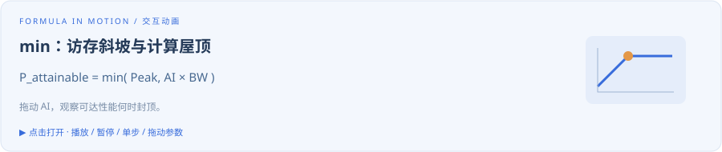
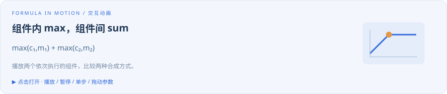
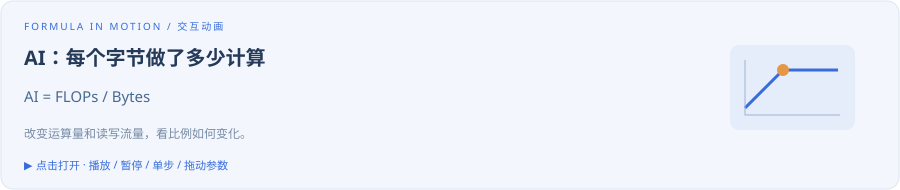
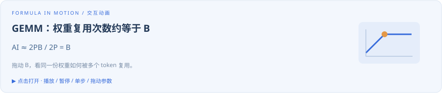
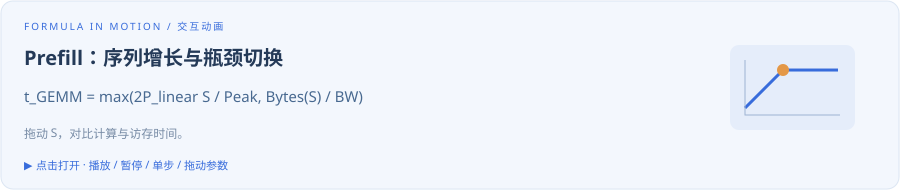
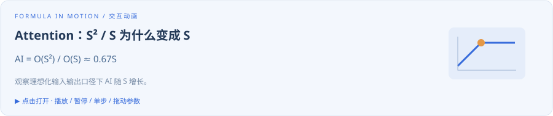
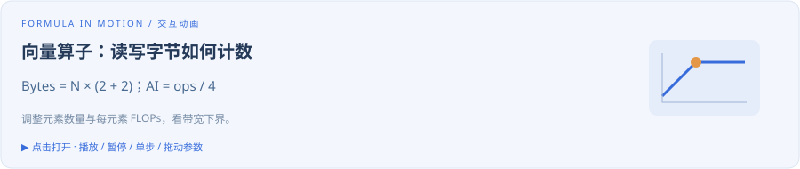
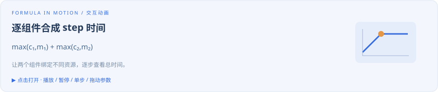
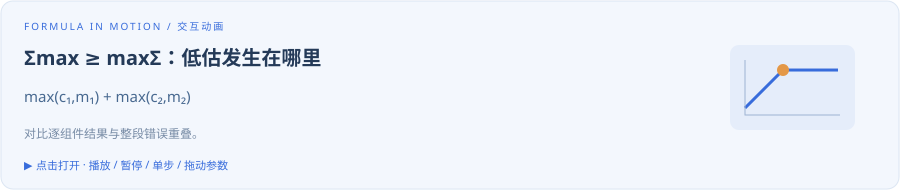

# 第 1 章 模拟器估算、Roofline 与瓶颈

## 本章导读

> 一块标称算力达到 195 TFLOPS 的 GPU 运行 6 亿参数的语言模型时，单条请求每秒最多只能生成几百个 token，矩阵计算单元大部分时间都在空转。同一块卡、同一个模型，换成长文本输入后，算力利用率却会大幅上升。真机测量时，单步耗时还可能比显存带宽和峰值算力算出的理论下界慢上十倍以上。给定模型结构和硬件参数，如何判断一次前向计算究竟受限于算力、显存带宽，还是卡在进入 GPU 之前的调度环节？
>
> 1.1 从单个算子的并行执行过程建立 Roofline 模型，定义计算上限、访存上限和硬件拐点。1.2 定义算术强度和统一的运算与流量计数口径，计算线性层、注意力机制与逐元素算子的瓶颈归属。1.3 将单算子合成为整步耗时，分析模型规模、批大小和输入长度怎样改变主导成本。1.4 说明解析模拟器能可靠支持哪些判断、以及预测先于测量的对账方法。1.5 用 RX 9070 XT 的单算子与全模型实测对照理论下界，解释框架实现和 CPU 发射开销如何影响观测到的单步时间。章末实验提供复现命令与离线存档，供核对每一项指标。

::: info 互动演示：公式动画与瓶颈实验室

在网页端阅读时，本章 13 处核心公式下方可直接拖动参数、播放或单步观察计算与访存的变化；在 GitHub 阅读时，可展开公式下方的预览入口。

- [整章公式动画阅读版](https://datawhalechina.github.io/hello-mlsys/demos/chapter1/reader.html#formula-max)
- [Roofline、Batching 与 CPU / GPU 综合实验](https://datawhalechina.github.io/hello-mlsys/demos/chapter1/index.html)

:::

## 教学目标

- 能写出 Roofline 模型的耗时形式与吞吐形式，区分矩阵管线与向量管线的拐点，并说明标称下界的适用条件。
- 能按统一口径计算 GEMM、Attention（含 FlashAttention 与 GQA 解码）和逐元素算子的算术强度，判断其受限于计算还是显存带宽。
- 能用“组件内取最大值、组件间求和”的规则估算整步耗时，并解释批大小 $B$ 和输入长度 $S$ 如何改变瓶颈位置。
- 能从字节复用的角度识别“运算量不小却受带宽限制”的算子，避免只看浮点运算数做出误判。
- 能对照真机实测与标称下界，区分硬件计算效率、软件实现开销、口径差异与 CPU 发射瓶颈。

## 1.1 Roofline 模型

### 计算上限、访存上限与固定开销

GPU 执行单个算子时，需要把数据从高带宽显存（HBM）搬入片上缓存和寄存器，再由计算单元完成浮点运算，最后将结果写回显存。这个过程同时受两条硬件物理上限约束：计算单元每秒最多完成的浮点运算数称为**峰值算力** $P_{\mathrm{peak}}$（单位 FLOP/s），实际可发挥的比例记作**计算效率** $\eta \in (0, 1]$；HBM 与计算单元之间每秒最多搬运的字节数称为**峰值带宽** $\mathrm{BW}_{\mathrm{peak}}$（单位 B/s）。

在算子执行期间，数据搬运与算术运算按分块流水线并行推进，而不是把全部数据搬完才开始计算。只要其中一侧先触及上限，另一侧就会停下来等待。因此，单个算子的执行时间至少等于计算耗时与访存耗时中的较大者；再加上与数据规模无关的调度和 kernel 发射开销 $T_{\mathrm{fixed}}$，便得到单步耗时模型：

$$
t_{\mathrm{step}} = \max\!\left(\frac{\mathrm{FLOPs}}{P_{\mathrm{peak}} \cdot \eta},\; \frac{\mathrm{Bytes}}{\mathrm{BW}_{\mathrm{peak}}}\right) + T_{\mathrm{fixed}}.
$$

<!-- formula-demo:start:max -->
<FormulaDemo scene="max" title="max：计算与访存为什么取较大者" />

<details>
<summary>预览与独立演示入口</summary>

[](https://datawhalechina.github.io/hello-mlsys/demos/chapter1/reader.html#formula-max)

[打开交互动画：max：计算与访存为什么取较大者](https://datawhalechina.github.io/hello-mlsys/demos/chapter1/reader.html#formula-max)：拖动 η 与显存流量，播放并行资源动画。

</details>
<!-- formula-demo:end:max -->

将两项取 $\max$ 而非相加，反映的是单算子内部计算与访存的重叠关系。如果把两项直接相加，就相当于假设数据全部搬运完毕后计算单元才启动；而在实际流水线中，耗时由较慢的那条路径决定，较快路径的剩余能力被闲置。[mlsysbook.ai：System Paradigms](https://mlsysbook.ai)

### 屋顶线与拐点

忽略固定开销 $T_{\mathrm{fixed}}$ 并取理想效率 $\eta = 1$，把算子的总运算量 $\mathrm{FLOPs}$ 除以单步耗时，就可以得到该算子在目标硬件上理论上能达到的最高算力（Attainable FLOPS）。引入**算术强度** $\mathrm{AI} = \mathrm{FLOPs} / \mathrm{Bytes}$（每搬运 1 字节执行的浮点运算次数），上式改写为 **Roofline 模型**：[Williams, Waterman & Patterson (2009)](https://doi.org/10.1145/1498765.1498785)

$$
\mathrm{Attainable\;FLOPS} = \min\!\left(P_{\mathrm{peak}},\; \mathrm{AI} \times \mathrm{BW}_{\mathrm{peak}}\right).
$$

<!-- formula-demo:start:roof -->
<FormulaDemo scene="roof" title="min：访存斜坡与计算屋顶" />

<details>
<summary>预览与独立演示入口</summary>

[](https://datawhalechina.github.io/hello-mlsys/demos/chapter1/reader.html#formula-roof)

[打开交互动画：min：访存斜坡与计算屋顶](https://datawhalechina.github.io/hello-mlsys/demos/chapter1/reader.html#formula-roof)：拖动 AI，观察可达性能何时封顶。

</details>
<!-- formula-demo:end:roof -->

在双对数坐标系中，这条曲线由一条斜坡和一条水平线拼接而成。当 $\mathrm{AI}$ 较小时，可达算力等于 $\mathrm{AI} \times \mathrm{BW}_{\mathrm{peak}}$，落在左侧斜坡上，此时即使增加计算单元也无法缩短耗时，称为**访存受限**（memory-bound，指带宽成为瓶颈）。当 $\mathrm{AI}$ 足够大时，可达算力封顶在 $P_{\mathrm{peak}}$，落在右侧平顶上，此时提升性能需要更高的计算吞吐或更少的总运算量，称为**计算受限**（compute-bound）。

斜坡与平顶的交点称为硬件的**拐点**（ridge point，也称机器平衡点）：

$$
\mathrm{AI}^* = \frac{P_{\mathrm{peak}}}{\mathrm{BW}_{\mathrm{peak}}}.
$$

<!-- formula-demo:start:ridge -->
<FormulaDemo scene="ridge" title="拐点：让两条资源上限相等" />

<details>
<summary>预览与独立演示入口</summary>

[](https://datawhalechina.github.io/hello-mlsys/demos/chapter1/reader.html#formula-ridge)

[打开交互动画：拐点：让两条资源上限相等](https://datawhalechina.github.io/hello-mlsys/demos/chapter1/reader.html#formula-ridge)：分别改变峰值和带宽，观察拐点移动。

</details>
<!-- formula-demo:end:ridge -->

将算子的 $\mathrm{AI}$ 与硬件的 $\mathrm{AI}^*$ 比较，即可判定其瓶颈归属：$\mathrm{AI} < \mathrm{AI}^*$ 属于访存受限，$\mathrm{AI} > \mathrm{AI}^*$ 属于计算受限。这里需要区分两个容易混淆的概念：Roofline 中的 **memory-bound 指显存带宽受限，而不是显存容量不足（OOM）**。显存容量决定模型权重和缓存能否装下，属于[第 3 章](/part1-modeling/chapter3/)讨论的范围；本章关注的是数据搬运与算术计算谁先达到速度上限。

### 同一块硬件的不同计算管线

现代 GPU 通常为不同类型的运算配备独立的硬件管线。矩阵乘运行在专用的矩阵管线上，而归一化、位置编码和激活函数运行在通用向量管线上。两条管线的峰值算力不同，但共享同一块 HBM 带宽，因此各自对应不同的拐点。以本书实验所用的 **AMD Radeon RX 9070 XT** 为例（硬件参数见[第 0 章](/part0-intro/chapter0/)）：

| 计算管线 | 典型算子 | 峰值算力 $P_{\mathrm{peak}}$ | 标称显存带宽 $\mathrm{BW}_{\mathrm{peak}}$ | 拐点 $\mathrm{AI}^*$ |
| --- | --- | ---: | ---: | ---: |
| BF16 矩阵管线 | GEMM、线性投影、注意力矩阵乘 | 195 TFLOPS | 640 GB/s | $\approx 305\;\text{FLOP/byte}$ |
| FP32 向量管线 | RMSNorm、LayerNorm、RoPE、SiLU | 48.7 TFLOPS | 640 GB/s | $\approx 76\;\text{FLOP/byte}$ |

判定瓶颈前必须先确认算子运行在哪条管线上。在这块卡上，BF16 矩阵乘需要每字节完成 305 次以上的浮点运算才能进入计算受限区；如果拿矩阵峰值去套用只跑在向量管线上的归一化算子，算出的拐点和耗时下界都会失真。

### 标称下界与多组件合成

本章的解析估算统一采用**标称参数**（$\eta = 1$、标称峰值带宽、$T_{\mathrm{fixed}} = 0$）。这个口径给出的不是真实执行时间的精确预言，而是物理上的**理论下界**：真实算子受限于指令调度、缓存未命中和内核效率，执行时间只会大于或等于该下界。

单个算子内部的计算与访存并行，因此取 $\max$；而一次完整的模型前向传播由多个算子按层序依次执行，前后组件之间存在数据依赖，不能视为完全重叠。因此，整步耗时由各组件的下界相加，再加上固定开销构成：

$$
t_c = \max\!\left(t_{\mathrm{compute}, c},\; t_{\mathrm{memory}, c}\right),
\qquad
t_{\mathrm{step}} = \sum_{c} t_c + T_{\mathrm{fixed}}.
$$

<!-- formula-demo:start:compose -->
<FormulaDemo scene="compose" title="组件内 max，组件间 sum" />

<details>
<summary>预览与独立演示入口</summary>

[](https://datawhalechina.github.io/hello-mlsys/demos/chapter1/reader.html#formula-compose)

[打开交互动画：组件内 max，组件间 sum](https://datawhalechina.github.io/hello-mlsys/demos/chapter1/reader.html#formula-compose)：播放两个依次执行的组件，比较两种合成方式。

</details>
<!-- formula-demo:end:compose -->

为什么不能把整步所有组件的计算量和访存量直接汇总后只取一次 $\max$，1.3 节会给出数学证明与数值反例。

## 1.2 算术强度与三类典型算子

### 定义与统一计数口径

要判断一个算子落在拐点的哪一侧，需要先算出它的算术强度：

$$
\mathrm{AI} = \frac{\mathrm{FLOPs}}{\mathrm{Bytes}}.
$$

<!-- formula-demo:start:ai -->
<FormulaDemo scene="ai" title="AI：每个字节做了多少计算" />

<details>
<summary>预览与独立演示入口</summary>

[](https://datawhalechina.github.io/hello-mlsys/demos/chapter1/reader.html#formula-ai)：改变运算量和读写流量，看比例如何变化。

</details>
<!-- formula-demo:end:ai -->

计算 $\mathrm{AI}$ 时必须统一口径，否则同一算子会算出不同的交叉点。最容易混淆的是分母 $\mathrm{Bytes}$ 的含义：**它表示本步在 HBM 与计算单元之间实际搬运的字节总数（读入与写回之和），而不是数据在显存中的静态占用大小**。例如，某模型权重在显存里占 1.19 GB，单步解码 $B = 1$ 时需要把权重从头到尾读一遍，权重流量是 1.19 GB；批大小增至 $B = 16$ 时，同一份权重仍然只需读一遍，权重流量仍是 1.19 GB，增加的只是激活值和 KV 缓存的读写流量。

::: info 本章冻结的计数口径

| 计数项 | 统一约定 |
| --- | --- |
| 乘加运算（FMA） | $1\;\text{FMA} = 2\;\text{FLOPs}$ |
| BF16 元素大小 | $2\;\text{bytes}$ |
| HBM 流量（$\mathrm{Bytes}$） | 本步从 HBM 读取与写回的字节总和（权重 + KV 缓存 + 激活） |
| 片上缓存与寄存器 | 中间结果若留在 SRAM 或寄存器中，不计入 HBM 流量 |
| 矩阵乘 $(M \times K) \times (K \times N)$（BF16） | $\mathrm{FLOPs} = 2MNK$；$\mathrm{Bytes} = 2(MK + KN + MN)$ |

:::

下文的数值算例统一采用 **Qwen3-0.6B** 的结构参数：共 $L = 28$ 层，隐藏维 $d_{\mathrm{model}} = 1024$，采用分组查询注意力（GQA），每层有 $n_q = 16$ 个查询头和 $n_{kv} = 8$ 个键值头，单头维度 $d_{\mathrm{head}} = 128$（即 $d_q = 2048$、$d_{kv} = 1024$）；总参数量 $P \approx 5.96 \times 10^8$，其中不含词表输出头的线性层参数量 $P_{\mathrm{linear}} \approx 4.40 \times 10^8$。

### 线性层（GEMM）：权重复用决定瓶颈

语言模型的大部分参数集中在注意力投影（Q/K/V/O）和前馈网络（FFN）的矩阵乘中。在**解码阶段（Decode）**，引擎每一步同时为 $B$ 条请求各生成 1 个新 token，对应矩阵乘的行数 $M = B$。每条请求都要经过全部参与线性计算的参数 $P$（含输出词表投影 LM head），每个参数做 1 次乘加（2 FLOPs），因此总运算量约为 $2PB$。而这 $P$ 个 BF16 参数总共只需从 HBM 读取一次（$2P$ 字节），当 $B$ 远小于隐藏维度时，激活值的读写量 $O(B)$ 远小于权重读取量，由此得到：

$$
\mathrm{FLOPs} \approx 2PB,
\qquad
\mathrm{Bytes} \approx 2P + O(B),
\qquad
\mathrm{AI}_{\mathrm{decode}}(B) \approx B.
$$

<!-- formula-demo:start:reuse -->
<FormulaDemo scene="reuse" title="GEMM：权重复用次数约等于 B" />

<details>
<summary>预览与独立演示入口</summary>

[](https://datawhalechina.github.io/hello-mlsys/demos/chapter1/reader.html#formula-reuse)：拖动 B，看同一份权重如何被多个 token 复用。

</details>
<!-- formula-demo:end:reuse -->

这一关系说明，BF16 解码时线性层的算术强度近似等于批大小 $B$，即同一份权重被多少个 token 复用。当 $B = 1$ 时，$\mathrm{AI} \approx 1$，远低于 RX 9070 XT 的矩阵拐点 305，单步耗时被权重扫描时间 $2P / \mathrm{BW}_{\mathrm{peak}}$ 牢牢钉住。即使批大小增至 $B = 16$，$\mathrm{AI} \approx 16$ 依然处于访存斜坡上；要让单卡解码线性层跨过拐点进入计算受限区，批大小需达到拐点量级（$B^* \approx 305$）。

在**预填充阶段（Prefill）**，单条请求一次性并行处理长度为 $S$ 的输入提示词，矩阵乘的行数变为 $M = S$（LM head 仅作用于最后一个 token，此处忽略）。权重同样只需读取一遍，于是：

$$
\mathrm{FLOPs} \approx 2P_{\mathrm{linear}}S,
\qquad
\mathrm{Bytes} \approx 2P_{\mathrm{linear}} + O(S).
$$

<!-- formula-demo:start:prefill -->
<FormulaDemo scene="prefill" title="Prefill：序列增长与瓶颈切换" />

<details>
<summary>预览与独立演示入口</summary>

[](https://datawhalechina.github.io/hello-mlsys/demos/chapter1/reader.html#formula-prefill)：拖动 S，对比计算与访存时间。

</details>
<!-- formula-demo:end:prefill -->

随着输入长度 $S$ 增加，权重复用次数线性增长，算术强度随之抬升，并在交叉序列长度 $S^*$ 处跨过硬件拐点。在 RX 9070 XT 上运行 Qwen3-0.6B 时，$S^*$ 约在 300 到 450 之间（随激活算子的融合程度而移动）：输入短于 $S^*$ 时，预填充同样受权重扫描限制；输入长于 $S^*$ 后，矩阵计算成为主导瓶颈。

### 注意力机制（Attention）：分块与键值缓存

注意力层在预填充和解码两个阶段的访存行为差异很大。

在**预填充阶段**，长度为 $S$ 的序列经过 $L$ 层注意力时，$QK^\top$ 与 $\mathrm{Softmax} \cdot V$ 两次矩阵乘合计产生约 $4S^2 d_q L$ 次浮点运算。如果算子把 $S \times S$ 的注意力分数矩阵保留在片上 SRAM 中完成归一化，只从 HBM 读入 $Q, K, V$ 并写回输出 $O$（即 FlashAttention 的理想输入输出口径），则流量随 $S$ 线性增长，算术强度与 $S$ 成正比：

$$
\mathrm{FLOPs} \approx 4S^2 d_q L,
\qquad
\mathrm{Bytes}_{\mathrm{FA}} \approx 2S(2d_q + 2d_{kv})L,
\qquad
\mathrm{AI}_{\mathrm{FA}} \approx \frac{d_q}{d_q + d_{kv}} S.
$$

<!-- formula-demo:start:attention -->
<FormulaDemo scene="attention" title="Attention：S² / S 为什么变成 S" />

<details>
<summary>预览与独立演示入口</summary>

[](https://datawhalechina.github.io/hello-mlsys/demos/chapter1/reader.html#formula-attention)：观察理想化输入输出口径下 AI 随 S 增长。

</details>
<!-- formula-demo:end:attention -->

代入 Qwen3-0.6B 的 $d_q = 2048$ 和 $d_{kv} = 1024$，可得 $\mathrm{AI}_{\mathrm{FA}} \approx 0.67 S$。当 $S = 512$ 时，$\mathrm{AI}_{\mathrm{FA}} \approx 341$，刚刚跨过 305 的矩阵拐点；而当 $S = 128$ 时，$\mathrm{AI}_{\mathrm{FA}} \approx 85$，仍落在访存斜坡上。

如果不做片上分块，而是采用朴素实现（Naive Attention），将 $n_q$ 个头的 $S \times S$ 中间矩阵以 BF16 写入 HBM 再读出一次，流量就会增加 $4 n_q S^2 L$ 字节：

$$
\mathrm{Bytes}_{\mathrm{naive}} \approx 4 n_q S^2 L + \mathrm{Bytes}_{\mathrm{FA}},
\qquad
\lim_{S \to \infty} \mathrm{AI}_{\mathrm{naive}} = \frac{d_q}{n_q} = d_{\mathrm{head}} = 128\;\text{FLOP/byte}.
$$

<!-- formula-demo:start:flash -->
<FormulaDemo scene="flash" title="Naive 与分块：中间矩阵写在哪里" />

<details>
<summary>预览与独立演示入口</summary>

[](https://datawhalechina.github.io/hello-mlsys/demos/chapter1/reader.html#formula-flash)：播放矩阵物化与片上 tile 的机制对照。

</details>
<!-- formula-demo:end:flash -->

由于分子和分母同为 $O(S^2)$，朴素实现的算术强度无论序列多长都被限制在 $d_{\mathrm{head}} = 128$ 以下（若计入 Softmax 的多趟读写，实际数值更低），始终无法到达 RX 9070 XT 的 305 拐点。**FlashAttention** 通过片上分块（tiling）和重计算避免了 $S \times S$ 矩阵的 HBM 读写。[Dao et al. (2022)](https://arxiv.org/abs/2205.14135) 公开的 A100 实测数据展示了这种权衡：标准注意力耗时 41.7 ms，执行 66.6 GFLOPs，搬运 40.3 GB；FlashAttention 因重算多做了约 13% 的浮点运算（75.2 GFLOPs），却将 HBM 流量降至 4.4 GB（缩减约 9 倍），耗时缩短至 7.3 ms（提速 5.7 倍）。[CMU 15-442 Week 5](https://msyscourse.org) 在访存斜坡上，用少量额外计算换取显存流量大幅下降，可以直接把算子推向计算屋顶。

在**解码阶段**，每一步有 $B$ 条请求，各自需要用当前新生成的 1 个查询向量遍历长度为 $S_{\mathrm{ctx}}$ 的历史键值缓存。由于不同请求的上下文各自独立、无法复用彼此的缓存，总计算量与总 KV 读取流量同时随 $B$ 和 $S_{\mathrm{ctx}}$ 线性增长：

$$
\mathrm{FLOPs} \approx 4 B S_{\mathrm{ctx}} d_q L,
\qquad
\mathrm{Bytes}_{\mathrm{KV}} \approx 4 B S_{\mathrm{ctx}} d_{kv} L,
\qquad
\mathrm{AI}_{\mathrm{decode,attn}} = \frac{d_q}{d_{kv}}.
$$

<!-- formula-demo:start:kv -->
<FormulaDemo scene="kv" title="KV：为什么 B 和 ctx 被约掉" />

<details>
<summary>预览与独立演示入口</summary>

[](https://datawhalechina.github.io/hello-mlsys/demos/chapter1/reader.html#formula-kv)：增加请求和上下文，看计算与流量同倍增长。

</details>
<!-- formula-demo:end:kv -->

$B$ 与 $S_{\mathrm{ctx}}$ 在比值中相互抵消。对 Qwen3-0.6B（$d_q / d_{kv} = 2$），解码注意力的算术强度恒等于 2。这意味着增大批大小虽然能提高线性层的权重复用率，却无法摊薄 KV 缓存的读取成本。减少键值头数量（GQA）、压缩 KV 位宽或复用公共前缀（Prefix Cache），本质上都是为了压低这一项的带宽消耗。

### 向量与逐元素算子

RMSNorm、LayerNorm、RoPE 与 SiLU 等逐元素算子对每个元素只做少量浮点运算，但每次执行都要从 HBM 读入张量并将结果写回（BF16 单次读写合计约 4 字节/元素）：

$$
\mathrm{FLOPs} \approx O(1)\;\text{FLOP/元素},
\qquad
\mathrm{Bytes} \approx 4\;\text{bytes/元素},
\qquad
\mathrm{AI} \approx 1\text{–}2.
$$

<!-- formula-demo:start:vector -->
<FormulaDemo scene="vector" title="向量算子：读写字节如何计数" />

<details>
<summary>预览与独立演示入口</summary>

[](https://datawhalechina.github.io/hello-mlsys/demos/chapter1/reader.html#formula-vector)：调整元素数量与每元素 FLOPs，看带宽下界。

</details>
<!-- formula-demo:end:vector -->

对照 76 的向量管线拐点，这类算子恒为带宽受限。虽然单个算子的理论耗时通常低于 10 微秒，但在未融合的逐层执行中，它们会引入大量独立的 kernel 发射，成为小批大小下固定开销的重要来源。

### 容易误判的两类算子

对照上述计算，可以识别两类最容易凭直觉误判为计算受限的算子：

1. **单请求解码线性层（$B = 1$）**：单步要乘遍模型全部参数（Qwen3-0.6B 约 1.19 GFLOP），但每个字节的权重只复用了一次，实际 $\mathrm{AI} \approx 1$，几乎全部耗时花在读取 1.19 GB 权重上。
2. **朴素预填充注意力（$S = 512$）**：计算量随 $S^2$ 增长（28 层合计约 60 GFLOP），但由于把 $S \times S$ 中间矩阵写入 HBM 又读出，总流量推高至约 646 MB，$\mathrm{AI}$ 降到约 93，仍远低于 305 的拐点。

这两类误判源于同一个盲区：只统计了浮点运算总数，没有统计这些运算复用了多少字节的显存流量。

## 1.3 从单算子到整步：合成、缩放与瓶颈切换

### 逐组件合成的不等式

估算一个完整前向步骤的标称耗时时，需要先对每个组件分别取计算与访存耗时的较大者，再将各组件相加：

$$
t_{\mathrm{step}} = \sum_{c} \max\!\left(t_{\mathrm{compute}, c},\; t_{\mathrm{memory}, c}\right) + T_{\mathrm{fixed}}.
$$

<!-- formula-demo:start:compose-step -->
<FormulaDemo scene="compose-step" title="逐组件合成 step 时间" />

<details>
<summary>预览与独立演示入口</summary>

[](https://datawhalechina.github.io/hello-mlsys/demos/chapter1/reader.html#formula-compose-step)：让两个组件绑定不同资源，逐步查看总时间。

</details>
<!-- formula-demo:end:compose-step -->

如果不拆组件，而是先将整步的总计算时间和总访存时间分别求和，再取一次 $\max$，所得结果在数学上一定小于或等于逐组件之和：

$$
\sum_{c} \max\!\left(t_{\mathrm{compute}, c},\; t_{\mathrm{memory}, c}\right) \;\ge\; \max\!\left(\sum_{c} t_{\mathrm{compute}, c},\; \sum_{c} t_{\mathrm{memory}, c}\right).
$$

<!-- formula-demo:start:inequality -->
<FormulaDemo scene="inequality" title="Σmax ≥ maxΣ：低估发生在哪里" />

<details>
<summary>预览与独立演示入口</summary>

[](https://datawhalechina.github.io/hello-mlsys/demos/chapter1/reader.html#formula-inequality)：对比逐组件结果与整段错误重叠。

</details>
<!-- formula-demo:end:inequality -->

等号仅在所有组件都绑定于同一资源时成立（全访存受限，或全计算受限）。只要不同组件分处拐点两侧，整段合并就相当于假设组件 A 空闲的带宽可以被后续组件 B 提前使用，从而系统性地低估总耗时。

::: details 双组件数值反例

设组件 A 的计算时间为 8 ms、访存时间为 2 ms（计算受限），组件 B 的计算时间为 2 ms、访存时间为 8 ms（访存受限）。两者依次执行，正确的标称下界是 $\max(8, 2) + \max(2, 8) = 16\;\text{ms}$。若先将总计算时间（10 ms）和总访存时间（10 ms）求和再取 $\max$，会得到 10 ms，低估了 6 ms。

:::

### 单步解码拆解与模型缩放

按逐组件口径拆解 Qwen3-0.6B 在 RX 9070 XT 上的单步解码（$B = 1$，上下文长度 $\mathrm{ctx} = 1024$，标称下界 $\eta = 1$）：

| 组件 | 运算量 FLOPs | HBM 流量 Bytes | 算术强度 AI | $t_{\mathrm{comp}}$ | $t_{\mathrm{mem}}$ | $t_c$ | 瓶颈判定 |
| --- | ---: | ---: | ---: | ---: | ---: | ---: | --- |
| GEMM（线性层 + LM head） | $1.19 \times 10^9$ | $1.19\;\text{GB}$ | $1.0$ | $6.1\;\mu\text{s}$ | $1.86\;\text{ms}$ | $1.86\;\text{ms}$ | 访存受限 |
| Attention（KV 遍历） | $2.3 \times 10^8$ | $117\;\text{MB}$ | $2.0$ | $1.2\;\mu\text{s}$ | $0.18\;\text{ms}$ | $0.18\;\text{ms}$ | 访存受限 |
| Element-wise（Norm/RoPE/SiLU） | $<10^7$ | $<1\;\text{MB}$ | $1\text{–}2$ | $<0.1\;\mu\text{s}$ | $<0.002\;\text{ms}$ | $\approx 0$ | 访存受限 |
| **整步合计（标称下界）** | — | — | — | — | — | **$\approx 2.05\;\text{ms} + T_{\mathrm{fixed}}$** | 全组件访存受限 |

在这 2.05 ms 中，线性层的权重扫描占了 91%（1.86 ms），对应的单请求理论上限约 430–500 tok/s。由于 $B = 1$ 时单步时间几乎由 $2P / \mathrm{BW}_{\mathrm{peak}}$ 决定，同一块 GPU 上的单请求解码上限吞吐近似与参数量 $P$ 成反比：

| 模型 | BF16 权重大小 | 单步下界（$B=1, \mathrm{ctx}=1024$） | 理论吞吐上限 |
| --- | ---: | ---: | ---: |
| Qwen3-0.6B | $1.19\;\text{GB}$ | $\approx 2.0\;\text{ms}$ | $\approx 430\text{–}500\;\text{tok/s}$ |
| Qwen3-1.7B | $\approx 3.4\;\text{GB}$ | $\approx 5.3\;\text{ms}$ | $\approx 180\text{–}190\;\text{tok/s}$ |
| Qwen3-4B | $\approx 8.0\;\text{GB}$ | $\approx 12.5\;\text{ms}$ | $\approx 80\;\text{tok/s}$ |

要缩短权重扫描时间，从公式上看只有两条途径：降低每个权重占用的字节数（模型量化，见[第 4 章](/part1-modeling/chapter4/)），或者增加同一批处理的请求数以提高权重复用率。

### 批大小曲线：权重复用与 KV 接管

固定 Qwen3-0.6B 和 $\mathrm{ctx} = 1024$，把解码批大小 $B$ 从 1 依次提高到 4 和 16。由于权重每次只读一遍，线性层的访存下界几乎维持在 1.86–1.91 ms；而每条请求都需要读取各自的 KV 缓存，注意力组件的耗时随 $B$ 线性增长（0.18 → 0.73 → 2.94 ms）：

| 批大小 $B$ | GEMM AI | KV 流量 | $t_{\mathrm{step}}$ 下界 | 聚合吞吐上限 | 单请求吞吐上限 |
| ---: | ---: | ---: | ---: | ---: | ---: |
| 1 | 1.0 | 117 MB | $\approx 2.1\;\text{ms}$ | $\approx 480\;\text{tok/s}$ | $\approx 480\;\text{tok/s}$ |
| 4 | 4.0 | 469 MB | $\approx 2.6\;\text{ms}$ | $\approx 1,540\;\text{tok/s}$ | $\approx 385\;\text{tok/s}$ |
| 16 | 16.0 | 1.88 GB | $\approx 4.9\;\text{ms}$ | $\approx 3,300\;\text{tok/s}$ | $\approx 206\;\text{tok/s}$ |

批大小从 1 增至 16 时，权重被 16 个 token 复用，聚合吞吐上限提高了 6.8 倍（480 → 3,300 tok/s），这是[第 7 章](/part1-modeling/chapter7/)连续批处理提升服务容量的硬件依据。与此同时，单请求吞吐上限从 480 降至 206 tok/s：到了 $B = 16$ 时，KV 缓存流量（1.88 GB）已经超过模型权重本身（1.19 GB），成为整步最主要的访存成本。如果只用一个“整步 $\mathrm{AI} \approx B$”来概括解码阶段，就无法看出 KV 扫描在中等批大小下接管成本的转折。

### 预填充序列曲线与阶段不对称

在同一块卡上考察 Qwen3-0.6B 单请求（$b = 1$）预填充随输入长度 $S$ 的变化（激活按未融合口径计数，约 0.8 MB/token）：

| 序列长度 $S$ | GEMM $t_{\mathrm{comp}}$ | GEMM $t_{\mathrm{mem}}$ | GEMM 判定 | Attention $t_c$（FA 口径） | $t_{\mathrm{step}}$ 下界 | 整步主导瓶颈 |
| ---: | ---: | ---: | --- | ---: | ---: | --- |
| 128 | $0.58\;\text{ms}$ | $\approx 1.4\text{–}1.5\;\text{ms}$ | 访存受限 | $0.07\;\text{ms}$（访存） | $\approx 1.5\;\text{ms}$ | 访存（权重扫描） |
| 512 | $2.3\;\text{ms}$ | $\approx 2.0\;\text{ms}$ | 计算（贴边） | $0.31\;\text{ms}$（计算，$\mathrm{AI}\approx 341$） | $\approx 2.7\;\text{ms}$ | 计算（GEMM） |
| 2048 | $9.3\;\text{ms}$ | $\approx 4.0\;\text{ms}$ | 计算受限 | $4.9\;\text{ms}$（计算，$\mathrm{AI}\approx 1365$） | $\approx 14\;\text{ms}$ | 计算（GEMM + Attn） |

把解码表和预填充表放在一起对照，可以看到推理负载的**阶段不对称**（phase asymmetry）：同一模型在常规解码（$B \le 16$）和短预填充（$S = 128$）下都受显存带宽限制；而输入长度跨过交叉点 $S^* \approx 300\text{–}450$ 后，预填充转入计算受限区，且在 $S = 2048$ 时注意力的 $S^2$ 项已占到整步耗时的三分之一以上。两种阶段分别受限于带宽与算力，这种资源需求差异会在后续章节的混合批调度和预填充/解码分离（PD 分离）设计中反复出现。

## 1.4 用解析模拟器做预测

当需要比较几十种模型规模、批大小、序列长度和硬件参数的组合时，逐一在真机上跑实验既耗时又受设备数量限制。把 1.1–1.3 节的逐组件计数和 Roofline 方程实现为**解析模拟器**，可以在 CPU 上用毫秒级时间穷举配置空间，先筛出关键交叉点，再挑出信息量最大的少数配置上真机检验。

本课程使用的解析口径参考了 Harvard CS249r 教材配套的开源建模工具 [mlsysbook.ai（MLSys·im）](https://mlsysbook.ai)，并在同一套逐组件 FLOPs/Bytes 计数之上，配套了确定性服务模拟器 [mlsys-simulator](https://github.com/eyuansu62/mlsys-simulator)（后者在后续章节扩展到连续批处理、KV 显存压力与多卡并行）。使用解析模拟器前，需要分清它能可靠支持什么、以及它的边界在哪里：

- **可依赖的输出**：每个组件的瓶颈归属（计算受限或访存受限）、交叉点位置（$B^*$ 与 $S^*$）以及不同配置间的相对快慢排序。
- **需要真机校准或裁决的部分**：未校准（$\eta = 1, T_{\mathrm{fixed}} = 0$）下的绝对毫秒数只是理论下界，真实执行通常慢 $1.5\text{–}2\times$ 以上；此外，解析模型只计算算术与字节账，不预测模型输出质量，量化等改动的精度影响必须由真机评测确认。

为了避免事后用参数强行凑合实测数据，开展真机测试前应先按标称口径记录预测值，再将实测结果与预测值逐项对账。这样才能把预测与实测的差值归因到具体的硬件效率、框架实现或调度机制上。

## 1.5 真机锚定：当理论下界遇上真实 GPU

本节将 1.2 与 1.3 节的标称预测放到 **AMD Radeon RX 9070 XT**（PyTorch + ROCm，BF16，SDPA 后端）上做实测对照。这里暂不拟合硬件效率 $\eta$（校准与留出验证放在[第 2 章](/part1-modeling/chapter2/)），而是检验两个基本问题：标称预测是否严格构成真实耗时的下界，以及实测与下界之间的差距分别来自哪些机制。

### 单算子的下界检验

首先单独测量三个代表性算子，排除整网逐层调度的干扰（原始数据见 `code/part1-modeling/chapter1/results/ops_9070xt.json`）：

| 算子配置 | 算术强度 AI | 标称下界（ms） | 真机实测（ms） | 实测 / 下界 | 机制归因 |
| --- | ---: | ---: | ---: | ---: | --- |
| Matmul $4096^3$（BF16） | $1365.3$ | $0.70$（计算） | $1.06$ | $1.5\times$ | 实测 $130.2 / 195\;\text{TFLOPS}$，矩阵效率 $\eta_{\mathrm{gemm}} \approx 67\%$ |
| LayerNorm $S=2048, d=1024$ | $1.0$ | $0.013$（访存） | $0.027$ | $2.1\times$ | 实测 $307.1 / 640\;\text{GB/s}$，小算子带宽利用率 $48\%$ |
| Attention Fused（28 层，$S=512$） | $256.0$ | $0.31$（计算） | $1.63$ | $5.3\times$ | MHA 16/16 口径 + kernel 效率 + 发射开销 |
| Attention Naive MATH（28 层，$S=512$） | $85.3$ | $1.0$（访存） | $15.31$ | $15.3\times$ | 物化 $S \times S$ 矩阵 + Softmax 多趟读写 |

把这些单算子的预测下界（空心点）和实测结果（实心点）画在同一张 RX 9070 XT 双屋顶图上：


所有实测点都落在对应屋顶之下，验证了标称模型的下界语义。大尺寸矩阵乘发挥出 67% 的标称矩阵算力，单个 LayerNorm 发挥出 48% 的标称显存带宽。在 28 层、$S = 512$ 的注意力对照中，强制禁用融合走 MATH 后端耗时 15.31 ms，默认 ROCm fused kernel 耗时 1.63 ms（提速 9.4 倍），直接印证了消除 $S \times S$ 中间矩阵 HBM 读写的收益。

::: details 为什么图中 Attention 单算子的 AI 是 256 / 85，而非 1.2 节的 343 / 93？

本环境的 ROCm fused SDPA kernel 要求查询头与键值头数量相等（MHA 16/16），单算子基准因此按 16/16 等头口径测量，每层读写 4 个等尺寸张量（$Q, K, V, O$），理想 $\mathrm{AI} = S / 2 = 256$、朴素版 $\mathrm{AI} = 85.3$。在全模型推理中，Qwen3-0.6B 采用 16q/8kv 的 GQA，框架会先执行 `repeat_kv` 将 K/V 展开为 16 头再调用 fused kernel。按 $B = 1, \mathrm{ctx} = 1024$ 估算，展开操作每步增加约 352 MB 的 HBM 读写（对应约 0.55 ms 标称带宽时间），属于框架实现引入的口径差。

:::

### 全模型实测与层数相关的耗时地板

接着在 PyTorch eager 模式下测量完整的 Qwen3-0.6B、1.7B 和 4B 单步解码与预填充耗时（数据见 `code/part1-modeling/chapter1/results/qwen_9070xt.json`）：

| 配置 | 标称下界（ms） | 真机实测（ms） | 实测 / 下界 | 观测特征 |
| --- | ---: | ---: | ---: | --- |
| 0.6B · Decode $B=1, \mathrm{ctx}=1024$ | $2.0$ | $29.30$ | $14.7\times$ | 显著高于 2.0 ms 权重扫描下界 |
| 0.6B · Decode $B=4, \mathrm{ctx}=1024$ | $2.6$ | $29.43$ | $11.3\times$ | $B$ 增至 4 倍，单步耗时仅增 $0.13\;\text{ms}$ |
| 0.6B · Decode $B=16, \mathrm{ctx}=1024$ | $4.9$ | $29.58$ | $6.0\times$ | $B$ 增至 16 倍，单步耗时仅增 $0.28\;\text{ms}$ |
| 1.7B · Decode $B=1, \mathrm{ctx}=1024$ | $5.3$ | $29.74$ | $5.6\times$ | 权重增至 $2.9\times$，耗时与 0.6B 几乎一致 |
| 4B · Decode $B=1, \mathrm{ctx}=1024$ | $12.5$ | $39.35$ | $3.1\times$ | 耗时比 $39.35 / 29.30 = 1.34$，接近层数比 $36 / 28 = 1.29$ |
| 0.6B · Prefill $S=128$ | $1.5$ | $30.13$ | $20.1\times$ | 落在约 30 ms 地板上 |
| 0.6B · Prefill $S=512$ | $2.7$ | $32.01$ | $11.9\times$ | 相对 $S=128$ 增加 $1.88\;\text{ms}$ |
| 0.6B · Prefill $S=2048$ | $14.0$ | $52.57$ | $3.8\times$ | 相对 $S=128$ 增加 $22.44\;\text{ms}$，为下界增量（$12.5\;\text{ms}$）的 $1.8\times$ |
| 1.7B · Prefill $S=512$ | $\approx 7.8$ | $37.46$ | $4.8\times$ | 地板之上叠加模型计算增量 |
| 4B · Prefill $S=512$ | $\approx 18.5$ | $62.44$ | $3.4\times$ | 地板之上叠加模型计算增量 |

将全模型实测与标称下界沿模型规模、批大小和序列长度三条轴分别作图：


对比表格与图形，可以看到三个一致的规律：其一，0.6B 与 1.7B 都是 28 层，权重相差近 3 倍，解码耗时却都停在 29.3–29.7 ms；4B 增加到 36 层后，耗时升至 39.35 ms，增幅（$1.34\times$）接近层数比（$36/28 = 1.29$），而远小于权重比（$8.0 / 1.19 = 6.7$）。其二，0.6B 的解码批大小从 1 提高到 16，单步耗时仅增加 0.28 ms，因此聚合吞吐从 34.1 tok/s 升至 540.9 tok/s（$15.8\times$），而 1.3 节预测的“KV 扫描拉高单步耗时”并未在墙钟时间里显现。其三，预填充从 $S = 128$ 增至 $S = 2048$ 时，扣除 30 ms 的固定底数后，实测增量（22.44 ms）恰好是理论下界增量（12.5 ms）的 1.8 倍，说明 GPU 侧的 Roofline 增长规律依然成立，只是在短序列和小批解码时被一个约 29 ms 的固定项盖住了。

### 隔离诊断：识别 CPU 发射瓶颈

为了定位这 29 ms 固定项的来源，对 Qwen3-0.6B（$B = 1, \mathrm{ctx} = 1024$）执行四组隔离测量（数据见 `code/part1-modeling/chapter1/results/launch_diag_9070xt.json`）：

| 诊断项 | 测量方式 | 直接观测值 | 排除或确认的因素 |
| --- | --- | ---: | --- |
| A. 逐步同步 | 每步结束后强制同步等待 GPU | $28.92\;\text{ms/步}$ | 基线墙钟时间 |
| B. 32 步突发 | 连续提交 32 步后仅同步一次 | $28.67\;\text{ms/步}$ | 去掉每步同步后耗时几乎不变，排除同步等待主导 |
| C. 纯 CPU 入队 | 仅计 CPU 端下发 kernel 的耗时，不等待 GPU | $29.54\;\text{ms/步}$ | CPU 发射速率本身已达约 29 ms/步 |
| D. Profiler 剖析 | 统计单步 kernel 总数与 GPU 自身执行时间之和 | $1591\;\text{个 kernel}$，$12.29\;\text{ms}$ | GPU 实际忙碌比例约 43%（$12.29 / 28.92$），处于饥饿状态 |

由 C 和 D 两项直接观测值可以推算出单核开销：在 PyTorch eager 模式下，28 层模型每解码 1 个 token 需要由 CPU 逐个发射 1591 个小 kernel，平均每个 kernel 的 CPU 发射耗时约 18.6 微秒（$29.54\;\text{ms} / 1591$），而 GPU 执行每个 kernel 的平均耗时仅 7.7 微秒（$12.29\;\text{ms} / 1591$）。CPU 派发任务的速度慢于 GPU 完成任务的速度，导致 GPU 超过一半时间在等待指令。此时 1.1 节公式中的固定项 $T_{\mathrm{fixed}} \approx 18.6\,\mu\text{s} \times 1591 \approx 29\;\text{ms}$ 不再是可忽略的零头，而是主导了整步耗时。

这也说明了为何单步耗时与层数成正比：层数决定 kernel 总数，kernel 总数决定 CPU 发射地板。当预填充序列增长到 $S = 2048$ 时，单个矩阵乘和注意力 kernel 的 GPU 执行时间大幅拉长并超过 CPU 发射时间，GPU 重新饱和，耗时增量便回到 Roofline 预测的轨迹上。

### 实测对后续校准的约束

这组诊断划清了性能建模的边界：上述 29 ms 的发射地板属于 PyTorch eager 执行协议下的现象，不能直接推广到所有推理框架。如果在未剥离发射开销的前提下，直接拿 29.30 ms 的端到端耗时去除 2.0 ms 的理论下界，会把 CPU 发射瓶颈误算成“GPU 显存带宽利用率只有 7%”。生产级推理引擎通过 CUDA Graphs / HIP Graphs 和算子融合将上千个小 kernel 合并为极少数发射调用，从而压低 $T_{\mathrm{fixed}}$。到了[第 2 章](/part1-modeling/chapter2/)，我们将先通过性能剖析分离出真实的 GPU 执行时间，再在此基础上拟合效率参数 $\eta$ 并做留出验证。

## 实验：算子基准、全模型锚定与发射瓶颈诊断

本实验复现 1.5 节的三组测量：核对单算子下界与 FlashAttention 加速、观察全模型解码与预填充耗时，以及定位 eager 模式的 CPU 发射瓶颈。如果手边没有 RX 9070 XT 或 ROCm 环境，可直接读取仓库内置的离线存档完成同样的计算与判断。

### 环境与代码位置

进入仓库的 `code/part1-modeling/chapter1` 目录。原实验在 Linux 宿主机上通过 `HIP_VISIBLE_DEVICES=1` 选中 RX 9070 XT，模型位于 `/mnt/public/models/`（含 Qwen3-0.6B、1.7B、4B）。复现时按本机情况调整设备编号与模型路径。

### 步骤 1：单算子下界与 FlashAttention 对照

运行单算子基准脚本（预热 10 次，每轮采样 50 次，共 3 轮取中位数）：

```bash
cd code/part1-modeling/chapter1
HIP_VISIBLE_DEVICES=1 python3 bench_ops.py
```

打开输出文件 `results/ops_9070xt.json`（无 GPU 时读取仓库内置的同名存档），按以下步骤核对：

1. 读取 `ops.matmul_4096.median_ms` 和 `ops.matmul_4096.gflops`，用 `gflops / 195000` 计算矩阵管线的实际效率 $\eta_{\mathrm{gemm}}$，确认 `median_ms` 大于 0.70 ms 的标称下界。
2. 读取 `ops.layernorm_2048x1024.median_ms` 和 `ops.layernorm_2048x1024.gbps`，计算小算子占 640 GB/s 标称带宽的比例。
3. 比较 `ops.attention_fused_mha16_s512.model_median_ms`（1.63 ms）与 `ops.attention_math_mha16_s512.model_median_ms`（15.31 ms），计算加速比并检查两者是否都高于各自的标称下界。

### 步骤 2：全模型解码与预填充锚定

运行全模型基准脚本，测量 Qwen3-0.6B、1.7B 和 4B 在解码与预填充配置下的单步耗时：

```bash
HIP_VISIBLE_DEVICES=1 python3 bench_qwen.py
```

打开 `results/qwen_9070xt.json`（或内置存档），完成两项核对：

1. 读取三个模型在 `decode-B1-ctx1024` 下的 `median_ms`，分别计算 1.7B/0.6B 和 4B/0.6B 的耗时比值，并与权重比（2.9× 和 6.7×）以及层数比（28/28 和 36/28）对照。
2. 计算 `Qwen3-0.6B` 从 `prefill-S128-b1` 到 `prefill-S2048-b1` 的实测耗时增量，并与 1.3 节标称下界增量（12.5 ms）求比值。

### 步骤 3：诊断 CPU 发射瓶颈

运行发射诊断脚本，获取四组隔离测量：

```bash
HIP_VISIBLE_DEVICES=1 python3 diag_launch.py
```

打开 `results/launch_diag_9070xt.json`（或内置存档），读取 `measurements` 中的字段：

- 对照 `A_per_step_sync_median_ms`（28.92 ms）、`B_burst_one_sync_ms`（28.67 ms）和 `C_cpu_enqueue_ms`（29.54 ms），说明为何三者相近即可排除同步等待并锁定 CPU 发射受限。
- 读取 `d_kernels_per_step`（1591）和 `d_gpu_self_ms`（12.29 ms），验证单核平均 CPU 发射耗时（18.6 微秒）、GPU 执行耗时（7.7 微秒）以及 GPU 忙碌比例（约 43%）。

## 练习

1. 某 GPU 的 BF16 矩阵峰值为 312 TFLOPS，FP32 向量峰值为 19.5 TFLOPS，标称显存带宽为 2,000 GB/s。分别计算该卡在两条管线上的 Roofline 拐点 $\mathrm{AI}^*$。若一个 BF16 矩阵乘的算术强度为 120 FLOP/byte，它属于计算受限还是访存受限？
2. 沿用第 1 题的硬件参数。按 1.2 节的统一口径，计算一个 BF16 矩阵乘（$M = 16, K = 4096, N = 4096$）的 $\mathrm{FLOPs}$、HBM $\mathrm{Bytes}$、算术强度 $\mathrm{AI}$ 和标称耗时下界（$\eta = 1, T_{\mathrm{fixed}} = 0$）。保持 $K$ 和 $N$ 不变，当 $M$ 增大到多少时，该算子恰好跨过矩阵管线的拐点？
3. 在 Qwen3-0.6B（$d_q = 2048, d_{kv} = 1024$，权重 1.19 GB）的解码阶段，上下文长度固定为 $\mathrm{ctx} = 1024$（单条请求 KV 流量约 117 MB），批大小从 $B = 1$ 增大到 $B = 32$。分别说明线性层 GEMM 与解码 Attention 的算术强度如何变化，并计算 $B = 32$ 时两者的 HBM 流量，判断哪一项占主导。
4. 某模型采用多头注意力（MHA，查询头与键值头均为 32，单头维度 $d_{\mathrm{head}} = 128$）。在 BF16 朴素实现（中间矩阵写一次、读一次）下，当输入长度 $S \to \infty$ 时，其算术强度的极限是多少？若改为分组查询注意力（GQA，32 个查询头共享 4 个键值头），解码阶段 Attention 的算术强度是多少？
5. 一个前向步骤包含两个串行执行的组件：组件 1 的计算时间为 12 ms、访存时间为 3 ms；组件 2 的计算时间为 2 ms、访存时间为 10 ms。求正确的逐组件标称下界；若错误地先将两者的计算时间与访存时间分别求和再取 $\max$，会低估多少毫秒？
6. 在 1.5 节的真机数据中，Qwen3-0.6B 在 $B = 16$ 时的实测单步耗时为 29.58 ms，几乎与 $B = 1$（29.30 ms）相同，但聚合吞吐从 34.1 tok/s 升至 540.9 tok/s。解释为何单步耗时几乎不变时聚合吞吐仍能提高近 16 倍；这组数据能否说明 GPU 侧在 $B = 16$ 时没有增加 KV 缓存读取耗时？
7. 某次测试在 PyTorch eager 模式下测得单步解码耗时为 30 ms，而按权重大小与标称带宽算出的访存下界为 2 ms。有人据此推断“该模型在 GPU 上的有效显存带宽利用率只有 $2 / 30 \approx 6.7\%$”。指出这一推断的错误之处，并说明应补充哪两项测量来验证真正的瓶颈。

::: details 参考答案

1. 矩阵管线拐点 $\mathrm{AI}^*_{\mathrm{mat}} = 312 \times 10^{12} / (2000 \times 10^9) = 156\;\text{FLOP/byte}$；向量管线拐点 $\mathrm{AI}^*_{\mathrm{vec}} = 19.5 \times 10^{12} / (2000 \times 10^9) = 9.75\;\text{FLOP/byte}$。由于 $120 < 156$，该矩阵乘属于访存受限。
2. $\mathrm{FLOPs} = 2 \times 16 \times 4096 \times 4096 \approx 5.37 \times 10^8$；$\mathrm{Bytes} = 2 \times (16 \times 4096 + 4096 \times 4096 + 16 \times 4096) \approx 3.38 \times 10^7\;\text{B}$（约 33.8 MB）。由此得 $\mathrm{AI} \approx 15.9\;\text{FLOP/byte} < 156$，属于访存受限；标称下界 $t_{\mathrm{mem}} \approx 3.38 \times 10^7 / (2 \times 10^{12}) \approx 16.9\;\mu\text{s}$。令 $2MNK / [2(NK + M(K+N))] = 156$，代入 $K = N = 4096$ 解得 $M \approx 169$（粗略近似为拐点值 156）。
3. 线性层 GEMM 的 $\mathrm{AI} \approx B$，随 $B$ 从 1 线性增至 32；解码 Attention 的 $\mathrm{AI} = d_q / d_{kv} = 2$，不随 $B$ 变化。在 $B = 32$ 时，权重流量仍为 1.19 GB，而 KV 缓存流量达到 $32 \times 117\;\text{MB} \approx 3.74\;\text{GB}$，KV 遍历成为主导访存成本。
4. 朴素实现的大 $S$ 极限 $\mathrm{AI}_{\mathrm{naive}} \to d_q / n_q = d_{\mathrm{head}} = 128\;\text{FLOP/byte}$。改为 32q/4kv 的 GQA 后，解码阶段 Attention 的 $\mathrm{AI} = d_q / d_{kv} = 32 / 4 = 8\;\text{FLOP/byte}$。
5. 正确的逐组件下界为 $\max(12, 3) + \max(2, 10) = 22\;\text{ms}$。若先分别求和再取 $\max$，得到 $\max(12 + 2,\; 3 + 10) = 14\;\text{ms}$，低估了 8 ms。
6. 聚合吞吐等于 $B / t_{\mathrm{step}}$。当 $t_{\mathrm{step}}$ 被约 29 ms 的 CPU 发射地板钉住、随 $B$ 几乎不变时，每步产出的 token 数变为 16 倍，聚合吞吐相应提高近 16 倍。这不能说明 GPU 侧没有增加 KV 流量：KV 缓存读取耗时只是在 GPU 侧（约 12 ms 尺度内）增长，尚未超过 29 ms 的发射地板，因此在端到端墙钟时间里被掩盖。
7. 错误在于将 30 ms 的端到端墙钟时间全部归因于 GPU 显存访存，忽略了 $T_{\mathrm{fixed}}$（尤其是 eager 模式下的 CPU kernel 发射开销）。应补充两项测量：① 测量纯 CPU 入队耗时或连续多步不中断同步的突发平均步长，判断耗时是否受限于 CPU 发射；② 使用 profiler 统计单步 kernel 数和 GPU 自身执行时间（`gpu_self_ms`），用真实的 GPU 执行时间来评估显存带宽利用率。

:::
