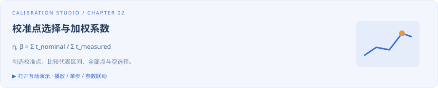
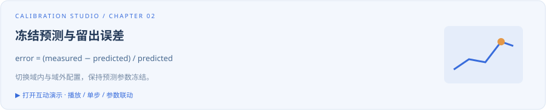

# 第 2 章 第一次真机 Profile 与性能校准

## 本章导读

> 第 1 章用硬件标称峰值算力和显存带宽给出了单步耗时的理论下界。但在真实硬件上，计算单元很少能跑满标称算力，显存控制器也难以长期维持满带宽，测量工具本身还会引入额外的计时扰动。如何把理想下界校准成可用于预测真机耗时的模型，并判断校准后的模型在哪些范围内可靠、在哪些情况下会失效？
>
> 本章从双系数校准模型出发，将标称模型扩展为包含计算效率 $\eta$ 与访存效率 $\beta$ 的真机近似。2.1 说明上卡测量前必须完成的环境准入与基线记录。2.2 在单个矩阵乘上跑通最小 Profile，量化性能剖析工具的测量扰动并建立同条件计时纪律。2.3 构造涵盖计算侧与访存侧的校准集，解释为何两个系数会随算子区间漂移以及如何选取代表点拟合。2.4 对偏离拟合区间的误差做物理归因，区分功耗墙降频、温度墙与显存碎片。2.5 用未参与拟合的新形状做留出验证，划清模型的适用域与域外失效边界。2.6 将校准模型用于 Qwen3-1.7B 端到端推理，把实测墙钟时间拆解为校准预测、未覆盖 GPU 工作与 CPU 发射空档。2.7 用 CPU 参照线将“硬件加速”与“软件引擎差异”拆分为两个正交维度。章末实验与练习提供完整命令和离线存档。

<!-- ch2-intro:start -->
::: info 互动演示：校准实验室

[打开整章互动阅读版](https://datawhalechina.github.io/hello-mlsys/demos/chapter2/index.html#scene-model)：八组交互演示分别对应双系数模型、测量扰动、选点拟合、缓存命中、负载漂移、留出误差、计时口径与硬件/引擎对照。网页端在对应公式或图表下方直接展示交互面板；GitHub 阅读时可展开该位置的预览入口。

:::
<!-- ch2-intro:end -->

## 教学目标

- 能在测量前完成环境准入检查，记录硬件空闲基线、性能剖析工具链边界和算子后端口径。
- 能在单算子上运行最小 Profile，区分冷启动初始化开销与逐核固定发射扰动，并遵循干净计时与同条件比较原则。
- 能写出双系数 Roofline 校准模型，解释 $\eta$ 与 $\beta$ 随算子区间变化的原因，并在代表区间上完成加权拟合。
- 能结合频率、功耗、温度与显存分配采样，区分功耗墙降频、温度降频与显存碎片，并对留出集的域内与域外误差作出机制解释。
- 能将端到端单步耗时拆解为校准预测、未覆盖 GPU 工作与发射空档，并区分硬件换代与软件引擎优化各自带来的加速比。

## 双系数校准模型

第 1 章的标称模型假设硬件在计算侧达到 100% 峰值算力 $P_{\mathrm{peak}}$，在访存侧达到 100% 标称带宽 $\mathrm{BW}_{\mathrm{peak}}$。要让解析模型贴近真实硬件的稳态表现，需要为两条路径分别引入无量纲效率系数——计算效率 $\eta$ 与带宽效率 $\beta$：

$$
t_{\mathrm{nom}, c} = \max\!\left(\frac{\mathrm{FLOPs}_c}{P_{\mathrm{peak}}},\; \frac{\mathrm{Bytes}_c}{\mathrm{BW}_{\mathrm{peak}}}\right),
\qquad
t_{\mathrm{cal}, c} = \max\!\left(\frac{\mathrm{FLOPs}_c}{P_{\mathrm{peak}} \cdot \eta},\; \frac{\mathrm{Bytes}_c}{\mathrm{BW}_{\mathrm{peak}} \cdot \beta}\right).
$$

<!-- ch2-demo:start:model -->
<FormulaDemo chapter="2" scene="model" title="双系数：重新比较计算与访存" />

<details>
<summary>预览与独立演示入口</summary>

[](https://datawhalechina.github.io/hello-mlsys/demos/chapter2/index.html#scene-model)

[打开交互演示：双系数：重新比较计算与访存](https://datawhalechina.github.io/hello-mlsys/demos/chapter2/index.html#scene-model)：拖动 η、β 与工作量，观察校准后的时间和拐点。

</details>
<!-- ch2-demo:end:model -->

其中，$\eta$ 衡量计算受限算子实际达成的算力占 $P_{\mathrm{peak}}$ 的比例，$\beta$ 衡量访存受限算子实际达成的有效带宽占 $\mathrm{BW}_{\mathrm{peak}}$ 的比例。引入这两个系数后，硬件的有效拐点也随之移动：

$$
\mathrm{AI}^*_{\mathrm{eff}} = \frac{P_{\mathrm{peak}} \cdot \eta}{\mathrm{BW}_{\mathrm{peak}} \cdot \beta} = \mathrm{AI}^* \cdot \frac{\eta}{\beta}.
$$

当 $\eta < \beta$ 时（例如大矩阵乘仅发挥约 62% 峰值算力，而流式访存可发挥约 90% 标称带宽），有效拐点会向左移动，意味着算子比标称模型预期的更早进入计算受限区。同时需要提前明确一点：$\eta$ 和 $\beta$ 并不是某块 GPU 固有的绝对常数，它们会随算子尺寸、缓存命中率和持续功耗状态而变化。如何选点拟合、如何界定它们的适用域，是本章的核心内容。

## 2.1 真机准入检查

在采集任何性能数据之前，先对目标机器执行一次环境准入检查并记录环境快照（对应 `results/env_9070xt.json`）。准入检查的目的不只是确认代码能否跑通，更重要的是在实验开始前锁定软件栈、工具链和硬件空闲基线，避免将架构不兼容或算子路径差异误判为模型误差。

| 检查维度 | 本章实验环境快照（RX 9070 XT） |
| --- | --- |
| 目标 GPU 与架构 | AMD Radeon RX 9070 XT（`gfx1201` / RDNA4），15.9 GiB 显存；通过 `HIP_VISIBLE_DEVICES=1` 隔离同机第二张卡 |
| 软件栈版本 | Python 3.13.11 / PyTorch 2.16.0.dev+rocm10.1 / ROCm 7.16.26385 / 驱动 6.16.13 / Linux 6.14 |
| 标称参数基线 | BF16 矩阵峰值 195 TFLOPS，显存带宽 640 GB/s，标称拐点 304.7 FLOP/byte |
| 空闲硬件基线 | 温度 35 °C，板载功耗 26 W，内存互联时钟 `fclk` 219 MHz |

除版本快照外，准入检查还需主动确认三项容易影响后续测量的边界条件：

1. **性能剖析工具链的架构支持范围**。ROCm 生态中不同工具的职责和支持的架构并不相同：`rocprofv3 --kernel-trace` 用于追踪 kernel 发射与 GPU 执行时间，在 `gfx1201` 上可用；`rocprof-compute` 的 `profile` 模式用于采集微架构深度计数器，但在当前版本仅支持 `gfx908`、`gfx90a`、`gfx94x`、`gfx950` 和 `gfx115x`，不支持本机 `gfx1201`（若需硬件计数器，应改用 `rocprofv3 --pmc` 并按[附录 F](/appendix/appendix-f-troubleshooting/)锁定稳定性能档）；`torch.profiler` 通过 HIP activity 提供进程内追踪，可跨架构作为端到端剖析的补充。提前查清工具边界，就能在实验设计阶段选对工具。
2. **注意力算子的后端口径**。探测 SDPA 后端可用性发现：等头输入（MHA 16/16）可使用 `FLASH`、`EFFICIENT` 与 `MATH` 后端，而原始分组查询输入（GQA 16q/8kv）会拒绝 `EFFICIENT` 后端。因此 Qwen3 系列模型在执行前会先通过 `repeat_kv` 将键值头展开至 16 头再调用 fused kernel，后续的理论流量预测也必须沿用同一展开口径。
3. **目标模型可正常加载与前向运行**。验证 Qwen3-1.7B（28 层，隐藏维 2048，中间层 6144，16 查询头 / 8 键值头，单头维度 128，词表 151,936，输入输出权重共享）可完成预填充和单步解码。空闲态的 35 °C 和 26 W 记录下来，作为 2.4 节判断是否发生降频的参照基准。

## 2.2 最小 Profile 与测量扰动

拿到可用的剖析工具后，不要直接去剖析包含上千个算子的完整模型，而应先在单个大算子上完成一次**最小 Profile**。这样既能验证工具能否正确归属 kernel，也能直接量出剖析工具本身给计时带来了多大扰动。

以单个 BF16 矩阵乘 $4096 \times 4096 \times 4096$ 为例，在同一会话、同一张量和同一协议（预热 10 次，采样 50 次，共 3 轮取中位数）下采集四组读数（数据见 `results/minimal_profile_9070xt.json`）：

| 读数 | 测量条件 | 实测值 | 相对干净基准比值 |
| --- | --- | ---: | ---: |
| A. 干净基准 | 无 profiler，每轮 `Event` 计时并同步 | $1.054\;\text{ms}$ | $1.000\times$ |
| B. CPU 发射开销 | 连续提交 32 次不等待同步，取单次均值 | $0.0253\;\text{ms}$ | — |
| C. `rocprofv3 --kernel-trace` | 开启 kernel 追踪时的单轮 `Event` 耗时 | $1.0665\;\text{ms}$ | $1.012\times$ |
| D. `torch.profiler` | 开启进程内剖析时的单轮 `Event` 耗时 | $1.0710\;\text{ms}$ | $1.016\times$ |

<!-- ch2-demo:start:profiler -->
<FormulaDemo chapter="2" scene="profiler" title="Profiler：区分冷启动与逐核开销" />

<details>
<summary>预览与独立演示入口</summary>

[](https://datawhalechina.github.io/hello-mlsys/demos/chapter2/index.html#scene-profiler)

[打开交互演示：Profiler：区分冷启动与逐核开销](https://datawhalechina.github.io/hello-mlsys/demos/chapter2/index.html#scene-profiler)：改变 kernel 数与 warmup 设置，比较首样本和稳态。

</details>
<!-- ch2-demo:end:profiler -->

两款工具报告的 kernel 数量完全一致（每次迭代 1 个 GEMM kernel），GPU 自身执行时间也非常接近（`rocprofv3` 为 1.036 ms，`torch.profiler` 为 1.032 ms）。干净基准 1.054 ms 对应 130.4 TFLOPS，约占标称矩阵峰值 195 TFLOPS 的 67%，与第 1 章单算子锚定结果一致。

对照 B、C、D 三项，可以明确性能剖析工具开销的两个本质特征：

- **预热区必须包含在剖析窗口内**。新进入剖析区域的第一次迭代往往伴随约 1 ms 的一次性初始化成本；如果不经过预热只测单次迭代，会让单次 1 ms 的算子看起来膨胀近两倍。将预热和多次采样一起放进剖析区域取中位数后，两款工具的稳态膨胀都只有 1.2%–1.6%。
- **剖析开销按 kernel 发射次数累加，而非按计算时间按比例缩放**。对于仅包含 1 个 1 ms 大 kernel 的矩阵乘，单次发射的额外记录成本被摊薄到约 1%；但当负载变成 2.6 节那样每步发射 1591 个小 kernel 的全模型解码时，每次发射的固定记录成本会乘以 1591，把端到端耗时膨胀到近 1.9 倍。

由此得出贯穿全书的**计时与剖析纪律**：性能剖析工具用来观察 kernel 构成和 GPU 自身执行时间，不直接用来报端到端墙钟时间。所有“干净墙钟时间”必须在关闭 profiler 的条件下单独测量；需要比较“墙钟时间与 GPU 执行时间之差”时，必须清楚区分两种口径——若用同一次剖析内的墙钟时间减去 GPU 自身时间，差值里包含了 profiler 自身的发射膨胀；只有用无 profiler 的干净墙钟时间减去 GPU 自身时间，才能得到真实运行时的发射空档。

## 2.3 校准集设计与双系数拟合

最小 Profile 确认测量可靠后，可以设计一组涵盖计算侧与访存侧的基准算子作为**校准集**，在 RX 9070 XT 上按相同协议（预热 10 次，采样 50 次，3 轮取中位数）逐一实测（数据见 `results/cal_9070xt.json`）。对每个算子，按标称耗时除以实测中位数计算逐点效率系数：计算受限算子记为 $\eta_i = t_{\mathrm{comp}, i} / t_{\mathrm{meas}, i}$，访存受限算子记为 $\beta_i = t_{\mathrm{mem}, i} / t_{\mathrm{meas}, i}$。

| 算子 | 形状 | 算术强度 AI | 标称下界（ms） | 实测中位数（ms） | 逐点系数 | 是否参与拟合 | 偏离代表区间的归因 |
| --- | --- | ---: | ---: | ---: | ---: | --- | --- |
| GEMM | $2048^3$ | $682.7$ | $0.0881$（计算） | $0.1817$ | $\eta = 0.4848$ | 否 | 尺寸偏小，未完全饱和矩阵管线 |
| GEMM | $4096^3$ | $1365.3$ | $0.7048$（计算） | $1.0668$ | $\eta = 0.6607$ | 是 | 计算甜区代表点 |
| GEMM | $5120^3$ | $1706.7$ | $1.3766$（计算） | $2.2671$ | $\eta = 0.6072$ | 是 | 计算甜区代表点 |
| GEMM | $8192^3$ | $2730.7$ | $5.6385$（计算） | $11.9214$ | $\eta = 0.4730$ | 否 | 持续高负载触发功耗墙降频（见 2.4 节） |
| LayerNorm | $2048 \times 1024$ | $1.0$ | $0.0131$（访存） | $0.0268$ | $\beta = 0.4891$ | 否 | 张量偏小，发射开销占比过高 |
| LayerNorm | $8192 \times 4096$ | $1.0$ | $0.2097$（访存） | $0.2331$ | $\beta = 0.8996$ | 是 | 流式访存代表点 |
| Softmax | $4096 \times 4096$ | $1.0$ | $0.1049$（访存） | $0.0803$ | $\beta = 1.3061$ | 否 | 命中 L2 缓存，实际 HBM 流量低于标称口径 |
| Softmax | $8192 \times 4096$ | $1.0$ | $0.2097$（访存） | $0.2301$ | $\beta = 0.9113$ | 是 | 流式访存代表点 |


这张表展示了为何不能把所有测点直接打包拟合。计算侧的 $\eta$ 沿矩阵尺寸呈现出明显的“中间高、两头低”曲线：$2048^3$ 尚未把计算单元填满（$\eta = 0.4848$），$4096^3$ 与 $5120^3$ 处于充分饱和的甜区（$0.6607$ 与 $0.6072$），到了 $8192^3$ 又回落至 $0.4730$。访存侧的 $\beta$ 跨度更大：小尺寸 LayerNorm 受发射开销拖累仅跑出 $0.4891$，大尺寸 $8192 \times 4096$ 稳定在 $0.90$ 左右；而中等尺寸的 Softmax（$4096 \times 4096$，输入输出合计约 67 MB）竟然跑出了 $\beta = 1.3061 > 1$。

表观带宽效率大于 1 并不意味着突破了显存物理带宽上限，而是因为张量工作集部分驻留在片上 L2 缓存中，实际穿过 HBM 显存控制器的字节数少于标称模型按“无缓存复用”假设算出的流量。如果把这类受缓存命中、小核发射或持续降频影响的点混进拟合，得到的系数既不能代表纯 HBM 流式带宽，也不能代表稳态矩阵效率。

<!-- ch2-demo:start:cache -->
<FormulaDemo chapter="2" scene="cache" title="缓存命中与表观 β" />

<details>
<summary>预览与独立演示入口</summary>

[](https://datawhalechina.github.io/hello-mlsys/demos/chapter2/index.html#scene-cache)

[打开交互演示：缓存命中与表观 β](https://datawhalechina.github.io/hello-mlsys/demos/chapter2/index.html#scene-cache)：减少实际 HBM 流量，理解 β 大于 1 的一种来源。

</details>
<!-- ch2-demo:end:cache -->

因此，拟合只选取代表区间内的测点——计算侧取 GEMM $4096^3$ 与 $5120^3$，访存侧取超出 L2 容量的流式算子 LayerNorm $8192 \times 4096$ 与 Softmax $8192 \times 4096$，按总标称耗时除以总实测耗时加权求解：

$$
\eta = \frac{\sum t_{\mathrm{comp}}}{\sum t_{\mathrm{meas}}} = \frac{0.7048 + 1.3766}{1.0668 + 2.2671} = 0.6243,
\qquad
\beta = \frac{\sum t_{\mathrm{mem}}}{\sum t_{\mathrm{meas}}} = \frac{0.2097 + 0.2097}{0.2331 + 0.2301} = 0.9054.
$$

<!-- ch2-demo:start:fit -->
<FormulaDemo chapter="2" scene="fit" title="校准点选择与加权系数" />

<details>
<summary>预览与独立演示入口</summary>

[](https://datawhalechina.github.io/hello-mlsys/demos/chapter2/index.html#scene-fit)

[打开交互演示：校准点选择与加权系数](https://datawhalechina.github.io/hello-mlsys/demos/chapter2/index.html#scene-fit)：勾选校准点，比较代表区间、全部点与空选择。

</details>
<!-- ch2-demo:end:fit -->

代入双系数模型后，RX 9070 XT 的有效矩阵拐点从标称的 304.7 FLOP/byte 移动至 $304.7 \times (0.6243 / 0.9054) \approx 210.1\;\text{FLOP/byte}$。

## 2.4 误差归因

把异常测点排除在拟合之外后，不能把它们当作无法解释的噪声丢弃，而必须通过针对性的受控测量查明物理机制。真实 GPU 上最常见的三类系统性偏差分别来自**时钟降频**、**显存碎片**和**工具/架构口径不一致**。

### 功耗墙降频而非温度降频

为了解释 2.3 节中大型 GEMM（$8192^3$）效率回落至 $\eta = 0.4730$ 的现象，我们在 RX 9070 XT 上对 GEMM $4096^3$ 执行了“冷态基准—持续 60 秒满载—热态复测”实验，并在后台每隔 1.5 秒用 `rocm-smi` 记录核心时钟 `sclk`、互联时钟 `fclk`、板载功耗与温度（数据见 `results/clock_drift_9070xt.json`）：

- **单步耗时缓慢漂移**：空闲刚启动时的冷态中位数（fresh）为 1.1145 ms，持续满载 60 秒后立即复测的热态中位数（hot）升至 1.1667 ms，增幅 **+4.68%**；持续负载期间每 200 次迭代的分块中位数从 1.1136 ms 平缓爬升至 1.1700 ms（+5.1%），没有出现阶跃突变。
- **核心时钟单调回落，功耗顶格，温度温和**：负载启动约 5 秒内，`sclk` 冲高至峰值 2496 MHz，随后在 60 秒内持续回落至 2428 MHz；与此同时，板载功耗稳定贴在 316–333 W 的板功耗上限，而核心温度仅从 53 °C 升至 67 °C，远未触及消费级 GPU 的温度降频阈值；内存互联时钟 `fclk` 全程恒定在 1889 MHz。

<!-- ch2-demo:start:drift -->
<FormulaDemo chapter="2" scene="drift" title="联动回放功耗、时钟与温度" />

<details>
<summary>预览与独立演示入口</summary>

[](https://datawhalechina.github.io/hello-mlsys/demos/chapter2/index.html#scene-drift)

[打开交互演示：联动回放功耗、时钟与温度](https://datawhalechina.github.io/hello-mlsys/demos/chapter2/index.html#scene-drift)：拖动时间，逐点查看本章已有的真实观测。

</details>
<!-- ch2-demo:end:drift -->


这组联动观测排除了温度墙，直接锁定了**板载功耗上限（power-cap）导致的动态降频**。在持续高密度矩阵运算下，硬件为守住功耗上限主动压低核心频率；$8192^3$ 矩阵乘的单次执行时间超过 11 ms，全程贴着功耗墙运行，因此实测效率显著低于短时间脉冲式的 $4096^3$。

### 排除显存碎片与隔离工具链差异

在同一 60 秒持续负载前后检查 PyTorch 显存分配状态：`allocated` 始终恒定在 0.062 GiB，`reserved` 在启动初期从 0.062 GiB 一次性扩张至 0.172 GiB 后保持平稳，未随迭代次数增长。由此排除了显存碎片化导致的性能漂移。

至于工具链与架构口径差异（例如 `rocprof-compute` 不支持 `gfx1201`、以及剖析工具对小 kernel 的逐核发射膨胀），已在 2.1 与 2.2 节的准入和最小 Profile 阶段显式记录并隔离，确保它们不会混入硬件效率系数 $\eta$ 和 $\beta$ 的估计中。

## 2.5 留出验证与模型适用域

用校准集拟合出 $\eta = 0.6243$ 和 $\beta = 0.9054$ 后，必须用**未参与拟合的新形状**检验模型能否泛化。为了防止事后调参掩盖偏差，留出集的预测时间必须在执行留出实测之前冻结并落盘（在 `results/cal_9070xt.json` 中，`holdout_prediction.stored_at` 早于实测时间）。

留出集包含两类测点：第一类是与拟合算子同属“饱和计算”或“流式访存”区间的新尺寸（GEMM $6144^3$、LayerNorm $16384 \times 4096$、Softmax $16384 \times 4096$），用于检验**域内泛化**；第二类是单请求（$b = 1$）的 fused MHA16 注意力算子（$S = 512$ 时 $\mathrm{AI} = 256$ 属访存侧，$S = 1024$ 时 $\mathrm{AI} = 512$ 属计算侧），用于做**域外压力测试**。

| 留出配置 | 理论绑定（按标称拐点） | 校准预测（ms） | 真机实测（ms） | 相对误差 | 实测效率读数 | 测试域 |
| --- | --- | ---: | ---: | ---: | --- | --- |
| GEMM $6144^3$ | 计算（$\mathrm{AI}=2048$） | $3.8103$ | $3.8921$ | $+2.1\%$ | $\eta = 0.6112$ | 域内 |
| LayerNorm $16384 \times 4096$ | 访存（$\mathrm{AI}=1$） | $0.4633$ | $0.4529$ | $-2.2\%$ | $\beta = 0.9261$ | 域内 |
| Softmax $16384 \times 4096$ | 访存（$\mathrm{AI}=1$） | $0.4633$ | $0.4475$ | $-3.4\%$ | $\beta = 0.9372$ | 域内 |
| Attn MHA16 $S=512$ | 访存（$\mathrm{AI}=256$） | $0.0145$ | $0.0527$ | $+264.1\%$ | 40.7 TFLOPS（21% 峰值） | 域外 |
| Attn MHA16 $S=1024$ | 计算（$\mathrm{AI}=512$） | $0.0706$ | $0.1218$ | $+72.6\%$ | 70.5 TFLOPS（36% 峰值） | 域外 |

<!-- ch2-demo:start:holdout -->
<FormulaDemo chapter="2" scene="holdout" title="冻结预测与留出误差" />

<details>
<summary>预览与独立演示入口</summary>

[](https://datawhalechina.github.io/hello-mlsys/demos/chapter2/index.html#scene-holdout)

[打开交互演示：冻结预测与留出误差](https://datawhalechina.github.io/hello-mlsys/demos/chapter2/index.html#scene-holdout)：切换域内与域外配置，保持预测参数冻结。

</details>
<!-- ch2-demo:end:holdout -->


对照域内与域外两组结果，双系数模型的适用边界清晰可见。在域内，三个此前未见过的更大尺寸算子相对误差全部控制在 **$\pm 3.5\%$ 以内**，逐点效率系数也紧贴拟合值（$\eta = 0.6112$ 对比 $0.6243$，$\beta = 0.9261 / 0.9372$ 对比 $0.9054$），说明只要算子处于“饱和计算”或“流式访存”区间，两系数模型对尺寸缩放具有良好的泛化能力。

而在域外的单请求注意力上，模型系统性地**偏乐观**（实测比预测慢 72.6% 至 264.1%）。偏差并非来自公式错误，而是因为 $b = 1$ 的单个 SDPA kernel 并行度不足，在 $S = 512$ 时只发挥出 21% 的矩阵峰值算力（40.7 TFLOPS），$S = 1024$ 时也仅发挥出 36%（70.5 TFLOPS）。从饱和 GEMM 和大张量流式算子上学到的两个标量，无法直接覆盖低并行度、未饱和的执行区间。这一偏差反过来指明了后续章节的优化方向：增大批大小以抬高并行度，以及通过算子融合减少片外读写。

## 2.6 端到端模型剖析与三段拆解

单算子验证完成后，把 $\eta = 0.6243$ 与 $\beta = 0.9054$ 带入完整语言模型 **Qwen3-1.7B**（BF16，SDPA 后端按 `repeat_kv` 口径计数，$B = 1$），对比解码（$\mathrm{ctx} = 1024$）与预填充（$S = 512$）两个阶段的校准预测、干净墙钟时间与进程内 `torch.profiler` 剖析结果（数据见 `results/e2e_1p7b_9070xt.json`）。

::: details 为什么端到端剖析采用 `torch.profiler` 而非 `rocprofv3`？

虽然 `rocprofv3 --kernel-trace` 在 2.2 节的纯 PyTorch 矩阵乘上工作正常，但包裹完整 `transformers` 模型进程时会触发动态库冲突（模型加载路径引入的另一份 LLVM 库与 `rocprofv3` 注入的 LLVM 库重复注册了同名命令行选项，导致子进程 `SIGABRT`）。因此端到端 kernel 级时间线以进程内 `torch.profiler` 为准，该工具链冲突记录在 `results/e2e_1p7b_9070xt.json` 的 `profiler_overhead.rocprofv3_fullmodel_error` 字段中。

:::

| 观测与拆解项 | Decode（$B=1, \mathrm{ctx}=1024$） | Prefill（$S=512$） |
| --- | ---: | ---: |
| 校准预测 GPU 耗时（$\sum t_{\mathrm{cal}, c}$） | $6.754\;\text{ms}$ | $14.965\;\text{ms}$ |
| ├ GEMM 组件预测 | $5.938\;\text{ms}$（访存） | $14.472\;\text{ms}$（计算） |
| ├ Attention 组件预测（`repeat_kv`） | $0.811\;\text{ms}$（访存） | $0.494\;\text{ms}$（访存） |
| └ Norms / 逐元素量级估计 | $0.005\;\text{ms}$（访存） | — |
| 干净墙钟时间（无 profiler） | $30.116\;\text{ms}$（$33.2\;\text{tok/s}$） | $38.332\;\text{ms}$（约 $13,357\;\text{tok/s}$） |
| 单步 kernel 数量 | $1591$ | $1617$ |
| GPU 自身执行时间之和（$\sum t_{\mathrm{self}}$） | $14.943\;\text{ms}$ | $36.402\;\text{ms}$ |
| 干净 GPU 忙碌比例（$\sum t_{\mathrm{self}} / t_{\mathrm{clean}}$） | $49.6\%$ | $95.0\%$ |
| 干净发射空档（$t_{\mathrm{clean}} - \sum t_{\mathrm{self}}$） | $15.17\;\text{ms}$ | $1.93\;\text{ms}$ |
| 未覆盖 GPU 工作（$\sum t_{\mathrm{self}} - \sum t_{\mathrm{cal}, c}$） | $8.19\;\text{ms}$ | $21.44\;\text{ms}$ |
| 开启 `torch.profiler` 后的墙钟时间与膨胀比 | $57.616\;\text{ms}$（$1.913\times$） | $58.563\;\text{ms}$（$1.528\times$） |

<!-- ch2-demo:start:timing -->
<FormulaDemo chapter="2" scene="timing" title="干净计时与 Profile 计时" />

<details>
<summary>预览与独立演示入口</summary>

[](https://datawhalechina.github.io/hello-mlsys/demos/chapter2/index.html#scene-timing)

[打开交互演示：干净计时与 Profile 计时](https://datawhalechina.github.io/hello-mlsys/demos/chapter2/index.html#scene-timing)：切换时间来源，区分同条件比较与跨条件估算。

</details>
<!-- ch2-demo:end:timing -->


由于性能剖析工具的额外记录开销主要发生在 CPU 发射端，对 GPU 内部单个 kernel 的硬件执行时长 $\sum t_{\mathrm{self}}$ 影响极小，因此可以用无 profiler 测得的干净墙钟时间减去 $\sum t_{\mathrm{self}}$，把整步耗时拆成互不重叠的三段：**校准模型已覆盖的 GPU 工作**、**模型未覆盖的 GPU 工作**，以及**干净发射空档**。

如果违反 2.2 节的计时纪律，误用开启 `torch.profiler` 后的膨胀墙钟时间（预填充 58.563 ms）去减 GPU 自身时间（36.402 ms），就会得出“预填充也有 22.16 ms 发射空档、GPU 忙碌仅 62.2%”的错误判断；改用无 profiler 的干净墙钟时间（38.332 ms）后，真实发射空档其实只有 1.93 ms，GPU 忙碌比例高达 **95.0%**。

拆解结果揭示了两个阶段截然不同的瓶颈结构：

- **解码阶段受“发射空档”与“未建模逐元素小核”双重主导**。28 层前向共发射 1591 个 kernel，单步产生 15.17 ms 干净发射空档（平均约 9.5 微秒/核），GPU 有一半时间处于空闲等待。而在 14.943 ms 的实际 GPU 工作里，核对 `top_kernels` 明细发现：矩阵乘（`Cijk` 系列）约占 6.95 ms（预测 5.938 ms，吻合度约 85%），注意力（`flyc_attn_fwd`）约占 0.88 ms（预测 0.811 ms，吻合度约 92%），Roofline 建模的两大主角基本准确；剩下的约 7–8 ms 缺口几乎全部来自大量未融合的逐元素、归约、拷贝和类型转换小核（`elementwise_kernel`、`reduce_kernel`、`CatArrayBatchedCopy` 等），而模型此前只将它们粗略估计为 0.005 ms。
- **预填充阶段已接近 GPU 饱和，缺口几乎全部在 GPU 侧**。虽然预填充的 kernel 总数（1617 个）与解码（1591 个）几乎相同，但每个 kernel 处理的是 512 个 token 而非 1 个 token，单个 kernel 的计算时长足以掩盖 CPU 发射间隔，GPU 忙碌比例升至 95.0%。此时 21.44 ms 的未覆盖 GPU 工作主要来自两方面：一是 $M = 512$ 的矩阵乘尚未进入 $4096^3$ 那样的计算甜区（套用甜区 $\eta = 0.6243$ 偏乐观），二是未融合的逐元素与内存拷贝小核同样消耗了可观的 GPU 时间。

这一拆解为性能优化提供了明确的优先级：针对解码阶段，首要任务是用 CUDA/HIP Graphs、算子融合和批处理消除上千次小核发射；而针对已经 95% 饱和的预填充阶段，引入 Graphs 收益有限，改进重点应放在算子融合与面向实际矩阵形状的核效率优化。

## 2.7 硬件与软件的正交对照：CPU 参照线

在讨论推理性能时，人们常把“换用 GPU”和“换用高效推理引擎”混为一谈。为了把这两个维度拆开，也为了让没有独立 GPU 的读者拥有一条可本地复现的性能参照线，我们在同一模型（Qwen3-0.6B，F16 GGUF）和同一推理引擎（`llama.cpp` 的 `llama-bench`，默认测试 512 token 预填充 `pp512` 与 128 token 生成 `tg128`，批大小 $B = 1$，重复 5 次取中位数以消除首轮预热凹陷）下，对比了 12 核 CPU（AMD Ryzen 9 3900X，`-ngl 0 -t 12`）与全层上卡的 RX 9070 XT（`-ngl 999`），结果见 `results/cpu_refline_9070xt.json`：

| 阶段 | CPU（12 核，`-ngl 0`） | RX 9070 XT（`-ngl 999`） | 同引擎 GPU / CPU 加速比 |
| --- | ---: | ---: | ---: |
| Decode $B=1$（`tg128`） | $17.16\;\text{tok/s}$ | $162.28\;\text{tok/s}$ | $9.45\times$ |
| Prefill $S=512$（`pp512`） | $3,344.53\;\text{tok/s}$ | $29,984.50\;\text{tok/s}$ | $8.97\times$ |

<!-- ch2-demo:start:speed -->
<FormulaDemo chapter="2" scene="speed" title="硬件与引擎的两种对照" />

<details>
<summary>预览与独立演示入口</summary>

[](https://datawhalechina.github.io/hello-mlsys/demos/chapter2/index.html#scene-speed)

[打开交互演示：硬件与引擎的两种对照](https://datawhalechina.github.io/hello-mlsys/demos/chapter2/index.html#scene-speed)：选择阶段和对照维度，检查两项是否都有可比观测。

</details>
<!-- ch2-demo:end:speed -->

将这张表与第 1 章在同一张 RX 9070 XT 上用 PyTorch eager 模式测得的 Qwen3-0.6B 解码速度（`34.13 tok/s`，单步 29.30 ms）并排观察，就能清楚分离出两个正交的加速维度：

1. **硬件维度（CPU 换 GPU，约 $9\times$）**。固定模型与引擎，仅把计算从 12 核 CPU 迁到 RX 9070 XT，解码提速 $9.45\times$、预填充提速 $8.97\times$，两个阶段的硬件加速比都在一个数量级左右。
2. **软件引擎维度（PyTorch eager 换 `llama.cpp`，约 $4.75\times$）**。固定在同一张 RX 9070 XT 上运行 Qwen3-0.6B 解码，采用高度融合 kernel 与低发射开销路径的 `llama.cpp` 跑到 162.28 tok/s，是逐核发射的 PyTorch eager 模式（34.13 tok/s）的 4.75 倍。这从软件实现侧直接印证了 2.6 节的诊断：消除上千次小 kernel 的 CPU 发射与逐元素碎片开销，单靠软件栈本身就能带来数倍的端到端提速。

对于手边没有 GPU 的读者，Roofline 模型在 CPU 上同样成立（只需换成 CPU 的峰值算力与内存带宽）。可以先用 `llama-bench -ngl 0` 测出本机 CPU 的解码与预填充吞吐作为实测锚点，再对照本章存档完成校准与端到端拆解练习。

## 实验：准入、校准、留出验证与端到端拆解

本实验带你走完一次完整的“准入 → 最小 Profile → 校准拟合 → 误差归因 → 留出验证 → 端到端剖析”闭环。如果手边没有 RX 9070 XT 或 ROCm 环境，可直接读取 `code/part1-modeling/chapter2/results/` 下保留的离线存档完成同样的计算与验证。

### 环境与脚本位置

进入仓库的 `code/part1-modeling/chapter2` 目录。在配备 RX 9070 XT 的 Linux 宿主机上，通过 `HIP_VISIBLE_DEVICES=1` 选中目标卡；复现时按本机 GPU 编号调整环境变量。

### 步骤 1：准入检查与最小 Profile

依次运行准入脚本与单 GEMM 最小 Profile 脚本：

```bash
cd code/part1-modeling/chapter2
HIP_VISIBLE_DEVICES=1 python3 env_check.py
HIP_VISIBLE_DEVICES=1 python3 minimal_profile.py
```

打开 `results/env_9070xt.json` 与 `results/minimal_profile_9070xt.json`（或内置存档），核对以下字段：

1. 在 `env_9070xt.json` 中确认目标 GPU 架构、空闲温度/功耗基线，以及 `rocprofv3`、`rocprof-compute` 与 SDPA 后端的可用性记录。
2. 在 `minimal_profile_9070xt.json` 中读取 `A_event_sync_median_ms`（1.054 ms）、`C_rocprofv3.event_ms_inside`（1.0665 ms）与 `D_torch_profiler.event_ms_inside_profile`（1.0710 ms），验证两款工具对单大核负载的稳态膨胀均在 $1.01\times\text{–}1.02\times$ 之间。

### 步骤 2：校准拟合、时钟归因与留出验证

运行校准与留出验证脚本，以及 60 秒时钟漂移诊断脚本：

```bash
HIP_VISIBLE_DEVICES=1 python3 bench_cal.py
HIP_VISIBLE_DEVICES=1 python3 diag_clocks.py
```

打开 `results/cal_9070xt.json` 与 `results/clock_drift_9070xt.json`（或内置存档），完成三项检查：

1. 在 `cal_9070xt.json` 的 `calibration` 下核对 8 个算子的 `eta_point` / `beta_point`，验证用 4 个 `fit: true` 代表点算出的加权系数与 `fit.eta`（0.6243）、`fit.beta`（0.9054）一致。
2. 在 `cal_9070xt.json` 的 `holdout_measured` 下对比域内三点（`gemm_6144`、`ln_16384x4096`、`softmax_16384x4096`）与域外两点（`attn_mha16_s512`、`attn_mha16_s1024`）的 `pred_err_pct`。
3. 在 `clock_drift_9070xt.json` 中读取 `fresh.median_ms`、`hot.median_ms`、`sclk_max_mhz`、`power_max_w` 与 `temp_max_c`，说明为何这组曲线指向功耗墙降频而非温度降频。

### 步骤 3：端到端三段拆解与 CPU 参照线

运行 Qwen3-1.7B 端到端剖析脚本（可选运行 CPU 参照线脚本）：

```bash
HIP_VISIBLE_DEVICES=1 python3 profile_e2e.py
```

打开 `results/e2e_1p7b_9070xt.json`（或内置存档），对 `measured.decode` 与 `measured.prefill` 分别计算：

1. 干净发射空档 `wall_ms - profile.gpu_self_ms` 与干净 GPU 忙碌比例 `profile.gpu_self_ms / wall_ms`。
2. 对比 `profile.gap_wall_minus_self_ms`（剖析态膨胀后的差值）与上述干净发射空档，体会为何不能用开启 profiler 后的墙钟时间直接估算发射开销。
3. 打开 `results/cpu_refline_9070xt.json`，读取 `summary.tg128_tok_s` 与 `summary.pp512_tok_s`，验证硬件加速比（9.45× / 8.97×）与同卡引擎差异（4.75×）。

## 练习

1. 某 GPU 的 BF16 标称峰值为 200 TFLOPS，标称显存带宽为 800 GB/s。经代表区间校准后测得计算效率 $\eta = 0.60$、访存效率 $\beta = 0.85$。分别求该卡的标称拐点 $\mathrm{AI}^*$ 和校准后的有效拐点 $\mathrm{AI}^*_{\mathrm{eff}}$。一个算术强度为 200 FLOP/byte 的算子，在标称模型与校准模型下分别被判定为计算受限还是访存受限？
2. 某款 GPU 在 4096³ 和 5120³ 两个计算甜区 GEMM 上的标称耗时分别为 0.70 ms 和 1.40 ms，实测中位数分别为 1.05 ms 和 2.25 ms；在 8192³ 降频点上的标称耗时为 5.60 ms，实测为 11.90 ms。按总标称耗时除以总实测耗时的口径，分别计算“仅用甜区两点”与“混入 8192³ 三点”拟合出的 $\eta$。若拿这两个 $\eta$ 去预测 6144³（标称耗时 2.38 ms，实测 3.89 ms），各自的相对误差是多少？
3. 在 2.3 节的校准表中，Softmax $4096 \times 4096$ 的标称访存下界为 0.1049 ms，实测仅需 0.0803 ms（表观 $\beta = 1.3061$）。这是否意味着该算子突破了 GPU 的物理 HBM 带宽上限？如果假设实际有效 HBM 带宽效率仍是 $\beta = 0.90$，估算至少有多大比例的标称流量被片上 L2 缓存吸收而未经过 HBM？
4. 某单算子在无 profiler 下的干净耗时为 1.00 ms，开启 profiler 后耗时变为 1.02 ms。某同学由此推断：“给一个单步包含 1,500 个小 kernel、干净耗时为 30 ms 的解码负载开启同一 profiler 后，总耗时也只会增加约 2%，即 30.6 ms。”指出这个推断错在哪里，并估算实际可能增加的耗时量级。
5. 持续运行 60 秒高负载 GEMM 时，监控日志记录到：核心温度从 50 °C 升至 65 °C，板载功耗全程维持在 320 W（接近板卡功耗上限），核心时钟从 2500 MHz 缓慢降至 2430 MHz，单步耗时上升 4.5%，显存 `allocated` 与 `reserved` 保持不变。该漂移属于功耗墙降频、温度墙降频还是显存碎片？如果更换了一套更强的散热器将温度压低到 55 °C，但功耗上限不变，这种降频会消失吗？
6. 在 2.6 节的 Qwen3-1.7B 预填充（$S = 512$）数据中，无 profiler 干净墙钟时间为 38.332 ms，开启 `torch.profiler` 后的墙钟时间为 58.563 ms，GPU 自身执行时间之和为 36.402 ms，校准模型预测的 GPU 耗时为 14.965 ms。分别计算干净发射空档、干净 GPU 忙碌比例和未覆盖的 GPU 工作时间；并说明为什么对这个预填充负载优先引入 CUDA Graphs 收益不大。
7. 在同一块 GPU 上运行同一模型解码，引擎 A 测得 35 tok/s，引擎 B 测得 160 tok/s；用引擎 B 在 12 核 CPU 上测得 18 tok/s。若有人直接拿引擎 B 的 GPU 结果（160 tok/s）除以引擎 A 在 CPU 上的结果来宣称“GPU 硬件加速了数十倍”，这个比较违背了什么原则？正确的硬件加速比与软件引擎加速比分别是多少？

::: details 参考答案

1. 标称拐点 $\mathrm{AI}^* = 200 \times 10^{12} / (800 \times 10^9) = 250\;\text{FLOP/byte}$；有效拐点 $\mathrm{AI}^*_{\mathrm{eff}} = 250 \times (0.60 / 0.85) \approx 176.5\;\text{FLOP/byte}$。对于 $\mathrm{AI} = 200$ 的算子，在标称模型下 $200 < 250$ 判为访存受限，在校准模型下 $200 > 176.5$ 转为计算受限。
2. 仅用甜区两点：$\eta_1 = (0.70 + 1.40) / (1.05 + 2.25) = 2.10 / 3.30 \approx 0.6364$，预测 6144³ 耗时 $2.38 / 0.6364 \approx 3.74\;\text{ms}$，相对误差 $(3.89 - 3.74) / 3.74 \approx +4.0\%$。混入 8192³ 后：$\eta_2 = (0.70 + 1.40 + 5.60) / (1.05 + 2.25 + 11.90) = 7.70 / 15.20 \approx 0.5066$，预测 6144³ 耗时 $2.38 / 0.5066 \approx 4.70\;\text{ms}$，相对误差 $(3.89 - 4.70) / 4.70 \approx -17.2\%$，精度显著变差。
3. 并没有突破 HBM 物理带宽上限，而是标称模型按“零片上缓存复用”高估了实际 HBM 流量。若真实 HBM 效率为 $\beta = 0.90$，则实际经过 HBM 的流量占比约为 $(0.0803 \times 0.90) / 0.1049 \approx 68.9\%$，即至少约 **31.1%** 的标称流量被 L2 缓存吸收。
4. 错在把剖析开销当成了按耗时等比例缩放的百分比（2%）。剖析开销本质上是每次 kernel 发射的固定记录成本：单核增加约 $0.02\;\text{ms} = 20\,\mu\text{s}$，若每步包含 1,500 个小 kernel，固定开销累加量级为 $1500 \times 20\,\mu\text{s} = 30\;\text{ms}$，总耗时可能膨胀至约 60 ms（接近 $2\times$），而非 30.6 ms。
5. 属于**功耗墙降频**（功耗钉死上限、温度仅 65 °C 远未触及温度墙、显存稳定排除碎片）。在板载功耗上限不变的前提下，仅降低核心温度不会消除功耗墙触发的降频（仅可能因漏电功耗略微减小而带来极小幅度缓解）。
6. 干净发射空档 $= 38.332 - 36.402 = 1.930\;\text{ms}$；干净 GPU 忙碌比例 $= 36.402 / 38.332 \approx 95.0\%$；未覆盖 GPU 工作 $= 36.402 - 14.965 = 21.437\;\text{ms}$。由于发射空档仅占整步时间的 5%，即便用 CUDA Graphs 完全消除这 1.93 ms，端到端耗时最多也只能缩短约 5%，主要优化空间在 GPU 侧算子本身。
7. 违背了控制变量（正交分解）原则，把“硬件换代”和“软件引擎差异”混在了一起。同引擎 B 下的硬件加速比为 $160 / 18 \approx 8.89\times$；同卡下的软件引擎加速比为 $160 / 35 \approx 4.57\times$。

:::
