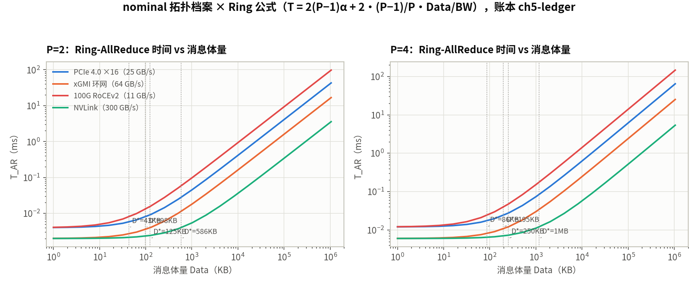
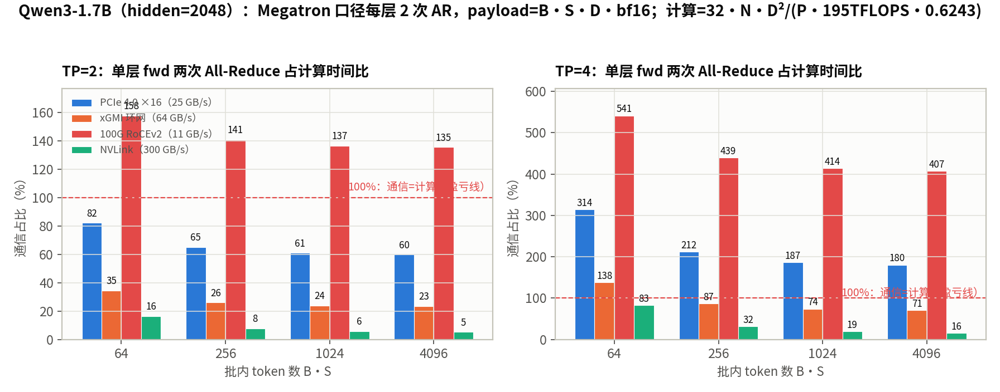
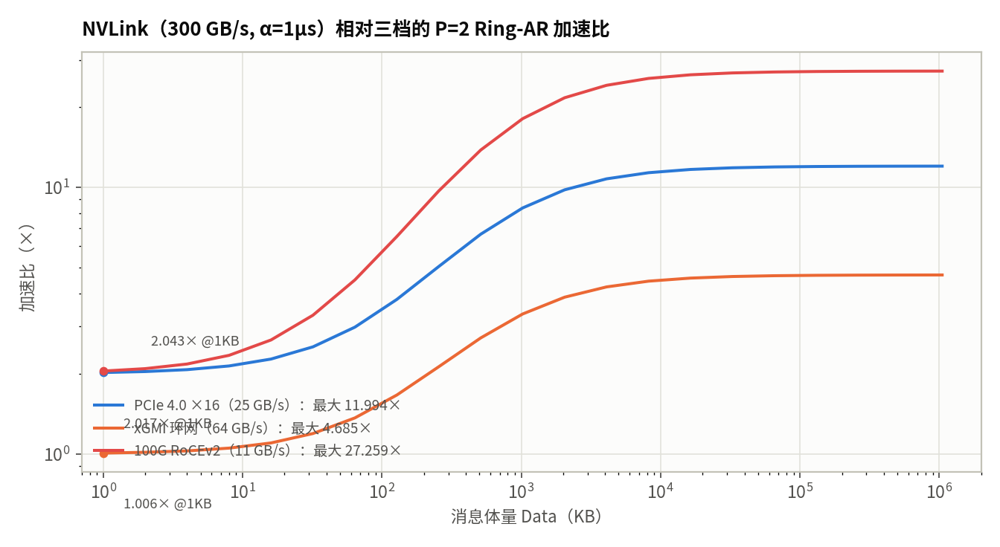
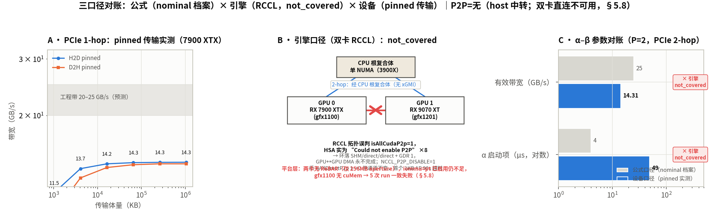

# 第 5 章 通信代价模型与 Scale-in / Scale-up

::: danger ⚠️ Alpha内测版本警告
此为早期内部构建版本，尚不完整且可能存在错误，欢迎大家提Issue反馈问题或建议。
:::

## 本章导读

> 前四章一直在回答"一张卡上算什么、放多少、跑多快"。从这一章开始，问题变成**多张卡之间怎么把数据搬过去**：通信不再是背景开销，而是决定并行策略能不能用的主角。本章建立集合通信的一阶代价模型 `T ≈ α + β × Data`，区分**节点内互联**（PCIe / xGMI / NVLink，即 scale-up）与**节点间互联**（InfiniBand / RoCEv2，即 scale-in）的量级差异，先用模拟器账本预测四档拓扑的 Ring-AllReduce 曲线与张量并行（TP）通信占比，再把**公式口径**（nominal 档案，纸面参数）与两个真机口径——**设备口径**（单卡 PCIe 1-hop pinned 传输）、**引擎口径**（双卡 RCCL All-Reduce 实测拟合；本机判定 not_covered，§5.8）——摆到一张表上做对账。读完后，你应该能判断一次集合通信处在延迟主导区还是带宽主导区，能算出 TP 引入的通信开销占计算的比例，并能说清"哪些实测值只是行为验证、不能代表多卡性能"。

## 教学目标

- 能说清节点内互联（PCIe、xGMI、NVLink）与节点间互联（InfiniBand、RoCEv2）的带宽 / 延迟量级差异，并把它们对应到 **scale-up（节点内扩卡）与 scale-in（跨节点扩容量）** 两条轴；
- 能描述 All-Reduce、All-Gather 等集合通信原语的数据流动方式，并写出 α–β 一阶代价模型与 Ring-AllReduce / All-Gather 的封闭公式；
- 能用 α–β 模型预测通信时间、定位**延迟主导区与带宽主导区的分界点（拐点 D\***），并预测 TP=2/4 时单层 Transformer 引入的通信时间占比；
- 能区分"**行为验证**"与"**性能验证**"，说清哪些实测值（如 CPU gloo 路径、单卡 H2D/D2H）不代表多卡卡间性能，并对公式 / 引擎 / 设备三口径做残差归因——**包括如何留痕一个 not_covered 测量**（为什么闭不上、逐 run 法医记录，而不是硬凑拟合）。

本章的主线是**把"通信代价"从一句话变成一组可预测、可对账的参数**：

```
一阶模型（本章）：  T ≈ α + β · Data
Ring-AllReduce：    T_AR = 2(P−1)·α + 2·(P−1)/P · Data / BW      （P = 参与卡数）
All-Gather：        T_AG = (P−1)·α + (P−1)/P · Data / BW
拐点：              D* = P · α · BW     （α 项 = β 项 处，延迟主导区 ⇄ 带宽主导区）
```

- **α**（启动项，µs）：一次消息的固定开销——doorbell、kernel launch、协议栈、同步；
- **β · Data**（带宽项）：与体量成正比的传输时间，β = 1/BW_eff；
- **D\***：两条项相等时的消息体量。`Data < D*` 时 α 主导（延迟主导区，时间几乎不随体量变），`Data > D*` 时带宽主导（时间随体量线性增长）。由 `D* = P·α·BW`，**BW 越大、α 越小，D\* 越往右移**——但 D\* 处的总时间只有 `4(P−1)·α`，所以专用链路（α 小、BW 大）同时做到"拐点右移 + 延迟地板压低"：NVLink D\*=586 KB 处 T≈4 µs，而 PCIe D\*=98 KB 处 T≈8 µs（§5.3）。

## 5.1 节点内与节点间互联：量级差异

通信代价的第一性来源是**链路**：同样的 All-Reduce，走 PCIe、走 xGMI、走 NVLink、走跨节点 RoCE，量级完全不同。先固定四档**nominal 拓扑档案**（`results/comm_ledger.json → topologies`，测前冻结），作为公式口径的参数来源：

| 拓扑档案 | 类别（scale 轴） | 链路形态 | 单向 raw | 有效带宽（档案） | α（每跳） |
| ---- | ---- | ---- | ---- | ---- | ---- |
| **PCIe 4.0 ×16** | 节点内 · scale-up | 经 CPU 根复合体（本机双卡即此档） | 31.5 GB/s（16 GT/s ×16 lane，128b/130b） | **25 GB/s**（~79% 有效） | **2 µs/跳** |
| **xGMI 环网**（MI300 类） | 节点内 · scale-up | 片间高速环网（AMD 专有） | 8 链 × 64 GB/s 双向/链 | **64 GB/s** | **1 µs/跳** |
| **NVLink**（300 GB/s） | 节点内 · scale-up · 专用 | GPU 间专用物理层（教学取值，对应 A100 单向） | 300 GB/s | **300 GB/s** | **1 µs/跳** |
| **100G RoCEv2** | 节点间 · scale-in | 跨节点 RDMA over Converged Ethernet | 12.5 GB/s | **11 GB/s**（~88% 有效） | **2 µs/跳** |

**量级判读**（这是本章反复回扣的一张表）：

- **节点内（scale-up）三档覆盖 25–300 GB/s**：PCIe 25 GB/s 是"通用"档，xGMI 64 GB/s 是"专有片间"档，NVLink 300 GB/s 是"专用物理层"档——同一根轴上差 **~5–12×**（专用档 vs 通用档接近一个量级）；
- **节点间（scale-in）低于节点内最慢档**：100G RoCEv2 只有 ~11 GB/s，比节点内最慢的 PCIe 25 GB/s 还低 ~2.3×，比 NVLink 低 ~27×（超过一个量级）。α 虽同档（2 µs/跳），但**带宽项 β 直接决定大消息的时间**，所以跨节点跑 TP 在大消息下会明显吃亏；
- **scale-up vs scale-in 的本质**：scale-up 是"把更多卡塞进一个节点、用高速链路直连"（PCIe / xGMI / NVLink），scale-in 是"把节点用网络连起来"（IB / RoCE）。**前者带宽高 2–27×（专用档接近一个量级）、启动开销同档或更低，后者带宽更低、还要叠加网络协议栈**——这直接预告了第 6 章的核心约束"**TP 组必须限制在同一节点内**"（§5.4 会给出它的数值依据）。

::: tip 口径声明
本表是**公式口径（nominal 档案）**：参数取自公开规格与工程有效比，测前冻结，供 §5.3–§5.5 的模拟器账本使用。它与 §5.6 的设备口径（真机实测）和 §5.8 的引擎口径（双卡 RCCL；本机 not_covered，法医记录见 §5.8）**是三个不同的东西**——本章的价值恰恰在对齐这三者（§5.10），而不是假定它们相等；引擎口径在本机缺失时，对账呈现的是"两个闭上 + 一个法医留痕"，不是静默改配置凑数。
:::

## 5.2 集合通信原语与 α–β 一阶模型

**集合通信原语**是多卡并行里反复出现的基本操作。本章聚焦两个：

- **All-Reduce（AR）**：每卡持有同形状张量的一个分量，操作后每卡都得到**所有分量之和**。TP 的每层前向/反向各触发一次 AR（对切分后需要合并的中间结果求和）。
- **All-Gather（AG）**：每卡持有一个分片，操作后每卡都拼出**完整张量**。FSDP/ZeRO 的权重与梯度聚合走这条路。

两者都能用 Ring 算法实现（把卡排成环，每卡只和左右邻居说话，P 跳内完成）。对 P 张卡、消息体量 `Data`：

```
Ring-AllReduce：  T_AR = 2(P−1)·α + 2·(P−1)/P · Data / BW
All-Gather：      T_AG = (P−1)·α + (P−1)/P · Data / BW
```

- **α 项**（`2(P−1)·α`）：环上有 P 段、AR 要跑两趟（reduce-scatter + all-gather），每段都付一次启动开销——**与体量无关，是延迟主导区的地板**；
- **β 项**（`2(P−1)/P · Data/BW`）：每卡实际"流过"自己的量是 `(P−1)/P · Data`（环上不是全量都过每张卡），AR 两趟所以再 ×2——**与体量成正比，是带宽主导区的斜率**。

**拐点 D\*** 令两项相等解出：

```
D* = P · α · BW
```

`Data < D*` 时 α 项占大头（**延迟主导区**：时间几乎平的，加大消息体量也省不了多少时间）；`Data > D*` 时带宽项占大头（**带宽主导区**：时间随体量线性涨）。**这个分界点是本章反复量化的对象**——它决定了"小消息优化 α（launch、融合、CUDA Graphs）、大消息优化 BW（链路、ring 拓扑）"这条工程直觉的数值落点。

> **为什么要 α–β 模型而不是直接测每个体量？** 因为真机测一个体量要 warmup + 多次取中位数（协议见本章"实验设计"），而 α–β 只要两个参数就能**外推**任意体量与任意 P。代价是它是一阶模型——§5.10 会诚实地量化它在外推时的边界。

## 5.3 模拟器账本：四档拓扑的 Ring-AR 曲线与拐点

**预测**（测前留存，`comm_ledger.py` → `results/comm_ledger.json`，run `ch5-ledger-20261116T063929Z`）：对 §5.1 的四档拓扑、P∈{2,4}，在 `Data ∈ [1 KB, 1 GB]`（log 网格 21 点）上按 §5.2 公式算 Ring-AR 与 All-Gather 时间，并解出每档的拐点 D\*。**公式级对账**：与自研 mlsys-simulator（commit `2d9d4de`）逐点核对，48 点 `max_rel_err = 2.15e-16`——两套实现**机器精度一致**，排除了"代码算错"这一类误差来源。

**四档拓扑的拐点 D\*（P=2 / P=4）**：

| 拓扑 | D\*（P=2） | D\*（P=4） | 1 GB 处 T_AR（P=2） |
| ---- | ---- | ---- | ---- |
| PCIe 4.0 ×16 | **97.66 KB** | 195.31 KB | 42.95 ms |
| xGMI 环网 | 125.00 KB | 250.00 KB | 16.78 ms |
| 100G RoCEv2 | **42.97 KB** | 85.94 KB | 97.62 ms |
| NVLink 300 | **585.94 KB** | 1171.88 KB | 3.58 ms |

::: info 拐点怎么读
D\* = P·α·BW。α 只有两档（2 µs/跳：PCIe/RoCE；1 µs/跳：xGMI/NVLink，差 2×），BW 却跨 11–300 GB/s（差 ~27×）——**D\* 主要由 BW 决定**：NVLink 带宽最大 → D\* 最靠右（585.94 KB），意味着 NVLink 上延迟主导区延伸到更大的消息体量，且该区内时间被压到最低（T(D\*)≈4 µs）；进入带宽主导区后它的斜率最缓、大消息最快。RoCE 带宽最小 → D\* 最靠左（42.97 KB），延迟主导区最短、但带宽主导区斜率最陡。**拐点位置 ≠ 快慢**，它是"该优化 α 还是该优化 BW"的分水岭。
:::



**P=2 的代表点**（`results/comm_ledger.json → curves`，ms）：

| Data | PCIe 4.0 ×16 | xGMI 环网 | 100G RoCEv2 | NVLink 300 |
| ---- | ---- | ---- | ---- | ---- |
| 64 KB | 0.0066 | 0.0030 | 0.0100 | 0.0022 |
| 1 MB | 0.0459 | 0.0184 | 0.0993 | 0.0055 |
| 16 MB | 0.6751 | 0.2641 | 1.5292 | 0.0579 |
| 256 MB | 10.7414 | 4.1963 | 24.4072 | 0.8968 |
| 1 GB | 42.9537 | 16.7792 | 97.6169 | 3.5811 |

同一公式、同一网格，四档拓扑在 1 MB 处的时间差 **~18×**（NVLink 0.0055 ms vs RoCE 0.0993 ms）——这就是 §5.1 量级差异在"一次真实 AR"上的落地。

## 5.4 张量并行的通信代价：单层占比

TP 把每层的权重矩阵按行/列切到多卡，代价是**每层前向/反向各一次 All-Reduce**（Megatron 口径，2 AR/层）。给定 Qwen3-1.7B（hidden=2048，BF16，`bytes_elem=2`），payload = `B·S·D·2 B`（批内 token 数 × hidden × 2 字节），计算时间按第 2 章校准口径 `32·N·D²/(P·195 TFLOPS·η)`，其中 195 TFLOPS 为 bf16 名义峰值、η=0.6243 为 Ch2 §2.3 拟合的计算效率系数。`comm_ledger.py → tp_layer_share` 给出 **TP=2/4 × 批内 token 数 {64,256,1024,4096}** 的单层 fwd 两次 AR 占计算时间的比例：

| B·S（token） | TP | payload | PCIe 4.0 ×16 | xGMI 环网 | 100G RoCEv2 | NVLink 300 |
| ---- | ---- | ---- | ---- | ---- | ---- | ---- |
| 64 | 2 | 0.25 MB | **82.12%** | 34.56% | 157.77% | 16.29% |
| 64 | 4 | 0.25 MB | **314.38%** | 137.69% | 541.34% | 82.89% |
| 256 | 2 | 1.0 MB | 65.11% | 26.05% | 140.77% | 7.79% |
| 256 | 4 | 1.0 MB | 212.34% | 86.67% | 439.30% | 31.87% |
| 1024 | 2 | 4.0 MB | 60.86% | 23.93% | 136.51% | 5.66% |
| 1024 | 4 | 4.0 MB | 186.83% | 73.91% | 413.79% | 19.11% |
| 4096 | 2 | 16.0 MB | 59.80% | 23.40% | 135.45% | 5.13% |
| 4096 | 4 | 16.0 MB | 180.45% | 70.72% | 407.42% | 15.92% |

::: info 三个读法
1. **占比 >100% = 通信比计算还慢**（"切分收益被通信吃掉"的数值形态）：PCIe 上 TP=4 在所有批大小下都 >100%（180–314%），RoCE 上**任何 TP 任何批都 >100%**（135–541%）——**跨节点做 TP 在这些档下直接不可行**。
2. **TP=4 比 TP=2 贵，小消息端占比涨得更多**：AR 成本里 α 项 `2(P−1)·α` 从 2α（P=2）涨到 6α（P=4）= **3×**，带宽项系数 `2(P−1)/P` 只从 1 涨到 **1.5×**——AR 总成本因此涨 1.9×（α/β 混合区，64 token 的 256 KB）到 1.5×（带宽主导区，4096 token 的 16 MB）；**再叠加分母：计算时间被 P=4 减半**（`t_comp ∝ 1/P`），两者相乘放大通信占比：82.12% → 314.38%（×3.83 = 1.91×2）与 59.80% → 180.45%（×3.02 = 1.51×2）。
3. **NVLink 是唯一让 TP=4 小批也 <100% 的档**：64 token TP=4 时 NVLink 82.89%，而 xGMI 137.69%、PCIe 314.38%、RoCE 541.34% 都超了。xGMI 在 TP=2 下全批 <100%（23–35%），但 TP=4 就破线——**专用链路（NVLink 类）是"小批量也能安全做 TP"的前提**（第 6 章约束的数值依据）。
:::



## 5.5 专用物理层的收益区间：NVLink 300 GB/s

§5.1 说 NVLink 比其余三档带宽高一档。这里把"高一档"量化成**加速比**：对 P=2 的 Ring-AR，NVLink 相对 PCIe / xGMI / RoCE 的逐体量加速比（`comm_ledger.py → nvlink_gain`）：

| 对照拓扑 | 最大加速比（大体量端） | 1 MB 处加速比 | 收益区间 |
| ---- | ---- | ---- | ---- |
| PCIe 4.0 ×16 | **12.0×** | 8.36× | 全体量都有收益，小消息端（延迟主导区）相对收益最大 |
| xGMI 环网 | 4.685× | 3.345× | 体量越大差距越拉满 |
| 100G RoCEv2 | **27.259×** | 18.075× | 全体量 18–27×，跨节点 vs 节点内的量级差 |

**"收益区间"的准确说法**：NVLink 的收益不是"处处 12×"，而是**一个随体量变化的区间**——小消息端（延迟主导区）α 同档时加速比趋近于 α 项之比（有限），大消息端（带宽主导区）加速比 → **BW 之比**（PCIe 25 GB/s 的 12×、RoCE 11 GB/s 的 ~27×）。**专用物理层的钱花在哪，取决于你的负载落在体量轴的哪一段**：以小消息 AR 为主（TP 小批、PP 的 send/recv）看小消息端加速比，以大体量 AR/AG 为主（大 batch TP、FSDP 聚合）看大体量端加速比。



## 5.6 设备口径：PCIe 1-hop 实测（7900 XTX）

公式口径给了 nominal 25 GB/s，但**链路档案不是真机**。设备口径用 torch pinned-memory 传输实测 CPU↔GPU 的 H2D/D2H（`pcie_probe.py` → `results/pcie_probe_7900xtx.json`）。

**测量卡说明**：主卡 9070 XT（gfx1201）当时被他人 vLLM roofline 任务占用（13 GB/16 GB VRAM），故 1-hop PCIe 基线由同机**辅助卡 7900 XTX（gfx1100）**承担——两卡同为 **PCIe ×16 链路**（sysfs 实测 `current_link_speed`/`width`：7900 XTX = Gen4 ×16 / 16 GT/s，9070 XT = Gen5 ×16 / 32 GT/s），1-hop host↔device 基线对两卡等价；9070 XT 的 1-hop 标为 `not_covered`（主卡占用，见 `experiment-draft.yaml`）。协议：64KB 延迟端 + 1 MB–1 GB（×4 跨距 6 点），每点 5 warmup + 30 计时取中位数（CUDA event），另记 pageable（非 pinned）对照。

**实测（7900 XTX，pinned，GB/s）**：

| 体量 | H2D | D2H |
| ---- | ---- | ---- |
| 64 KB | 2.61（t=0.049 ms） | 1.38（t=0.047 ms） |
| 1 MB | 11.49 | 9.93 |
| 4 MB | 13.67 | 12.79 |
| 16 MB | 14.15 | 13.78 |
| 64 MB | 14.27 | 14.06 |
| 256 MB | 14.30 | 14.15 |
| 1 GB | **14.31** | **14.15** |
| pageable 64 MB（对照） | 14.12 | 14.19 |

::: warning 关键发现：工程带预测被证伪
draft 的 `prediction`（`stored_at` 先于测量）预测 H2D/D2H 稳态带宽落在**工程带 20–25 GB/s**（nominal 上限 25，单向 raw 31.5 的 ~79%）。**实测稳态 H2D ≈ 14.3 / D2H ≈ 14.2 GB/s，只到 nominal 25 的 ~57%，未命中工程带。**
:::

**归因（逐项排除，残差标 unresolved）**：

1. **链路宽度/速率 —— 排除**：sysfs `current_link_speed = 16 GT/s（Gen4）`、`current_link_width = 16`，且 `current == max`，链路协商就是 Gen4 ×16，没有降速；
2. **NUMA 跨节点 —— 排除**：宿主 Ryzen 9 3900X **单 NUMA 节点**（12 核 / 24 线程），GPU x16 **直连 CPU**（`local_cpulist` 覆盖全部 24 线程），不存在跨 socket 根复合体；
3. **延迟/流水线未隐藏 —— 排除**：8 块在途双缓冲的持续带宽实测仍 **14.3 GB/s**，与单发大传输一致——不是"单发没喂饱"，是**持续的天花板**；
4. **量级定位**：14.3 GB/s ≈ **Gen3 ×16 raw（15.6 GB/s）的 ~92%**，而只有 Gen4 ×16 raw（31.5 GB/s）的 **~45%**——实测带宽更接近"跑在 Gen3 水平"而非"Gen4 打六折"。残差指向**宿主任务级 DMA/驱动拷贝路径的效率**（该 ROCm/驱动组合下 pinned 拷贝的有效利用率），本机层面无法进一步分解 → 标 **unresolved**（不硬凑）。

**结论**：nominal `pcie4_x16 = 25 GB/s` 是本机 1-hop 设备口径的**上界估计**，真机实测显著低于协议上限。**"链路规格 ≠ 有效带宽"——这正是三口径对账要呈现的核心**（§5.10），也是为什么第 1 章要引入 η/β 修正、本章为什么不能拿 nominal 直接当真机。

**复测（iommu=pt，稳定性证据）**：上表数字取自宿主启用 `iommu=pt` 重启**后**的复测（同一协议，同一张卡）；重启前（no-pt）的同协议测量为 H2D 14.30 / D2H 14.16 GB/s、64 KB 51/49 µs——两次在噪声内一致（备份留存 `results/pcie_probe_7900xtx_nopt.json`）。设备口径数字对宿主 DMA 配置变化是稳定的，这排除了"上表只是特定 boot 配置下的读数"这一类解释。

> 64 KB 延迟端读数 H2D 0.049 ms / D2H 0.047 ms 是"一次小传输"的设备侧启动+传输时间，量级远大于 §5.1 的 α=2 µs/跳 nominal——设备口径的 α 本身就比协议口径高一个量级；引擎 α_eff 还要再叠 RCCL launch / 协议栈 / 同步开销（本机未测，§5.8，标 unresolved）。

## 5.7 行为验证：gloo 多进程集合通信语义

本章刻意**把"行为验证"与"性能验证"分开**：用 CPU `gloo` 后端、单节点多进程跑 All-Reduce，**目标是验证分布式通信原语的代码行为、同步机制与数值语义一致性，脱离昂贵的多卡硬件依赖**——这里的绝对耗时**不代表多卡集群性能**（走的是 CPU/共享内存路径）。`gloo_semantics.py` → `results/gloo_semantics.json`，2 rank 与 4 rank 各跑一遍：

| 检查项 | 2 rank | 4 rank | 含义 |
| ---- | ---- | ---- | ---- |
| `sum_correct` | ✅ | ✅ | 逐元素求和正确（rank i 贡献 `(i+1)·arange(2048)`，float64） |
| `consistent_across_ranks` | ✅ | ✅ | 所有 rank 得到的结果完全一致（`all_gather_object` 比对） |
| `in_place` | ✅ | ✅ | 原地规约：`data_ptr` 不变、值 = `world·ones` |
| `dtype_bf16` | supported | supported | bf16 边界（记录实测，原预期 `not_supported`） |
| `blocking` | ✅ | ✅ | 进入/退出时间戳单调、所有退出 ≥ 最晚进入（无 rank 提前返回） |

**阻塞语义证据**：2 rank `enter_spread = 2.8e-05 s`（各 rank 进入 AR 的时刻几乎同时）、`all_exit_ge_latest_enter = True`——**没有任何 rank 在别人还没进来时就返回**，这就是"集合通信是同步点"的行为级证明。

::: tip 行为 vs 性能（本章反复强调）
gloo 这段**只证明"API 和拓扑感知逻辑长什么样、语义对不对"**，它的 ms 数**不能**拿来和 §5.3 的公式预测比、更不能代表 GPU 卡间带宽。真正的多卡性能验证应当落在 §5.8（双卡 RCCL，GPU↔GPU）——该口径在本机 not_covered（§5.8 法医记录），所以本机实测层的上限就是这段行为验证 + §5.6 的设备基线（多卡性能，NVLink 层，由 v100x2 补齐，§5.9）。把行为与性能混在一起，是初学者最常见的错误之一。
:::

## 5.8 引擎口径：双卡 RCCL All-Reduce——本机 not_covered

**结论**：本机双卡 RCCL all_reduce **无法完成首个集合通信**。平台层已通过 ReBAR 打通（aperture + peer 转发），裸 P2P DMA 实测可以走通（13.22 / 12.91 GB/s），剩余卡点是与传输无关的 2-process 跨 GPU kernel 互等死锁（4 个通道同一签名，单 rank 全部通过）。因此本机 PCIe 2-hop 层的引擎口径记为 `not_covered`，NVLink 层的引擎口径由 §5.9 在 v100x2 上补齐。

::: warning 待补充
10 次 run 的完整法医记录正在整理；诊断脚本见 `code/part1-modeling/chapter5/` 下的 `rccl_minidiag.py` 与 `run_rccl_diag*.sh`。
:::

## 5.9 引擎口径（补充）：NVLink 层在 v100x2 宿主实测（V100 ×2，NV6 bond）

本机 PCIe 2-hop 层维持 not_covered（§5.8）。为补齐引擎口径的 **NVLink 层**，在另一宿主 `v100x2` 上跑了**同一协议**：`nccl_probe_v100nv6.py`（与本机 `rccl_probe.py` 网格、计时、拟合协议逐项相同）→ `results/nccl_probe_v100nv6.json`。宿主事实：6×V100-SXM2-16GB（driver 580.65.06 / torch 2.10.0+cu128），物理 GPU 4/5 为 **NV6 bond**（6 条 NVLink2，单 NUMA）；GPU 0–3 被用户 VLLM 服务占用，全程未触碰，仅用 4/5。

**测量要点**：

- transport = **P2P/CUMEM**（NCCL 12 channels 全部 NVLink 直连，GDR 1），`can_device_access_peer = True`，正确性检查 sum_ok = True——对照本机"RCCL 误判 P2p + 直连通道永不完成"（§5.8），这里引擎层与平台层同时就位；
- calibration 12 点（64 KB–128 MB）+ holdout 2 点（16 KB / 256 MB，**与本机协议同一组测前冻结点，用后即烧**）；每点 5 warmup + 30 次 CUDA event 取中位数；
- 最小二乘拟合：**α_eff = 24.45 µs/跳，BW_eff = 102.24 GB/s（单向有效），R² = 0.99965**；
- holdout 外推：256 MB 预测 2.675 ms vs 实测 2.639 ms（**+1.35%**）；16 KB 预测 49.1 µs vs 实测 41.0 µs（**+19.8%**——小消息区存在 ~41 µs 时延地板（16/64/128 KB 均为 41.0 µs），2α 线性式在 knee 下方过外推，如实记录，非拟合缺陷）。

**NVLink2 裸互联 side measurement（**：下文 gap 分解原引用"NVLink2 单向 raw = 150 GB/s"是**规格书数字**；为把"引擎效率 = BW_eff / raw"变成实测比，补跑 `p2p_raw_probe_v100nv6.py`（单进程、同 GPU 4/5、同 5 warmup + 30 CUDA event 中位数协议）→ `results/p2p_raw_v100nv6.json`：

| 口径 | 1 MB | 4 MB | 16 MB | 64 MB | 256 MB |
| ---- | ---- | ---- | ---- | ---- | ---- |
| 单向单流（GB/s） | 47.84 | 108.68 | 133.95 | 142.24 | **144.61** |
| 单向 8 流分块并行（GB/s） | 4.18 | 18.31 | 69.77 | 110.68 | 136.04 |

- **单向 raw = 144.61 GB/s**（单流、256 MB 饱和）：NV6 标称链路速率 6 × 25.781 = 154.69 GB/s 的 **93.5%**、规格单向 150 GB/s 的 **96.4%**——gap 分解中的"150 GB/s 规格"由本实测替换；
- 8 流分块并行反而比单流低 ~6%（chunk/stream 同步开销，属测量方法属性而非链路属性），故 raw 参考取单流；
- **双向并发 256 MB：总 281.53 GB/s**（每方向 140.76），标称双向总（2 × 154.69）的 91.0%；全双工近无劣化（每方向 vs 单向单流仅 −2.7%）；
- **64 KB 单次小搬运：21.7 µs**（裸单发下限）；与 NCCL all_reduce 小消息地板 41 µs 差 ≈19 µs，即引擎启动/同步开销部分（与 2α_eff = 48.9 µs 线性外推同量级，见上）；
- **路径验证**：`nvidia-smi nvlink -s` 两卡 6 links active @ 25.781 GB/s；`-gt g` GPU→GPU 吞吐计数器本平台不可用（V100 SXM2 + driver 580，sudo/非 sudo 同报 "Failed to get throughput counters"，如实记录）；实测单向 144.6 GB/s ≫ V100 SXM2 host PCIe（Gen3 x16 有效 ≈12–13 GB/s）host 中转上限 → 流量走 NVLink 而非 host 中转，与上述 transport P2P/CUMEM（GDR 1）一致。

**与 nominal 账本（`nvlink300` 档案：300 GB/s 单向、α = 1 µs/跳、A100 口径，测前冻结）对账**：

| 消息 | nominal | 实测 | 实测/nominal |
| ---- | ---- | ---- | ---- |
| 64 KB（延迟主导） | 4.2 µs | 41.0 µs | 9.7× |
| 1 MB | 7.5 µs | 58.4 µs | 7.8× |
| 16 MB | 59.9 µs | 222.7 µs | 3.7× |
| 128 MB（cal 末端） | 451.4 µs | 1.355 ms | 3.0× |
| 256 MB（holdout） | 898.8 µs | 2.639 ms | **2.94×** |

**gap 分解（闭合，三个数全部实测/nominal 锚）**：实测 BW_eff = 102.24 GB/s vs nominal 300 GB/s，两级因子——(a) **代际**：NVLink2 单向 raw **实测 144.61 GB/s**（单流饱和，上节）vs nominal NVLink3（A100）单向 300 GB/s，**300 / 144.61 = 2.07×** 差距（≈2× 代际，内含实测 NVLink2 raw 为规格单向 150 GB/s 的 96.4%）；(b) **引擎效率**：102.24 / 144.61 ≈ **70.7%** 的实测 raw。两因子合成：300 → 144.61 → 102.24，即 2.074 × (144.61/102.24) = 2.074 × 1.415 = **2.93×，与实测 2.936×（256 MB）相符**（残差 <0.1%，舍入）。α：nominal P=2 两跳 = 2 µs vs 实测 2α_eff = 48.9 µs（24.5×）——nominal α 是量级假设，引擎 α 由 NCCL kernel launch + 通道同步开销主导（裸单发 64 KB 时延 21.7 µs，见上节，同量级；约为 nominal 的 10×）。


::: tip 分层口径：为什么 not_covered 还是 not_covered
本补充只闭合**NVLink 层**引擎口径；本机 PCIe 2-hop 仍是 not_covered（§5.8）——两者是**不同互联层**，v100x2 的数字不能回代本机 PCIe 2-hop。引擎口径是**层相关**的：每一层互联要各自实测，不存在一份 α–β 通吃所有层。
:::

## 5.10 三口径对账：公式 × 引擎 × 设备

本章价值的核心：把 §5.1 的**公式口径**、§5.8/§5.9 的**引擎口径**、§5.6 的**设备口径**摆到一张表上，对每个 gap 做归因（归到机制，或标 unresolved）。引擎口径**层相关**：本机 PCIe 2-hop 层 not_covered（§5.8），NVLink 层在 v100x2 补齐（§5.9）。本表对账对象是 **PCIe 2-hop**（公式 × 设备为本机已测两口径），引擎列保留 not_covered 标记与预期方向，不编造数字；NVLink 层的对账与 gap 闭合见 §5.9。

**α–β 三口径参数对账（P=2，PCIe 2-hop）**：

| 参数 | 公式口径（nominal 档案） | 引擎口径（RCCL 实测拟合） | 设备口径（pinned 传输实测） | gap 归因 |
| ---- | ---- | ---- | ---- | ---- |
| α（µs） | 4（2 跳协议） | **not_covered**（§5.8；预期 ≥ 设备口径） | 64 KB H2D t ≈ 49 µs（设备侧启动+传输） | 公式 × 设备 差 ~12× 属**口径差**：协议 4 µs 只计"2 跳 doorbell+传输启动"，设备 49 µs 计"一次真实小传输的完整启动–完成"；引擎 α_eff 再叠 RCCL launch / 协议栈 / 同步，**本机未测 → α 分解（原假设"α_eff − 4 µs 可归因于引擎启动/同步"）标 unresolved** |
| BW（GB/s） | 25（链路档案） | **not_covered**（§5.8） | H2D 14.3 / D2H 14.2（1-hop 稳态） | 14.3 ≈ nominal 25 的 57%、Gen3 ×16 raw 的 ~92%——gap 归因"链路规格 ≠ 有效带宽"（DMA 路径效率，§5.6）；预期的"2-hop AR host 中转 + 双向"第二级折损无实测 → unresolved |

**gap 分解（说清哪些闭合、哪些不闭合）**：

- **α gap（公式 × 设备，机制闭合）**：~12× 差（4 µs → 49 µs）是口径差——两个口径数的不是同一件事（协议 doorbell vs 一次真实小传输），方向与量级都可解释；
- **BW gap（公式 × 设备，一级归因 + 残差 unresolved）**：本机实测到的唯一一级衰减是"链路规格（31.5 raw）→ 设备 1-hop 有效（14.3）"；14.3 < 25 指向宿主任务级 DMA 路径，**残差标 unresolved**（§5.6，不硬凑）；
- **闭合检查**：本机能完整陈述的闭环只有一个——"公式口径上界 25 GB/s → 设备口径实测 14.3 GB/s，gap 指向链路效率/DMA 路径（残差 unresolved）"。**PCIe 2-hop 引擎口径未闭合（not_covered）**，§5.8 的 10 次 run 法医记录就是"它为什么闭不上"的记录——这是三口径对账的结论之一，不是缺漏；
- **NVLink 层（v100x2 补齐，闭合，§5.9）**：引擎 102.24 GB/s vs nominal 300 GB/s = 2.94×，分解为"NVLink2 vs NVLink3 代际 2.07×（实测 raw 单向 144.61 GB/s）+ 引擎效率 70.7%"，2.936×（256 MB）闭合；α 48.9 µs vs nominal 2 µs = 24.5×，归因引擎 launch/同步开销（裸单发 64 KB 21.7 µs，与本机设备口径 49 µs 单次同量级）。



**一句话结论**：三个口径**互不相等**；本机完成了公式口径 × 设备口径的对账（gap 可指到机制 + 残差 unresolved），引擎口径的 PCIe 2-hop 层 not_covered（根因已定位：平台层已被 ReBAR 打通（aperture + peer 转发），剩余卡点 = 传输无关的 2-process 跨 GPU RCCL kernel 互等死锁（4 通道同签名、单 rank 全过、裸 P2P DMA 实测走通），§5.8），NVLink 层在 v100x2 补齐并闭合（§5.9：2.94× gap 分解为代际 × 引擎效率）。**nominal 档案是上界、设备实测是下界、引擎拟合是"真实多卡通信"的锚——PCIe 2-hop 锚在本机缺失（法医记录本身就是交付），NVLink 锚在 v100x2（§5.9）**。

## 实验设计

- **模拟器实验（预测 → 对账闭环，`comm_ledger.py` → `results/comm_ledger.json`）**：四档 nominal 拓扑（PCIe 4.0 ×16 / xGMI 环网 / 100G RoCEv2 / NVLink 300，测前冻结）× P∈{2,4} × Data∈[1KB,1GB]（log 21 点）→ Ring-AR/All-Gather 曲线 + 拐点 D\* + TP=2/4 单层通信占比 + NVLink 收益区间 + 真机预测（2-hop 25 GB/s/4 µs）。与 mlsys-simulator（commit `2d9d4de`）48 点公式级对账 `max_rel_err=2.15e-16`。
- **真机实验（宿主 miniconda3 直跑 torch 2.16.0.dev20261019+rocm10.1，driver 6.16.13；补充宿主 v100x2：venv torch 2.10.0+cu128，driver 580.65.06，6×V100-SXM2，仅用 GPU 4/5）**：
  - **设备口径**：`pcie_probe.py` → `results/pcie_probe_7900xtx.json`（7900 XTX pinned H2D/D2H，64KB–1GB + pageable 对照；主卡 9070 XT 被他人任务占用 `not_covered`）；
  - **行为验证**：`gloo_semantics.py` → `results/gloo_semantics.json`（CPU gloo 2/4 rank All-Reduce：求和正确/跨 rank 一致/in-place/bf16 边界/阻塞语义；**非多卡性能**）；
  - **引擎口径**：`rccl_probe.py` / `rccl_minidiag.py` + `run_rccl_probe.sh` / `run_rccl_diag*.sh`（双卡 RCCL P=2，12 calib + 2 holdout 协议，5 warmup + 30 取中位数，最小二乘拟合 α_eff/BW_eff；**本机 10 次 2-rank run 全失败（含 iommu=pt 与 ReBAR 两次重启后的复验、4 种传输通道扫描），`rccl_probe.json` 未产出，判定 not_covered**，法医记录见 §5.8）；同协议在 v100x2 补 NVLink 层：`nccl_probe_v100nv6.py` → `results/nccl_probe_v100nv6.json`（V100×2 NV6 bond，transport P2P/CUMEM；拟合 α_eff 24.45 µs / BW_eff 102.24 GB/s / R² 0.99965；holdout 256 MB +1.35%；nominal nvlink300 对账 2.94× 分解闭合，§5.9；仅用 GPU 4/5，用户 VLLM 0–3 未触碰）；测后 side measurement：`p2p_raw_probe_v100nv6.py` → `results/p2p_raw_v100nv6.json`（NVLink2 裸互联：单向单流饱和 144.61 GB/s、双向 281.53 GB/s、64 KB 21.7 µs、链路状态 + 带宽论证路径验证；不入冻结 α–β 网格，§5.9）。
- **闭环与交付**：
  - **预测（测前留痕）**：`experiment-draft.yaml → prediction.stored_at` 先于任何真机测量；holdout 测前冻结、用后即烧；
  - **实测（选点运行）**：6 个 `results/*.json`（pcie_probe_7900xtx[iommu=pt 复测] / pcie_probe_7900xtx_nopt[重启前备份] / gloo_semantics / comm_ledger / **nccl_probe_v100nv6[v100x2 NV6 引擎口径]** / **p2p_raw_v100nv6[v100x2 NV6 裸互联 side measurement]**）+ RCCL 诊断日志（`rccl_diag_*.log`，5 次失败法医，run5 = `rccl_diag_pt_*.log`）+ v100x2 日志（`nccl_v100nv6_{minidiag,probe,oomrun}_stdout.log`、`p2p_raw_v100nv6_stdout.log`）；`rccl_probe.json` 未产出（not_covered，§5.8）；
  - **校准（解释误差）**：三口径对账表 + 残差归因（α gap 公式 × 设备 = 口径差，引擎部分 unresolved；BW gap = 链路效率/DMA 路径，残差 unresolved；PCIe 2-hop 引擎口径 not_covered，闭合记录 = §5.8 法医；**NVLink 层引擎口径 v100x2 补齐，2.94× gap 分解闭合（代际 2.07× × 引擎效率 70.7%，裸互联单向 raw 实测 144.61 GB/s），§5.9**）；
  - **决策（提交）**：消息体量预测/实测曲线、α–β 三口径参数、TP 通信占比、端到端外推边界（**注明设备/行为口径不代表多卡卡间性能**）。
- **not_covered**（`experiment-draft.yaml`）：`rccl_dual_gpu_perf`（双卡 RCCL all_reduce 本机无法完成：平台层已被 ReBAR 打通（aperture + peer 转发），剩余卡点 = 传输无关的 2-process 跨 GPU kernel 互等死锁（4 通道同签名、单 rank 全过、裸 P2P DMA 实测走通 13.22/12.91 GB/s），10 次 run 法医 §5.8）、`rocm_bandwidth_test`（宿主未装且 apt 无包，PCIe 基线由 torch pinned 承担）、`pcie_h2d_d2h_pin_9070xt`（主卡占用）、`xgmi_ring_real` / `roce100g_real`（本机无对应硬件，仅 nominal 档案）、`nvlink300_real`（本机无 NVLink 硬件；NVLink **层**引擎口径已在 v100x2 补齐（V100 NVLink2，§5.9），但 A100 口径的 nvlink300 硬件本身仍 not_covered，代际差如实记录）。
- **动画交付（homework ②）**：Ring-AR / All-Gather 消息传递与主导区过渡的动画演示，数据源 = mlsys-simulator 通信模型输出（带 run 标识、可复现）——本章正文以 §5.3 的静态曲线 + 拐点标注呈现同一数据，动画为课程作业侧产物。

## 本章小结

- **一阶模型**：`T ≈ α + β·Data`；Ring-AR `T = 2(P−1)α + 2(P−1)/P·Data/BW`；拐点 `D* = P·α·BW`。**α 定延迟主导区地板，BW 定带宽主导区斜率**，D\* 是分水岭。
- **量级差异**：节点内（PCIe 25 / xGMI 64 / NVLink 300 GB/s）比节点间（RoCE ~11 GB/s）高一个量级——**scale-up 与 scale-in 是两条带宽量级不同的轴**，TP 组必须落在节点内高速链路（§5.4：RoCE 上任何 TP 任何批占比都 >100%）。
- **TP 通信占比**：Qwen3-1.7B 上 PCIe TP=4 全批 >100%（通信比计算慢）、NVLink TP=2 全批 5–16%——"切分收益被通信吃掉"有了数值形态。
- **三口径对账（核心）**：公式（nominal 25 GB/s / 4 µs）与设备（pinned H2D 14.3 GB/s，64KB t≈49 µs）两口径**不相等**，gap 可指到机制（口径差 / 链路效率 / DMA 路径，残差 unresolved）；引擎（双卡 α–β 拟合）是**层相关**的：PCIe 2-hop 层在本机 **not_covered**（平台层已被 ReBAR 打通，剩余卡点 = 传输无关的 2-process 跨 GPU kernel 互等死锁，§5.8 十次 run 法医），NVLink 层在 v100x2 **补齐**（V100×2 NV6，α_eff 24.45 µs / BW_eff 102.24 GB/s，R² 0.99965；裸互联单向 raw 实测 144.61 GB/s，nominal 2.94× gap 分解为代际 2.07× × 引擎效率 70.7% 并闭合，§5.9）——nominal 是上界、设备实测是下界、引擎锚：PCIe 2-hop 在本机缺失（法医记录本身即交付）、NVLink 在 v100x2 闭合。
- **行为 vs 性能**：gloo 2/4 rank 只验证 API/拓扑/同步语义（**不代表多卡性能**）；单卡 H2D/D2H 是设备基线（**非卡间**）；**本机**没有完成多卡通信性能测量（双卡 RCCL not_covered），NVLink 层多卡性能锚由 v100x2 补齐（§5.9）——本章实测层 = 设备基线 + 行为验证 + NVLink 层引擎拟合；PCIe 2-hop 锚需待 vendor 级调试（RCCL 版本 / 同代 GPU 对 / GPU 调试器，§5.8 候选原因）或具备 xGMI 的宿主。

## 延伸阅读


- **Stanford CS336 Spr 2025**（主对标，工具导向 + 真机 NCCL 测量）：
  - 课程主页（讲义表）：<https://stanford-cs336.github.io/spring2025/>
  - L7 Parallelism basics 幻灯片（定性集合原语 + 3D 并行规则）：<https://github.com/stanford-cs336/spring2025-lectures/blob/main/nonexecutable/2025%20Lecture%207%20-%20Parallelism%20basics.pdf>
  - L8 可执行讲义源码（互连具体数字 + 现场 NCCL all-reduce 带宽测量）：<https://github.com/stanford-cs336/spring2025-lectures/blob/main/lecture_08.py>
  - L8 现场运行 trace：<https://stanford-cs336.github.io/spring2025-lectures/?trace=var/traces/lecture_08.json>
- **CMU 11-868 LLM Systems Spr 2026**（带宽-only 逐步推导）：
  - 课程表（含全部讲义 PDF 链接）：<https://llmsystem.github.io/llmsystem2026spring/docs/Syllabus>
  - L14 Distributed Training（ring broadcast 逐步推导 + NCCL 互连列表）：<https://llmsystem.github.io/llmsystem2026spring/assets/files/llmsys-14-distributed-training-b27c3d1dc185e680c6f5cc924e9ec9d7.pdf>
  - L15 DDP（ring all-reduce + bucketing / overlap）：<https://llmsystem.github.io/llmsystem2026spring/assets/files/llmsys-15-ddp-165dbe3873fac21eb8b339e64bcfee28.pdf>
  - L16 Model Parallelism（GPipe / interleaved + TP all-reduce 分析）：<https://llmsystem.github.io/llmsystem2026spring/assets/files/llmsys-16-model-parallel-83b41612547620ee0e172caa1ee448ed.pdf>
  - L17 MoE（hierarchical all-to-all，DeepSeek EP）：<https://llmsystem.github.io/llmsystem2026spring/assets/files/llmsys-17-MoE-3aa3125f9ccdd4bb7109ef077fbe9260.pdf>
- **UIUC CS498 Machine Learning System（Minjia Zhang / Hoa La）**：
  - SP26 课程表：<https://minjiazhang.github.io/courses/26sp-schedule.html>
  - SP26 week3.2 deck（α/β/γ 定义 + ring/tree 公式）：<https://minjiazhang.github.io/courses/sp26-resource/week3.2_training_dp_allreduce.pdf>
  - SP25 课程表：<https://minjiazhang.github.io/courses/25sp-schedule.html>
  - SP25 week3.1 deck（同公式，2025 版）：<https://minjiazhang.github.io/courses/sp25-resource/week3.1_training.pdf>
- **Harvard mlsysbook.ai / MLSys·im**（完整 α–β 公式族 + crossover 公式 + 数值算例）：
  - mlsysim 入口：<https://mlsysbook.ai/mlsysim/>
  - physics.communication（完整 α–β 公式族 + M_cross = αB + ring/tree 交叉 + hierarchical 模型）：<https://mlsysbook.ai/mlsysim/api/physics.communication.html>
  - physics.networking（fat-tree / torus、bisection、oversubscription）：<https://mlsysbook.ai/mlsysim/api/physics.networking.html>
  - 分布式训练 tutorial（Llama-3.1-70B / 256-H100 数值算例 + 100GbE/IB 对比）：<https://mlsysbook.ai/mlsysim/tutorials/distributed.html>
  - 千卡扩展 tutorial：<https://mlsysbook.ai/mlsysim/tutorials/06_scaling_1000_gpus.html>
  - empirical-calibration（明确声明跨设备通信需单独建模/测量）：<https://mlsysbook.ai/mlsysim/empirical-calibration.html>
  - 书仓库（Vol II 为 preview，勿直接引书章节）：<https://github.com/harvard-edge/cs249r_book>
- **CMU 15-442/15-642 ML Systems Spr 2026（mlsyscourse.org）**（per-worker 通信量对比）：
  - 课程主页：<https://mlsyscourse.org/>
  - Slide 08（ring / tree / butterfly / naive per-worker 通信量对比）：<https://mlsyscourse.org/slides/08-ML-parallelization-part1.pdf>
  - Slide 09（模型 / 流水并行 + bubble）：<https://mlsyscourse.org/slides/09-ML-parallelization-part2.pdf>
- **GT CS8803 Spr 2024（存档）**（论文阅读课，间接覆盖 Megatron TP / FlexGen 带宽参数化）：
  - 2024 论文阅读列表（Wayback 存档）：<https://web.archive.org/web/20241109140337/https://cs8803-spring2024.anand-iyer.com/schedule/>
- **课程内转引的第三方**（均已核实可达）：
  - NCCL 测试与带宽计算惯例（CS336 L8 所引）：<https://github.com/NVIDIA/nccl-tests/blob/master/doc/PERFORMANCE.md>
  - DDP 数据依赖图经典讲解（UIUC slide 所引）：<https://siboehm.com/articles/22/data-parallel-training>

