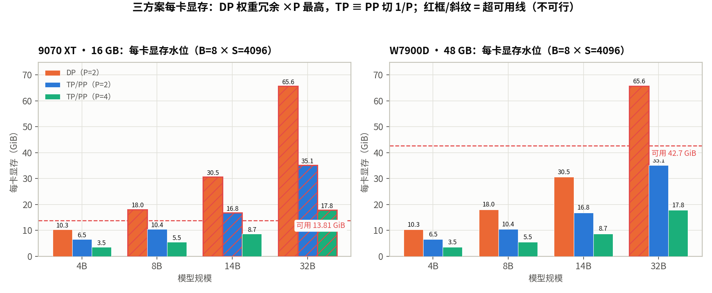
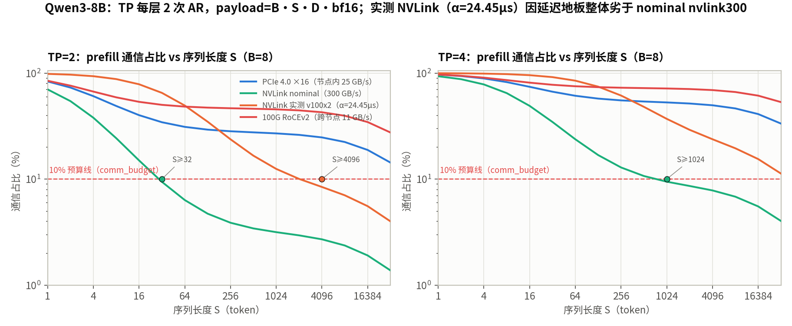
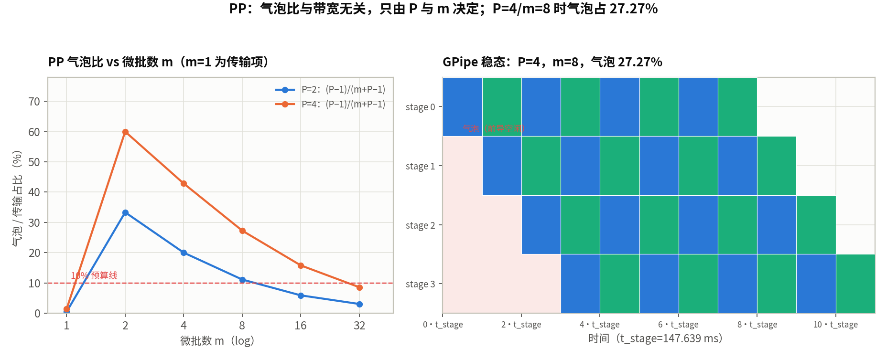
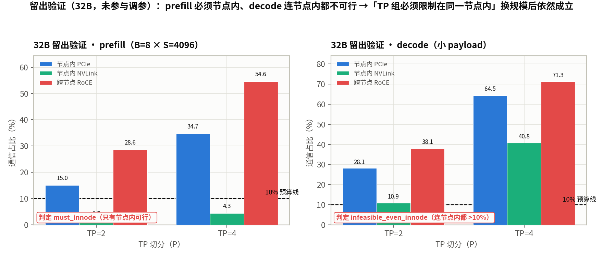

# 第 6 章 模型并行策略与显存 / 算力拆解

::: danger ⚠️ Alpha内测版本警告
此为早期内部构建版本，尚不完整且可能存在错误，欢迎大家提Issue反馈问题或建议。
:::

::: warning 本章口径与证据边界
本章的数字分**三个口径**，互不混用：

- **公式口径**：`code/part1-modeling/chapter6/parallel_ledger.py` 生成的 `results/parallel_ledger.json`，
  消费 Ch2 算力常数（PEAK = 195 TFLOPS bf16、η = 0.6243）与 Ch5 拓扑档案
  （pcie4_x16 / nvlink300 / nvlink_measured_v100x2 / roce100g 的带宽与 α），
  是**模拟器**输出——不是任何一张实卡的测量值。
- **引擎口径**：`nvlink_measured_v100x2` 这一条曲线直接引用 Ch5 在 v100x2 上
  实测的 α_eff = 24.45 µs/跳、BW_eff = 102.24 GB/s（R² = 0.99965），
  与本章公式口径**同式同源**，是"公式 + 实测互联参数"的混合口径。
- **行为口径**：`results/gloo_tp_pp_4b.json`，gloo 后端（CPU 共享内存）2-rank
  真机 TP/PP，只验证**行为**（分片显存、AR 调用次数与顺序、输出一致性），
  **通信耗时不是 GPU 间通信性能**，不能与上两条口径的数字直接比大小。

不要把模拟器曲线当成本机实测，也不要把 gloo 的通信耗时当成 GPU 互联性能。
:::

## 本章导读

> 单卡放不下一个模型时，"怎么切"就不再是语法问题，而是**显存**与**通信**的联合优化问题：
> 数据并行（DP）切 token、张量并行（TP）切层内权重、流水并行（PP）切层间——
> 三者每卡显存不同、通信结构不同、通信占比也不同。本章以**模拟器为主角**：
> 给定一个单卡放不下的模型，用 DP / TP / PP 各拆一次，读出每卡显存与通信时间占比；
> 再设计一个显存卡在卡容量边界的配置，迫使你做真实的切分决策；
> 最后用**留出验证**换一个模型规模，检验"TP 组必须限制在同一节点内"这一结论是否泛化。
> 真机部分用 gloo 后端起 2 个 rank 走一遍 TP/PP 的代码路径，
> 把**行为验证**（分片显存、AR 调用次数与顺序、输出一致性）和**性能验证**（通信耗时）明确分开。

## 教学目标

- 能说明 DP / FSDP 的显存冗余与梯度同步、TP 的层内切分与频繁通信、PP 的层间切分与流水线气泡；
- 能给出"切分收益被通信吃掉"的判定条件（通信占比相对 10% 预算线）；
- 能用模拟器比较 DP / TP / PP 三种方案的每卡显存占用与通信时间占比，并解释差异来源；
- 能在真机上观察多 rank 代码路径（行为验证），并把它与性能验证明确分开。

## 主线公式与要点

本章的账本围绕下面四组式子搭建，全部来自 `parallel_ledger.py` 的 `formulas` 块
（`results/parallel_ledger.json`）：

```text
每 rank 单步时间（公式口径）
  t_step = F(N) / (P · PEAK · η)
  —— DP 切 token（每副本跑全模型、N/P 个 token）；TP 切层内权重（每 rank F/N，精确 1/P）；
     PP 切层间（每 rank L/P 层，末 rank 多一个 lm_head，轻微不均衡）。三方案每 rank 计算量同值。

TP 通信（Megatron 口径）
  每层 2 次 Ring-AllReduce：o_proj 行并行归约 + mlp down 行并行归约
  payload = B · S · D · 2B（bf16）；L 层 → 每前向 2L 次 AR。

PP 气泡
  m≥2（GPipe 稳态）：bubble = (P−1) / (m + P−1)   —— 与带宽无关
  m=1（单流）：传输开销占比 = (P−1) · T_p2p / t_step

通信占比（统一判定口径）
  share = t_comm / (t_comm + t_comp)
  预算线 comm_budget_pct = 10.0（测前冻结）；share ≤ 10% 判"切分收益没被通信吃掉"。
```

要点：

- **三方案每 rank 计算量相同**（`compute_equivalence` 块）：DP ≡ TP 精确相等，
  PP 仅末 rank 因多一个 lm_head 而略高——所以"切分"的差异全部体现在**显存**与**通信**上，
  而不是计算吞吐。
- **TP 通信随 payload 走**：prefill 时 payload = B·S·D·2B 很大（8B 在 B=8、S=4096 下 32 MB/次），
  decode 时 B 小 payload 很小——但 AR 次数固定为 2L，所以 decode 的占比反而更"脆"。
- **PP 气泡与带宽无关**：气泡比只由 P 和 m（微批数）决定；带宽只影响 m=1 单流的传输项。

---

## 6.1 三种切分：切什么、显存、通信

三种方案切的东西不同，决定了每卡显存与通信结构：

| 方案 | 切分对象 | 每卡权重 | 每卡 KV 池 | 通信结构 |
| --- | --- | --- | --- | --- |
| **DP** | token（每副本跑全模型，B/P 请求） | 全量冗余 ×P | (B/P)·S 独立 | **0**（推理无梯度同步） |
| **TP** | 层内权重（列并行 q/k/v + 行并行 o_proj/mlp-down） | 1/P | KV 头 n_kv/P | 每层 2×AR（2L/前向） |
| **PP** | 层间（每 rank L/P 层） | L/P | 随层切 | 每前向 1 send + 1 recv（rank0→rank1…） |

`compute_equivalence` 块（`results/parallel_ledger.json`）给出 Qwen3-8B 在 P=2、
B=8、S=4096 下的每 rank 单步时间（prefill / decode，ms）：

| 方案 | prefill（rank0 / rank1） | decode（rank0 / rank1） | 说明 |
| --- | --- | --- | --- |
| DP | 295.2782 / 295.2782 | 0.5767 / 0.5767 | 切 token，全模型 N/P |
| TP | 295.2782 / 295.2782 | 0.5767 / 0.5767 | 切层内权重，F/N 精确 1/P |
| PP | 274.3394 / **316.2171** | 0.5358 / **0.6176** | 末 rank 多 lm_head，轻微不均衡 |

DP 与 TP 每 rank 时间**精确相等**（一个切 token、一个切权重，总计算量都是 1/P）；
PP 因末 rank 多算一个 lm_head（2N·V·d 的 FLOPs）而略高。这是理解"为什么三种方案
计算吞吐差不多、却要仔细比较显存与通信"的基础。

::: tip GQA 下的 TP 切分
Qwen3-8B 是 GQA：32 个 query head、8 个 KV head。TP=2 时按 rank 切为
**16q / 4kv**（每 rank 持一半 query head 与一半 KV head）；TP=4 时 8q / 2kv。
列并行切 q/k/v 投影的 **out 维**，行并行切 o_proj 与 mlp-down 的 **in 维**，
行并行输出需一次 AR 归约——这正是"每层 2 次 AR"的来源。
:::



*图 6-1：四模型 × 两卡档 × 三方案（P=2/4）的每卡显存水位，对照可用显存线（16 GB 卡 13.81 GiB / 48 GB 卡 42.7 GiB）。数据：`parallel_ledger.json → memory`。*

---

## 6.2 显存账本：四模型 × 两卡档 × 三方案

`memory` 块对 4 个模型（Qwen3-4B / 8B / 14B / 32B，config 已逐一核实）×
2 个卡档（9070 XT 16 GB、W7900D 48 GB）× 3 方案 × P∈{2,4} 共 48 个组合
给出每卡显存账本。每卡可用显存 = 卡容量 × 0.9 − 0.5 GiB 运行时开销
（16 GB → **13.81 GiB**；48 GB → **42.7 GiB**）。固定服务负载 B=8 × S=4096。

下表为每卡**总显存**（GiB），`✓` = 落在可用线内、`✗` = 超出：

| 模型（权重 GiB） | 9070 XT / 16 GB（可用 13.81） | | | | | | W7900D / 48 GB（可用 42.7） | | | | | |
| --- | --- | --- | --- | --- | --- | --- | --- | --- | --- | --- | --- | --- |
| | DP2 | DP4 | TP2 | TP4 | PP2 | PP4 | DP2 | DP4 | TP2 | TP4 | PP2 | PP4 |
| **4B**（7.493） | 10.262✓ | 9.137✓ | 6.535✓ | 3.537✓ | 6.535✓ | 3.537✓ | 10.262✓ | 9.137✓ | 6.535✓ | 3.537✓ | 6.535✓ | 3.537✓ |
| **8B**（15.257） | 18.038✗ | 16.913✗ | 10.441✓ | 5.502✓ | 10.441✓ | 5.502✓ | 18.038✓ | 16.913✓ | 10.441✓ | 5.502✓ | 10.441✓ | 5.502✓ |
| **14B**（27.509） | 30.548✗ | 29.298✗ | **16.832✗** | 8.705✓ | **16.832✗** | 8.705✓ | 30.548✓ | 29.298✓ | 16.832✓ | 8.705✓ | 16.832✓ | 8.705✓ |
| **32B**（61.025） | 65.564✗ | 63.564✗ | 35.091✗ | 17.834✗ | 35.091✗ | 17.834✗ | 65.564✗ | 63.564✗ | 35.091✓ | 17.834✓ | 35.091✓ | 17.834✓ |

读这张表的三件事：

1. **DP 永远最费显存**：权重全量冗余 ×P，DP2 的每卡权重 = 模型全量权重。
   8B 的 DP2（18.038）比 TP2（10.441）多出整整一份冗余权重（15.257 → 7.628/rank）。
2. **TP ≡ PP 显存相同**（同为 1/P 切权重），差异只在通信结构（见 6.3 / 6.4）。
   14B 的 TP2 与 PP2 都是 16.832，都超出 16 GB 卡的 13.81。
3. **卡容量档位决定切分决策**：同一个 8B，16 GB 卡上 DP 不可行、TP/PP 可行；
   48 GB 卡上全部可行。切分不是"越大越好"，而是**由卡容量档位逼出来的**。

::: warning 卡容量边界压力场景（`boundary` 块）
`boundary` 块专门构造了两个"卡在边界"的场景，迫使学生做真实切分决策：

- **Qwen3-8B @ 16 GB 单卡**：权重 15.257 + KV 4.5 + 激活 0.031 + 开销 0.5 =
  **20.288 GiB > 13.81**，单卡不可行（verdict："weights 16.4 GB > 13.81 → 必须切分"）；
  DP2 也是 **18.038 ✗**（权重冗余 ×2 = 30.514）；只有 **TP2 / PP2 = 10.441 ✓**。
- **Qwen3-14B @ 2×16 GB vs 48 GB**：TP2 / PP2 在 16 GB 上都是 **16.832 ✗**，
  必须升到 **TP4 / PP4 = 8.705 ✓**；而单张 48 GB 卡上 14B 权重 27.509 + KV 5.0 +
  激活 0.039 + 0.5 = **33.048 ✓** 直接单卡可放——
  **切分决策取决于卡容量档位**，这正是本章要练的"真实切分决策"压力场景。

::: info W7900D 48 GB 参数
48 GB 卡的显存档位（可用 42.7 GiB）为**容量档**；W7900D 官方标称参数见第 0 章 §0.2，本章未实测，
正文只消费"48 GB 容量"这一档，不对其带宽/算力做断言。
:::

---

## 6.3 TP 通信占比与判定条件

TP 的通信占比 `share = t_comm / (t_comm + t_comp)`，随序列长度 S（prefill）
或 batch B（decode）变化。以 **Qwen3-8B、TP=2** 为例，`comm_share.Qwen3-8B.tp_p2`
块给出四条拓扑曲线（%）：

**prefill（B=8，S 从 1 到 32768）**：

| S | pcie4_x16 | nvlink300（nominal） | **nvlink_measured_v100x2（实测）** | roce100g |
| --- | --- | --- | --- | --- |
| 1 | 83.367 | 70.13 | 98.268 | 84.604 |
| 32 | 34.367 | 9.411 | 65.039 | 50.151 |
| 512 | 27.586 | 3.423 | 16.627 | 46.078 |
| **4096** | **24.713** | 2.701 | **8.421** | 42.686 |
| 16384 | 18.818 | 1.902 | 5.549 | 34.495 |
| 32768 | 14.291 | 1.373 | 3.986 | 27.477 |

**decode（B 从 1 到 32）**：

| B | pcie4_x16 | nvlink300 | nvlink_measured | roce100g |
| --- | --- | --- | --- | --- |
| 1 | 81.211 | 66.94 | 97.997 | 82.575 |
| 8 | 45.255 | 21.689 | 86.082 | 55.42 |
| 32 | 31.135 | 8.231 | 61.631 | 46.485 |

关键观察：

- **同一拓扑下，TP=4 比 TP=2 更差**（每层 AR 次数不变、但每 rank 计算量减半，
  分母变小、占比上升）：8B TP4 prefill 在 pcie 上 S=4096 为 **49.69%**，
  而 TP2 同点是 24.713%。
- **实测 NVLink 曲线整体劣于 nominal nvlink300**：nvlink300 是 300 GB/s 的
  理想档案，而 `nvlink_measured_v100x2` 用 Ch5 实测的 **α_eff = 24.45 µs/跳**
  与 BW_eff = 102.24 GB/s——**α（每次集合通信的固定延迟）是地板**。
  小 payload（decode、短 S）时占比被 α 顶到 98%+，只有大 payload 才能摊薄。
  这是"公式 + 实测互联参数"混合口径的价值：它揭示了 nominal 带宽模型会**系统性低估**
  延迟主导区间的通信占比。



*图 6-2：Qwen3-8B TP 通信占比 vs S（prefill，B=8），四条拓扑曲线 + 10% 预算线。
数据：`parallel_ledger.json → comm_share.Qwen3-8B.tp_p2 / tp_p4.prefill_share_by_s`。*

**判定条件：`tp_smin`（prefill，`share ≤ 10%` 的最小 S）**

`judgment.<model>.tp_smin_prefill` 块对四模型 × TP∈{2,4} × 四拓扑给出
"通信占比降到预算线 10% 以内所需的最小序列长度"（`null` = 网格 S≤32768 内无解）：

| 模型 | TP2 pcie | TP2 nvlink300 | TP2 nvlink_measured | TP2 roce | TP4 nvlink300 | TP4 nvlink_measured |
| --- | --- | --- | --- | --- | --- | --- |
| 4B | null | 64 | 4096 | null | 2048 | 32768 |
| 8B | null | 32 | 4096 | null | 1024 | null |
| 14B | null | 16 | 1024 | null | 256 | 32768 |
| 32B | **32768** | 16 | 512 | null | 128 | 16384 |

读法：

- **pcie4_x16 与 roce100g 几乎处处 `null`**——节点内 PCIe 与跨节点 RoCE 在网格内
  都压不进 10% 预算（只有 32B+TP2 在 pcie 的 S=32768 压线到 32768，属边界点）。
- **nominal nvlink300 很宽松**（8B TP2 只要 S≥32），但**实测 nvlink 明显收紧**
  （8B TP2 要 S≥4096；8B TP4 直接 null）——再次体现 α 延迟地板的作用。
- **结论**：TP 的通信占比能否进预算，**强依赖互联档位**，而"节点内 PCIe / 跨节点 RoCE
  压不进预算"是普遍的——这为 6.5 的"TP 组必须限制在节点内"留出验证提供了公式口径的铺垫。

---

## 6.4 PP 流水线气泡

PP 的代价是**流水线气泡**。`comm_share.<model>.pp` 块对 P∈{2,4}、
m∈{1,2,4,8,16,32}（微批数）给出占比（%），Qwen3-8B 如下：

| m（微批） | P=2 | P=4 |
| --- | --- | --- |
| 1（单流，传输项） | 0.462 | 1.374 |
| 2 | 33.33 | 60.0 |
| 4 | 20.0 | 42.86 |
| 8 | 11.11 | 27.27 |
| 16 | 5.88 | 15.79 |
| 32 | 3.03 | 8.57 |

要点：

- **m=1 用传输项**（`(P−1)·T_p2p / t_step`，与带宽有关），m≥2 用 **GPipe 稳态气泡比**
  `(P−1)/(m+P−1)`（**与带宽无关**）。8B 的 payload 0.062 MB、t_p2p 0.0046 ms
  （pcie4_x16），所以 m=1 单流占比很小（0.46%），一旦进入稳态就跳到气泡比。
- **气泡比只由 P 和 m 决定**：P=2 要 m≥9 才进 10% 预算（`m_min_for_10pct = 9`），
  P=4 要 m≥27（网格 m≤32 内都 >8.57%，**进不了 10%**）。
- 这套 `(P−1)/(m+P−1)` 口径与 CMU 11-868 L16 的 `(K−1)/(M+K−1)`、其
  "M > 4×K 时气泡可忽略"经验阈值同构；与 mlsysim 的 `(P−1)/(VM+P−1)`、
  CS336 的 `(n−1)/n_micro` 在口径上不同，**不可直接混用**（见 6.8 对账节与延伸阅读）。



*图 6-3：PP 气泡比 vs 微批数 m（P=2 / P=4，10% 预算线），右侧 P=4、m=8 的 GPipe 稳态甘特
（每 stage 先等 P−1 个微批进入，之后连续流水）。数据：`parallel_ledger.json →
comm_share.Qwen3-8B.pp` 与 `animation_data.pp_gantt`（bubble 27.27%）。*

---

## 6.5 留出验证："TP 组必须限制在同一节点内"

CMU 11-868 L16 原话："TP 组必须限制在同一节点内"。这句话在公式口径下可以
被**留出验证**：换一个模型规模（32B，训练/冻结时未参与本章 4B/8B/14B 的调参），
检查"TP 跨节点（RoCE）的通信占比是否必然不可行、而节点内（NVLink/PCIe）才可行"。

`holdout_32b` 块（`burned_at = 2026-11-16T12:23:42Z`，**测前冻结、用后即烧**）
对 32B 的 TP2 / TP4 给出 prefill 与 decode 的三档占比（节点内 PCIe / 节点内 NVLink /
跨节点 RoCE），并给出判定 `verdict`：

| 配置 | prefill（PCIe / NVLink / RoCE） | 判定 | decode（PCIe / NVLink / RoCE） | 判定 |
| --- | --- | --- | --- | --- |
| **32B TP2** | 14.99 / **1.47** / 28.59 | `must_innode` | 28.09 / 10.88 / 38.07 | `infeasible_even_innode` |
| **32B TP4** | 34.65 / **4.33** / 54.59 | `must_innode` | 64.49 / 40.77 / 71.33 | `infeasible_even_innode` |

- **prefill → `must_innode`**：跨节点 RoCE（28.59% / 54.59%）远高于节点内 NVLink
  （1.47% / 4.33%），**只有节点内才可行**——"TP 限节点内"在 prefill 上成立。
- **decode → `infeasible_even_innode`**：decode payload 极小（0.078 MB），
  被 α 顶住，**连节点内 NVLink 都进不了 10%**（10.88% / 40.77%）——
  说明"限节点内"是**必要但不充分**条件：小 payload 的 decode 即便节点内也不划算。

对照组（8B / 14B，同口径同负载）给出相同模式的判定：

| 对照 | prefill（NVLink / RoCE） | decode（NVLink / RoCE） |
| --- | --- | --- |
| 8B TP2 | 2.70 / 42.69 → `must_innode` | 21.69 / 55.42 → `infeasible_even_innode` |
| 8B TP4 | 7.81 / 69.11 → `must_innode` | 61.24 / 83.94 → `infeasible_even_innode` |
| 14B TP2 | 2.11 / 36.68 → `must_innode` | 15.01 / 47.08 → `infeasible_even_innode` |
| 14B TP4 | 6.15 / 63.50 → `must_innode` | 49.90 / 78.27 → `infeasible_even_innode` |

**留出结论**：32B（未参与调参的新规模）与 8B/14B 对照组给出**一致的判定结构**——
prefill 必须节点内（`must_innode`），decode 连节点内都不可行（`infeasible_even_innode`）。
"TP 组必须限制在同一节点内"这一结论在换规模后**依然成立**，且更精确地表述为：
**节点内是必要条件，但 decode 的小 payload 场景即便节点内也受 α 限制**——
这正是把"经验说法"落到"可复算公式 + 留出验证"上的价值。



*图 6-4：32B 留出验证，TP2/TP4 × {PCIe, NVLink, RoCE} 的 prefill 与 decode 占比，
对照 10% 预算线；标注 `must_innode`（prefill）与 `infeasible_even_innode`（decode）判定。
数据：`parallel_ledger.json → holdout_32b`。*

---

## 6.6 训练口径：DP / FSDP

本章核心内容之一。`training_caliber` 块对 Qwen3-8B（n_tok=8、S=4096、P=2、
混合精度 16 B/param、fwd+bwd ≈ 3×F，Ch2 常数）给出 DP 与 FSDP 的**方案间对比账本**
（注意：**不是单卡可行性**，而是两种方案的显存/通信相对量级）：

| 方案 | 每 rank 显存（GiB） | 通信 payload | 通信占比 |
| --- | --- | --- | --- |
| **DP** | **122.054** | 梯度 AR 15.257 GiB（一次） | **99.737%** |
| **FSDP** | **61.027** | 每层 all-gather 368.025 MiB | **99.69%** |

- **DP 每 rank 122 GiB** 远超 16/48 GB 档位（权重 16 B/param × 全量 + 优化器状态），
  说明训练口径下 DP 单卡不可行，必须靠 FSDP 切分或更大卡档。
- **FSDP 把每 rank 显存砍半**（122.054 → 61.027，ZeRO-1 口径：切优化器状态 + 梯度），
  代价是**每层一次 all-gather**——通信占比与 DP 几乎相同（99.69% vs 99.737%），
  因为训练单步的通信量（梯度同步 / 参数聚合）本来就主导。
- 这与 CS336 L7 的 "DP 2×#params"、"ZeRO 2×/2×/3×" 以及 CMU L18 的 "20N + 激活"
  口径方向一致（本账本为 16 B/param 混合精度的教学级对比，非单卡可行性断言，
  非 serving 主线）。

::: info 口径说明
训练口径的 `comm_share_pct ≈ 99.7%` 是**方案间相对量级**（训练单步通信本就主导），
不是"训练不可行"——它回答的是"DP 与 FSDP 谁更省显存、通信结构如何不同"。
:::

---

## 6.7 真机行为验证：gloo TP / PP

::: warning 行为验证 ≠ 性能验证
本节用 `gloo` 后端在真机上起 **2 个 rank** 走 TP / PP 的代码路径。gloo 走 **CPU 共享内存**，
通信耗时**不是** GPU 间通信性能——这里只验证**行为**：分片显存、AR 调用次数与顺序、
输出一致性。性能口径全部走 6.3–6.5 的公式 / 引擎口径（Ch5 NVLink 实测 + nominal 档案）。
:::

**为什么选 gloo**：本机 2-process RCCL 跨 GPU kernel 互等死锁（Ch5 §5.8 的
10-run 法医记录，vendor 级，`not_covered`），因此本章真机部分选用 gloo——
行为验证与 GPU P2P 解耦，代码路径（`torch.distributed` 的集合通信调用序列）与真实多卡一致。

**环境**：Qwen3-4B（在盘真权重 `/mnt/public/models/Qwen3-4B`，bf16 加载），
B=2 × S=512（AR payload 5.24 MB），seed=42。两 rank 同卡部署
（`CH6_DEV=cuda:0`，GPU1 被其他用户容器作业占用、不抢卡，**如实登记**于 JSON `device_note`）。
`results/gloo_tp_pp_4b.json`（run_at `2026-11-16T13:17:54Z`，含 q_norm/k_norm 修复）。

**行为验证结果（`judgment` 块全绿）**：

| 观测项 | 预测（测前冻结） | 实测 | 判定 |
| --- | --- | --- | --- |
| TP AR 次数 / 前向 | 72（2L，L=36） | rank0 = rank1 = **72** | ✓ |
| TP AR 顺序 | 逐层 o_proj / mlp_down 交替（Megatron 口径） | `order_matches_megatron = true` | ✓ |
| PP 集合通信 | 0 次 AR + 每前向 1 send + 1 recv | rank0 = rank1 = **0** AR | ✓ |
| 每 rank 分片显存（GiB） | 4.109（(总 7.493 − embed)/2 + embed） | TP 4.144 / 4.135；PP 4.144 / 4.135 | ✓（带 [4.1, 5.8] 内） |
| 输出一致性 | cosine ≥ 0.998，top-10 ≥ 5/10 | 见下表 | ✓ |

**正确性三链路**（HF ← manual_full ← {TP, PP}，全部对 ref）：

| 链路 | cosine | top-10 重叠 |
| --- | --- | --- |
| manual_full vs HF | 0.999846 | 0.9785 |
| TP vs manual_full | 0.999889 | 0.9771 |
| PP vs manual_full | **1.0** | 0.9785 |

**gloo 通信三段耗时**（行为口径，**非性能断言**，仅如实登记）：

| 段 | rank0（median, ms） | rank1（median, ms） |
| --- | --- | --- |
| D2H（GPU→CPU） | 0.6444 | 0.6447 |
| CPU gloo AR（共享内存） | 3.2634 | 3.1917 |
| H2D（CPU→GPU） | 0.9573 | 0.9844 |
| 每前向通信（ms） | 4.865（占比 0.87%） | 4.821（占比 0.86%） |

::: warning D2H / H2D 偏离的三点法医（已闭合）
单进程同卡基线（Ch5 口径）下 D2H/H2D 应为 0.366 / 0.367 ms，实测 0.6444 / 0.9573
（+76% / +161%）。三点归因法医：

1. **单进程同卡**（同 sync 结构、无 gloo）：D2H 0.3966 / H2D 0.3977 ms——与 Ch5 口径 +8%，
   **排除本机固有差异**；
2. **2 进程同卡纯传输**（barrier 同步轮次、无计算）：D2H 0.7797 / H2D 0.7612 ms
   （×1.97 / ×1.91）——**PCIe 路径共享 ≈ 2×，主因**（`CH6_DEV` 同卡部署偏离）；
3. **probe 实测**（2 进程同卡 + 并发注意力计算）：D2H 0.6444（低于②，两 rank AR
   时间窗不完全重叠）/ H2D 0.9573（较② +0.20 ms，**同设备并发计算干扰，次因**）。

结论：偏离归因于 `CH6_DEV` 同卡部署（2 进程共享 GPU0 PCIe 路径 + H2D 同设备计算干扰），
**非探针计时缺陷**（计时窗口仅含 D2H/H2D 传输，同步点位置已复核）。
默认双卡设计下传输应落在 Ch5 口径。acceptance 的 d2h_h2d 条款以
"偏差 <50% **或给出可归因偏离**"判定 → 归因闭合，pass。
:::

::: tip 复现 HF 前，读安装版 modeling_*.py
run 14 的正确性 cosine 一度跌到 0.172，根因是手写 forward **缺 Qwen3 特有的
q_norm / k_norm**（q/k 投影后、RoPE 前的逐 head RMSNorm，权重 [hd]）——从层 0 即分歧。
逐层法医 → 子阶段法医 → 注意力后端排除（eager/sdpa 一致）→ 读安装版
`modeling_qwen3.py` 定位。修复后 36 层全对齐、post final_norm cos 0.9999。
教训：**复现 HF 模型前，先读安装版的 `modeling_*.py`，不要凭印象写 forward。**
:::

**真机 wall（行为口径，非性能断言）**：manual_full 628.52 ms、TP 561.95 ms、PP 140.69 ms
（median）；PP send 10.316 ms（rank0）/ recv 2.37 ms（rank1）。

---

## 6.8 跨章三口径对账

本章把三个口径放在同一张模型上对账，各自闭合到不同层次：

| 口径 | 来源 | 消费什么 | 闭合到 |
| --- | --- | --- | --- |
| **公式口径** | `parallel_ledger.py`（本章） | Ch2 算力常数（195 TFLOPS × η=0.6243）+ Ch5 拓扑档案（BW / α） | 每卡显存、三方案通信占比、tp_smin、PP 气泡、32B 留出判定 |
| **引擎口径** | Ch5 v100x2 NVLink 实测（`nvlink_measured_v100x2`） | 实测 α_eff=24.45 µs/跳、BW_eff=102.24 GB/s（R²=0.99965） | 与公式口径**同式同源**；揭示 α 延迟地板使实测曲线整体劣于 nominal nvlink300 |
| **行为口径** | `gloo_tp_pp_4b.json`（本章真机） | gloo CPU 共享内存 2-rank | 分片显存、AR 次数/顺序、输出一致性（**非性能**） |

- **公式 × 引擎**：`nvlink_measured_v100x2` 曲线直接由 Ch5 实测参数驱动，
  与本章公式**同式同源**（不重跑，Ch5 commit 2d9d4de 公式级对账 max_rel_err=2.15e-16 沿用）。
  两条曲线（nominal nvlink300 vs 实测）的差异**全部来自 α 与 BW 的取值**，
  直观展示"带宽模型 vs 带宽+延迟模型"在延迟主导区间的分歧。
- **公式 × 行为**：真机 TP 每前向 AR 次数 **72 = 2L**，与公式口径的"每层 2 次 AR"
  精确一致；AR 顺序逐层 o_proj / mlp_down 交替，与 Megatron 口径一致。
  行为口径**验证了公式口径对通信结构的预测**，但不验证其耗时（gloo ≠ GPU 互联）。
- **口径瑕疵标注**：mlsysim 的 4D 表把 TP 标为 point-to-point，
  而 TP 实为**集合通信**（AR）——引用其 η_scale 判定式时须标注此口径瑕疵。

---

## 6.9 切分决策记录（含被否方案）

把 6.2–6.5 的账本落成决策。固定负载 B=8 × S=4096：

| 场景 | 选中方案 | 被否方案（理由） |
| --- | --- | --- |
| **8B @ 16 GB** | **TP2 / PP2**（10.441 ✓） | 单卡（20.288 ✗，权重 16.4 GB > 13.81）；DP2（18.038 ✗，权重冗余 ×2） |
| **14B @ 2×16 GB** | **TP4 / PP4**（8.705 ✓） | TP2 / PP2（16.832 ✗，超 13.81）；DP（30.548 ✗） |
| **14B @ 48 GB** | **单卡**（33.048 ✓） | 一切切分（48 GB 单卡可放，切分只增通信不省显存——决策由卡容量档位逼出） |
| **32B @ 48 GB** | **TP2 / PP2**（35.091 ✓） | DP（65.564 ✗，权重 61 GB > 42.7）；16 GB 档 4 卡（17.834 ✗，卡档不够） |
| **32B TP 跨节点（RoCE）** | **节点内 NVLink**（prefill 1.47%） | 跨节点 RoCE（prefill 28.59% / decode 38.07%，`must_innode` + `infeasible_even_innode`） |

**决策原则**（由账本直接推出）：

1. **先比显存可行性，再比通信**：卡容量档位先筛掉不可行方案（6.2 的 ✗），
   可行方案里再比通信占比（6.3–6.5）。
2. **DP 只用于"单卡放得下、要扩吞吐"的场景**：它最费显存（权重冗余 ×P），
   放不下就别用 DP。
3. **TP 限节点内**：跨节点 RoCE 在 prefill 上 `must_innode`、decode 上
   `infeasible_even_innode`——TP 组必须留在节点内（6.5 留出验证成立）。
4. **PP 靠堆微批压气泡**：P=2 要 m≥9、P=4 要 m≥27 才进 10% 预算（6.4）；
   小 m 下 PP 气泡比 TP 的通信占比更可控，但 P 越大越难压。
5. **不静默改配置**：所有 `not_covered`（rank4_real_hw、gpu_gpu_collective_perf、
   rccl_tp_pp、w7900d_real、training_fsdp_real_hw）如实登记，不硬凑。

---

## 动画演示（作业④）

本章交付一个**自包含动画**（`docs/part1-modeling/chapter6/animation.html`，
数据内嵌自 `parallel_ledger.json → animation_data`，Qwen3-8B、16 GB 卡、P=2、B=8 S=4096）：

- **三方案每卡显存水位**：DP 18.038（不可行，超 13.81 线）/ TP 10.441 ✓ / PP 10.441 ✓，
  动画展示每方案逐块（权重 + KV 池 + 激活 + 开销）堆叠到水位，对照可用显存线；
- **TP 逐层通信时序**：36 层中每层的 attn（2.5402 ms）→ AR（1.3462 ms，
  payload 32 MB，pcie4_x16）→ mlp（5.0804 ms）节奏，体现"每层 2 次 AR"的通信密度；
- **PP 流水线甘特**：P=4、m=8 的 GPipe 稳态（t_stage 147.639 ms，气泡 27.27%），
  每 stage 先等 P−1 个微批进入（气泡区）后连续流水，气泡比与带宽无关。

数据全部来自 `animation_data` 块，动画只做可视化、不改数字。

---

## 实验设计

### 模拟器实验（本章主角）

- **单卡放不下 → 三方案各拆一次**：给定 8B / 14B / 32B，用 DP / TP / PP 各拆一次，
  输出每卡显存（6.2）与通信时间占比（6.3–6.4）；
- **卡容量边界**：构造 8B@16 GB、14B@2×16 GB vs 48 GB 两个"卡在边界"的配置，
  迫使做出真实切分决策（6.2 `boundary` 块、6.9 决策记录）；
- **留出验证**：换 32B（未参与调参），检验"TP 组必须限制在同一节点内"是否成立
  （6.5，`holdout_32b` 测前冻结、用后即烧）。

### 真机实验（行为验证，非性能）

- gloo 后端 2-rank 走 TP / PP 代码路径，观察分片显存、AR 调用次数与顺序、输出一致性
  （6.7，`gloo_tp_pp_4b.json`）；
- 通信耗时（CPU 共享内存）**不作 GPU 间通信性能**，性能口径走 Ch5 NVLink 实测 + nominal 档案。

### 闭环与交付

- **预测（测前冻结）**：`experiment-draft.yaml` 的 `prediction` 块（stored_at 先于任何真机测量）；
- **实测（选点运行）**：run 15（含 q_norm/k_norm 修复），`gloo_tp_pp_4b.json`；
- **校准（解释误差）**：D2H/H2D 三点法医归因 `CH6_DEV` 同卡偏离（已闭合，6.7）；
- **决策（提交）**：6.9 切分决策记录（含被否方案）。

### not_covered

| 项 | 原因 |
| --- | --- |
| rank4_real_hw | 本机仅 2 GPU，P=4 真机切分不可行（P=4 仅模拟器口径） |
| gpu_gpu_collective_perf | GPU 侧集合通信性能 = Ch5 not_covered（2-process RCCL kernel 互等死锁，vendor 级） |
| rccl_tp_pp | 同上：真机 TP/PP 走 gloo（行为口径），RCCL 路径未产出 |
| w7900d_real | W7900D 48 GB 未实测（官方标称参数见第 0 章 §0.2），仅用容量档 |
| training_fsdp_real_hw | 训练口径（DP 梯度同步 / FSDP）仅账本对照（6.6），未上真机 |

### 动画交付

`animation.html`（作业④）：三方案每卡显存水位 + TP 逐层通信时序 + PP 流水线甘特，
数据内嵌自 `animation_data`，自包含、可离线打开。

---

## 本章小结

- **三方案每 rank 计算量相同**（DP ≡ TP 精确、PP 末 rank 多 lm_head 略高），
  切分的差异全部体现在**显存**与**通信**上——这就是"显存 / 算力拆解"的落点。
- **显存**：DP 权重冗余 ×P 最费显存；TP ≡ PP 同为 1/P 切权重。
  8B@16 GB 单卡 / DP 不可行、TP/PP2 可行（10.441 < 13.81）；
  14B@2×16 GB 要升到 P=4（8.705）；32B 在 16 GB 档全不可行、48 GB 档 TP/PP2 可行（35.091）。
- **TP 通信**：每层 2 次 AR（2L/前向）；占比随 S/B 与互联档位强变——
  节点内 PCIe / 跨节点 RoCE 几乎压不进 10% 预算，实测 NVLink 因 α 延迟地板
  整体劣于 nominal。**8B TP2 prefill 要 S≥4096（实测 NVLink）才进 10%**。
- **PP 气泡**：`(P−1)/(m+P−1)` 与带宽无关；P=2 要 m≥9、P=4 要 m≥27 才进 10%。
- **留出验证**：32B（新规模）与 8B/14B 对照组判定一致——
  prefill `must_innode`、decode `infeasible_even_innode`，
  **"TP 组必须限制在同一节点内"换规模后依然成立**（且节点内只是必要条件）。
- **行为验证**：gloo 2-rank 真机 TP/PP，AR 72/72、顺序逐层交替、分片显存 4.144/4.135
  vs 预测 4.109、正确性三链路 cosine 0.9998 / 0.9999 / 1.0，全部达标；
  D2H/H2D 偏离经三点法医归因同卡部署（已闭合）。
- 下一章进入**服务、排队与 SLA**：从"一个请求有多快"走向"一台机器能稳定服务多少人"。

---

## 延伸阅读

### Stanford CS336（spring2025）—— 主对标，L7 公式最密

- <https://cs336.stanford.edu/spring2025/> — 课程主页。
- <https://github.com/stanford-cs336/spring2025-lectures/blob/main/nonexecutable/2025%20Lecture%207%20-%20Parallelism%20basics.pdf> — Lecture 7：并行基础，
  DP 2×#params、ZeRO 2×/2×/3×、8×A100 最大可训模型 6.66/16/24.62/53.33B、
  TP 每层通信 8b·s·h·(n−1)/n（本章 6.1 / 6.6 的公式对标）。
- <https://raw.githubusercontent.com/stanford-cs336/spring2025-lectures/main/lecture_01.py> /
  <https://raw.githubusercontent.com/stanford-cs336/spring2025-lectures/main/lecture_02.py> —
  讲义代码（lecture_02.py 含 16 B/param × 8×H100 → 40B 的现场算账）。
- <https://raw.githubusercontent.com/stanford-cs336/assignment2-systems/main/cs336_assignment2_systems.pdf> —
  A2-systems：FSDP 实现 + "communication vs compute inequality" 开放任务
  （带宽-only 无 α、gloo 行为验证先例，与本章 6.7 口径呼应）。

### CMU 11-868（Spring 2026）—— "TP 限节点内"原话出处 + 气泡经验阈值

- <https://llmsystem.github.io/llmsystem2026spring/assets/files/llmsys-18-zero-20eb6c8d8c1e7092e1b922abf03d8cdd.pdf> —
  L18：ZeRO 20N + 激活口径（LLaMA-3 8B→160 GB、GPT-3 175B→3500 GB），对标 6.6 训练口径。
- <https://llmsystem.github.io/llmsystem2026spring/docs/Syllabus> — 课程大纲。
- <https://llmsystem.github.io/llmsystem2026spring/assets/files/llmsys-16-model-parallel-83b41612547620ee0e172caa1ee448ed.pdf> —
  L16：模型并行，"TP 组必须限制在节点内"原话 + 气泡 (K−1)/(M+K−1) + "M > 4×K 可忽略"
  经验阈值（本章 6.4 / 6.5 的出处）。

### CMU 15-442 —— TP vs PP 通信量级对比

- <https://mlsyscourse.org/slides/08-ML-parallelization-part1.pdf> /
  <https://mlsyscourse.org/slides/09-ML-parallelization-part2.pdf> —
  TP O(C_out·C_in) vs PP O(B·C_in)、气泡 (p−1)/m、interleaved (1/v)·(p−1)/m、Megatron 512-GPU 算例。
- <https://mlsyscourse.org/slides/11-memory-optimization.pdf> — 显存优化（ZeRO 系列）。
- <https://mlsyscourse.org/schedule> — 课程排期。

### mlsysim（mlsysbook.ai）—— η_scale 判定式 + 气泡阈值（引用时标注口径瑕疵）

- <https://mlsysbook.ai/mlsysim/math.html> — 数学模型：η_scale = T_compute/(T_compute+T_dp+T_tp+T_ep+T_bubble)、
  气泡 (P−1)/(VM+P−1)、M ≥ 19×(P−1)（气泡 <5%）、70B/256 H100 算例（纯 DP 42.5%→DP8+TP8+PP4 57.8%）。
  **口径瑕疵**：其 4D 表把 TP 标为 point-to-point（TP 实为集合通信 AR），引用时须标注（见 6.8）。
- <https://mlsysbook.ai/mlsysim/api/physics.communication.html> /
  <https://mlsysbook.ai/mlsysim/api/physics.networking.html> — 通信 / 网络物理模型（ring/tree）。
- <https://mlsysbook.ai/mlsysim/tutorials/distributed.html> /
  <https://mlsysbook.ai/mlsysim/tutorials/06_scaling_1000_gpus.html> — 分布式 / 千卡扩展教程。
- <https://mlsysbook.ai/mlsysim/empirical-calibration.html> — 经验校准（与本章"公式+实测参数"混合口径同思路）。

### 其他参考

- <https://web.archive.org/web/20241109140337/https://cs8803-spring2024.anand-iyer.com/schedule/> —
  GT CS8803（spring2024）排期（存档链接）。
- <https://github.com/NVIDIA/nccl-tests/blob/master/doc/PERFORMANCE.md> — NCCL 集合通信性能测量方法（带宽/延迟口径）。
- <https://siboehm.com/articles/22/data-parallel-training> — 数据并行训练的工程实践。

::: info 不可引清单（调研时已核实不可达 / 不适用，勿再引用）
MIT 6.S056 / 6.8850 / 6.S184 / 6.852 / 6.S965、Berkeley CS294-262 / CS250、Stanford CS250、
UW CSE 5712、GT CS8803 Spr2026 列表（非 2024 存档）、mlsysbook.ai Vol II 各章节、
MIT-Efficient-AI 镜像分布式讲义。
:::
