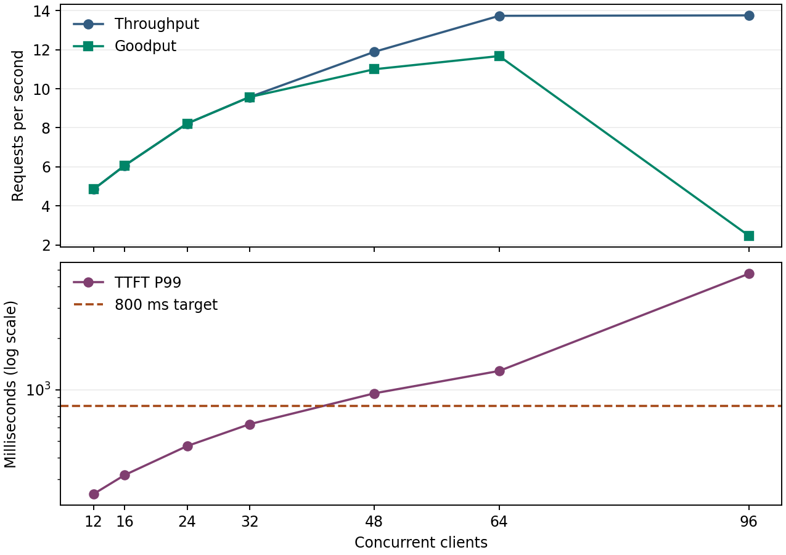

# 第 7 章 服务、排队与 SLA

你在聊天窗口输入一句话并发送后，应用会把这条消息作为一条请求发给服务，之后服务会把生成的回答陆续发回来。如果点了发送却迟迟看不到回答，可以从发送时刻计到回答开头出现。如果开头来得很快，后面的文字却时断时续，就要量相邻两段文字隔了多久。前一个读数反映你为等到回答开头花了多少时间，后一个读数能找出回答已经开始后发生的停顿。

当许多人同时发消息时，每个人关心自己的回答什么时候到，服务还要决定每条请求何时开始处理。增加并发可以让服务每秒答完更多条请求，也可能让一部分请求等得更久。本章要解决的是，在给定的请求负载和等待时间要求下，怎样判断一个推理服务能支撑多大的并发。

7.1 从一次回答的时间线建立计时指标，再说明怎样用多条请求的结果衡量整轮服务。7.2 用这些指标逐档检查闭环压测，找出满足服务目标的最大已测并发。闭环客户端要等上一问结束才发下一问，线上请求却可能在服务忙碌时继续到来。7.3 解释这种到达方式怎样形成排队，以及推理引擎的批处理和缓存怎样改变等待。7.4 将到达、调度和计算写进模拟器，用一组实测数据估计各步耗时，再用独立测点检验预测。章末实验回到闭环压测，用两档并发的结果判断服务是否达标，以及每秒能交付多少条合格回答。

## 7.1 服务指标

### 单次请求的延迟

模型以 **token** 为单位逐步生成回答。一个 token 可以是一个字，也可以是词的一部分。压测时，客户端用收到第一个输出 token 的时刻代表回答开头到达。它从发出请求时开始计时，到收到首个 token 时停表，得到**首 token 延迟**（Time to First Token，TTFT）。


图中发出请求和收到首个 token 分别发生在第 0 和第 300 毫秒，TTFT 因此是 300 毫秒。这段时间涵盖了请求传送、获得计算机会、处理输入和送出首个 token 等环节。如果要量出其中有多少时间花在首次排队上，就要在服务端用同一个时钟记录这条请求何时入队、何时第一次获得计算机会。即使两条请求的 TTFT 都是 300 毫秒，它们的首次排队时间也可能不同。

回答开始后，客户端每收到一个新 token，就可以用它的到达时刻减去上一个 token 的到达时刻。这个时间差叫**输出 token 间隔**（Inter-Token Latency，ITL）。图中前两个 token 相隔 $320-300=20$ 毫秒，后两个相隔 $400-320=80$ 毫秒，因此较长的停顿出现在第二个 token 之后。

若想用一个数表示生成阶段的整体节奏，可以把一条请求的所有 ITL 取平均。这个平均值叫**每个输出 token 的平均耗时**（Time per Output Token，TPOT）。设客户端收到的第一个和最后一个 token 的时刻分别为 $t_1$ 和 $t_n$。一条返回 $n\geq 2$ 个 token 的请求有 $n-1$ 个输出间隔，这些间隔的总和恰好是 $t_n-t_1$。因此，图中的 TPOT 为

$$
\mathrm{TPOT}=\frac{t_n-t_1}{n-1}=\frac{400-300}{3-1}\,\mathrm{ms}=50\,\mathrm{ms}.
$$

如果用户要等完整回答才能继续操作，计时应从发出请求一直持续到响应结束，得到**端到端延迟**（End-to-End Latency，E2E）。图中的响应恰好随最后一个 token 在第 400 毫秒结束，所以 E2E 为 400 毫秒。回答越长，生成阶段的间隔就越多。即使每个间隔都很短，用户也可能要等很久才能拿到完整回答。

### 尾延迟

一轮压测包含许多条请求。假设其中 98 条在 100 毫秒时收到首个 token，另外两条等了 2 秒。这一轮的平均 TTFT 是 138 毫秒。要了解等得较久的用户经历了什么，可以把各条请求的 TTFT 从小到大排列，再读接近末尾的位置。

一种便于手算的算法是**最近秩法**。一共有 $n$ 个值时，取排序后第 $\lceil 0.99n\rceil$ 个值，得到**第 99 百分位数**（99th Percentile，P99）。在上面的 100 条请求里，第 99 个值是 2 秒。如果其中一条等待 2 秒的请求缩短到了 100 毫秒，第 99 个值便会降到 100 毫秒。P99 描述的是延迟分布的尾部，常用作**尾延迟**指标。样本较少时，末尾个别请求就能影响这个数，报告 P99 时应一并说明样本量。

本章的真机压测和模拟结果采用线性插值来算分位数。将排序后的 $n$ 个样本从 0 编号，P99 的下标为 $0.99(n-1)$。以上述缩短一条请求后的数据为例，前 99 个值都是 100 毫秒，最后一个是 2 秒。下标为 98.01，所以从下标 98 的值向下标 99 的值取 1% 的差距，得到 $100+0.01(2000-100)=119$ 毫秒。比较不同测点时，应使用同一套分位数算法。

### 有效吞吐

**请求吞吐量**是服务在测量窗口内每秒成功完成的请求数。如果服务还要求用户在 800 毫秒内看到回答开头，就要在成功请求中数出哪些按时返回了首个 token。回到最初的 100 条请求，其中 98 条在 100 毫秒时收到首个 token，两条等了 2 秒。若 100 条请求都在 10 秒的测量窗口内成功完成，总吞吐量是 $100/10=10$ 请求/秒。逐条检查 800 毫秒的门槛后，有 98 条符合要求，每秒就交付了 $98/10=9.8$ 条合格回答。

把成功完成且满足全部逐请求耗时门槛的请求数除以同一段测量时长，得到**有效吞吐**（goodput）。如果还设了 TPOT 和 E2E 门槛，要对同一条请求检查三项耗时，全部通过才将这条请求计入有效吞吐。

### 服务目标

有效吞吐回答的是服务每秒交付多少条合格回答。部署时还要决定整轮表现是否可以接受。例如，有些较慢的请求也应在规定时间内开始回答，失败的请求则应控制在允许的比例内。像这样为指定的指标、统计范围和测量窗口设定标准，称为**服务目标**（Service Level Objective，SLO）。

本章以成功请求为样本，分别计算 TTFT、TPOT 和 E2E 的 P99，并用 `failed / (completed + failed)` 计算整轮失败率。如果一条很慢的请求最终失败，它会进入失败率统计。将失败率纳入服务目标，才能在判断整轮表现时考虑这类请求。

::: info 本章压测的服务目标

一轮压测的四项指标都在上限以内才算达标。

| 指标 | 上限 |
| --- | ---: |
| 首 token 延迟（TTFT P99） | 800 毫秒 |
| 每个输出 token 的平均耗时（TPOT P99） | 100 毫秒 |
| 端到端延迟（E2E P99） | 15 秒 |
| 请求失败率 | 1% |

:::

假设一条成功请求在第 900 毫秒才收到首个 token。它增加了总吞吐的分子，但超过了逐请求的 800 毫秒门槛，因此有效吞吐的分子不增加。要判断它所在的整轮压测是否达标，还得把该轮的三个延迟 P99 和失败率分别与表中的上限比较。服务方如果把这些承诺写进**服务等级协议**（Service Level Agreement，SLA），还可以约定目标适用的负载和时段，以及未达标时如何处理。

## 7.2 闭环压测与并发容量

### 闭环压测中的请求循环

两个人用同一个聊天服务核对习题，每个人都等上一题答完再发下一题。为模拟这种用法，可以让两个客户端分别反复发问。甲在第 0 秒发出第一问，如果第 2 秒收到完整回答，就在第 2 秒发第二问。如果第一问直到第 5 秒才结束，第二问也推迟到第 5 秒。乙什么时候发下一问，则由乙的上一问何时结束决定。让同一个客户端等当前请求结束后再发送下一个请求，称为**闭环压测**（closed-loop load testing）。

每个客户端最多有一条已经发出、尚未结束的**在途请求**，它可能正在排队，也可能已经开始处理。若有 $C$ 个这样的客户端，最多就有 $C$ 条在途请求。仍以两个客户端为例，如果每问都恰好耗时 2 秒，两人合计平均每秒完成 1 问。若每问用时变为 4 秒，平均每秒就只完成 0.5 问。两种情况下并发上限相同，补发请求的速度和完成速度都随每问的耗时变化。

本章用 `--max-concurrency` 限制在途请求数，并设 `--request-rate inf`，使工具有待发请求时能在已有请求结束后补上空位。最后几条请求全部发出后，只剩已经在途的请求，压测会等它们陆续结束。

### 延迟约束下的并发容量

如果当前并发较低，更多请求可以利用原本空闲的资源，服务每秒就可能答完更多条。当大量请求需要争用同一批资源时，提高并发也可能让单条请求等待更久。因此，要知道服务能支撑多大的并发，应在每档压测结束后同时核对尾延迟和失败率。对给定的工作负载、服务配置和服务目标，满足全部目标的最大闭环并发称为**并发容量**。如果压测只覆盖若干档位，数据能直接确认的是其中最大的达标测点。

下表各档都在 RX 9070 XT 上运行 Qwen3-4B，使用相同的服务配置。每档正式发送 200 条请求，每条输入 256 个 token，生成 128 个 token。要判断某一档是否达标，沿同一行对照四项[服务目标](#服务目标)。

| 并发上限 $C$ | TTFT P99（毫秒） | TPOT P99（毫秒） | E2E P99（毫秒） | 失败率 |
| ---: | ---: | ---: | ---: | ---: |
| 24 | 467.80 | 21.18 | 2,788.89 | 0% |
| 32 | 627.86 | 23.88 | 3,282.76 | 0% |
| 48 | 951.50 | 28.08 | 4,120.58 | 0% |
| 64 | 1,286.09 | 31.65 | 4,913.82 | 0% |
| 96 | 4,762.77 | 31.70 | 8,525.19 | 0% |

并发 48 的 TPOT P99、E2E P99 和失败率都通过了各自的门槛，但 TTFT P99 达到 951.50 毫秒，超过 800 毫秒，因此这一档未通过。并发 64 和 96 也因同一项超标而未通过。并发 24 和 32 的四项指标均达标，所以 32 是表中的最大达标并发。若准备将上限设为 40，应补测这一档再作判断。

### 吞吐峰值与达标容量

**吞吐峰值**是给定工作负载和服务配置下，吞吐曲线达到的最高值，单位是请求数每秒。读图时要先确认在看哪条曲线。总吞吐的峰值对应每秒完成请求最多的档位，有效吞吐的峰值对应每秒交付合格回答最多的档位。压测只覆盖若干并发时，能直接确认的是这些档位中的最高值。

**达标容量**是满足全部服务目标时，系统能承受的最大负载。本节用闭环并发数表示达标容量。要从压测中估计它，先逐项核对 TTFT P99、TPOT P99、E2E P99 和失败率，再从通过的档位中选出最大的并发数。

提高并发后，即使成功请求中合格的比例下降，每秒仍可能交付更多合格回答。设成功请求中通过全部耗时门槛的比例为 $p$。在同一个时间窗口内，每秒成功完成的请求数乘以 $p$，就是每秒成功完成且符合门槛的请求数。当总吞吐的增长足以抵消 $p$ 的下降时，有效吞吐就会增加。



先沿上图的有效吞吐曲线找最高点，可以读到并发 64 时约为每秒 11.7 条。沿同一个并发轴往下看，这一档的 TTFT P99 已超过 800 毫秒虚线。要找达标容量，再回[容量表](#延迟约束下的并发容量)核对四项服务目标，得到最大已测达标并发为 32。

再比较并发 64 和 96，两档的总吞吐都接近每秒 14 条，但成功请求中满足全部耗时门槛的比例从约 85% 降到了 18%，有效吞吐也随之降到每秒约 2.5 条。下图的延迟轴采用对数刻度，读 TTFT P99 时按轴上的刻度和虚线位置判断。

生产环境通常会在达标档位以下运行，给流量波动留出余量。闭环压测里，服务一变慢，请求结束得慢，客户端也会随之减少补发。线上服务变慢时，其他用户仍可能同时发来消息。要观察这批消息会在队列里等多久，可以让压测工具按独立于服务进度的时间发送请求。

## 7.3 排队延迟

### 请求到达与队列长度

晚高峰时，许多用户可能同时打开应用。即使服务还在处理已有请求，新用户也可以发送消息。为模拟这样的流量，压测工具预先安排每条请求的发送时刻，到了时刻就发送。上一条请求何时结束不影响后续请求的发送节奏。这样测到的是服务面对外部到达压力时，请求怎样积压、用户又要多等多久。这种方法叫**开环压测**（open-loop load testing）。平均到达率记作 $\lambda$，单位为请求数每秒。

同样的平均到达率可以对应不同的等待。假设服务台一次只能处理一条请求，每条恰好用四分之一秒。如果每秒开始时同时来四条，服务台空闲时能立刻处理第一条，第四条则要等前三条处理完，排队四分之三秒。如果改成每隔四分之一秒来一条，上一条会在下一条到达时恰好完成。两种情况的平均到达率都是每秒四条，集中在同一时刻的那一批形成了**突发**，让其中三条发生了排队。

只要一段时间内进入系统的请求多于离开的，未完成请求就会积压。到达放缓后，只有当离开的速度高于新请求的到达速度，积压才会减少。在一次发送 120 条固定长度请求的真机压测中，把设定到达率从每秒 16 条提高到 20 条，整轮完成速率从约每秒 11.9 条升至 12.7 条，TTFT P99 则从约 175 毫秒升至 1,001 毫秒。设定到达率控制发送节奏，完成速率用的是整轮计时，最后一批请求发出后到它们全部结束的时间也包含在内。

如果监控给出了系统内的平均请求数和长期请求到达率，就可以用**Little 定律**估计一条请求平均在系统内逗留多久。设系统稳定运行，长期平均到达率为 $\lambda$，平均逗留时间为 $W$，系统内平均请求数为 $L$。每秒平均进入 5 条请求，每条平均逗留 2 秒，相当于平均有 10 条请求同时留在系统内。一般关系为

$$
L=\lambda W.
$$

三个量要用相同的系统边界。如果 $W$ 从入队计到离开，$L$ 就要包括排队中和计算中的请求。在系统稳定且请求都在处理完成后离开的条件下，可以用长期平均完成速率替代到达率。例如，每秒完成 5 条、系统里平均有 20 条时，平均逗留时间约为 $20/5=4$ 秒。如果系统也接纳最终被取消的请求，核算离开速率时要包括取消，逗留时间计到请求实际离开。Little 定律给出平均逗留时间。要估计逗留最久的一批请求会等多久，还要知道请求如何到达、服务台如何处理。

### 服务余量与尾延迟

设服务台持续工作时平均每秒能处理 8 条请求。到达率从每秒 6 条升到 7 条时，尾延迟会增加多少？要把这个问题化成可计算的例子，可以假定请求按泊松过程到达，因而到达间隔独立且服从指数分布。系统只有一个服务台，按到达顺序处理，等待队列的长度没有上限。各请求的服务时间独立、服从同一个指数分布，也独立于到达过程。满足这些假设的队列称为 **M/M/1 队列**。

用 $\mu$ 表示服务台持续忙碌时的平均服务率。当 $\lambda<\mu$ 时，队列可以达到稳态，$\rho=\lambda/\mu$ 就是稳态下服务台忙碌时间的比例，即**利用率**。在这个模型中，请求从入队到处理完成的总逗留时间 $T$ 服从速率为 $\mu-\lambda$ 的指数分布。于是，只需找出超过概率等于 1% 的那个时刻，就能求得总逗留时间的 P99。

$$
\Pr(T>P_{99})=e^{-(\mu-\lambda)P_{99}}=0.01
\qquad\Longrightarrow\qquad
P_{99}=\frac{\ln(100)}{\mu-\lambda}.
$$

代入 $\mu=8$，到达率为 6 时，分母 $\mu-\lambda$ 为 2，P99 约为 2.30 秒。到达率升到 7 时，单位时间只多来一条请求，却用掉了原来一半的**处理余量**，P99 随之加倍到约 4.61 秒。这个模型说明了尾延迟为什么可能在接近饱和时迅速增加。要把这条思路用到 GPU 推理服务，还要确定引擎能怎样安排新旧请求一起计算。

### 批处理与缓存约束

单服务台要等甲的请求全部处理完，才能开始处理乙。图形处理器（GPU）上的推理引擎可以让多个请求参加同一轮计算。理解这些请求何时可以合在一起，先要知道引擎会做哪两类工作。请求被接纳后，引擎要处理已知的输入，这个阶段叫 **Prefill**，并据此生成首个 token。随后，引擎利用已有的序列历史逐步生成后续 token，这个阶段叫 **Decode**。

假设甲、乙都已开始生成，甲还差一个 token 就答完，乙还有五十个。当前这步计算结束后，甲交付完回答并释放位置。若丙正在等待且符合接纳条件，下一轮就可以处理丙的输入，同时推进乙的生成。即使乙的回答很长，丙也有机会从甲释放的位置加入。引擎在生成过程中逐轮调整参与请求的做法叫**连续批处理**（continuous batching）。

某一步实际参加计算的序列数称为**批大小**，记作 $B$。客户端的并发上限 $C$ 约束最多有多少条请求在途，$B$ 记录的是引擎在这一轮安排的序列数。本章实验将引擎可同时运行的序列上限设为 64。把客户端的并发上限提高到 96 后，引擎依然最多让 64 条序列处于运行状态，其余在途请求可能还在等待接纳。

运行名额还有空缺时，引擎也要检查显存里有没有给新序列保存历史的空间。生成下一个 token 时，模型需要使用注意力计算中的键和值。为了复用已有历史的键和值，引擎把它们保存在**键值缓存**（Key-Value Cache，KV Cache）中。如果两批请求的运行序列数相同，已经生成了几百个 token 的那批通常要保留更多历史，占用更多缓存块，留给新请求的空间也会减少。

### 键值缓存的容量估算

要估计固定大小的缓存池能容纳多少条序列，可以先计算每个 token 需要保存多少字节，再按实际的分块规则算一条序列要占几块。对各层都保存完整历史的模型，设层数为 $\ell$，每层有 $H_{\mathrm{KV}}$ 个键值头，每个头含 $d$ 个元素，每个元素占 $s$ 字节。每个 token 在每一层都有一份键和一份值，所以该 token 的缓存字节数为

$$
m_{\mathrm{token}}=2\ell H_{\mathrm{KV}}ds.
$$

Qwen3-4B 有 36 层、8 个键值头，头维度为 128。按本实验每个缓存元素 2 字节计算，每个 token 占 $2\times36\times8\times128\times2=147{,}456$ 字节，即 144 KiB。实验配置给键值缓存分配了约 3.36 GiB，可容纳 24,464 个 token。引擎每次按 16 个 token 的块来分配，因此池中共有 $K=24{,}464/16=1{,}529$ 块。

假设各条序列的历史互不共享，且长度都为 $L_{\mathrm{hist}}$ 个 token。一条历史即使只用到最后一块的一部分，也要占下整块，因此每条需要 $\lceil L_{\mathrm{hist}}/16\rceil$ 块。用缓存池的总块数除以一条历史所需的块数，再向下取整，就得到此时最多能同时保留的历史条数。

$$
N_{\mathrm{KV}}
=\left\lfloor\frac{K}{\lceil L_{\mathrm{hist}}/16\rceil}\right\rfloor .
$$

如果每条请求有 256 个输入 token，且已生成 128 个输出 token，每条 384 个 token 的历史恰好占 24 块，池中至多容纳 63 条。将问题改为每条已生成 512 个输出 token，历史就会长到 768 个 token，每条占 48 块，最多只能容纳 31 条。实际运行中的序列长度会随生成进度而变化。要估计当前还能接纳多少请求，应查看当前剩余块数、新请求所需块数和可用运行名额。

已经开始生成的请求也可能耗尽缓存。当它生成下一个 token 需要新块，而池中没有足够的空闲块时，引擎可以暂停一条运行中的请求并收回它占用的块，这叫**抢占**。采用**重算**策略时，引擎保留请求已有的 token，请求重新得到计算机会后，再根据这些 token 重建缓存。被抢占的用户会等到请求恢复，还要等恢复时的重建计算完成后才能收到新的内容。

可以保持并发上限和输入长度相同，改变输出长度，观察缓存的使用压力。并发 64 时，生成 128 个 token 的一轮完成了 200 条请求，采样到的缓存占用峰值为 98.95%，抢占计数增加了 3 次。生成 512 个 token 的一轮完成了 160 条，采样峰值达到 100%，抢占计数增加了 165 次。计数单位是抢占事件，同一条请求可能贡献多次。若要确认某条请求因此多等了多久，还需要找到它自己的暂停、恢复和重算记录。

## 7.4 离散事件模拟

### 请求模拟与耗时校准

压测表只给出了若干离散的并发档位。若想了解请求改成集中到达时会出现什么情况，可以用模型推演这些请求何时到达、何时获得计算机会，以及何时生成完毕。新请求到达后进入等待队列，获得运行名额和缓存后进入计算批，生成结束便释放名额和缓存。按这些事件的先后顺序更新系统状态的方法叫**离散事件模拟**（Discrete-Event Simulation，DES）。

例如，某条请求在第 10 毫秒到达，第 30 毫秒第一次得到计算机会，首次排队用了 20 毫秒。如果引擎当前没有工作，模拟时钟可以直接跳到下一条请求到达的时刻。如果引擎有请求要计算，就按完成本轮计算所需的时间推进时钟，轮末再更新请求的生成进度。记录这些时刻，便能沿着某条请求的时间线查找它在哪一步花了多久。

推进时钟时，需要把本轮参与计算的批大小换算成耗时。负责这个换算的函数叫**服务时间模型**。本章先用闭环并发 1、2、4、8 的实测结果确定函数的参数，这一步叫**校准**。拟合脚本用每档 TTFT 的中位数（P50）估计 Prefill 耗时，用 TPOT 的中位数估计 Decode 一步的耗时。

这两个读数来自客户端，拟合时使用的是压测的并发上限 $C$。模拟运行时，耗时函数使用的则是某一步实际参加计算的序列数 $B$。要让拟合出的函数反映批大小对计算耗时的影响，低并发时的实际批大小应大致随 $C$ 变化，客户端计时随并发的变化也应主要来自计算。如果用已经出现明显积压的档位拟合，随并发增长的排队时间也可能被吸收进耗时参数。若要直接量出引擎某轮 Prefill 或 Decode 的计算耗时，需在引擎内记录相应阶段的起止时刻。

### 一次模拟迭代

假设甲是排在队首的新请求，乙、丙已经开始生成。模拟器在安排本轮计算时先检查是否能接纳甲。除了要留出一个运行名额，还要为甲的 256 个输入 token 和即将产生的首个输出 token 分配缓存。输入恰好占 16 块，再为首个输出 token 增加一块，所以本轮接纳甲一共需要 17 块。

若本轮顺利接纳甲，参加 Prefill 的有甲一条，参加 Decode 的有乙、丙两条。把 Prefill 和 Decode 各自的批大小记作 $B_p$ 和 $B_d$，在这里分别是 1 和 2。教学模拟器将两段估计耗时相加，用得到的 $\Delta t$ 推进一轮。

$$
\Delta t=t_{\mathrm{prefill}}(B_p)+t_{\mathrm{decode}}(B_d).
$$

对本章固定 256 个输入 token 的负载，校准所得函数如下。两个函数的返回值均以毫秒为单位。如果某阶段本轮没有请求，该项耗时记为 0。

$$
t_{\mathrm{prefill}}(B)=17.9093+19.4696B,\qquad
t_{\mathrm{decode}}(B)=13.8927B^{0.062544}\qquad(B\geq 1).
$$

代入 $B_p=1$ 得到约 37.38 毫秒，代入 $B_d=2$ 得到约 14.51 毫秒，模拟时钟一共前进约 51.89 毫秒。本例假设乙、丙生成下一个 token 所需的缓存也足够。轮末，甲得到首个 token，乙、丙分别多生成一个。如果有请求此时完成，就释放其缓存和运行名额，供下一轮接纳请求使用。

若本轮给 Decode 请求新增缓存时空间不足，模拟器从运行列表中最近加入的请求开始抢占，使其释放缓存并回到队首。它重新得到运行名额和缓存后，模拟器在 Prefill 阶段为已有历史重建缓存，之后再继续 Decode。代码在检查 Decode 的额外缓存之前就确定了本轮的耗时，因此即使抢占改变了参与请求，时钟仍按先前算出的耗时前进。请求每次重新接纳时，代码还会覆盖接纳时刻字段。要计算一次次抢占后分别等了多久，需要为每次入队和接纳单独保留时刻。

在这套模拟里，新请求在首次接纳的那一轮结束时得到首个 token，因此 TTFT 包括首次接纳前的等待和接纳当轮的耗时。引擎实际运行时，长输入可能分到多轮处理，客户端的计时还可能包含传输等开销。换用不同的调度方式后，即使批大小相同，一轮的耗时也会变化。用上面的函数预测之前，要核对输入长度、调度规则和测量范围。

### 留出验证与预测误差

经过校准的模型能够解释多少其他档位的表现，可以用独立测点检查。事先留下一组数据，等模型结构和参数确定之后，才把这些测点的预测值与实测值比较，这个过程叫**留出验证**。如果已经根据某个测点的误差调整过模型，该点就参与了设计。此后若想独立检验调整后的模型，需要另外留出测点。

验证时应选后续判断实际会用到的指标。在留出的并发 48 上，模拟的 TTFT P99 为 952.45 毫秒，真机测得 951.50 毫秒，两者都超出 800 毫秒门槛，因此对这项服务目标会给出相同的判定。如果判断还依赖较慢请求的生成速度，就要对照 TPOT P99。该指标的预测为 17.70 毫秒，实测为 28.08 毫秒，低估了约 37%。

比较这些数字时，要确认每一边统计的请求范围。闭环模拟按完成顺序丢掉前 20%，用剩下的 160 条请求计算分位数。真机压测先单独发送预热请求，再用正式测量中成功的 200 条请求计算分位数。确认样本范围后，若还要把偏差定位到某个计算阶段，就需要引擎里对应阶段的计时。

即使两边的 TTFT P99 接近，用于估计有效吞吐时，也应检查三项耗时门槛以下有多少条请求。仍以并发 48 为例，在各自的样本窗口内，模拟中通过全部门槛的占 5%，真机上约占 92.5%。TTFT P99 只反映排序后的一个位置，门槛以下的样本数可以相差很多。验证有效吞吐时，既要对照通过全部门槛的请求数，也要核对用于取平均的测量时长。

### 从固定长度到真实流量

固定输入、输出长度有助于观察并发改变时的影响。线上请求的长短会随时间变化。例如，晚高峰可能恰好有更多长输入同时到达，引擎就需要在同一时段处理更多输入 token。如果把请求长度随机分给不同到达时刻，这段集中出现的处理压力就可能消失。

回放时，把每条请求的到达时刻、输入长度和输出长度放在同一条记录里，以保留它们之间的关系。模拟器可以根据本轮要处理的输入长度估计 Prefill 耗时，再依据各序列的生成进度更新缓存占用。校准完这样的模型后，可以在另一段此前未用于校准或调整的流量上，对照预测和实测，检查它能否支持那段流量下的容量判断。

## 实验：闭环并发压测

比较并发 24 和 48 对同一种负载的影响。每档先核对四项服务目标，再比较每秒交付的合格回答数。如果手边没有真机环境，可以用下面提供的存档按同样的规则判断。

### 环境与服务启动

在 Linux 宿主机启动 `ch7-vllm` 容器。原实验用 `HIP_VISIBLE_DEVICES=1` 选中 RX 9070 XT，并将它映射为容器内的设备 0。复现时，按宿主机调整 GPU 编号、`render` 组 GID（原实验为 `991`）和模型目录。

```bash
docker run -d --name ch7-vllm \
  --device=/dev/kfd --device=/dev/dri \
  --group-add video --group-add 991 \
  -e HIP_VISIBLE_DEVICES=1 \
  -e VLLM_ROCM_USE_AITER=0 \
  -v /mnt/public/models:/models:ro \
  -v /tmp/ch7-vllm:/results \
  -p 18000:8000 \
  rocm/vllm:rocm10.1.0_ubuntu24.04_py3.14-pytorch_2.13.0_vllm-0.29.0 \
  vllm serve /models/Qwen3-4B \
    --served-model-name qwen3-4b \
    --host 0.0.0.0 --port 8000 \
    --gpu-memory-utilization 0.90 \
    --max-model-len 4096 \
    --max-num-seqs 64
```

### 运行压测

压测脚本通过宿主机的 `18000` 端口采集监控指标，并从挂载目录 `/tmp/ch7-vllm` 读取压测结果。进入仓库的 `code/part1-modeling/chapter7` 目录后运行下面的命令。两档均正式发送 200 条请求，每条输入 256 个 token，生成 128 个 token。

```bash
python3 run_bench.py --mode closed --points 24,48 --num-prompts 200 \
  --input-len 256 --output-len 128 --out-dir practice --prefix practice
```

1. 打开 `results/practice/summary.json`，找到 `point` 为 24 和 48 的记录。对照[服务目标](#服务目标)逐项检查 `ttft_p99_ms`、`tpot_p99_ms`、`e2el_p99_ms` 和 `failure_rate`。前三项以毫秒为单位，因此 15 秒对应 15,000 毫秒。失败率用小数表示，`0.01` 对应 1%。
2. 比较两档的 `request_goodput`，看提高并发后每秒交付的合格回答数怎样变化。再将每档的 `request_goodput` 除以该档的 `request_throughput`，得到成功请求中符合全部耗时门槛的比例。结合第一步的整轮达标判断，说明提高并发后，哪项指标先超标，以及有效吞吐是否仍有增长。

若使用存档，从同一目录下的 `results/holdout_v2/summary.json` 读取 `point` 为 24 和 48 的记录。并发 24 的四项指标均达标，总吞吐和有效吞吐都是每秒 8.219 条。并发 48 的 TTFT P99 超标，这档的有效吞吐增至每秒 10.998 条，约占总吞吐的 92.5%。[容量表](#延迟约束下的并发容量)里的并发 32 和 64 来自 `results/holdout/summary.json`。

## 练习：指标与容量判断

1. 客户端在第 0 毫秒发出请求，分别在第 200、230、320 毫秒收到三个 token。收到最后一个 token 时响应结束。求 TTFT、两个 ITL、TPOT 和 E2E。哪个读数直接量出了最后一次停顿？
2. 将 TTFT P99 上限从 800 毫秒收紧到 600 毫秒，保留其余三项服务目标。按[容量表](#延迟约束下的并发容量)从小到大检查已测并发。第一个超标的是哪一档？最大的达标测点是哪一档？
3. 并发 48 的短输出压测中，TTFT P99 为 951.50 毫秒，`/metrics` 采样窗口内的抢占计数没有增加。这两项数据是否足以说明一条慢请求的首 token 延迟都花在首次排队上？如果要量出这条请求的首次排队时间，应记录哪两个时刻？
4. 某缓存池可容纳 24,464 个 token，每块容纳 16 个 token。一批序列各有 1,024 个输入 token 和 256 个已生成的输出 token，各条历史互不共享。缓存池最多能同时保留多少条这样的历史？若引擎最多可同时运行 64 条序列，逐条增加序列时会先遇到哪个限制？
5. 回到[一次模拟迭代](#一次模拟迭代)。甲排在队首，本轮开始时可用缓存不足以接纳甲，乙、丙仍能各生成一个 token。求这一轮的 $B_p$、$B_d$ 和耗时。对甲来说，这一轮应计入哪一段等待？

::: details 参考答案

1. TTFT 为 200 毫秒。两个 ITL 分别为 $230-200=30$ 毫秒和 $320-230=90$ 毫秒。TPOT 为 $(320-200)/2=60$ 毫秒，E2E 为 320 毫秒。第二个 ITL 直接量出了最后一次停顿。
2. 并发 32 的 TTFT P99 是 627.86 毫秒，第一个越过 600 毫秒。并发 24 的 TTFT P99 是 467.80 毫秒，其余三项也达标，因此是表中最大达标并发。
3. P99 是整轮的延迟统计值，抢占计数记录的是采样窗口内的事件，两者都没有给出这条请求的首次排队时长。给这条请求记录同一服务端时钟上的入队时刻和首次获得计算机会的时刻，两者相减便是首次排队时间。再将其与同一条请求的客户端 TTFT 比较。
4. 每条历史长 $1{,}024+256=1{,}280$ 个 token，占 80 块。池中有 1,529 块，所以最多保留 $\lfloor 1{,}529/80\rfloor=19$ 条这样的历史。要为第 20 条保留同样长度的历史时，缓存就已经不够了，此时运行序列还没有达到 64 条。
5. 甲留在队列中，因此 $B_p=0$。乙、丙参加 Decode，因此 $B_d=2$。本轮耗时约为 14.51 毫秒，计入甲首次接纳前的排队时间。

:::
