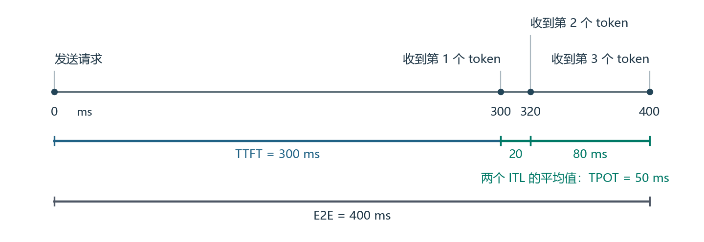

# 第 7 章 服务性能与服务质量

你在聊天窗口输入一句话并发送后，应用会把这条消息作为一条请求发给服务，之后服务会把生成的回答陆续发回来。如果点了发送却迟迟看不到回答，可以从发送时刻计到回答开头出现。如果开头来得很快，后面的文字却时断时续，就要量相邻两段文字隔了多久。前一个读数反映你为等到回答开头花了多少时间，后一个读数能找出回答已经开始后发生的停顿。

当许多人同时发消息时，增加并发可能让服务每秒答完更多条请求，也可能让一部分人等得更久。给定请求的发送方式和用户能接受的延迟，一个推理服务能承受多大的负载？负载接近这个范围时，请求又会在哪里等？

7.1 从一次回答的时间线建立延迟指标，再用吞吐和服务目标判断达标容量，估算当前负载还剩多少余量。7.2 用闭环和开环两种方式给服务施加负载，比较请求怎样积压。7.3 把到达规律和处理过程写成排队模型，计算平均队长、等待时间和尾延迟。7.4 进入推理引擎，解释批处理怎样安排请求，以及键值缓存怎样限制请求接纳。7.5 把这些机制写进离散事件模拟器，通过校准和独立测点判断模型能支持哪些预测。章末用压测练习把容量判断和队列观察连起来。

## 7.1 服务指标

### 单次请求的延迟

模型以 **token** 为单位逐步生成回答。一个 token 可以是一个字，也可以是词的一部分。压测时，客户端用收到第一个输出 token 的时刻代表回答开头到达。它从发出请求时开始计时，到收到首个 token 时停表，得到**首 token 延迟**（Time to First Token，TTFT）。



图中发出请求和收到首个 token 分别发生在第 0 和第 300 毫秒，TTFT 因此是 300 毫秒。这段时间涵盖了请求传送、获得计算机会、处理输入和送出首个 token 等环节。如果要量出其中有多少时间花在首次排队上，就要在服务端用同一个时钟记录这条请求何时入队、何时第一次获得计算机会。即使两条请求的 TTFT 都是 300 毫秒，它们的首次排队时间也可能不同。

回答开始后，客户端每收到一个新 token，就可以用它的到达时刻减去上一个 token 的到达时刻。这个时间差叫**输出 token 间隔**（Inter-Token Latency，ITL）。图中前两个 token 相隔 $320-300=20$ 毫秒，后两个相隔 $400-320=80$ 毫秒，因此较长的停顿出现在第二个 token 之后。

若想用一个数表示生成阶段的整体节奏，可以把一条请求的所有 ITL 取平均。这个平均值叫**每个输出 token 的平均耗时**（Time per Output Token，TPOT）。设客户端收到的第一个和最后一个 token 的时刻分别为 $t_1$ 和 $t_n$。一条返回 $n\geq 2$ 个 token 的请求有 $n-1$ 个输出间隔，这些间隔的总和恰好是 $t_n-t_1$。因此，图中的 TPOT 为

$$
\mathrm{TPOT}=\frac{t_n-t_1}{n-1}=\frac{400-300}{3-1}\,\mathrm{ms}=50\,\mathrm{ms}.
$$

只输出一个 token 的请求有 TTFT，但没有可用来计算 TPOT 的输出间隔。如果客户端只能记录流式响应块的到达时刻，只有在每块对应一个 token 时，才能直接用相邻块的时间差计算逐 token 的 ITL。

如果用户要等完整回答才能继续操作，计时应从发出请求一直持续到响应结束，得到**端到端延迟**（End-to-End Latency，E2E）。图中的响应恰好随最后一个 token 在第 400 毫秒结束，所以 E2E 为 400 毫秒。回答越长，生成阶段的间隔就越多。即使每个间隔都很短，用户也可能要等很久才能拿到完整回答。

### 尾延迟

一轮压测包含许多条请求。假设其中 98 条在 100 毫秒时收到首个 token，另外两条等了 2 秒。这一轮的平均 TTFT 是 138 毫秒。要了解等得较久的用户经历了什么，可以把各条请求的 TTFT 从小到大排列，再读接近末尾的位置。

一种便于手算的算法是**最近秩法**。一共有 $n$ 个值时，取排序后第 $\lceil 0.99n\rceil$ 个值，得到**第 99 百分位数**（99th Percentile，P99）。在上面的 100 条请求里，第 99 个值是 2 秒。如果其中一条等待 2 秒的请求缩短到了 100 毫秒，第 99 个值便会降到 100 毫秒。P95 和 P99 这样的高分位数描述延迟分布的尾部，常用作**尾延迟**（tail latency）指标。样本较少时，末尾个别请求就能影响这个数，报告 P99 时应一并说明样本量。

本章的真机压测和模拟结果采用线性插值来算分位数。将排序后的 $n$ 个样本从 0 编号，P99 的下标为 $0.99(n-1)$。以上述缩短一条请求后的数据为例，前 99 个值都是 100 毫秒，最后一个是 2 秒。下标为 98.01，所以从下标 98 的值向下标 99 的值取 1% 的差距，得到 $100+0.01(2000-100)=119$ 毫秒。比较不同测点时，应使用同一套分位数算法。

### 吞吐量与有效吞吐

**吞吐量**（throughput）衡量服务在单位时间交付多少工作。可以按成功完成的请求数计量，也可以按生成的 token 数计量。回答越长，每条请求交付的 token 就越多，两种口径下的吞吐量可能朝不同方向变化。本章比较容量时使用请求口径。

回到最初的 100 条请求。如果它们都在 10 秒内成功完成，请求吞吐量就是 $100/10=10$ 请求/秒。若要求用户在 800 毫秒内看到回答开头，只有其中 98 条符合要求，服务每秒交付 $98/10=9.8$ 条合格回答。把成功完成且满足全部逐请求耗时门槛的请求数除以同一段测量时长，得到**有效吞吐**（goodput）。如果还设了 TPOT 和 E2E 门槛，就对同一条请求检查三项耗时，通过全部门槛才计入分子。

设成功请求中通过全部门槛的比例为 $p$，则有效吞吐等于请求吞吐量乘以 $p$。负载增大时，即使合格比例下降，只要请求吞吐量的增长能抵消这部分损失，有效吞吐仍会升高。

### 服务目标

有效吞吐回答的是服务每秒交付多少条合格回答。部署时还要决定整轮表现是否可以接受。例如，有些较慢的请求也应在规定时间内开始回答，失败的请求则应控制在允许的比例内。像这样为指定的指标、统计范围和测量窗口设定标准，称为**服务目标**（Service Level Objective，SLO）。

本章以成功请求为样本，分别计算 TTFT、TPOT 和 E2E 的 P99，并用 `failed / (completed + failed)` 计算整轮失败率。如果一条很慢的请求最终失败，它会进入失败率统计。将失败率纳入服务目标，才能在判断整轮表现时考虑这类请求。

::: info 本章压测的服务目标

一轮压测的四项指标都在上限以内才算达标。

| 指标                                  |     上限 |
| ------------------------------------- | -------: |
| 首 token 延迟（TTFT P99）             | 800 毫秒 |
| 每个输出 token 的平均耗时（TPOT P99） | 100 毫秒 |
| 端到端延迟（E2E P99）                 |    15 秒 |
| 请求失败率                            |       1% |

:::

假设一条成功请求在第 900 毫秒才收到首个 token。它增加了总吞吐的分子，但超过了逐请求的 800 毫秒门槛，因此有效吞吐的分子不增加。要判断它所在的整轮压测是否达标，还得把该轮的三个延迟 P99 和失败率分别与表中的上限比较。服务方如果把这些承诺写进**服务等级协议**（Service Level Agreement，SLA），还可以约定目标适用的负载和时段，以及未达标时如何处理。

### 延迟约束下的并发容量

在给定的工作负载和服务配置下，满足全部服务目标的最大负载称为 **SLO 达标容量**（SLO-compliant capacity）。负载可以用同时在途的请求数表示，也可以用外部每秒发来的请求数表示。确定容量时，要沿着同一种负载尺度逐档测试，在通过全部门槛的档位中选出最大的测点。

下面用同时在途的请求数来施加负载。压测客户端把在途请求数限制在 $C$ 以内，每结束一条就补发一条。这是 7.2 要讲的闭环压测。下表各档都在 RX 9070 XT 上以相同配置运行 Qwen3-4B，每档正式发送 200 条请求，每条输入 256 个 token，生成 128 个 token。判断某一档是否达标时，沿同一行核对四项[服务目标](#服务目标)。

| 并发上限 $C$ | TTFT P99（毫秒） | TPOT P99（毫秒） | E2E P99（毫秒） | 失败率 |
| -------------: | ---------------: | ---------------: | --------------: | -----: |
|             24 |           467.80 |            21.18 |        2,788.89 |     0% |
|             32 |           627.86 |            23.88 |        3,282.76 |     0% |
|             48 |           951.50 |            28.08 |        4,120.58 |     0% |
|             64 |         1,286.09 |            31.65 |        4,913.82 |     0% |
|             96 |         4,762.77 |            31.70 |        8,525.19 |     0% |

并发 48 的 TPOT P99、E2E P99 和失败率都通过了各自的门槛，但 TTFT P99 达到 951.50 毫秒，超过 800 毫秒，因此这一档未通过。并发 64 和 96 也因同一项超标而未通过。并发 24 和 32 的四项指标均达标，所以 32 是表中的最大达标并发。若准备将上限设为 40，应补测这一档再作判断。

### 吞吐峰值与达标容量

读吞吐曲线时，可以分别找出每秒成功完成请求最多的档位和每秒交付合格回答最多的档位，再检查这些档位是否满足整轮目标。图中的两个子图共用并发轴，下图的延迟轴采用对数刻度。


并发 64 时，有效吞吐达到图中最高值，约为每秒 11.7 条。沿同一个并发轴往下看，这一档的 TTFT P99 已超过 800 毫秒虚线。并发再提高到 96，两档的请求吞吐量都接近每秒 14 条，但合格比例从约 85% 降到了 18%，有效吞吐也就降到了每秒约 2.5 条。用[容量表](#延迟约束下的并发容量)的四项标准逐行判断，最大的达标测点仍是并发 32。

### 服务余量

如果将日常运行负载设在达标容量以下，服务就有空间应对流量升高。**服务余量**（service headroom）是当前运行负载与所采用达标容量之间的差额。设同一负载尺度下的运行负载为 $x_{\mathrm{run}}$，达标容量取值为 $x_{\mathrm{cap}}$。本章以达标容量为基准计算余量比例。

$$
H=x_{\mathrm{cap}}-x_{\mathrm{run}},\qquad
h=\frac{x_{\mathrm{cap}}-x_{\mathrm{run}}}{x_{\mathrm{cap}}}.
$$

以上表的 32 作为容量依据，把运行并发设为 24，就留出了 8 个在途请求的余量，占容量的 25%。如果线上流量以每秒到达的请求数描述，就用同类流量下测得的达标到达率计算余量，结果单位是请求/秒。同一平均到达率下，突发程度或请求长度改变也会影响延迟，因此计算余量时要说明容量所对应的流量条件。

## 7.2 压力测试与请求队列

### 闭环压测与并发上限

两个人用同一个聊天服务核对习题，每个人都等上一题答完再发下一题。为模拟这种用法，可以让两个客户端分别反复发问。甲在第 0 秒发出第一问，如果第 2 秒收到完整回答，就在第 2 秒发第二问。如果第一问直到第 5 秒才结束，第二问也推迟到第 5 秒。乙的发送时刻同样取决于自己的上一问何时结束。这种由完成事件触发补发请求的方法叫**闭环压测**（closed-loop load testing）。

已经发出、尚未结束的请求称为**在途请求**。它可能正在等待，也可能已经开始处理。每个客户端同一时刻最多有一条在途请求，$C$ 个客户端就给出了在途并发的上限 $C$。如果每问都用 2 秒，两个客户端合计每秒完成 1 问。如果每问都变为 4 秒，完成速度随之降为每秒 0.5 问。只要还有请求可发，完成一条就补发一条，所以两种情况下的发送速度也跟着减半。

在足够长的测量窗口内，假设每条请求都成功、客户端完成后立即补发，且 $C$ 个位置持续占满，那么请求吞吐量约为 $C/\bar W$，其中 $\bar W$ 是平均客户端请求耗时，单位是秒。这个关系可以从客户端的占用时间算出来。$C$ 个位置在 $D$ 秒内合计可用 $CD$ 个请求·秒，每条完成请求平均占去 $\bar W$ 个请求·秒，忽略测量窗口边界后，每秒约完成 $C/\bar W$ 条。再提高 $C$ 时，平均耗时也可能上升，所以吞吐量未必与 $C$ 成比例。

本章用 `--max-concurrency` 限制在途请求数，将 `--request-rate` 设为 `inf`，使工具有待发请求时能在已有请求结束后尽快补上空位。最后几条请求发出后，客户端就只等在途请求结束。

### 开环压测与到达率

晚高峰时，许多用户可能同时打开应用。即使服务还在处理已有请求，新用户也可以发送消息。为模拟这种流量，压测工具按独立于服务进度的时刻计划发送请求。到了计划时刻，工具便发出下一条请求，无须等已有请求结束。这样能观察请求来得比服务处理得快时会积压多少。这种方法叫**开环压测**（open-loop load testing）。[Open Versus Closed: A Cautionary Tale](https://www.usenix.org/conference/nsdi-06/open-versus-closed-cautionary-tale)

**到达率** $\lambda$ 表示平均每秒到达多少条请求。例如，$\lambda=4$ 请求/秒对应平均到达间隔 $1/4$ 秒。本章开环命令通过 `--request-rate` 设定平均发送速率，`--burstiness 1` 使发送间隔按指数分布采样。实际比较时，可以用发送阶段的时间戳核对发出速率，再用服务端的入队时间戳核对到达速率。客户端如果受连接数或自身负载限制，实际到达服务端的流量就可能偏离设定值。[vLLM 压测参数](https://docs.vllm.ai/en/latest/cli/bench/serve/#--burstiness)

同样的平均到达率可以对应不同的等待。假设服务台一次只能处理一条请求，每条恰好用四分之一秒。如果每秒开始时同时来四条，服务台空闲时能立刻处理第一条，第四条则要等前三条处理完，排队四分之三秒。如果改成每隔四分之一秒来一条，上一条会在下一条到达时恰好完成。两种情况的平均到达率都是每秒四条，集中在同一时刻的那一批形成了**突发**，让其中三条发生了排队。

### 开环与闭环如何影响队列

当请求到达时，服务台如果正忙，它就进入等待队列。这里把等待的请求数记作 $Q$，把等待中和处理中的请求一起计入系统内请求数。若请求只在进入队列和开始处理时改变队长，那么一段时间内的队长变化可以直接数出来。

$$
Q_{\mathrm{末}}=Q_{\mathrm{初}}+\text{到达的请求数}-\text{开始处理的请求数}.
$$

直接开始处理的请求可以看作入队后立即出队，两次计数抵消。处理完成会腾出服务台，使下一条等待中的请求有机会开始。若系统会取消等待中的请求，取消也要计作离队。

仍用一台每 0.25 秒处理完一条请求的服务台。从空系统开始，闭环安排 4 个客户端同时发出第一条，此后每结束一条就补发一条。开环则在第 0、1、2 秒各同时送来 8 条，请求完成与否都照常发送。表中队长是在该时刻的到达、完成和接纳全部处理之后读取的。

| 时刻（秒） | 闭环，4 个在途位置 | 开环，每秒送来一批 8 条 |
| ---------: | -----------------: | ----------------------: |
|          0 |           3 条等待 |                7 条等待 |
|          1 |           3 条等待 |               11 条等待 |
|          2 |           3 条等待 |               15 条等待 |

闭环里始终有一条在处理，最多还有三条等待。若服务变慢，客户端也要等得更久才腾出位置补发。开环里服务台每秒处理 4 条，每秒新到 8 条，等待队列在每次突发之后比上一次多 4 条。发送停止后，剩余请求才按服务台的速度陆续处理完。实际服务如果限制队长，持续超载还可能表现为请求被拒绝或超时。

用闭环压测可以控制在途请求上限，观察增加并发怎样改变吞吐和延迟。用开环压测可以控制外部发送节奏，观察同一服务在到达率增加或流量集中时怎样积压。两种压测都可以查看服务端等待队列。客户端的在途请求还包括正在处理和传输中的请求，判断积压时应直接查看等待中的请求数。

本章开环存档中，设定发送速率从每秒 20 条提高到 24 条时，`/metrics` 采样记录的最大等待请求数从 15 增至 36，TTFT P99 从约 1,001 毫秒升至 1,525 毫秒。两档各发送 120 条相同长度的请求，完成速率分别约为每秒 12.7 条和 13.2 条。完成速率的分母包含发送结束后的排空时间，而等待峰值是监控在采样时刻读到的最大值。用这些数据可以比较两档的积压程度。如果要量出一条慢请求的实际排队时间，还得记录该请求的入队和首次开始处理时刻。

## 7.3 排队论基础

### Kendall 记号

前一节的服务台每条请求都处理 0.25 秒。如果换成长短各异的请求，平均处理时间即使相同，一条特别长的请求也会压住后续请求，让它们一起等待。要算这种情况下的队长和延迟，需要描述到达间隔、服务时间和可以同时处理多少条请求。**Kendall 记号**（Kendall’s notation）用 $A/S/c$ 概括这三个条件。$A$ 表示到达间隔的分布，$S$ 表示每条请求的服务时间分布，$c$ 表示并行服务台的数量。[Kendall 的原论文](https://doi.org/10.1214/aoms/1177728975)

| 符号  | 写在 $A$ 的位置                                    | 写在 $S$ 的位置                |
| ----- | ---------------------------------------------------- | -------------------------------- |
| $M$ | 到达间隔独立且服从同一个指数分布，到达过程是泊松过程 | 服务时间独立且服从同一个指数分布 |
| $D$ | 到达间隔为固定值                                     | 每条请求的服务时间为固定值       |
| $G$ | 到达间隔采用一般分布                                 | 服务时间采用一般分布             |

每隔 0.25 秒来一条请求、每条也恰好处理 0.25 秒的单服务台可以写成 $D/D/1$。若改成平均每秒到达 4 条的泊松流量，但服务时间仍固定，就写成 $M/D/1$。这两个例子的平均到达间隔和平均服务时间都相同，但后者可能连续出现几个很短的到达间隔，从而形成队列。前一节每秒同时到达四条的例子有成批到达，需要在模型里另外说明。

需要描述满员时怎么处理，可以用扩展记号 $A/S/c/K$，其中 $K$ 是系统内允许容纳的请求总数，包含正在处理的请求。例如，$M/M/2/5$ 表示两台服务台和三个等待位置。两台都忙且三个等待位置都占满后，新请求无法进入系统。下文的 $M/M/1$ 采用无限等待空间、先到先服务的约定，并假定到达与服务时间相互独立。

### Little 定律

设一个系统稳定运行，从请求入队开始计时，到它离开系统时结束。观察足够长的时间，若平均每秒有 5 条请求进入，每条平均停留 2 秒，那么系统平均同时留有 $5\times2=10$ 条。把每条请求停留的秒数相加，再除以观测时长，就得到系统内平均请求数。把同一个和式按请求数分解，则得到有效到达率乘以平均逗留时间。这就是 **Little 定律**。用 $\lambda_{\mathrm{in}}$ 表示实际进入系统的长期平均速率，用 $L$ 和 $W$ 分别表示系统内平均请求数和平均逗留时间。[Little 的原论文](https://doi.org/10.1287/opre.9.3.383)

$$
L=\lambda_{\mathrm{in}} W.
$$

同样的关系也可以只对等待队列使用。设长期时间平均队长为 $L_q$，已接纳请求的平均等待时间为 $W_q$，直接开始处理的请求计作零等待，则 $L_q=\lambda_{\mathrm{in}}W_q$。例如，若每秒有 5 条进入系统，系统内平均有 20 条，其中 15 条在等待，那么平均逗留时间为 $20/5=4$ 秒，平均等待时间为 $15/5=3$ 秒。

计算这两个平均值时，要在同一系统边界上统计请求。若入口会拒收请求，$\lambda_{\mathrm{in}}$ 只计实际进入的请求。如果用离开速率代替到达率，还要在稳定运行的窗口内把取消等所有离开方式算进去。队长应按观测时长取平均值。用某个时刻的峰值代入 $L_q$，无法得到平均等待时间。

### M/M/1 的平均等待与尾延迟

设一台服务台连续工作时平均每秒能处理 8 条请求，即平均服务时间为 $1/8$ 秒。如果到达率从每秒 6 条提高到 7 条，用户会多等多久？用 $M/M/1$ 建模，设 $\lambda$ 为到达率，$\mu$ 为服务台忙碌时的平均服务率，两者都用请求/秒计量。令 $\rho=\lambda/\mu$。当 $\rho<1$ 时系统可以达到稳态，$\rho$ 等于服务台忙碌时间的比例，即**利用率**。当 $\rho\geq1$ 时，这个无限等待空间的模型没有稳态队长分布。

设 $p_n$ 是稳态下系统里有 $n$ 条请求的概率。一次到达会把系统内的请求数从 $n$ 提高到 $n+1$，一次完成会把它从 $n+1$ 降回 $n$。稳态下两种转移的长期频率相等，即 $p_n\lambda=p_{n+1}\mu$。所以 $p_{n+1}=\rho p_n$，用概率和为 1 得到 $p_n=(1-\rho)\rho^n$。对这个分布取平均，得到 $L=\rho/(1-\rho)$。再用 Little 定律和平均服务时间 $1/\mu$，就能算出平均逗留和等待时间。[MIT《Data Networks》第 3 章](https://web.mit.edu/dimitrib/www/Queueing_Data_Nets.pdf)

$$
W=\frac{L}{\lambda}=\frac{1}{\mu-\lambda},
\qquad
W_q=W-\frac{1}{\mu},
\qquad
L_q=\lambda W_q.
$$

要判断等待较久的请求经历了什么，还需要看时间的分布。在先到先服务的 $M/M/1$ 队列中，稳态下请求的总逗留时间 $T$ 服从速率为 $\mu-\lambda$ 的指数分布。把超过概率设为 1%，就能求得总逗留时间的 P99。

$$
\Pr(T>P_{99})=e^{-(\mu-\lambda)P_{99}}=0.01
\qquad\Longrightarrow\qquad
P_{99}=\frac{\ln(100)}{\mu-\lambda}.
$$

::: details 总逗留时间的分布从哪里来

泊松到达看到的系统状态比例与长期时间比例相同。用 $N$ 表示一条新请求到达时已经在系统中的请求数，则 $\Pr(N=n)=(1-\rho)\rho^n$。给定 $N=n$，新请求要等前面 $n$ 条和自己这条依次完成。指数分布的无记忆性意味着，最先完成的那条即使已经处理了一段时间，其剩余服务时间仍服从速率为 $\mu$ 的指数分布。

可以设想服务台在这条请求完成后仍然一直忙。那么未来 $t$ 秒内的完成次数 $D(t)$ 服从均值为 $\mu t$ 的泊松分布，与 $N$ 独立。如果 $D(t)\leq N$，这条请求在 $t$ 秒后还留在系统中。由几何分布的尾概率 $\Pr(N\ge k)=\rho^k$，对 $D(t)$ 取平均，得到

$$
\Pr(T>t)=\sum_{k=0}^\infty e^{-\mu t}\frac{(\mu t)^k}{k!}\rho^k
=e^{-(\mu-\lambda)t}.
$$

:::

把 $\mu=8$ 和两档 $\lambda$ 代入，可以同时比较平均队长、平均等待和尾延迟。

| 到达率（请求/秒） | 利用率 $\rho$ | 平均队长 $L_q$（条） | 平均等待 $W_q$（秒） | 平均逗留 $W$（秒） | 总逗留 P99（秒） |
| ----------------: | --------------: | ---------------------: | ---------------------: | -------------------: | ---------------: |
|                 6 |             75% |                   2.25 |                  0.375 |                0.500 |             2.30 |
|                 7 |           87.5% |                  6.125 |                  0.875 |                1.000 |             4.61 |

以每秒到达 6 条为例，$W=1/(8-6)=0.5$ 秒，减去平均服务时间 0.125 秒，得到 $W_q=0.375$ 秒，再乘以 6，得到平均有 2.25 条在排队。提高到每秒 7 条后，平均服务时间依旧是 0.125 秒，但 $\mu-\lambda$ 减半，总逗留时间的均值和 P99 都翻倍。若总逗留 P99 要控制在 3 秒内，可以反解 $\ln(100)/(\mu-\lambda)\leq3$，得到 $\lambda\leq 8-\ln(100)/3\approx6.46$ 请求/秒。

这里的 P99 从请求入队算到处理完毕。要预测推理服务的 TTFT，还要刻画请求获得计算机会后怎样生成第一个 token。GPU 可以在同一轮推进多条请求，每一轮的耗时和接纳条件也会随调度改变。

## 7.4 批处理与键值缓存

### 连续批处理

单服务台要等甲的请求全部处理完，才能开始处理乙。GPU 上的推理引擎可以把多个请求在同一轮要做的计算合在一起，共用模型权重并利用硬件的并行能力。这种做法叫**批处理**（batching）。理解哪些计算能放在一起，先要区分两个阶段。请求被接纳后，引擎处理已知的输入，称为 **Prefill**，并据此生成首个 token。随后，引擎利用序列历史逐步生成后续 token，称为 **Decode**。

一种简单的安排是在一组请求开始时固定成员，等组内全部请求生成完，再接纳下一组。如果同组请求有长有短，短请求答完后就不再参加计算，等待中的请求却要等最长的那条结束才能补进来。

假设甲、乙都已开始生成，甲还差一个 token 就答完，乙还有五十个。当前这步计算结束后，甲交付完回答并释放位置。若丙正在等待且符合接纳条件，下一轮就可以处理丙的输入，同时推进乙的生成。即使乙的回答很长，丙也有机会从甲释放的位置加入。引擎在生成过程中逐轮调整参与请求的做法叫**连续批处理**（continuous batching）。

某一步实际参加计算的序列数称为**批大小**，记作 $B$。客户端的并发上限 $C$ 约束最多有多少条请求在途，$B$ 记录的是引擎在这一轮安排的序列数。本章实验将引擎可同时运行的序列上限设为 64。把客户端的并发上限提高到 96 后，引擎依然最多让 64 条序列处于运行状态，其余在途请求可能还在等待接纳。

连续批处理让等待中的请求有机会更早加入，也能在短请求结束后继续利用释放的位置。但一轮加入更多 Prefill 工作时，已经进入 Decode 的请求可能要等更久才收到下一个 token。评估调度效果时，可以同时看新增请求的 TTFT 和生成中请求的 ITL。

### 键值缓存与请求接纳

运行名额还有空缺时，引擎也要检查显存中是否有给新序列保存历史的空间。生成下一个 token 时，模型需要使用注意力计算中的键和值。为了复用已有历史的键和值，引擎把它们保存在**键值缓存**（Key-Value Cache，KV Cache）中。如果两批请求的运行序列数相同，已经生成了几百个 token 的那批通常要保留更多历史，占用更多缓存块，留给新请求的空间也会减少。

### 键值缓存的容量估算

要估计固定大小的缓存池能容纳多少条序列，可以先计算每个 token 需要保存多少字节，再按实际的分块规则算一条序列要占几块。对各层都保存完整历史的模型，设层数为 $\ell$，每层有 $H_{\mathrm{KV}}$ 个键值头，每个头含 $d$ 个元素，每个元素占 $s$ 字节。每个 token 在每一层都有一份键和一份值，所以该 token 的缓存字节数为

$$
m_{\mathrm{token}}=2\ell H_{\mathrm{KV}}ds.
$$

Qwen3-4B 有 36 层、8 个键值头，头维度为 128。按本实验每个缓存元素 2 字节计算，每个 token 占 $2\times36\times8\times128\times2=147{,}456$ 字节，即 144 KiB。实验配置给键值缓存分配了约 3.36 GiB，可容纳 24,464 个 token。引擎每次按 16 个 token 的块来分配，因此池中共有 $K=24{,}464/16=1{,}529$ 块。

假设各条序列的历史互不共享，且都要为 $L_{\mathrm{hist}}$ 个 token 保存缓存。一条历史即使只用到最后一块的一部分，也要占下整块，因此每条需要 $\lceil L_{\mathrm{hist}}/16\rceil$ 块。用缓存池的总块数除以一条历史所需的块数，再向下取整，就得到此时最多能同时保留的历史条数。

$$
N_{\mathrm{KV}}
=\left\lfloor\frac{K}{\lceil L_{\mathrm{hist}}/16\rceil}\right\rfloor .
$$

按输入和已生成 token 的总长度估算，如果每条请求有 256 个输入 token 和 128 个输出 token，每条 384 个 token 的历史恰好占 24 块，池中至多容纳 63 条。将问题改为每条已生成 512 个输出 token，历史就会长到 768 个 token，每条占 48 块，最多只能容纳 31 条。实际运行中的序列长度会随生成进度而变化。要估计当前还能接纳多少请求，应查看当前剩余块数、新请求所需块数和可用运行名额。

### 缓存不足时的抢占

已经开始生成的请求也可能耗尽缓存。当它生成下一个 token 需要新块，而池中没有足够的空闲块时，引擎可以暂停一条运行中的请求并收回它占用的块，这叫**抢占**。采用**重算**策略时，引擎保留请求已有的 token，请求重新得到计算机会后，再根据这些 token 重建缓存。被抢占的用户会等到请求恢复，还要等恢复时的重建计算完成后才能收到新的内容。

可以保持并发上限和输入长度相同，改变输出长度，观察缓存的使用压力。并发 64 时，生成 128 个 token 的一轮完成了 200 条请求，采样到的缓存占用峰值为 98.95%，抢占计数增加了 3 次。生成 512 个 token 的一轮完成了 160 条，采样峰值达到 100%，抢占计数增加了 165 次。计数单位是抢占事件，同一条请求可能贡献多次。若要确认某条请求因此多等了多久，还需要找到它自己的暂停、恢复和重算记录。

## 7.5 离散事件模拟

### 请求模拟与耗时校准

压测表只给出了若干离散的并发档位。若想了解请求改成集中到达时会出现什么情况，可以用模型推演这些请求何时到达、何时获得计算机会，以及何时生成完毕。新请求到达后进入等待队列，获得运行名额和缓存后进入计算批，生成结束便释放名额和缓存。按这些事件的先后顺序更新系统状态的方法叫**离散事件模拟**（Discrete-Event Simulation，DES）。

例如，某条请求在第 10 毫秒到达，第 30 毫秒第一次得到计算机会，首次排队用了 20 毫秒。如果引擎当前没有工作，模拟时钟可以直接跳到下一条请求到达的时刻。如果引擎有请求要计算，就按完成本轮计算所需的时间推进时钟，轮末再更新请求的生成进度。模拟时钟的步长由事件或本轮计算耗时决定。对本轮计算期间到达的请求，模拟器保留原定到达时刻，并在下一轮调度时把它们放入等待队列。

推进时钟时，需要把本轮参与计算的批大小换算成耗时。负责这个换算的函数叫**服务时间模型**。本章先用闭环并发 1、2、4、8 的实测结果确定函数的参数，这一步叫**校准**。拟合脚本用每档 TTFT 的中位数（P50）估计 Prefill 耗时，用 TPOT 的中位数估计 Decode 一步的耗时。

这两个读数来自客户端，拟合时使用的是压测的并发上限 $C$。模拟运行时，耗时函数使用的则是某一步实际参加计算的序列数 $B$。要让拟合出的函数反映批大小对计算耗时的影响，低并发时的实际批大小应大致随 $C$ 变化，客户端计时随并发的变化也应主要来自计算。如果用已经出现明显积压的档位拟合，随并发增长的排队时间也可能被吸收进耗时参数。若要直接量出引擎某轮 Prefill 或 Decode 的计算耗时，需在引擎内记录相应阶段的起止时刻。

### 一次模拟迭代

假设甲是排在队首的新请求，乙、丙已经开始生成。模拟器在安排本轮计算时先检查是否能接纳甲。除了要留出一个运行名额，还要为甲的 256 个输入 token 和即将产生的首个输出 token 分配缓存。输入恰好占 16 块，再为首个输出 token 增加一块，所以本轮接纳甲一共需要 17 块。

若本轮顺利接纳甲，参加 Prefill 的有甲一条，参加 Decode 的有乙、丙两条。把 Prefill 和 Decode 各自的批大小记作 $B_p$ 和 $B_d$，在这里分别是 1 和 2。教学模拟器将两段估计耗时相加，用得到的 $\Delta t$ 推进一轮。

$$
\Delta t=t_{\mathrm{prefill}}(B_p)+t_{\mathrm{decode}}(B_d).
$$

对本章固定 256 个输入 token 的负载，校准所得函数如下。两个函数的返回值均以毫秒为单位。如果某阶段本轮没有请求，该项耗时记为 0。

$$
t_{\mathrm{prefill}}(B)=17.9093+19.4696B,\qquad
t_{\mathrm{decode}}(B)=13.8927B^{0.062544}\qquad(B\geq 1).
$$

代入 $B_p=1$ 得到约 37.38 毫秒，代入 $B_d=2$ 得到约 14.51 毫秒，模拟时钟一共前进约 51.89 毫秒。本例假设乙、丙生成下一个 token 所需的缓存也足够。轮末，甲得到首个 token，乙、丙分别多生成一个。如果有请求此时完成，就释放其缓存和运行名额，供下一轮接纳请求使用。

若本轮给 Decode 请求新增缓存时空间不足，模拟器从运行列表中最近加入的请求开始抢占，使其释放缓存并回到队首。它重新得到运行名额和缓存后，模拟器在 Prefill 阶段为已有历史重建缓存，之后再继续 Decode。代码在检查 Decode 的额外缓存之前就确定了本轮的耗时，因此即使抢占改变了参与请求，时钟仍按先前算出的耗时前进。请求每次重新接纳时，代码还会覆盖接纳时刻字段。要计算一次次抢占后分别等了多久，需要为每次入队和接纳单独保留时刻。

在这套模拟里，新请求在首次接纳的那一轮结束时得到首个 token，因此 TTFT 包括首次接纳前的等待和接纳当轮的耗时。引擎实际运行时，长输入可能分到多轮处理，客户端的计时还可能包含传输等开销。换用不同的调度方式后，即使批大小相同，一轮的耗时也会变化。用上面的函数预测之前，要核对输入长度、调度规则和测量范围。

### 留出验证与预测误差

经过校准的模型能够解释多少其他档位的表现，可以用独立测点检查。事先留下一组数据，等模型结构和参数确定之后，才把这些测点的预测值与实测值比较，这个过程叫**留出验证**。如果已经根据某个测点的误差调整过模型，该点就参与了设计。此后若想独立检验调整后的模型，需要另外留出测点。

验证时应选后续判断实际会用到的指标。在留出的并发 48 上，模拟的 TTFT P99 为 952.45 毫秒，真机测得 951.50 毫秒，两者都超出 800 毫秒门槛，因此对这项服务目标会给出相同的判定。如果判断还依赖较慢请求的生成速度，就要对照 TPOT P99。该指标的预测为 17.70 毫秒，实测为 28.08 毫秒，低估了约 37%。

比较这些数字时，要确认每一边统计的请求范围。闭环模拟按完成顺序丢掉前 20%，用剩下的 160 条请求计算分位数。真机压测先单独发送预热请求，再用正式测量中成功的 200 条请求计算分位数。确认样本范围后，若还要把偏差定位到某个计算阶段，就需要引擎里对应阶段的计时。

即使两边的 TTFT P99 接近，用于估计有效吞吐时，也应检查三项耗时门槛以下有多少条请求。仍以并发 48 为例，在各自的样本窗口内，模拟中通过全部门槛的占 5%，真机上约占 92.5%。TTFT P99 只反映排序后的一个位置，门槛以下的样本数可以相差很多。验证有效吞吐时，既要对照通过全部门槛的请求数，也要核对用于取平均的测量时长。

### 从固定长度到真实流量

固定输入、输出长度有助于观察并发改变时的影响。线上请求的长短会随时间变化。例如，晚高峰可能恰好有更多长输入同时到达，引擎就需要在同一时段处理更多输入 token。如果把请求长度随机分给不同到达时刻，这段集中出现的处理压力就可能消失。

回放时，把每条请求的到达时刻、输入长度和输出长度放在同一条记录里，以保留它们之间的关系。模拟器可以根据本轮要处理的输入长度估计 Prefill 耗时，再依据各序列的生成进度更新缓存占用。校准完这样的模型后，可以在另一段此前未用于校准或调整的流量上，对照预测和实测，检查它能否支持那段流量下的容量判断。

## 实验：闭环与开环压测

比较并发 24 和 48 对同一种负载的影响。每档先核对四项服务目标，再比较每秒交付的合格回答数。然后换成开环压测，看看提高发送速率后，服务端有多少条请求同时等待。如果手边没有真机环境，可以用下面提供的存档按同样的规则判断。

### 环境与服务启动

在 Linux 宿主机启动 `ch7-vllm` 容器。原实验用 `HIP_VISIBLE_DEVICES=1` 选中 RX 9070 XT，并将它映射为容器内的设备 0。复现时，按宿主机调整 GPU 编号、`render` 组 GID（原实验为 `991`）和模型目录。

```bash
docker run -d --name ch7-vllm \
  --device=/dev/kfd --device=/dev/dri \
  --group-add video --group-add 991 \
  -e HIP_VISIBLE_DEVICES=1 \
  -e VLLM_ROCM_USE_AITER=0 \
  -v /mnt/public/models:/models:ro \
  -v /tmp/ch7-vllm:/results \
  -p 18000:8000 \
  rocm/vllm:rocm10.1.0_ubuntu24.04_py3.14-pytorch_2.13.0_vllm-0.29.0 \
  vllm serve /models/Qwen3-4B \
    --served-model-name qwen3-4b \
    --host 0.0.0.0 --port 8000 \
    --gpu-memory-utilization 0.90 \
    --max-model-len 4096 \
    --max-num-seqs 64
```

### 闭环并发扫描

压测脚本通过宿主机的 `18000` 端口采集监控指标，并从挂载目录 `/tmp/ch7-vllm` 读取压测结果。进入仓库的 `code/part1-modeling/chapter7` 目录后运行下面的命令。两档均正式发送 200 条请求，每条输入 256 个 token，生成 128 个 token。

```bash
python3 run_bench.py --mode closed --points 24,48 --num-prompts 200 \
  --input-len 256 --output-len 128 --out-dir practice --prefix practice
```

1. 打开 `results/practice/summary.json`，找到 `point` 为 24 和 48 的记录。对照[服务目标](#服务目标)逐项检查 `ttft_p99_ms`、`tpot_p99_ms`、`e2el_p99_ms` 和 `failure_rate`。前三项以毫秒为单位，因此 15 秒对应 15,000 毫秒。失败率用小数表示，`0.01` 对应 1%。
2. 比较两档的 `request_goodput`，看提高并发后每秒交付的合格回答数怎样变化。再将每档的 `request_goodput` 除以该档的 `request_throughput`，估算成功请求中符合全部耗时门槛的比例。结合第一步的整轮达标判断，说明提高并发后，哪项指标先超标，以及有效吞吐是否仍有增长。

若使用存档，从同一目录下的 `results/holdout_v2/summary.json` 读取 `point` 为 24 和 48 的记录。并发 24 的四项指标均达标，请求吞吐量和有效吞吐都是每秒 8.219 条。并发 48 的 TTFT P99 超标，这档的有效吞吐增至每秒 10.998 条，约占请求吞吐量的 92.5%。[容量表](#延迟约束下的并发容量)里的并发 32 和 64 来自 `results/holdout/summary.json`。

### 开环对照

保持输入和输出长度不变，将负载改为开环发送。两档各发送 120 条请求。

```bash
python3 run_bench.py --mode open --rates 20,24 --num-prompts 120 \
  --input-len 256 --output-len 128 --out-dir practice_open --prefix practice_open
```

在 `results/practice_open/summary.json` 中对照两档的 `point`、`request_throughput`、`metrics.waiting_peak` 和 `ttft_p99_ms`。`point` 此时是设定的发送速率。观察完成速率增加了多少，再读等待请求数的采样峰值和 TTFT P99，解释为什么只看完成速率容易漏掉积压。存档可用 `results/open_loop/summary_all.json` 中的 20、24 两档，对照 7.2 的讨论。

## 练习

1. 客户端在第 0 毫秒发出请求，分别在第 200、230、320 毫秒收到三个 token。收到最后一个 token 时响应结束。求 TTFT、两个 ITL、TPOT 和 E2E。哪个读数直接量出了最后一次停顿？
2. 将 TTFT P99 上限从 800 毫秒收紧到 600 毫秒，保留其余三项服务目标。按[容量表](#延迟约束下的并发容量)从小到大检查已测并发。第一个超标的是哪一档？最大的达标测点是哪一档？若仍在并发 24 运行，按新容量计算，服务余量是多少？
3. 并发 48 的短输出压测中，TTFT P99 为 951.50 毫秒，`/metrics` 采样窗口内的抢占计数没有增加。这两项数据是否足以说明一条慢请求的首 token 延迟都花在首次排队上？如果要量出这条请求的首次排队时间，应记录哪两个时刻？
4. 回到 7.2 的单服务台，每条仍处理 0.25 秒。闭环仍有 4 个客户端，开环改为从第 0 秒开始、每逢整数秒送来 6 条。两种方式在第 2 秒处理完该时刻的到达、完成和接纳后，各有多少条请求等待？
5. 请求按泊松过程到达。单个服务台按先到先服务处理，等待空间无限。各请求的服务时间独立且服从均值为 0.125 秒的指数分布，并且独立于到达过程。用 Kendall 记号写出这个模型。若到达率为每秒 5 条，求稳态平均排队时间和总逗留 P99。
6. 某缓存池可容纳 24,464 个 token，每块容纳 16 个 token。一批序列各有 1,024 个输入 token 和 256 个已生成的输出 token，各条历史互不共享。缓存池最多能同时保留多少条这样的历史？若引擎最多可同时运行 64 条序列，逐条增加序列时会先遇到哪个限制？
7. 回到[一次模拟迭代](#一次模拟迭代)。甲排在队首，本轮开始时可用缓存不足以接纳甲，乙、丙仍能各生成一个 token。求这一轮的 $B_p$、$B_d$ 和耗时。对甲来说，这一轮应计入哪一段等待？

::: details 参考答案

1. TTFT 为 200 毫秒。两个 ITL 分别为 $230-200=30$ 毫秒和 $320-230=90$ 毫秒。TPOT 为 $(320-200)/2=60$ 毫秒，E2E 为 320 毫秒。第二个 ITL 直接量出了最后一次停顿。
2. 并发 32 的 TTFT P99 是 627.86 毫秒，第一个越过 600 毫秒。并发 24 的 TTFT P99 是 467.80 毫秒，其余三项也达标，因此是表中最大达标并发。在并发 24 运行，服务余量为 $24-24=0$。
3. P99 是整轮的延迟统计值，抢占计数记录的是采样窗口内的事件，两者都没有给出这条请求的首次排队时长。给这条请求记录同一服务端时钟上的入队时刻和首次获得计算机会的时刻，两者相减便是首次排队时间。再将其与同一条请求的客户端 TTFT 比较。
4. 闭环的一个请求完成时才补发一个，始终是一条在处理、三条等待。开环在第 0 秒有一条直接开始处理、五条等待，之后每秒净积压 $6-4=2$ 条，所以第 2 秒有 $5+2\times2=9$ 条等待。
5. 这是 $M/M/1$。$\mu=1/0.125=8$ 请求/秒，$\lambda=5$ 请求/秒，所以 $W_q=1/(8-5)-1/8\approx0.208$ 秒，总逗留 P99 为 $\ln(100)/(8-5)\approx1.54$ 秒。
6. 每条历史长 $1{,}024+256=1{,}280$ 个 token，占 80 块。池中有 1,529 块，所以最多保留 $\lfloor 1{,}529/80\rfloor=19$ 条这样的历史。要为第 20 条保留同样长度的历史时，缓存就已经不够了，此时运行序列还没有达到 64 条。
7. 甲留在队列中，因此 $B_p=0$。乙、丙参加 Decode，因此 $B_d=2$。本轮耗时约为 14.51 毫秒，计入甲首次接纳前的排队时间。

:::
