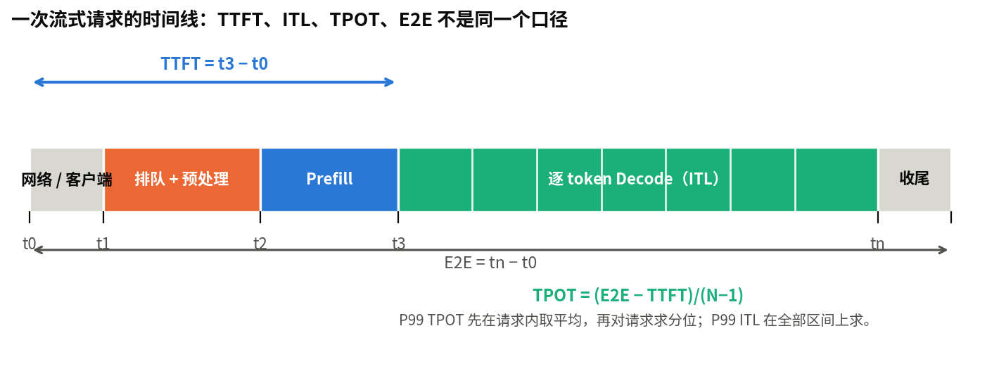
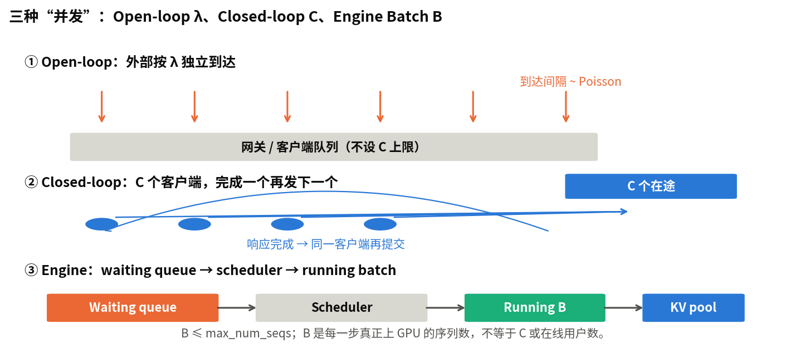
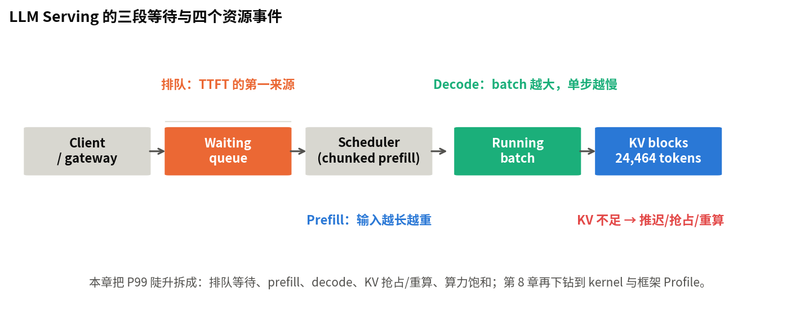
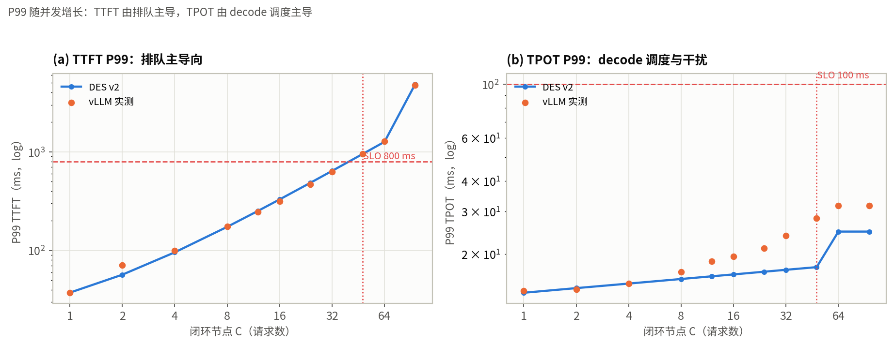
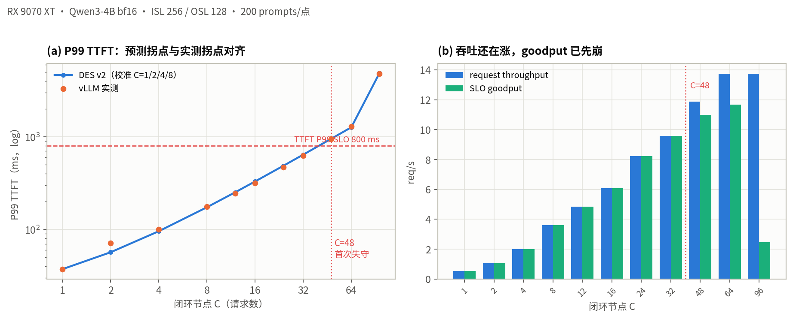
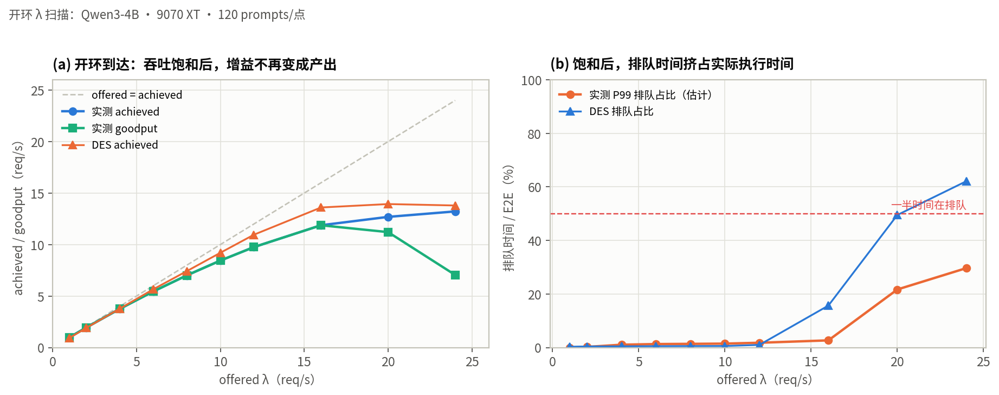
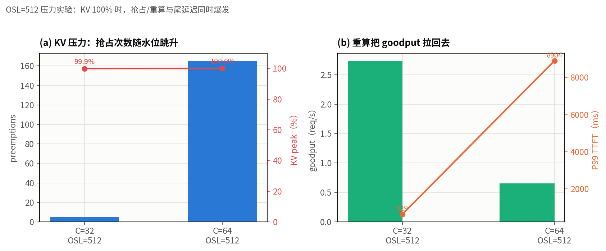

# 第 7 章 服务、排队与 SLA

::: danger ⚠️ Alpha内测版本警告
此为早期内部构建版本，尚不完整且可能存在错误，欢迎大家提Issue反馈问题或建议。
:::

::: warning 本章口径与证据边界
本章的主结论来自 2026-11-18 在单张 **AMD Radeon RX 9070 XT** 上完成的真机实验，以及用这批真机数据校准的离散事件模拟器（DES）。数字分成三个口径，不能混用：

- **真机口径**：Qwen3-4B bf16 + vLLM 0.29.1.dev0，样本与原始分位数保存在 `code/part1-modeling/chapter7/results/`。正文中的实测值只从这里取。
- **DES 口径**：`simulate_queue.py` 的服务时间参数由 C=1/2/4/8 校准集拟合，模型在打开 C=12/24/48/96 留出集之前冻结。DES 不是真机，也不等同于 vLLM 的内部实现。
- **解析口径**：Little's Law、M/M/1 与 P99 公式只用于建立直觉。它们不是本章这张卡、这个模型、这组工作负载的容量结论。

本章的 SLO 是教学与工程演示用的**实验目标**：P99 TTFT ≤ 800 ms、P99 TPOT ≤ 100 ms、P99 E2E ≤ 15 s、失败率 ≤ 1%。它不是产品 SLA，也不保证换模型、换卡、换请求分布后仍成立。所有容量数字都绑定本章冻结的测量契约；离开契约必须重新校准。
:::

## 本章导读

> 一个请求有多快，和一台机器能稳定服务多少人，是两个问题。前者由单请求时间线描述，后者由到达过程、排队、调度与资源上限共同决定。在线服务里最危险的数字往往不是最大吞吐，而是**吞吐还在上升、P99 已经失守**的那个点。

本章从这条分界线出发。先定义 TTFT、ITL、TPOT、E2E 与分位数，再区分 Open-loop 到达率 `λ`、Closed-loop 并发 `C` 与引擎内部 Batch Size `B`；然后用排队论解释尾延迟为什么先于平均延迟恶化；最后把连续批处理、KV Cache 与抢占机制放进一个可校准的 DES，并用真机 vLLM 压测裁决它。

本章使用的冻结契约是：

| 维度 | 取值 |
| --- | --- |
| 模型 | Qwen3-4B，bf16，36 层，hidden=2560，8 个 KV heads，head_dim=128 |
| 硬件 | AMD Radeon RX 9070 XT，15.92 GiB，gfx1201；`HIP_VISIBLE_DEVICES=1` |
| 软件 | ROCm 10.1，vLLM 0.29.1.dev0+g98dff2a81，容器镜像 `rocm/vllm:rocm10.1.0_ubuntu24.04_py3.14-pytorch_2.13.0_vllm-0.29.0` |
| 服务参数 | `--max-model-len 4096`、`--gpu-memory-utilization 0.90`、`--max-num-seqs 64` |
| 工作负载 | ISL=256，OSL=128；`ignore_eos`、`temperature=0`、`seed=42` |
| 主实验样本 | 每个闭环节点 200 prompts；开环节点 120 prompts；OSL=512 压力点 160 prompts |
| KV 池 | 24,464 tokens，3.36 GiB；16-token block |

一个直观的悬念先放在这里：同一张卡、同一个模型，C=1 时 TTFT P99 只有 **37.29 ms**；C=48 时升到 **951.50 ms**，首次越过 800 ms；C=96 时达到 **4,762.77 ms**。与此同时，C=96 的请求吞吐仍有 **13.755 req/s**，但满足 SLO 的 goodput 只剩 **2.476 req/s**。本章要解释的就是这组“吞吐还在涨、有效产出已经崩”的数字。

本章按以下路径展开：**课程坐标 → 指标口径 → 三种负载语义 → 排队论 → 引擎机制 → DES 校准与留出 → 真机压测 → 误差归因 → 工程决策**。

## 学习目标

完成本章后，应能够：

1. 区分钟观 TTFT、逐 token ITL、请求级 TPOT、端到端 E2E 及其 P50/P95/P99，并写出含失败请求的 SLA 判据；
2. 区分 Open-loop `λ`、Closed-loop `C` 与引擎 Batch Size `B`，解释为什么 **batch size 不等于在线用户数**；
3. 用 Little's Law 与 M/M/1 解释尾延迟的非线性，同时说明为什么简单排队模型不足以预测 LLM serving 的拐点；
4. 描述 Continuous Batching、KV Cache、Prefill/Decode、抢占与重算如何共同决定 goodput；
5. 用真机校准的服务时间模型驱动 DES，冻结预测后再用未见并发点做 holdout 验证；
6. 在 RX 9070 XT 上运行 vLLM 并发阶梯压测，给出 P99 曲线、SLA 水位、最大承载、goodput 与误差归因；
7. 说明哪些误差已归因、哪些仍是 unresolved，并拒绝在留出集上调参“凑答案”。

## 7.1 课程坐标：已有材料讲了什么，缺什么

本章不是从零发明指标。Harvard `mlsysbook.ai` 已经给出 Little's Law、M/M/1、P99、goodput 与 KV 预算的完整公式骨架；Stanford CS336、CMU 15-442/11-868、UIUC CS498 与 MIT 6.5940 则把 Continuous Batching、PagedAttention、Prefill/Decode 与抢占机制讲得很清楚。本章的增量不在“再讲一遍机制”，而在把这些机制放进一个**可校准、可留出验证、可复现**的真机闭环。

| 课程 / 材料 | 已经覆盖 | 本章如何使用 | 没有覆盖 |
| --- | --- | --- | --- |
| Harvard `mlsysbook.ai` Vol I Ch13 / Vol II Ch10 | Little's Law、M/M/1、P99、TTFT/TPOT、goodput、KV 预算 | 采用其公式骨架与 goodput 定义 | 没有“真机服务时间校准 DES，再做 holdout”的教学闭环 |
| Stanford CS336 Sp25 L10 | 单请求推理、KV、Continuous Batching、PagedAttention | 解释引擎内部 batch 与 KV 行为 | 没有正式排队论、SLA 容量扫描与留出验证 |
| CMU 15-442 / 15-642 | serving 调度、PagedAttention、RadixAttention | 解释调度与 KV 管理机制 | 没有公开的 1→64 vLLM 容量实验 |
| CMU 11-868 | vLLM 内部、request-level preemption、goodput、DistServe | 借用 preemption / recompute / goodput 词汇 | 没有消费级 AMD 单卡上的实测拐点对齐 |
| UIUC CS498 MLSys | TTFT/TPOT/E2E、Continuous Batching | 对齐指标定义 | 没有 Little/M/M/1/P99 的 DES 实验 |
| MIT 6.5940 | LLM deployment、vLLM、Continuous Batching | 作为机制对照 | 没有在线容量规划与压测作业 |

> MIT 6.S184 是 diffusion / flow matching 课程，不属于 ML systems serving 材料，本章不引用它来支撑服务结论。

在核实范围内，上述材料没有同时完成这套组合：**DES + 真机 vLLM 校准 + 1→64 并发扫描 + 冻结预测后的 holdout + 消费级 AMD 单卡 + DES 驱动动画**。这正是本章的实验设计空间。

## 7.2 服务指标：从一次请求的时间线开始



为一次流式请求标记时间点：客户端发出请求 `t0`，服务端接受 `t1`，Prefill 开始 `t2`，客户端收到首个输出 token `t3`，收到最后一个 token `tn`。若输出 `N` 个 token，则客户端口径下：

$$
\mathrm{TTFT}=t_3-t_0,\qquad \mathrm{E2E}=t_n-t_0
$$

$$
\mathrm{ITL}_i=t_i-t_{i-1}\;(i\ge 2),\qquad
\mathrm{TPOT}=\frac{\mathrm{E2E}-\mathrm{TTFT}}{N-1}\;(N>1)
$$

- **TTFT** 包含网络、排队、tokenize、Prefill 与首 token 调度，不等于纯 Prefill Kernel 时间；
- **ITL** 是相邻 token 的间隔，描述流式输出的卡顿；它的尾部可能由一次调度抖动或抢占造成；
- **TPOT** 先在每个请求内部对生成阶段取平均，再对请求分布求分位数；它和 ITL 的样本单位不同；
- **E2E** 是完整回答的等待时间，必须写明是否包含客户端限流等待。

| 指标 | 回答的问题 | 常见误用 |
| --- | --- | --- |
| P50 TTFT | 典型用户多久见到首字？ | 只看 P50，忽略排队长尾 |
| P99 TTFT | 高峰时首字是否仍可接受？ | 把网络或客户端排队混入服务端时间 |
| P99 ITL / TPOT | 长尾生成是否卡顿？ | 把 ITL 与 TPOT 当成同一个统计量 |
| P99 E2E | 完整回答多久结束？ | 输出长度分布不同却直接比较 |
| 成功率 / 超时率 | 服务是否真的交付结果？ | 只统计成功请求，造成幸存者偏差 |
| 吞吐 / Goodput | 做了多少工作 / 有多少工作满足 SLO？ | 用 raw throughput 冒充有效容量 |

给定请求级判据：

$$
\mathrm{pass}(r)=\mathbf{1}\{\mathrm{success}(r),\ \mathrm{TTFT}_r\le 800\,\mathrm{ms},\ \mathrm{TPOT}_r\le100\,\mathrm{ms},\ \mathrm{E2E}_r\le15\,\mathrm{s}\}
$$

则 **Goodput** 可以定义为：测量窗口内满足上述判据的输出 token 总数除以窗口时长，或以 req/s 表示的有效完成请求率。本章表格中的 `request_goodput` 使用后者；`vllm bench serve` 的判据是 `ttft:800,tpot:100,e2el:15000`。

::: tip 200 个样本的 P99 只由约 2 条请求决定
主实验每个闭环节点 200 prompts，P99 名义上由最慢的约 2 条请求决定；开环节点只有 120 prompts，P99 更接近“最慢一两条”的观测。不要把 P99 当成精确到毫秒的物理常数。本章同时报告 P50/P95/P99，并把 800 ms 当作工程阈值，而不是自然定律。
:::

## 7.3 三种“并发”：Open-loop λ、Closed-loop C、Engine Batch B



### 7.3.1 Open-loop：外部独立到达

Open-loop 用到达率 `λ`（req/s）描述负载：无论服务器是否忙碌，新请求仍按某个随机过程到达。它适合研究积压、尾延迟、过载与失败。若到达间隔服从指数分布，就是 Poisson 到达；本章 DES 与 vLLM `--request-rate` 都使用这一族负载。

### 7.3.2 Closed-loop：固定数量客户端循环提交

Closed-loop 预先放置 `C` 个客户端，每个客户端完成上一请求后再提交下一请求。它适合研究“固定并发用户”下的响应时间与吞吐，但吞吐会反过来控制到达速度，拥塞时天然产生背压。`C` 是客户端数量上限，不是 GPU 每步执行的序列数。

### 7.3.3 Engine Batch：每一步真正上 GPU 的序列数

一个 Decode Step 的 Batch Size `B`，是该步实际参与模型计算的序列数；它受 `max_num_seqs`、KV 可用 block、调度策略、Prefill 与 Decode 混排共同限制。系统可以处在三种状态：客户端/网关等待、引擎 waiting queue、引擎 running batch。在线用户数是这三处的总和，`B` 只是最后一处。

真机数据直接展示了这个差异：

| 闭环节点 | `running_peak` | `waiting_peak` | 说明 |
| ---: | ---: | ---: | --- |
| C=48 | 48 | 22 | 客户端并发 48，但引擎内部仍可能出现等待 |
| C=64（OSL=512 压力） | 64 | 45 | `max_num_seqs=64` 被顶满，KV 压力同时出现 |
| C=96 | 64 | 69 | 客户端并发 96，但 GPU 每步最多运行 64 条 |

因此，“我开了 96 个并发客户端”不能推出“GPU 每步算了 96 条序列”，更不能推出“系统能稳定服务 96 个用户”。**batch size ≠ 在线用户数** 是本章的必考结论。

### 7.3.4 工作负载必须写成一个契约

| 维度 | 本章取值 | 为什么必须记录 |
| --- | --- | --- |
| 输入长度 ISL | 256 | 决定 Prefill 计算量与 KV 初始占用 |
| 输出长度 OSL | 128（压力实验 512） | 决定 Decode 步数与 KV 增长 |
| 到达过程 | Closed-loop C；Open-loop Poisson λ | 两种负载的“并发”含义不同 |
| 采样 | `ignore_eos`、`temperature=0`、seed=42 | 避免生成长度随机变化污染对比 |
| 样本量 | 200 / 120 / 160 prompts | P99 的尾部稳定性依赖样本量 |
| 前缀复用 | vLLM 默认开启 prefix caching | 未显式关闭；低负载 TTFT 可能被缓存命中压低 |
| 失败与超时 | `failed`、超时、SLO 未通过分别记录 | 不能只统计成功请求 |
| 版本 | 模型、精度、ROCm、vLLM、容器镜像 | 换任一版本都可能改变服务时间 |

## 7.4 排队论：为什么 P99 先于吞吐崩溃

### 7.4.1 Little's Law 是一条守恒关系

对处于稳定状态、口径一致的系统：

$$
L=\lambda W
$$

其中 `L` 是系统中平均在途请求数，`λ` 是实际完成吞吐率（稳态时等于长期到达率），`W` 是平均端到端停留时间。若系统持续超载，队列不断增长，就不存在上述意义的稳定平均 `L`；此时不能用 offered RPS 代替稳态吞吐。

### 7.4.2 M/M/1 的尾延迟拐点

考虑单服务台、Poisson 到达、指数服务时间、FCFS 的抽象模型。令 `ρ=λ/μ<1`，则：

$$
\mathbb E[W]=\frac{1}{\mu-\lambda},\qquad
P99(W)=\frac{-\ln(0.01)}{\mu-\lambda}
$$

取 `μ=8 req/s` 做一个纯数学示例：

| 到达率 λ | 利用率 ρ | 平均响应时间 | P99（M/M/1） |
| ---: | ---: | ---: | ---: |
| 4 req/s | 50% | 250 ms | 1.15 s |
| 6 req/s | 75% | 500 ms | 2.30 s |
| 7 req/s | 87.5% | 1,000 ms | 4.61 s |

从 6 到 7 req/s，吞吐只增加约 17%，P99 却翻倍。这个表说明的是**排队系统的形状**，不是本章这张卡的容量。LLM serving 至少还有四个偏离 M/M/1 的地方：服务时间不是指数分布、请求会批量调度、Prefill 与 Decode 会互相干扰、KV 不足会触发抢占与重算。因此本章用 DES 取代简单闭合式，而不是把 M/M/1 的 `8 req/s` 当成设备上限。

## 7.5 引擎机制：Continuous Batching、KV 与 goodput



### 7.5.1 从静态 batch 到 Continuous Batching

静态 batch 等一整批请求凑齐后一起开始，必须等最慢的请求结束才能释放批次；短请求会留下空洞。Continuous Batching 在每个 Decode Step 重新检查 waiting queue，把已完成的序列移出、把新请求加入。它提高了 GPU 利用率，但也让“用户并发”“引擎 batch”“KV 占用”三者不再同步变化。

### 7.5.2 KV 池是另一条硬边界

对 Qwen3-4B，bf16 下每个 token 的 KV 字节数为：

$$
\mathrm{KV\ bytes/token}=2\times L\times H_{kv}\times d_{head}\times 2
=2\times36\times8\times128\times2
=147{,}456\ \mathrm{B/token}
=144\ \mathrm{KiB/token}
$$

vLLM 启动日志给出 `24,464 tokens` 的 KV 池，对应：

$$
24{,}464\times147{,}456\ \mathrm{B}\approx3.36\ \mathrm{GiB}
$$

这解释了为什么“并发数”不能随便开大。按 `ISL+OSL` 计算每个请求的 token 当量：

| 工作负载 | 每请求 token | 24,464 tokens 可容纳的请求当量 | 本章对应现象 |
| --- | ---: | ---: | --- |
| ISL=256 / OSL=128 | 384 | 63.7 | C=48 时 KV 峰值 75.39%；C=96 时超过池容量 |
| ISL=256 / OSL=512 | 768 | 31.9 | C=32 时 KV 峰值 99.87%；C=64 时 100% 并出现大量抢占 |

这些是**按 token 数的理论上界**，没有计 block 内碎片、调度空窗和暂时无法复用的页；但已经足以解释实测趋势：短 OSL 的 C=48 仍在 KV 池内，长 OSL 的 C=32 已经贴顶。

### 7.5.3 抢占与重算

当 running 请求继续生成、但没有空闲 KV block 时，vLLM 可以抢占请求。`recompute` 会释放受害者的 KV，把它放回 waiting queue，之后重新 Prefill；`swap` 则把 KV 换出到 host。被抢占请求已经生成的 token 仍在，但它的后续 ITL/TPOT 会被重算拉长。OSL=512、C=64 的 165 次抢占就是这条路径的直接证据。

### 7.5.4 为什么要报告 goodput

Raw throughput 只问“做了多少”，goodput 问“有多少满足 SLO”。本章的 goodput 峰值出现在 C=64（11.673 req/s），raw throughput 峰值出现在 C=96（13.755 req/s），但 C=96 的 goodput 只有 2.476 req/s。若只报告吞吐，会把一个已经失去服务意义的运行点误判为“容量更大”。

## 7.6 DES：把服务时间、KV 与调度放进一个可校准模型

### 7.6.1 输入契约

DES 实现在 `code/part1-modeling/chapter7/simulate_queue.py`，输入分为四块：

1. **到达**：Open-loop 用 Poisson 间隔 `Exp(λ)`；Closed-loop 用 `C` 个客户端，完成一个再提交下一个；
2. **请求形状**：ISL=256、OSL=128；压力实验 OSL=512；
3. **服务时间**：由 C=1/2/4/8 真机校准得到的 Prefill 与 Decode 公式；
4. **资源上限**：`max_num_seqs=64`、KV 池 24,464 tokens、16-token block、RECOMPUTE 抢占。

本章的 DES 是**固定长度契约**，不是真实 trace 的三分布采样：ISL/OSL 固定，只让到达间隔随机。这样做的目的是先让服务时间、KV 与调度误差可解释；如果直接把长短混合分布丢进来，服务模型的偏差和负载分布的偏差会缠在一起。扩展到真实 trace 时，应在到达堆中同时采样 `ISL ~ F_in`、`OSL ~ F_out`，重新校准服务模型，并重新开一份 holdout；不能把固定长度下的拐点直接外推到长短混合负载。

### 7.6.2 服务时间模型

`fit_service_model.py` 只用校准集 C=1/2/4/8，先比较两个 Prefill 候选，再拟合 Decode：

$$
t_{prefill}(B)=17.9093+19.4696\,B\ \mathrm{[ms]}
$$

$$
t_{decode}(B)=13.8927\cdot\max(B,1)^{0.062544}\ \mathrm{[ms]}
$$

Prefill 候选的校准 RMSE：

| 候选 | 形式 | 校准 RMSE |
| --- | --- | ---: |
| v1 | `p0 + p1·log2(B)` | 12.554 ms |
| v2 | `p0 + p1·B` | **3.294 ms** |

线性模型的误差更小，因此 v2 选择线性。这个选择只使用 C=1/2/4/8，不使用任何留出点。

### 7.6.3 仿真循环

每个事件步大致执行：

1. 释放在当前时刻到达的请求，按 FCFS 进入 waiting queue；
2. 在 `running + prefill < max_num_seqs` 且 KV block 足够时接纳请求；
3. 以 `t_prefill(B_p) + t_decode(B_r)` 推进一个引擎迭代；
4. 为 running 请求各生成一个 token，更新 KV 占用与完成状态；
5. 若下一个 token 需要的新 block 不足，按 RECOMPUTE 抢占最近接纳的 running 请求；
6. 每 50 ms 记录 waiting / prefill / running / batch / KV / preemption 轨迹。

### 7.6.4 明确不建模的内容

DES 不模拟 kernel 级 roofline、prefix cache 命中、chunked-prefill token budget、CUDA graph replay、CPU 调度、网络与 tokenizer 时间，也不是 vLLM victim policy 的逐位复制。它抢占“最近接纳”的请求，属于 RECOMPUTE 家族，但不是 vLLM 的精确策略。把这些限制写进模型说明，比事后用误差去“补参数”更重要。

### 7.6.5 v1 的失败与 holdout 纪律

v1 用 `log2(B)` 拟合 Prefill，在 C=1/2/4/8 上看似可用；一旦外推到 C=16/32/64，误差迅速放大：

| C | 真机 TTFT P99 | v1 预测 | 相对误差 | 处置 |
| ---: | ---: | ---: | ---: | --- |
| 16 | 316.73 ms | 204.45 ms | +54.92% | 已烧掉 |
| 32 | 627.86 ms | 249.86 ms | +151.28% | 已烧掉 |
| 64 | 1,286.09 ms | 295.27 ms | +335.56% | 已烧掉 |

这组 C=16/32/64 数据在 v1 模型选择之后才被使用，因此对 v1 是**已烧掉的留出集**。v2 不能拿它们重新选模型，也不能把它们当作“v2 的验证点”。v2 在 C=1/2/4/8 上重新选择线性 Prefill，冻结后才打开全新的 C=12/24/48/96 留出集。

> 事后用 v2 回算 C=16/32/64，误差会缩小到 -3.85% / -2.04% / +1.75%。这只能作为诊断，不能写成“v2 通过了这三个点”；那三个点已经被 v1 消耗掉了。

### 7.6.6 从固定长度扩展到三分布 trace

真实在线负载至少有三个分布：到达间隔、输入长度、输出目标长度。本章把后两者固定为 256/128，是为了让服务时间误差与排队误差可以分开归因；这不代表固定长度模型可以直接套到真实 trace。扩展到三分布时，至少要改五处：

1. **到达**：把 Poisson 生成器换成外部 trace 的 `t_i`，或拟合经验到达间隔分布；Burst 与自相似到达必须单独保留，不能被平均值抹平；
2. **输入长度**：从 `F_in` 采样 `ISL_i`，并按长度分桶重新拟合 Prefill；`17.9093 + 19.4696B` 只对 ISL=256 成立；
3. **输出长度**：从 `F_out` 采样 `OSL_i`，用实际生成长度而非固定 128 计算 TPOT 与 KV 增长；
4. **KV 检查**：每个请求按 `ISL_i + OSL_i` 预留 token，长请求会先触发 `max_model_len` 拒绝或抢占；
5. **重新留出**：用新的 trace 重新冻结预测并开 holdout，不能拿本章的 C=48 拐点去代表长短混合负载。

这也解释了为什么本章不把 “C=48 首次失守” 写成普遍容量：它绑定的是 `ISL=256 / OSL=128 / Poisson 或固定 C` 的契约。省略这三个分布，容量数字就没有可比性。

## 7.7 DES 结果：1→96 的曲线、拐点与排队占比

### 7.7.1 闭环 DES 曲线

下表来自 `results/des_closed_v2.json`，服务模型与 KV 参数均与 7.6 节一致：

| C | TTFT P99 (ms) | TPOT P99 (ms) | 达成 req/s | goodput req/s | SLO 通过率 | 排队占比 | 平均 batch | KV 峰值 |
| ---: | ---: | ---: | ---: | ---: | ---: | ---: | ---: | ---: |
| 1 | 37.38 | 13.89 | 0.555 | 0.555 | 100% | 0.0% | 0.98 | 1.57% |
| 2 | 56.85 | 14.51 | 1.053 | 1.053 | 100% | 0.0% | 1.94 | 3.14% |
| 4 | 95.79 | 15.15 | 1.980 | 1.980 | 100% | 0.0% | 3.81 | 6.28% |
| 8 | 173.67 | 15.82 | 3.665 | 3.665 | 100% | 0.0% | 7.36 | 12.56% |
| 12 | 251.54 | 16.23 | 4.962 | 4.962 | 100% | 0.0% | 10.51 | 18.84% |
| 16 | 329.42 | 16.52 | 6.046 | 6.046 | 100% | 0.0% | 13.38 | 25.11% |
| 24 | 485.18 | 16.95 | 7.750 | 7.750 | 100% | 0.0% | 18.44 | 37.67% |
| 32 | 640.94 | 17.26 | 9.789 | 9.789 | 100% | 0.0% | 22.78 | 50.23% |
| 48 | 952.45 | 17.70 | 10.678 | 0.534 | 5% | 0.0% | 29.87 | 75.34% |
| 64 | 1,263.96 | 24.78 | 12.365 | 0.773 | 6.25% | 1.3% | 35.56 | 98.89% |
| 96 | 4,853.55 | 24.78 | 12.365 | 0.0 | 0% | 32.39% | 35.56 | 98.89% |

这张表里有两个必须分开看的现象。第一，**TTFT P99 在 C=32 到 C=48 之间越过 800 ms**；第二，DES 的 closed-loop goodput 在 C=48 之后急剧塌陷，但真机的 goodput 并没有塌得这么快。后者不是“真机更好”，而是 DES 的逐请求服务时间过于确定：同一批请求几乎同时完成 Prefill，TTFT 分布缺少真机那种 p50 与 p99 的离散性，于是按请求判定的通过率被低估。这个误差在第 7.9 节单独归因。

> 表中 C=16/32/64 的 DES 点没有干净的 v2 holdout 对照：这三个并发属于 v1 burned 区间。v2 的干净验收点只有 C=12/24/48/96；C=64 的真机 goodput 峰值来自 v1 阶段的真实测量，只作为测量使用，不参与 v2 模型选择。



### 7.7.2 拐点对齐



把 DES 预测与真机 holdout 放在同一张表：

| C | 真机 TTFT P99 | DES 预测 | 相对误差 | 真机 TPOT P99 | DES 预测 | 真机 E2E P99 | 真机 goodput |
| ---: | ---: | ---: | ---: | ---: | ---: | ---: | ---: |
| 12 | 245.11 ms | 251.54 ms | -2.56% | 18.67 ms | 16.23 ms | 2,444.77 ms | 4.851 |
| 24 | 467.80 ms | 485.18 ms | -3.58% | 21.18 ms | 16.95 ms | 2,788.89 ms | 8.219 |
| 48 | 951.50 ms | 952.45 ms | -0.10% | 28.08 ms | 17.70 ms | 4,120.58 ms | 10.998 |
| 96 | 4,762.77 ms | 4,853.55 ms | -1.87% | 31.70 ms | 24.78 ms | 8,525.19 ms | 2.476 |

四个留出点的 **TTFT P99 MAPE = 2.03%**。真机在 C=32 仍通过（TTFT P99 627.86 ms），C=48 首次失守（951.50 ms）；DES 也在 C=32 给 640.94 ms、C=48 给 952.45 ms，拐点落在同一对相邻扫描点之间。就“何时开始排队雪崩”这个问题，线性 Prefill + 有限 KV + 固定 batch 上限的 DES 已经足够好。

但 **TPOT P99 MAPE = 31.64%**，E2E P99 MAPE = 14.74%。TTFT 对齐得好，不代表 decode 对齐得好；这正是下一节误差归因的入口。

### 7.7.3 开环：到达率扫描与排队占比

开环真机每个点 120 prompts；DES 每个点 600 requests。下表把两条曲线并排：

| offered λ (req/s) | 真机达成 | 真机 goodput | 真机 TTFT P99 | DES TTFT P99 | 真机 P99 排队占比（估计） | DES 排队占比 |
| ---: | ---: | ---: | ---: | ---: | ---: | ---: |
| 1 | 0.985 | 0.985 | 70.28 ms | 88.42 ms | 0.00% | 0.31% |
| 2 | 1.939 | 1.939 | 75.72 ms | 97.61 ms | 0.24% | 0.41% |
| 4 | 3.755 | 3.755 | 96.53 ms | 107.58 ms | 1.06% | 0.46% |
| 6 | 5.447 | 5.447 | 104.05 ms | 120.24 ms | 1.30% | 0.51% |
| 8 | 7.009 | 7.009 | 108.58 ms | 132.54 ms | 1.38% | 0.54% |
| 10 | 8.446 | 8.446 | 114.88 ms | 142.51 ms | 1.47% | 0.57% |
| 12 | 9.756 | 9.756 | 128.26 ms | 555.01 ms | 1.79% | 1.00% |
| 16 | 11.875 | 11.875 | 174.73 ms | 2,490.59 ms | 2.68% | 15.67% |
| 20 | 12.689 | 11.209 | 1,001.34 ms | 7,962.98 ms | 21.69% | 49.51% |
| 24 | 13.219 | 7.050 | 1,525.44 ms | 12,002.49 ms | 29.66% | 62.11% |



真机的 raw throughput 在 λ≈20–24 时进入平台，但 offered load 继续增加只转化为排队时间；到 λ=24，达成吞吐 13.219 req/s，goodput 只剩 7.050 req/s。DES 捕捉到了“平台 + 排队”的定性形状，但在过载区明显更悲观：λ=20 时 DES 的 TTFT P99 是 7,962.98 ms，真机是 1,001.34 ms；λ=24 时 DES 的排队占比 62.11%，真机尾部估计为 29.66%。这不是可以靠调一个参数修掉的偏差，后文会把它归因于 FCFS、chunked prefill 与调度重叠的缺失。

> 真机的“排队占比”是尾部估计：以低负载 TTFT 为基线，把新增 TTFT 视为服务端排队，再除以 E2E P99。它不是逐请求的 trace 事件；DES 的排队占比则来自逐请求 `queue_wait / E2E`。

### 7.7.4 动画：把逐请求时间线放出来

<a href="./animation.html" target="_blank" rel="noreferrer">打开 DES 驱动的排队动画</a>

动画数据来自 `results/des_animation_trace.json`，不是手写数字：λ=24、600 条请求、609 个轨迹步；最大 waiting=186，最大 running=64，最大 KV=23,856 / 24,464 tokens。600 条请求中有 536 条至少违反一项 SLO，测量窗口内 SLO 通过率为 0%。它展示的顺序是 **到达 → waiting queue → Continuous Batching → KV 水位上升 → 抢占/重算 → SLA 突破**，可以直接对照 7.7.3 的 λ=24 行阅读。

## 7.8 真机实验：RX 9070 XT 上的 vLLM 服务

### 7.8.1 环境与服务启动

宿主机有两张 AMD GPU；本章只使用 `GPU[1] = RX 9070 XT`。容器内用 `HIP_VISIBLE_DEVICES=1` 把它重映射为 device 0，避免误用 `GPU[0] = RX 7900 XTX`。服务启动命令的核心部分如下（`--group-add 991` 是本机 render 组 gid，换机器时按实际 gid 调整）：

```bash
docker run -d --name ch7-vllm \
  --device=/dev/kfd --device=/dev/dri \
  --group-add video --group-add 991 \
  -e HIP_VISIBLE_DEVICES=1 \
  -e VLLM_ROCM_USE_AITER=0 \
  -v /mnt/public/models:/models:ro \
  -v /tmp/ch7-vllm:/results \
  -p 18000:8000 \
  rocm/vllm:rocm10.1.0_ubuntu24.04_py3.14-pytorch_2.13.0_vllm-0.29.0 \
  vllm serve /models/Qwen3-4B \
    --served-model-name qwen3-4b \
    --host 0.0.0.0 --port 8000 \
    --gpu-memory-utilization 0.90 \
    --max-model-len 4096 \
    --max-num-seqs 64
```

启动日志中的关键账本：

| 项目 | 观测值 |
| --- | ---: |
| 模型加载占用 | 7.56 GiB（权重 + 非 torch 实际占用 8.65 GiB） |
| KV Cache | 24,464 tokens / 3.36 GiB |
| 4,096-token 请求最大并发 | 5.97x |
| CUDA graph 池 | 1.62 GiB |
| 有效 GPU 利用率参数 | 0.90（等价于关闭 graph profiling 时的 0.7965） |

服务端同时启用了 `enable_prefix_caching=True` 与 `enable_chunked_prefill=True` 的默认行为。本章没有显式关闭 prefix caching；random 数据集下仍可能命中少量公共前缀，因此这里的 TTFT 是**服务端端到端观测**，不是纯 Prefill kernel 时间。这个限制不会改变“排队拐点”的结论，但会提醒读者：不要把本章的 37.29 ms 直接当成另一个模型的 Prefill 下限。

### 7.8.2 压测命令

`run_bench.py` 调用容器内的 `vllm bench serve`，并把结果、`/metrics` 采样与日志写回仓库。单点命令的核心参数是：

```bash
vllm bench serve \
  --backend openai \
  --base-url http://127.0.0.1:8000 \
  --endpoint /v1/completions \
  --model qwen3-4b \
  --tokenizer /models/Qwen3-4B \
  --dataset-name random \
  --random-input-len 256 --random-output-len 128 \
  --num-prompts 200 --num-warmups 2 \
  --seed 42 --ignore-eos --temperature 0 \
  --max-concurrency 48 --request-rate inf \
  --percentile-metrics ttft,tpot,itl,e2el \
  --metric-percentiles 50,95,99 \
  --goodput ttft:800 tpot:100 e2el:15000 \
  --save-result --save-detailed
```

闭环节点用 `--max-concurrency C --request-rate inf`；开环节点用 `--request-rate λ --burstiness 1`。`/metrics` 每 250 ms 采样一次，记录 `num_requests_running`、`num_requests_waiting`、`kv_cache_usage_perc`、`num_preemptions_total` 等指标。

### 7.8.3 校准集：C=1/2/4/8

| C | TTFT P50 | TTFT P95 | TTFT P99 | TPOT P99 | E2E P99 | 达成 req/s | 失败 |
| ---: | ---: | ---: | ---: | ---: | ---: | ---: | ---: |
| 1 | 32.95 ms | 34.55 ms | 37.29 ms | 14.13 ms | 1,828.89 ms | 0.548 | 0 |
| 2 | 61.60 ms | 70.16 ms | 71.19 ms | 14.32 ms | 1,881.84 ms | 1.065 | 0 |
| 4 | 96.41 ms | 99.33 ms | 100.07 ms | 15.17 ms | 1,990.85 ms | 2.012 | 0 |
| 8 | 172.72 ms | 175.22 ms | 176.11 ms | 16.89 ms | 2,217.31 ms | 3.612 | 0 |

这四点看起来非常“规整”：TTFT 随 C 近似线性，TPOT 从 14.13 ms 缓慢升到 16.89 ms。也正因为太规整，v1 的 `log2` 拟合在低并发上残差不大，却在 C=64 外推时崩掉。校准集只能证明“局部可拟合”，不能证明“外推可信”。

### 7.8.4 全新 holdout：C=12/24/48/96

| C | TTFT P99 | TPOT P99 | ITL P99 | E2E P99 | 达成 req/s | goodput | 失败 | 抢占 | KV 峰值 | running/waiting 峰值 |
| ---: | ---: | ---: | ---: | ---: | ---: | ---: | ---: | ---: | ---: | ---: |
| 12 | 245.11 ms | 18.67 ms | 20.20 ms | 2,444.77 ms | 4.851 | 4.851 | 0 | 0 | 18.85% | 12 / 0 |
| 24 | 467.80 ms | 21.18 ms | 50.47 ms | 2,788.89 ms | 8.219 | 8.219 | 0 | 0 | 37.70% | 24 / 14 |
| 48 | 951.50 ms | 28.08 ms | 156.55 ms | 4,120.58 ms | 11.890 | 10.998 | 0 | 0 | 75.39% | 48 / 22 |
| 96 | 4,762.77 ms | 31.70 ms | 158.70 ms | 8,525.19 ms | 13.755 | 2.476 | 0 | 3 | 99.48% | 64 / 69 |

四个点全部 `failed=0`。这很重要：本章的“失败”不是 HTTP 错误或超时崩溃，而是请求完成了、但没满足 SLO。C=48 的 TTFT P99 已经越过 800 ms，却仍有 10.998 / 11.890 = 92.5% 的请求通过；C=96 的 goodput 只有 2.476 / 13.755 = 18.0%。**P99 失守不等于所有请求都失败，goodput 才能表达“有效产出的比例”。**

换算成未满足 SLA 判据的请求比例：C=12 与 C=24 都是 0%，C=48 约 7.5%，C=96 约 82.0%。这三档差异正是“P99 尾部失守”与“大面积失效”的区别；只看 P99 一条线，会把 C=48 与 C=96 误判成同一种状态。

### 7.8.5 拐点、最大承载与安全水位

| 指标 | 结果 | 说明 |
| --- | ---: | --- |
| 最后 SLO 通过点 | C=32 | TTFT P99 627.86 ms；TPOT P99 23.88 ms；E2E P99 3,282.76 ms；9.574 req/s |
| 首次失守点 | C=48 | TTFT P99 951.50 ms；TPOT P99 28.08 ms；E2E P99 4,120.58 ms；goodput 10.998 req/s |
| 最大 raw throughput | C=96 | 13.755 req/s，但 goodput 2.476 req/s |
| 最大 goodput | C=64 | 11.673 req/s，raw 13.733 req/s；TTFT P99 1,286.09 ms，已不满足 SLO |
| 80% 安全水位 | C=25 | 7.659 req/s，按最后通过点 C=32 的 80% 计 |

> 这里的 C=16/32/64 真机点属于 v1 阶段的测量：它们不能用于 v2 模型选择，但仍然是有效的真机测量，因此可以用于定位业务水位与 goodput 峰值。v2 的干净 holdout（C=12/24/48/96）只用于验证 DES 预测。两类用途必须分开记录。

工程结论不是“C=96 吞吐最高，所以选 C=96”，也不是“C=64 goodput 最高，所以选 C=64”。C=64 的 goodput 高，是因为它完成了更多请求，但它的 TTFT P99 已经 1,286.09 ms；这是一个**吞吐已经越过 SLO 边界**的运行点。可上线候选是 C=32 附近的 9.574 req/s，再按突发与留出验证打折到 7.659 req/s。

### 7.8.6 OSL=512：把 KV 压力单独打开

| C | KV 峰值 | 抢占次数 | goodput | TTFT P99 | TPOT P99 | E2E P99 |
| ---: | ---: | ---: | ---: | ---: | ---: | ---: |
| 32 | 99.87% | 5 | 2.731 | 628.82 ms | 22.91 ms | 11,778.39 ms |
| 64 | 100.00% | 165 | 0.653 | 8,903.70 ms | 46.55 ms | 25,080.94 ms |



这组实验把“KV 不足”从猜测变成了证据。OSL=512 时每请求 token 当量为 768，24,464 tokens 只够约 31.9 条；C=32 已经贴顶（99.87%、5 次抢占），C=64 必然 100% 并触发 165 次抢占。C=64 的 raw throughput 仍有 3.072 req/s，但 goodput 只剩 0.653 req/s，E2E P99 达到 25.08 s。短 OSL 下 C=96 的尾延迟主要来自 batch/调度/算力；长 OSL 下，KV 与重算成为主导机制。两者不能混为一谈。

## 7.9 误差归因：哪些已经解释，哪些仍然 unresolved

| 现象 | 证据 | 候选机制 | 状态 |
| --- | --- | --- | --- |
| TTFT P99 四个 holdout 点 MAPE 2.03% | C=12/24/48/96 预测与实测几乎重合 | 线性 Prefill + 有限 KV + batch 上限已经抓住排队增长 | **已归因，模型可用** |
| TPOT P99 低估 31.64% | C=48 实测 28.08 ms vs 预测 17.70 ms（+58.64%），但 C=48 无抢占、KV 75.39% | chunked prefill 与 decode 混排、调度开销、batch 组成变化、确定性服务时间缺少尾部分散 | **部分归因** |
| C=96 TPOT 仍低估 | 实测 31.70 ms vs 预测 24.78 ms；KV 99.48%，抢占 3 次 | 在 C=48 的调度误差之上，再叠加 KV 压力与重算 | **部分归因，KV 贡献有证据** |
| DES closed-loop goodput 在 C=48 塌到 0.534 | 真机 goodput 10.998，真机 TTFT P50 458.38 ms、P99 951.50 ms；DES 把同一批请求的服务时间算得过于一致 | DES 缺少真机的逐请求服务时间分散，按请求判定的通过率被低估 | **模型限制，不可用于 goodput 决策** |
| 开环 DES 在 λ=20/24 明显更悲观 | 真机 TTFT P99 1,001.34 / 1,525.44 ms；DES 7,962.98 / 12,002.49 ms | 严格 FCFS、没有 chunked prefill 与调度重叠、过载时的批处理策略不同 | **已定位为结构性高估** |
| OSL=512、C=64 的 goodput 塌陷 | KV 100%、165 次抢占、E2E P99 25.08 s | KV block 耗尽 → RECOMPUTE → 重算拖长 ITL/TPOT | **已归因** |
| C=96 的 batch 上限 | running 峰值 64、waiting 峰值 69；`max_num_seqs=64` | 客户端并发不等于 engine batch；超出部分只能在 waiting queue | **已归因** |
| raw throughput 在 C=64→C=96 几乎不再增长 | 13.733 → 13.755 req/s；TPOT P99 31.65 → 31.70 ms | 单卡算力/带宽接近饱和，新增并发主要转成排队与 KV 压力；精确的 compute-bound 与 memory-bound 分界需要 kernel profile | **部分归因** |
| 绝对毫秒数的跨机器差异 | 单卡、单次运行、未做多轮重复 | GPU 时钟/功耗、温度、后台负载、prefix cache 命中、网络与 tokenizer | **unresolved，不外推** |

单卡算力饱和的证据不是某个漂亮的 kernel 利用率数字，而是 **raw throughput 在 C=64 到 C=96 几乎不再增长，同时 TPOT P99 仍在上升**。本章没有做 `rocprof-compute` 级别的 kernel profile，因此只能把它标成“部分归因”：可以确定新增并发没有再转化为有效产出，不能确定瓶颈具体落在 matrix core、HBM 还是调度间隙。

这里最重要的方法论不是“把误差拟合到 0”，而是**承认模型能回答什么、不能回答什么**。本章的 DES 可以回答“TTFT P99 何时越过 SLO、排队占比如何增长”；它不能回答“这个配置的 goodput 一定是多少”，也不能回答“换一个模型或换一张卡会怎样”。后两者必须重新测量。

::: danger 不要在 holdout 上调参
v1 的 C=16/32/64 已经被用于发现 log2 外推失败；它们不再是干净的留出集。v2 如果回头用这四个点选模型、改 gamma 或调抢占策略，就会把“验证”变成“训练”。本章保留了 v1 的失败记录，也保留了 v2 的全新 C=12/24/48/96，目的是让读者看到：**负结果和 burned holdout 也是实验资产。**
:::

## 7.10 工程决策与复现清单

### 7.10.1 本章的容量结论

在本章冻结契约下，可以写出这样的结论句：

> 在 Qwen3-4B bf16、RX 9070 XT 15.92 GiB、vLLM 0.29.1、ISL=256/OSL=128、`max-num-seqs=64` 的条件下，闭环保留扫描的最后一个 SLO 通过点是 C=32，对应 9.574 req/s；C=48 首次在 TTFT P99 上失守（951.50 ms）。按 80% 安全系数，运行水位暂定 C=25 / 7.659 req/s。C=64 的 goodput 峰值 11.673 req/s 与 C=96 的 raw 峰值 13.755 req/s 都不是可上线的 SLO 安全点。超过本契约的模型、上下文长度或框架版本，必须重新校准。

这个结论同时给出三件事：**最大承载**（raw 约 13.755 req/s）、**有效承载**（goodput 峰值 11.673 req/s）、**安全水位**（7.659 req/s）。三者不是同一个数，报告时必须写清楚用的是哪一个。

### 7.10.2 实验矩阵与产物

| 实验 | 规模 | 产物 |
| --- | --- | --- |
| 真机校准 | C=1/2/4/8，200 prompts/点 | `results/calibration/calibration_c*.json`、`results/service_model.json` |
| 真机 holdout v2 | C=12/24/48/96，200 prompts/点 | `results/holdout_v2/summary.json` |
| 真机开环 | λ=1…24，120 prompts/点 | `results/open_loop/summary_all.json` |
| KV 压力 | OSL=512，C=32/64，160 prompts/点 | `results/pressure/summary.json` |
| DES 闭环 | C=1…96，200 requests/点 | `results/des_closed_v2.json` |
| DES 开环 | λ=1…24，600 requests/点 | `results/des_open.json` |
| 动画 | λ=24，600 requests | `results/des_animation_trace.json` → `animation.html` |
| 汇总分析 | 全部真实与 DES 结果 | `results/analysis.json` |

未执行的扩展包括 C=128/256/512；它们不应被写成“已完成”。如果后续要补，必须沿用同一契约，并在测量前冻结预测。

### 7.10.3 复现命令

```bash
cd code/part1-modeling/chapter7

# 1) 真机校准与 holdout（服务已在 ch7-vllm:18000 上运行）
python3 run_bench.py --mode closed --points 1,2,4,8 \
  --num-prompts 200 --out-dir calibration --prefix calibration
python3 run_bench.py --mode closed --points 12,24,48,96 \
  --num-prompts 200 --out-dir holdout_v2 --prefix holdout_v2

# 2) 拟合服务模型（只读 calibration）
python3 fit_service_model.py

# 3) DES：闭环、开环与动画 trace
python3 simulate_queue.py --mode closed \
  --concurrency 1,2,4,8,12,16,24,32,48,64,96 \
  --num-requests 200 --output des_closed_v2.json
python3 simulate_queue.py --mode open \
  --rates 1,2,4,6,8,10,12,16,20,24 \
  --num-requests 600 --output des_open.json \
  --trace-run 24 --trace-requests 600

# 4) 汇总、作图、动画
python3 analyze_results.py
python3 figs/make_figs.py
python3 figs/make_animation.py
```

### 7.10.4 验收清单

| 交付物 | 验收问题 | 本章证据 |
| --- | --- | --- |
| 动画演示 | 数据是否来自 DES run，而不是手写数字？ | `des_animation_trace.json` 嵌入 `animation.html`；609 步、600 请求 |
| P99 曲线 + 拐点 + goodput | 是否同时报告 raw、goodput 与 SLO？ | 7.7/7.8 表；C=48 首次失守，C=96 raw 峰值但 goodput 2.476 |
| 实测分位表（含失败/超时） | 是否记录 failed、超时与 goodput？ | 7.8.4 表；四个 holdout 点 `failed=0`，SLO 失守逐项标注 |
| 拐点对齐对比 | 是否给出残差或相对误差？ | TTFT MAPE 2.03%；逐点相对误差表 |
| 误差归因记录 | 是否区分已归因与 unresolved？ | 7.9 表；KV、batch 上限、调度误差、goodput 模型限制 |
| 复现 | 版本、契约、命令是否齐全？ | 7.8.1/7.10.2/7.10.3 |

## 本章小结

在线 LLM 服务的核心问题不是“最多能一次塞进多少序列”，而是**在给定负载分布与延迟约束下，系统能够长期稳定交付多少有效工作**。本章用一条真机曲线回答了这个问题：RX 9070 XT 上的 Qwen3-4B 服务在 C=32 时仍有 9.574 req/s 的 SLO-safe 吞吐，C=48 时 TTFT P99 首次越过 800 ms；raw throughput 可以继续涨到 13.755 req/s，但 C=96 的 goodput 只剩 2.476 req/s。

方法上，本章留下了四个可复用的习惯：

1. **先写契约，再测数字**：模型、精度、ISL/OSL、到达过程、版本、样本量缺一不可；
2. **分开三种并发**：Open-loop `λ`、Closed-loop `C`、Engine Batch `B`，绝不互相替代；
3. **预测在测量前冻结**：校准集只用于选模型，holdout 只用于裁决；burned holdout 不能再当验证集；
4. **误差要归因，不要硬拟合**：TTFT 对齐不等于 TPOT 对齐，P99 对齐不等于 goodput 对齐。

第 8 章将在这个基础上继续问：为什么不同推理框架会给出不同的 P99 曲线？当调度器、KV 管理或框架版本变化时，本章的哪些结论仍然成立，哪些必须重新校准？

## 练习与思考

1. 若某个服务在 C=32 时吞吐 10 req/s、P99 TTFT 600 ms，在 C=48 时吞吐 12 req/s、P99 TTFT 1,000 ms。业务 SLO 是 P99 TTFT ≤ 800 ms。你会把运行水位设在哪里？为什么不能直接选 C=48？
2. 用本章的 Qwen3-4B KV 公式，计算 ISL=1,024、OSL=256 时 24,464 tokens 池大约能容纳多少条请求。若 `max_num_seqs` 仍设为 64，会发生什么？
3. 真机 C=48 的 TPOT P99 是 28.08 ms，DES 预测 17.70 ms，但该点没有抢占、KV 只有 75.39%。请列出至少三种可能的误差来源，并设计一个实验区分它们。
4. 为什么 C=96 的 `running_peak` 恰好是 64？如果只看到“客户端并发 96”，你会怎样向同事解释 `batch size ≠ 在线用户数`？
5. v1 的 C=16/32/64 已经 burned。若有人建议“用这四个点重新拟合 v2 的 gamma 会更好”，你会如何拒绝？请写出一个不污染 holdout 的替代实验方案。
6. 开环 λ=24 时真机 goodput 7.050 req/s，DES 的 TTFT P99 却高达 12,002.49 ms。请解释为什么 DES 在过载区会比真机更悲观，并说明这会不会影响“C=48 首次失守”的结论。

## 延伸阅读

- [Harvard mlsysbook.ai — Model Serving](https://mlsysbook.ai/vol1/13_model_serving/13_model_serving.html)：Little's Law、M/M/1、P99、batching 与 KV 的公式骨架。
- [Harvard mlsysbook.ai — Inference at Scale](https://mlsysbook.ai/vol2/10_inference/10_inference.html)：SLO goodput、batching waste、preemption 与 KV budget。
- [Stanford CS336 Sp25 — Lecture 10 Inference](https://stanford-cs336.github.io/spring2025/)：单请求推理、KV、Continuous Batching 与 PagedAttention。
- [CMU 15-442/15-642 — LLM Serving Part 1](https://mlsyscourse.org/slides/14-LLM-serving-part1.pdf)：Continuous Batching、PagedAttention、RadixAttention。
- [CMU 11-868 — vLLM / PagedAttention](https://llmsystem.github.io/llmsystem2025spring/assets/files/llmsys-22-vLLM_woosuk_kwon-1f34697dbb1a1fb5b798daf6eff14b67.pdf)：KV 利用率、request-level preemption 与 recompute。
- [CMU 11-868 — DistServe](https://llmsystem.github.io/llmsystem2025spring/assets/files/llmsys-24-disaggregating_prefill_decode_hao_zhang-c0e55139d20512a2348783423397cc7f.pdf)：TTFT/TPOT、goodput 与 PD 分离。
- [UIUC CS498 MLSys — Continuous Batching](https://minjiazhang.github.io/courses/sp25-resource/week8.1_inference_continusous_batching.pdf)：TTFT/TPOT/E2E 的课程口径。
- [vLLM / PagedAttention 论文](https://arxiv.org/abs/2309.06180)：分页 KV、内存碎片与 serving 吞吐。
- [Orca 论文](https://www.usenix.org/system/files/osdi22-yu.pdf)：Continuous Batching 的系统动机。
- [Sarathi-Serve 论文](https://arxiv.org/abs/2308.16369)：chunked prefill 与 Prefill/Decode 干扰。
- [DistServe 论文](https://www.usenix.org/system/files/osdi24-zhong-yinmin.pdf)：goodput、SLO attainment 与 PD 分离的完整实验。

*阅读路径：第 3 章 KV 账本 → 本章容量与 SLA → 第 8 章跨框架 Profile 与配置决策。*
