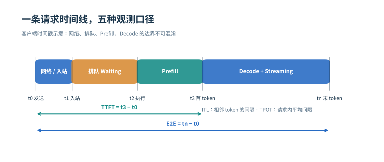
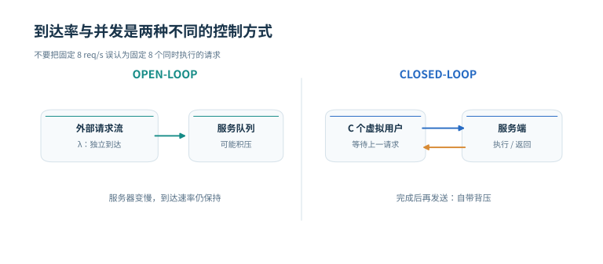
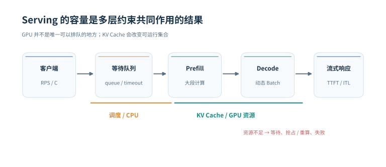
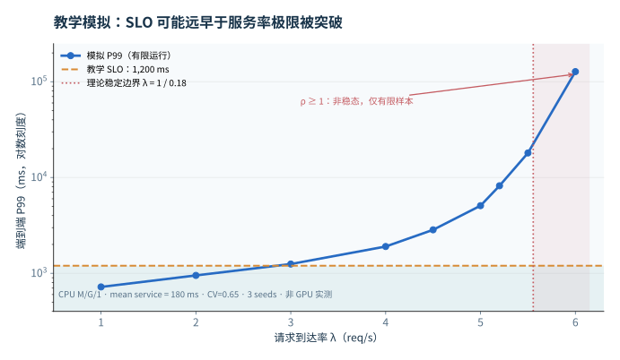

# 第 7 章 服务、排队与 SLA

> **从“一个请求有多快”，走向“一台机器能够稳定服务多少人”。** 单请求 Benchmark 告诉我们模型的速度，在线服务实验却常常给出更难解释的结论：吞吐仍在上升，P99 已经恶化；GPU 的利用率看似不高，用户却在等待；增加并发不再带来产出，反而使请求超时。本章将把这些现象还原为可测量、可预测、可校准的系统行为。

::: warning 实验状态与证据边界
本文包含**可运行的教学级排队模拟**以及**需要 AMD GPU 实机执行的实验规程**。教学图中的曲线来自明确标注的 CPU 模拟，不是 RX 9070 XT 或 Qwen3-4B 的实测结果；真机命令已参照公开工具文档编写，但仍需在实际安装版本下运行和记录。不要将教学曲线当作设备容量结论。
:::

## 本章导读

在前面章节，我们已经学会估算单步算力与显存需求。现在提出一个真实的部署问题：在 **RX 9070 XT 16 GB** 上运行 **Qwen3-4B**，应用要求流式响应尽可能迅速。应该接受多少并发请求？当负载从低到高增长时，应该先限制并发，还是调大 KV Cache？

我们先约定一组**教学 SLO**：P99 TTFT ≤ 800 ms、P99 TPOT ≤ 100 ms、P99 端到端延迟 ≤ 15 s、请求失败率 ≤ 1%。这些是本章为了说明方法而设定的目标，并非产品官方承诺，也不意味着这张卡一定能达到。

本章按以下路径展开：**定义延迟 → 定义流量 → 构建排队模型 → 识别 LLM 特有的调度行为 → 预测拐点 → 真机裁决 → 给出容量决策**。最终提交的是带有误差和适用范围的容量边界，而不是孤立的最大 tok/s。



### 学习目标

完成本章后，应能够：

1. 区分 TTFT、逐 token ITL、逐请求 TPOT、端到端延迟及其 P50/P95/P99，并定义含失败请求的 SLA；
2. 区分 **Open-loop 到达率**、**Closed-loop 并发**与推理引擎内部的 **Batch Size**；
3. 使用 Little's Law 与简单排队模型解释为何容量拐点先在尾延迟中出现；
4. 用教学模拟器预测 P99 曲线，并说明模型不包含哪些 LLM Serving 机制；
5. 用标准化工作负载实测一条 TTFT/TPOT/P99 曲线，给出预测—实测残差与安全水位。

## 7.1 服务性能指标与 SLA

### 7.1.1 从一次生成请求的时间线开始

为一次流式请求标记五个时间点：客户端开始发送 `t₀`、服务端接受请求 `t₁`、开始执行 Prefill `t₂`、客户端收到首个输出 token `t₃`、收到最后一个 token `tₙ`。若响应包含 `N` 个生成 token，则在**客户端观察口径**下：

$$
\mathrm{TTFT}=t_3-t_0,\quad
\mathrm{E2E}=t_n-t_0
$$

$$
\mathrm{ITL}_i=t_i-t_{i-1}\;(i\ge 2),\qquad
\mathrm{TPOT}=\frac{\mathrm{E2E}-\mathrm{TTFT}}{N-1}\;(N>1)
$$

- **TTFT**（Time to First Token）衡量首字等待，通常包含网络、排队、预处理与 Prefill 等开销；它并不等同于纯 Prefill Kernel 时间。
- **E2E**（End-to-End Latency）衡量整次请求的用户等待时间。若包含客户端限流等待，必须在指标名称中写明；否则不同压测工具的 E2E 口径可能不一致。
- **ITL**（Inter-Token Latency）描述相邻输出 token 的时间间隔；流式输出的卡顿需要关注 ITL 的尾部。
- **TPOT**（Time per Output Token）通常指单请求在首 token 之后的**平均**生成间隔；

::: tip TPOT 的 P99 不等于 ITL 的 P99
TPOT 先在**每个请求内部取平均**，然后对请求分布求分位数；ITL P99 则可以在**全部 token 间隔**上计算。二者样本单位不同，长响应还有额外的样本权重。比较不同工具之前，先检查其统计口径与过滤规则。
:::

### 7.1.2 分位数：谁在决定用户体验

若有 1000 个有效请求，P99 的直观含义是约 99% 的样本不超过这个延迟；它不是“最慢 1% 请求的平均值”，也不是单次最坏值。P50 告诉我们典型体验，P95/P99 帮助暴露排队、抢占与长尾抖动。对小样本而言，P99 极不稳定：只有 100 次请求时，尾部几乎由极少数观测决定。

| 指标            | 它回答的问题                    | 最容易遗漏的情况                 |
| --------------- | ------------------------------- | -------------------------------- |
| P50 TTFT        | 一般用户多久见到首字？          | 少数请求长时间排队               |
| P99 TTFT        | 高峰时首字是否仍可接受？        | 网络、客户端背压混入             |
| P99 ITL / TPOT  | 长尾生成是否卡顿？              | ITL 与 TPOT 混用                 |
| P99 E2E         | 完整回答多久结束？              | 输出 token 长度不一致            |
| 成功率 / 超时率 | 服务是否真的交付结果？          | 只统计成功请求造成“幸存者偏差” |
| 吞吐 / Goodput  | 做了多少工作 / 有多少有用工作？ | 总吞吐上升但 SLA 已失守          |

给出一个请求级可接受性判据：

$$
\mathrm{pass}(r)=\mathbf{1}\{\mathrm{success}(r),\ \mathrm{TTFT}_r\le 800\,ms,\ \mathrm{TPOT}_r\le100\,ms,\ \mathrm{E2E}_r\le15\,s\}.
$$

本章约定失败、超时均为 `pass=0`；无法计算 TPOT 的单 token 请求必须遵照预先写明的排除或单独计数规则。可定义 **Goodput（有效完成 token/s）** 为在测量窗口内满足请求级判据的输出 token 总数除以窗口时长。不同工具可能采用不同 Goodput 单位和合格定义，必须在图题或表注中明确。**SLO 是单请求或群体服务目标，SLA 是可能附带责任承诺的服务协议**；实验中通常先验证 SLO，再讨论上线 SLA。

### 7.1.3 两种不能互换的速度

假设 4 个用户各请求 200 个输出 token。一个系统可能在单用户情况下产生 90 tok/s，却在 4 人同时使用时达到总计 250 tok/s；这里每人的平均速度仍可能下降。必须同时报告：

$$
X_{req}=\frac{\#\mathrm{completed\ requests}}{T},\qquad
X_{tok}=\frac{\#\mathrm{generated\ tokens}}{T}.
$$

如果应用有长短不一的请求，报告 `req/s` 时必须附上输入/输出 token 分布，否则同样的 req/s 可能代表完全不同的负载强度。

## 7.2 请求负载与并发模型

### 7.2.1 Open-loop 与 Closed-loop

**Open-loop**：独立外部到达过程持续产生请求，通常用 $\lambda$（requests/s）描述。例如平均每秒到达 4 个请求，无论服务器是否忙碌，新的用户依然到来。它适合研究排队积压、尾延迟和过载失败。

**Closed-loop**：预先放置固定数量 $C$ 个虚拟用户，每个用户完成上一请求后再发下一请求（可设思考时间）。它适合研究“固定并发用户”下的吞吐与响应时间，但吞吐会反过来控制到达速度；因此在拥塞时天然产生背压。



::: danger 容易导致错误结论的混淆
`vllm bench serve --request-rate 4` 表示控制**请求生成速率**；`--max-concurrency 4` 表示客户端同时放行的**请求数上限**。二者一起使用时，超出限制的请求会在客户端排队，真实发往服务器的速率可能小于 4 RPS。此时必须单独报告客户端排队时延，不能把服务器“无明显拥塞”当成容量足够的证据。
:::

### 7.2.2 用户并发不等于 Batch Size

在线用户数是服务系统中尚未完成的请求数；而一个 Decode Step 的 Batch Size，是该步实际参与 GPU 计算的序列数。它们通常不相等：部分请求尚在队列中，部分正在 Prefill，部分被抢占，部分已完成。此外 `max_num_seqs` 是调度配置上限，也不等于每一步真实 Batch Size。

可把系统简化成三处：**客户端/网关等待 → 引擎 waiting queue → 引擎 running batch**。三处的总在途数决定用户感受，而 GPU 每步执行的工作量由最后一处决定。测量到“16 个并发请求”并不能据此宣称“GPU 每步都运行 batch 16”。

### 7.2.3 工作负载必须写成一个契约

| 维度            | 低成本教学实验       | 正式容量实验                 |
| --------------- | -------------------- | ---------------------------- |
| 输入长度（ISL） | 固定 256 tokens      | 给出 P50/P95 和长尾分布      |
| 输出长度（OSL） | 固定 128 tokens      | 给出分布与停止原因           |
| 请求到达        | Poisson 或固定并发   | Open-loop + Closed-loop 对照 |
| 前缀复用        | 关闭 / 尽量避免      | 单独测命中与不命中两组       |
| 超时与失败      | 逐项记录             | 错误码、超时、取消均入账     |
| 冷热状态        | 明确预热时长         | 重复运行、报告波动范围       |
| 模型与硬件      | 固定 checkpoint/精度 | 保存版本、功耗、显存、温度   |

固定长度便于最初校准，但不代表真实服务。实际应用还必须测试 Burst、长上下文与混合短长请求，特别是在 KV Cache 接近上限时。

## 7.3 排队论基础：为什么 P99 先于吞吐崩溃

### 7.3.1 Little's Law 是一条守恒关系

对处于稳定状态、口径一致的系统：

$$
\boxed{L=\lambda W}
$$

其中 $L$ 是系统中平均在途请求数，$\lambda$ 是**实际完成吞吐率**（稳定时与长期到达率相同），$W$ 是平均端到端停留时间。若 2 req/s 的稳定服务平均响应 3 s，则系统平均有 6 个在途请求。这个关系不依赖请求遵循指数分布，但要求稳态与统计边界一致。

若系统持续超载，到达率大于完成率，队列不断增长，不存在上述意义的稳定平均 $L$。因此不能用过载期间的 offered RPS 代替稳态吞吐，把 Little's Law 当作容量定律。

### 7.3.2 M/M/1 模型的拐点

考虑一个最简抽象：请求按 Poisson 过程到达，平均到达率 $\lambda$；服务时间服从指数分布，平均服务率 $\mu$；一个服务台先来先服务。利用率为 $\rho=\lambda/\mu$，仅在 $\rho<1$ 时有稳态。

$$
\mathbb E[W]=\frac{1}{\mu-\lambda},\qquad
P99(W)=\frac{-\ln(0.01)}{\mu-\lambda}.
$$

例如 $\mu=8$ req/s，即平均服务时间 125 ms：

| 到达率 λ | 利用率 ρ | 平均响应时间 | P99（M/M/1 理论） |
| --------: | --------: | -----------: | ----------------: |
|   4 req/s |       50% |       250 ms |            1.15 s |
|   6 req/s |       75% |       500 ms |            2.30 s |
|   7 req/s |     87.5% |     1,000 ms |            4.61 s |

吞吐从 6 到 7 req/s 只增约 17%，但 P99 翻倍。系统的“危险拐点”不是 GPU 利用率第一次达到 100% 的瞬间，而是 **P99 跨越业务 SLO 的那一刻**。若该模型要求 P99 ≤ 2 s，代入上式可得 $\lambda\le 8-\ln(100)/2\approx5.70$ req/s，远低于理论极限 8 req/s。

::: warning 本模型只用来理解机制
真实 LLM Serving 不是 M/M/1：连续批处理意味着多个请求共享一次 GPU Step，服务时间受输入长度、KV 命中和同时运行序列影响，并且 Prefill 与 Decode 的资源特征不同。上述公式只能建立方向性直觉，不能直接当作 Qwen3-4B 的容量预测。
:::

### 7.3.3 为什么要测尾延迟，而不只看均值

排队包含两个叠加来源：请求本身的服务时长波动，以及前面请求积压造成的等待。即便平均服务时间相同，长尾请求越多，后来者的排队波动通常也越强。将 OSL 从固定 128 tokens 改为含少数 2048-token 长响应的混合流量，可能使短请求的 P99 明显恶化；这是一种**队首阻塞及共享 GPU 资源争用**现象，不只是长请求“自己变慢”。

## 7.4 LLM Serving 的特有行为



### 7.4.1 Continuous Batching：服务不是一次一个请求

传统静态批处理往往等待一个 batch 收齐再执行；Continuous Batching 则在 Decode Step 之间动态接纳、结束或暂缓序列。这样可以提高 GPU 利用率和总吞吐，但调度决策本身会引入开销：需要管理请求状态、KV 块、token budget 与运行队列。

从第 1、2 章的 Roofline 视角来看，增加 Decode Batch 可以让原本显存带宽主导的权重读取被更多 token 分摊，从而提高吞吐；然而每步等待时间可能因此变长，TTFT 或 ITL 不一定同步改善。

### 7.4.2 Prefill 与 Decode 争夺的不是同一种资源

- **Prefill** 通常有较大的矩阵计算量，长提示会占用较长执行窗口；
- **Decode** 每轮只追加少量 token，较小 batch 时往往偏向访存/调度受限；
- **Chunked Prefill** 把长提示拆成若干片段，与 Decode 工作混合调度，让 TTFT 与 ITL 之间的取舍成为可调参数。

在 vLLM V1 中，Chunked Prefill 在适用情形下默认开启，`max_num_batched_tokens` 的大小会改变 TTFT、ITL 和吞吐之间的平衡。**不要假设“更大的 batch/token budget 必然更快”**，必须用实际负载验证。[参考：vLLM Optimization and Tuning](https://docs.vllm.ai/en/stable/configuration/optimization/)。

### 7.4.3 KV Cache 让容量约束进入排队模型

第 3 章建立了每 token KV 账本：

$$
M_{KV}\approx \sum_{r\in running}\bigl(S_{in,r}+S_{out,r}\bigr)\,m_{kv}+M_{pages/metadata}.
$$

这个式子是**理想化下界/近似**：分页大小、共享前缀、块对齐和空闲预留会影响实际占用。当并发增加到 KV 池不足时，引擎不能简单无限扩大 Running Batch；它可能推迟新请求、抢占并重算已有请求。**在 vLLM V1 的默认路径中，相关抢占采用 RECOMPUTE，而不是把 SWAP 作为必然行为。** 过度抢占会表现为排队变长、重复 Prefill 工作以及尾延迟迅速升高。

因此，“SLA 失守”至少可能来自三种机制：**算力/带宽饱和、调度与 CPU 开销、KV 资源压力**。本章先测量现象，下一章再进行框架级 Profile 归因。

## 7.5 离散事件模拟实验：先把预测写下来

### 7.5.1 实验目标和最小模型

为了能够手算并验证，我们先实现一个**M/G/1、FCFS、无限等待队列**教学模拟器：到达间隔服从指数分布，服务时间服从对数正态分布，输出每个请求的排队和端到端耗时。与 SimPy 的 [Bank Renege](https://simpy.readthedocs.io/en/latest/examples/bank_renege.html) 和 [Carwash](https://simpy.readthedocs.io/en/latest/examples/carwash.html) 教程相同，它采用离散事件时间推进思想；本仓库随章脚本为了方便复现使用 Python 标准库，不需要安装第三方依赖。

这里的“服务器”只有一个 FCFS 服务台，**不包含** Prefill/Decode、动态 Batch、显存、网络与实际 GPU Kernel。目的只是验证**给定到达率和服务时间分布，排队如何改变尾延迟**，并为后续复杂模拟器建立可解释的基线。

输入：平均服务时间 180 ms、变异系数 CV=0.65、Poisson 到达率由 1 扫到 6 RPS、每点 1800 s、前 180 s 预热、3 个独立重复、随机种子 42。服务率的一阶估计是 $1/0.18\approx5.56$ req/s。SLO 设为**教学模拟的端到端 P99 ≤ 1200 ms**；注意它不同于第 7.1 节真实 LLM 的多指标 SLO。

### 7.5.2 运行代码

在仓库根目录执行：

```bash
python3 code/part1-modeling/chapter7/simulate_queue.py \
  --rates 1,2,3,4,4.5,5,5.2,5.5,6 \
  --mean-service-ms 180 --cv 0.65 \
  --duration-s 1800 --warmup-s 180 \
  --replications 3 --slo-p99-ms 1200 \
  --seed 42 --output results/ch7/queue_results.csv
```

脚本输出 `offered_rps/rho/achieved_rps/p50_e2e_ms/p95_e2e_ms/p99_e2e_ms/p99_queue_ms/slo_pass`。其中 `rho>=1` 的行会明确标记为 **unstable; finite-trace only**：即使脚本对有限到达序列算出了 P99，它也不是稳态 P99，**不得**把这个数字外推到“无限运行的过载系统”。



*图 7-4：由随章 `simulate_queue.py` 在固定随机种子下得到的 CPU 教学模拟，**不是 GPU 实测**。虚线表示教学 SLO；ρ≥1 的有限运行样本只用于显示不稳定趋势。*

结合图表读结果：`rho` 接近 1 时 P99 开始急剧上升；但 **SLO 可能远早于稳定性极限被突破**。这也说明为什么容量规划需要分开讨论“理论极限”和“可承诺的服务水位”。

### 7.5.3 升级到项目模拟器：六元组与留出验证

第 1 章已经定义了项目主线模拟器的六元组：`workload / infra / strategy / calibration / evaluation / execution`。教学模拟与项目模拟器不是重复造轮子，分别承担两种责任：

| 层级                | 能预测什么                               | 不能据此断言什么                 |
| ------------------- | ---------------------------------------- | -------------------------------- |
| 标准库教学模拟      | 排队分布、到达率敏感性                   | TTFT、TPOT、KV 抢占机制          |
| `mlsys-simulator` | 显式假设下的 Batch、KV、请求时间线及 SLA | 自动等于任何真机的准确表现       |
| RX 9070 XT 真机     | 特定软件版本和硬件条件下的真实指标       | 无条件泛化到其他模型、负载、平台 |

对于项目模拟器，把模型、精度、GPU、ISL/OSL 分布、到达率、调度与 KV 预算写入显式配置，并保留第 1 章的 `calibration=nominal` 基线。由于该模拟器代码不在本仓库公开提供，**本文不虚构其完整配置文件或可执行 CLI 参数**；应在拥有该模拟器的环境中按照当前接口 schema 生成 `manifest.json` 与 `requests.jsonl`。冻结预测后，再打开真机结果。

校准时建议保留两组请求长度分布：A 组用于拟合有效服务时间/调度常数，B 组作为留出集，用于检查模型是否只是记住了某次压测曲线。

## 7.6 真机压测与校准

### 7.6.1 环境核对：先确认版本，再执行命令

本章建议沿用第 3 章的 AMD 单卡环境，目标为 RX 9070 XT 16 GB + Qwen3-4B。**ROCm、PyTorch、vLLM 对具体 GPU 的支持取决于安装组合**；先完成第 0/3 章的环境检查，不要假设任意 pip wheel 均支持该显卡。

```bash
amd-smi
rocminfo | head -40
python -c 'import torch, vllm; print(torch.__version__, vllm.__version__)'
vllm bench serve --help | head -60
```

记录 GPU 名称、驱动/ROCm/框架版本、模型 revision、dtype、机器功耗策略以及设备是否有其他进程。确认模型可被当前服务端加载后，示范性地启动：

```bash
vllm serve Qwen/Qwen3-4B \
  --served-model-name qwen3-4b \
  --host 127.0.0.1 --port 8000 \
  --dtype bfloat16 --max-model-len 4096 \
  --gpu-memory-utilization 0.85
```

上述参数是**实验起点**，不是已验证的最佳配置。若启动失败，先根据显存账本、模型支持和日志诊断，不要立即把 `--gpu-memory-utilization` 拉到 1。Qwen3 模型可能启用 thinking 输出；需明确模板与停止条件，保持各实验的 token 数口径一致。

### 7.6.2 第一组：Closed-loop 并发扫描

使用固定 ISL/OSL、相同 tokenizer、随机种子和模型，扫描 `C=1,2,4,8,16`，再在接近拐点时细化。这里把 `--request-rate inf` 与 `--max-concurrency C` 结合，形成一个**总请求数有限、客户端并发受限的饱和负载实验**；它并不严格等价于每位用户具有思考时间的传统 Closed-loop 客户端，但足以构造持续高负载对照。

```bash
mkdir -p results/ch7/vllm
for C in 1 2 4 8 16; do
  vllm bench serve \
    --backend openai-chat \
    --base-url http://127.0.0.1:8000 \
    --endpoint /v1/chat/completions \
    --model qwen3-4b --tokenizer Qwen/Qwen3-4B \
    --dataset-name random \
    --random-input-len 256 --random-output-len 128 \
    --num-prompts 256 --seed 42 --ignore-eos \
    --request-rate inf --max-concurrency "$C" \
    --percentile-metrics ttft,tpot,itl,e2el,client_queue_time \
    --metric-percentiles 50,95,99 \
    --save-result --result-dir results/ch7/vllm \
    --result-filename "closed_C${C}.json"
done
```

**特别注意**：此例开启 `--ignore-eos` 是为尽量固定输出长度，部分环境/模型未必采用完全相同的停止语义；最终仍要从结果 JSON 检查实际生成 token 数。短测试用于定位区间，正式 P99 需要更长测试、更多样本和重复运行，不能拿 256 次请求的 P99 当作严谨 SLA 证明。

### 7.6.3 第二组：Open-loop 到达率扫描

先利用低负载测得的服务速度确定一个保守的到达率网格，例如 $\lambda\in\{0.5,1,2,3,4\}$ RPS；**这些不是该显卡的已知容量**，只表示初始探索点。固定 `--request-rate`，不要同时加一个很小的 `--max-concurrency`，否则客户端背压会掩盖服务端过载。

```bash
for RPS in 0.5 1 2 3 4; do
  vllm bench serve \
    --backend openai-chat \
    --base-url http://127.0.0.1:8000 \
    --endpoint /v1/chat/completions \
    --model qwen3-4b --tokenizer Qwen/Qwen3-4B \
    --dataset-name random \
    --random-input-len 256 --random-output-len 128 \
    --num-prompts 512 --seed 42 --ignore-eos \
    --request-rate "$RPS" --burstiness 1 \
    --percentile-metrics ttft,tpot,itl,e2el \
    --metric-percentiles 50,95,99 \
    --goodput ttft:800 tpot:100 e2el:15000 \
    --save-result --result-dir results/ch7/vllm \
    --result-filename "open_RPS${RPS}.json"
done
```

`--goodput` 的阈值在这里用于请求级成功判据；**不能用它替代失败率和请求超时统计**。对每一个点保留 offered RPS、achieved RPS、TTFT/TPOT/ITL/E2E 分位数、成功/超时、Goodput、GPU/KV 指标。若最高点仍然没有明显退化，继续扩展网格；若已经超时激增，应停止无意义的继续加压，并将拐点附近细化。

### 7.6.4 把“拐点”定义成可复现的事件

定义三种相互独立的阈值：

1. **业务阈值**：首次违反预先设定的任意 P99 或错误率 SLO；
2. **吞吐阈值**：增加 offered load 后 achieved throughput 增幅显著变小，排队却明显增加；
3. **容量阈值**：日志或监控出现 KV 空间不足、请求抢占、OOM 等资源事件。

三者不一定重合。容量决策采用最保守的业务阈值，再留出余量。例如稳定通过的最大负载为 $\lambda^*$，上线目标可以先取 $0.7\lambda^*$ 或 $0.8\lambda^*$ 作为**工程安全系数起点**，但应由突发流量和留出集验证，而不是把 70% 当作普适标准。

### 7.6.5 校准：解释误差，而不是强行拟合

将模拟器预测的 $\widehat{P99}(\lambda)$ 与真机 $P99(\lambda)$ 叠图，记录残差 $e(\lambda)=P99-\widehat{P99}$。至少检查：

| 观察                            | 候选机制                   | 优先证据                                  |
| ------------------------------- | -------------------------- | ----------------------------------------- |
| TTFT 先陡升，TPOT 暂时正常      | Waiting Queue / 长 Prefill | Waiting requests、queue time、输入长度    |
| TPOT/ITL 恶化，TTFT 变化较小    | Decode 调度、Batch 改变    | Running Batch、token budget、GPU timeline |
| P99 与抢占次数同步跳升          | KV 不足、重算              | KV usage、preemption counter、引擎日志    |
| 吞吐停止增长，GPU 高负载        | 计算/带宽接近上限          | GPU utilization、Kernel Profile           |
| 服务端看似健康，客户端 E2E 过高 | 客户端限流/网络队列        | client queue time、网关 trace             |

出现不符合预测的情形，先检查测量口径和负载变化，再考虑增加模型参数。不要在留出数据上反复修改模拟器到“恰好命中”；否则精度提升没有泛化意义。

### 7.6.6 交付格式与验收

最终提交以下四项，分别作为四个飞轮阶段的证据：

| 阶段           | 必须留存的内容                               | 验收问题                               |
| -------------- | -------------------------------------------- | -------------------------------------- |
| **预测** | 冻结的输入契约、预测曲线、SLO 水位           | 是否真的在测量前给出预测？             |
| **实测** | 版本/模型/负载 manifest、原始 JSON、三次重复 | 同行能否复现指标？                     |
| **校准** | 残差曲线、瓶颈证据、留出工作负载             | 误差是由哪个可观测机制引起？           |
| **决策** | 业务容量上限、安全余量、不可外推条件         | 为什么选择这个水位，而不是更高吞吐点？ |

**建议的结论句式**：在 *模型 revision、精度、ISL/OSL 分布、显卡和框架版本* 均固定的条件下，Open-loop 负载达到 *X req/s* 以前全部 SLO 通过；超过 *Y req/s* 时 *TTFT P99* 首先失守。运行水位暂定为 *Z req/s*，其证据来自 *指定运行编号*；其他请求长度或框架版本需重新校准。没有实测时，保留 `X/Y/Z = 待测`，绝不代入教学模拟数值。

## 本章小结

在线 LLM 服务的核心问题不是“最多能一次塞进多少序列”，而是**在给定负载分布与延迟约束下，系统能够长期稳定交付多少有效工作**。分位数刻画体验，负载模型决定实验是否真实，排队论揭示尾延迟的非线性，Continuous Batching 与 KV Cache 解释偏离简单模型的原因。

读完本章，应该具备一个新的判断习惯：**看到吞吐上升时，先问 P99 和错误率是否同步变坏；看到模拟器与真机不符时，先问等待发生在客户端、调度器还是 GPU。** 第 8 章将在这个基础上进一步回答：为什么两套推理框架的曲线会不同？

### 练习与思考

1. 若 M/M/1 的服务率为 10 req/s，业务要求端到端 P99 ≤ 1 s，计算理论允许的最大到达率，并解释为何它不是 GPU 的可用容量。
2. 固定 8 个并发请求与固定 8 req/s 到达率，哪一种更容易产生不断扩张的队列？为何客户端限流会掩盖服务器过载？
3. 只将 1% 的请求 OSL 从 128 增至 2048 token，如何设计一组实验检验“长请求影响了短请求的尾延迟”？
4. 假设实测 TTFT P99 突增，但 `rocprof-compute` 未发现单 Kernel 效率变差，你会优先收集哪三种框架级数据？

### 延伸阅读

- [GuideLLM — Finding Your Server&#39;s Optimal Concurrency Limit](https://vllm-project.github.io/guidellm/latest/examples/optimal_concurrency/)：SLO 优先的容量扫描。
- [SimPy — Bank Renege](https://simpy.readthedocs.io/en/latest/examples/bank_renege.html)：等待、排队与取消的离散事件建模。
- [Microsoft Vidur](https://github.com/microsoft/vidur)：具有请求调度和延迟预测器的 LLM 仿真框架。
- [vLLM — Benchmarking CLI](https://docs.vllm.ai/en/latest/benchmarking/cli/)：在线压测、负载模式与指标口径。
- [NVIDIA AIPerf](https://github.com/ai-dynamo/aiperf)：实验负载、分位数、Goodput 与报告组织。

*阅读路径：第 3 章显存/KV 账本 → 本章容量与 SLA → 第 8 章跨框架 Profile 与配置决策。*
