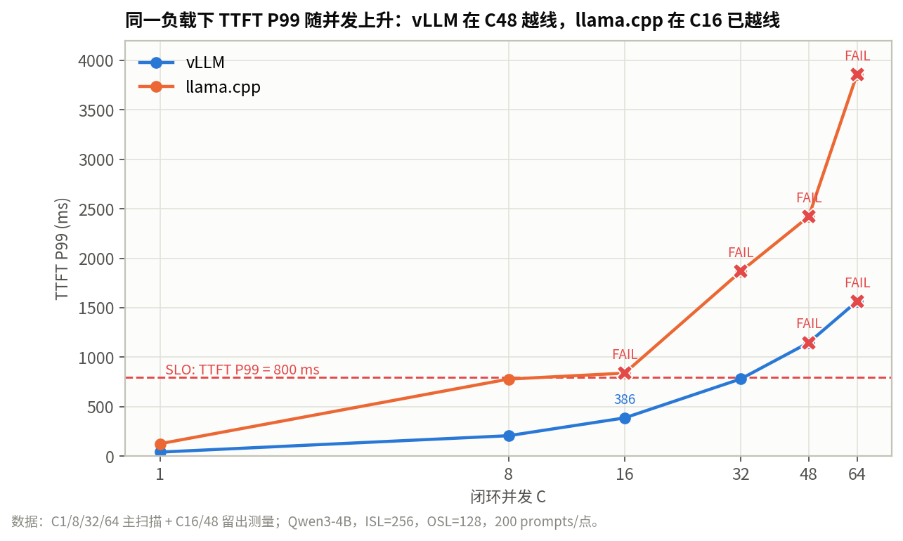

# 第 8 章 推理框架的系统取舍、Profile 与性能分析

## 本章导读

> 同一个模型、同一张显卡、同一组请求，仅把推理框架从 vLLM 换成 llama.cpp，首 token 延迟与达标并发上限就可能相差数倍。如果只把两个框架的峰值吞吐并排贴成排行榜，读者无法分辨这些差距究竟来自计算内核、调度策略、KV 缓存预算，还是权重格式与图执行路径的联动变化。
>
> 作为第 1 篇的收口章，本章把前面建立的 Roofline（第 1 章）、真机剖析（第 2 章）、显存账本（第 3 章）与排队容量（第 7 章）汇合到真实的推理框架对比中。8.1 拆解推理框架的四条系统取舍轴，并冻结测量契约与修正后的 TPOT 口径。8.2 先用显存账本和真机 OOM 探针排除静态不可行的长上下文配置，同时检验模拟筛选器的适用边界。8.3 在同一张 RX 7900 XTX 上完成主并发扫描，对比裸吞吐与 SLO 有效吞吐。8.4 用低并发三点拟合幂律，在测前冻结的留出并发上检验边界预测能力。8.5 通过框架级 kernel Profile 与前几章模型解释性能差异。8.6 列出全部不等价变量并给出有边界的选型决策矩阵。章末实验与练习提供离线存档核对路径。

## 教学目标

- 能从执行路径、算子融合、调度批处理与 KV 预算四条轴拆解推理框架的系统取舍，并说明为何不能仅凭裸吞吐比较框架优劣。
- 能在延迟压测前先用 KV 显存账本排除静态不可行配置，并区分解析筛选器在静态容量判定与并发延迟预测上的可靠性边界。
- 能结合 P99 延迟、单请求失败率、SLO 有效吞吐与 Little 定律，从并发扫描结果中找出工程安全水位与首次违约点。
- 能用低并发校准点拟合幂律并在测前冻结的留出点上评估误差，说明小样本外推的局限性。
- 能解读框架级 kernel Profile 中的 dispatch 次数、算子占比与 GPU 忙碌比例，并在列出全部不等价项的前提下作出有边界的选型结论。

## 8.1 推理框架的系统取舍与测量契约

把同一个 Transformer 模型放进不同推理引擎，速度与容量之所以拉开差距，是因为框架在四条相互牵制的系统轴上做出了不同取舍：[Harvard MLSysBook：ML Frameworks](https://mlsysbook.ai/vol1/07_frameworks/07_frameworks.html) · [Model Serving](https://mlsysbook.ai/vol1/13_model_serving/13_model_serving.html)

1. **执行路径**：逐算子 eager 发射会产生大量小 kernel 提交开销；图捕获（HIP/CUDA Graph）与编译优化可以把一连串小算子打包提交，直接压缩解码阶段的 CPU 发射空档，提高 GPU 忙碌比例。
2. **算子融合**：将归一化、位置编码（RoPE）和 KV 写入等小算子融合进更少的内核中，既减少显存读写流量，也降低 kernel 总数。
3. **调度与批处理**：连续批处理（continuous batching）允许已完成的请求立刻释放槽位，分块预填充（chunked prefill）限制单轮长输入对正在生成请求的阻塞，调度器策略直接决定排队时间与尾延迟。[Orca (OSDI 2022)](https://www.usenix.org/conference/osdi22/presentation/yu) · [Sarathi-Serve (OSDI 2024)](https://www.usenix.org/system/files/osdi24-agrawal.pdf)
4. **KV 缓存与上下文预算**：分页管理（PagedAttention）减少了显存碎片，但总 KV 池大小、单序列上下文上限与最大并发槽位共同决定了显卡能同时驻留多少条请求。[PagedAttention / vLLM (SOSP 2023)](https://arxiv.org/abs/2309.06180)

单一的 `tok/s` 数字无法区分这四条轴的贡献。要在同一张显卡上对比 **vLLM** 与 **llama.cpp**，必须先冻结硬件、模型、负载与服务目标（SLO）的测量契约：[Harvard MLSysBook：Benchmarking](https://mlsysbook.ai/vol1/12_benchmarking/12_benchmarking.html)

| 契约项 | 固定取值 |
| --- | --- |
| 硬件 | AMD Radeon RX 7900 XTX（23.98 GiB，`gfx1100`，宿主 GPU0，实验期间独占） |
| 模型 | Qwen3-4B（4,022,468,096 参数，36 层，隐藏维 2560，32 查询头 / 8 键值头，单头维度 128） |
| 负载 | 闭环压测，输入 256 token / 输出 128 token，`ignore_eos`，`temperature=0`，`top_p=1`，`seed=42` |
| 样本量 | 每档并发预热 2 条后正式发送 200 条请求 |
| 服务目标（SLO） | TTFT P99 $\le 800\;\text{ms}$，TPOT P99 $\le 100\;\text{ms}$，E2EL P99 $\le 15{,}000\;\text{ms}$，单点不合格率 $\le 1\%$ |
| 延迟口径 | $\mathrm{TTFT} = t_{\text{首 token}} - t_{\text{发出}}$；$\mathrm{TPOT} = (\mathrm{E2EL} - \mathrm{TTFT}) / (n_{\text{out}} - 1)$；$\mathrm{E2EL} = t_{\text{完成}} - t_{\text{发出}}$ |
| 吞吐口径 | 裸输出吞吐（tok/s）与满足全部单请求 SLO 的有效吞吐（goodput，req/s）分开报告 |

测量 TPOT 时有一个常见的工程陷阱：如果客户端直接拿流式响应（SSE）中相邻数据块的到达间隔除以数据块数来算 TPOT，由于 vLLM 和 llama.cpp 在高负载下都可能把多个输出 token 合并进同一个流式数据块，数据块数会少于实际生成的 token 数，从而把 TPOT 系统性算高。本章全部采用由原始请求记录 `requests.jsonl` 按 $(\mathrm{E2EL} - \mathrm{TTFT}) / (\text{completion\_tokens} - 1)$ 重算的修正口径 `tpot_corrected_ms`（见 `results/framework/analysis.json`）。以 vLLM 并发 1 为例，按流式块间隔计算的旧 TPOT P99 为 14.22 ms，按真实输出 token 数修正后为 **10.19 ms**。

## 8.2 先筛显存：静态容量边界与负结果分析

在做任何延迟压测之前，第一步应当按[第 3 章](/part1-modeling/chapter3/)的容量账本筛掉静态显存装不下的配置。根据 3.1.2 节的公式，Qwen3-4B（36 层、8 个键值头、单头维度 128，BF16/F16 每元素 2 字节）每个 token 所需的 KV 缓存为：

$$
m_{\mathrm{kv}} = 2 \times 36 \times 8 \times 128 \times 2 = 147{,}456\;\text{B} = 144\;\text{KiB/token}.
$$

如果尝试开启 131,072 token（128K）的长上下文，仅单条请求的 KV 缓存就需要 $131{,}072 \times 144\;\text{KiB} = 18.00\;\text{GiB}$。叠加上约 7.49 GiB 的 F16/BF16 模型权重，合计已达 25.49 GiB，尚未计入图捕获、激活工作区和运行时上下文，就已经超出 RX 7900 XTX 的 23.98 GiB 物理显存。


| 候选配置 | 权重（GiB） | KV 缓存（GiB） | 图 / 工作区 / 运行时（GiB） | 账本合计（GiB） | 静态容量判定 |
| --- | ---: | ---: | ---: | ---: | --- |
| vLLM，4K 上下文，并发 48 | $7.49$ | $10.61$ | $5.05$ | $23.15$ | 物理容量内 |
| vLLM，128K 上下文，并发 1 | $7.49$ | $18.00$ | $5.05$ | $30.54$ | 超容量 |
| llama.cpp，512 上下文/槽，并发 48 | $7.49$ | $4.50$ | $0.35$ | $12.34$ | 物理容量内 |
| llama.cpp，131K 上下文，并发 1 | $7.49$ | $18.00$ | $0.35$ | $25.84$ | 超容量 |

上表是依据声明配置与 KV 几何算出的规划账本，而非进程瞬时显存采样（实际运行中，vLLM 预分配显存稳定在约 20.20 GiB，llama.cpp 在约 13.5 GB 附近波动）。为了验证静态超容量的失败形态，用同一份 F16 GGUF 权重配合 `--ctx-size 131072` 启动 `llama.cpp`（日志见 `results/framework/llamacpp-memory-fail/probe.log`），进程在初始化阶段创建 KV 缓存时即告终止：

```text
n_ctx_seq (131072) > n_ctx_train (40960) -- possible training context overflow
ggml_backend_cuda_buffer_type_alloc_buffer: allocating 18432.00 MiB on device 0: cudaMalloc failed: out of memory
failed to allocate ROCm0 buffer of size 19327352832
```

报错中的 18,432.00 MiB（19,327,352,832 B）与账本算出的 18.00 GiB 逐字节吻合，失败发生在模型初始化（`llama_init_from_model`），根本没有进入请求服务阶段。这说明对于长上下文候选，**首次破坏的约束是静态显存，延迟曲线没有机会出现**。

同时，用解析筛选器（`results/screen-qwen4b-7900xtx-v2/`）对上述四组配置做离线预筛，得到的结果需要分项检验：

| 候选配置 | 筛选器结论 | 首次破坏的约束 | 与真机实测对照 |
| --- | --- | --- | --- |
| vLLM，4K / C48 | FAIL | 解析 TTFT P99 = 66,029 ms > 800 ms | 严重失真（真机实测 1,147.30 ms） |
| llama.cpp，512 / C48 | FAIL | 解析 TTFT P99 = 66,029 ms > 800 ms | 严重失真（真机实测 2,421.73 ms） |
| vLLM，131K / C1 | FAIL | 固定显存需求 32.79 GB > 25.75 GB | 有效（与静态容量不足方向一致） |
| llama.cpp，131K / C1 | FAIL | 固定显存需求 27.75 GB > 25.75 GB | 有效（与真机 OOM 探针一致） |

两个 131K 候选的静态显存判定准确可靠；但两个并发 48 候选的解析延迟都高达 66 秒，远高于真机实测的 1.15 秒（vLLM）与 2.42 秒（llama.cpp）。偏差并非“偏保守”，而是当前解析后端对批内权重与 KV 复用建模不足，把并发请求错误近似成了多次串行全量扫描。因此，工程上只应采信筛选器的静态显存判定，而不能盲目采信其高并发延迟数字。

## 8.3 并发扫描：裸吞吐、有效吞吐与服务容量

排除静态不可行配置后，在 RX 7900 XTX 上对 vLLM（KV 池 77,248 token，约 10.61 GiB）和 llama.cpp（64 槽位 × 512 token = 32,768 token，约 4.50 GiB）执行闭环并发扫描，两个服务均关闭前缀缓存（prefix cache），请求之间没有共享前缀。四档主扫描结果如下（数据见 `results/framework/analysis.json`）：

| 框架与并发 $C$ | TTFT P99（ms） | TPOT P99（ms） | E2EL P99（ms） | 裸输出（tok/s） | SLO 有效吞吐（req/s） | 合格请求数 | 整档判定 |
| --- | ---: | ---: | ---: | ---: | ---: | ---: | --- |
| vLLM · $C=1$ | $40.24$ | $10.19$ | $1{,}330.00$ | $96.43$ | $0.753$ | $200 / 200$ | PASS |
| vLLM · $C=8$ | $206.05$ | $14.25$ | $1{,}877.16$ | $546.79$ | $4.272$ | $200 / 200$ | PASS |
| vLLM · $C=32$ | $780.35$ | $20.74$ | $2{,}920.09$ | $1{,}406.22$ | $10.986$ | $200 / 200$ | PASS |
| vLLM · $C=64$ | $1{,}564.51$ | $30.30$ | $4{,}948.88$ | $1{,}834.59$ | $11.323$ | $158 / 200$ | FAIL |
| llama.cpp · $C=1$ | $124.86$ | $12.55$ | $1{,}693.72$ | $79.79$ | $0.623$ | $200 / 200$ | PASS |
| llama.cpp · $C=8$ | $778.33$ | $32.47$ | $4{,}900.64$ | $297.29$ | $2.323$ | $200 / 200$ | PASS |
| llama.cpp · $C=32$ | $1{,}867.03$ | $86.37$ | $12{,}015.42$ | $412.89$ | $2.500$ | $155 / 200$ | FAIL |
| llama.cpp · $C=64$ | $3{,}859.00$ | $112.41$ | $17{,}146.44$ | $553.48$ | $0.822$ | $38 / 200$ | FAIL |




如果只看裸输出吞吐，vLLM 从 96.43 tok/s 一路涨到 1,834.59 tok/s，llama.cpp 从 79.79 tok/s 涨到 553.48 tok/s，容易让人误以为“并发越高越好”。但引入 SLO 门槛后，两者的真实容量边界立刻显现：

- **vLLM 在 $C=64$ 仅因 TTFT 越线而失败**：TPOT P99（30.30 ms）与 E2EL P99（4,948.88 ms）都留有充足余量，但 TTFT P99 升至 1,564.51 ms（超出 800 ms），42/200 条请求因首 token 超时不合格（21% > 1%）。并发翻倍仅换来 3.1% 的有效吞吐增长（10.986 → 11.323 req/s）。
- **llama.cpp 在 $C=32$ 同样先由 TTFT 触发违约**：此时 TPOT P99（86.37 ms）与 E2EL P99（12,015.42 ms）尚未越过各自上限，但 TTFT P99 已达 1,867.03 ms，45/200 条请求超时（不合格率 22.5%）。到了 $C=64$，TTFT、TPOT 与 E2EL 三项 P99 同时超标，合格请求跌至 38/200，有效吞吐塌陷到 0.822 req/s，甚至只有 $C=8$ 时的约三分之一。

结合 8.4 节的留出测点，两个框架在本契约下的达标容量与违约边界如下：

| 框架 | 最大已测通过点 | 首次违约点 | 裸吞吐最高测点 | 工程安全水位 |
| --- | ---: | ---: | ---: | --- |
| vLLM | $C=32$ | $C=48$（留出点） | $C=64$ | $C=32$（有效吞吐 $10.986\;\text{req/s}$） |
| llama.cpp | $C=8$ | $C=16$（留出点，仅超 $38.66\;\text{ms}$） | $C=64$ | $C=8$（有效吞吐 $2.323\;\text{req/s}$） |

用[第 7 章](/part1-modeling/chapter7/)的 **Little 定律**可以核对高并发下新增在途请求的去向。闭环稳态下，平均逗留时间 $\bar W \approx C / X$（$X$ 为请求完成速率）。vLLM 在 $C=32$ 时完成速率为 10.986 req/s，$32 / 10.986 \approx 2.91\;\text{s}$（实测 E2EL P50 为 2.71 s）；并发翻倍至 $C=64$ 时完成速率仅增至 14.333 req/s，$64 / 14.333 \approx 4.47\;\text{s}$（实测 E2EL P50 为 3.98 s）。llama.cpp 呈现相同规律：$C=32$ 时 $32 / 3.226 \approx 9.92\;\text{s}$（实测 P50 为 9.39 s），$C=64$ 时 $64 / 4.324 \approx 14.80\;\text{s}$（实测 P50 为 14.47 s）。新增并发没有按比例转化为吞吐，而是拉长了每条请求的逗留时间。

此外，这两组 $C=64$ 的尾延迟恶化并非由 KV 池容量不足触发抢占所致。vLLM 全程 `num_preemptions_total` 均为 0；llama.cpp 分配的总上下文为 32,768 token，64 条定长请求合计仅需 $64 \times (256 + 128) = 24{,}576\;\text{tokens}$。虽然 llama.cpp 未暴露与 vLLM 直接等价的抢占计数器，但显存池本身足以容纳全部 64 条在途请求，因此尾延迟上升主要源于准入排队与每步计算时间的增长。

## 8.4 留出预测：用低并发三点粗筛容量边界

主扫描中的 $C=64$ 已经在分析阶段被观测到，不能算作盲预测。为了检验“仅凭低并发实测能否预判未测并发是否违约”，只取 $C \in \{1, 8, 32\}$ 三点，在双对数坐标下为每个框架拟合两条幂律：

$$
\log(\mathrm{TTFT}_{99}) = a_{\mathrm{T}} + b_{\mathrm{T}} \log C,
\qquad
\log(\mathrm{TPOT}_{99}) = a_{\mathrm{P}} + b_{\mathrm{P}} \log C,
$$

再利用固定输出长度 $n_{\mathrm{out}} = 128$ 合成端到端延迟估计 $\mathrm{E2EL}_{99} = \mathrm{TTFT}_{99} + 127 \times \mathrm{TPOT}_{99}$。预测结果在测量 $C=16$ 与 $C=48$ 之前落盘冻结（`prediction-holdout.json` 生成于 `04:22:20Z`，留出分析 `holdout-analysis.json` 生成于 `04:30:53Z`），$C=64$ 既不参与拟合也不参与验收。


| 框架与并发 | TTFT P99 预测 → 实测（误差） | TPOT P99 预测 → 实测（误差） | E2EL P99 预测 → 实测（误差） | SLO 预测 → 实测 |
| --- | ---: | ---: | ---: | --- |
| vLLM · $C=16$ | $408.74 \to 386.20$（$-5.5\%$） | $17.40 \to 16.57$（$-4.8\%$） | $2{,}618.59 \to 2{,}178.94$（$-16.8\%$） | PASS → PASS |
| vLLM · $C=48$ | $1{,}039.92 \to 1{,}147.30$（$+10.3\%$） | $21.72 \to 26.57$（$+22.3\%$） | $3{,}798.02 \to 4{,}033.74$（$+6.2\%$） | FAIL → FAIL |
| llama.cpp · $C=16$ | $1{,}173.08 \to 838.66$（$-28.5\%$） | $54.42 \to 53.18$（$-2.3\%$） | $8{,}084.38 \to 7{,}124.30$（$-11.9\%$） | FAIL → FAIL |
| llama.cpp · $C=48$ | $2{,}789.04 \to 2{,}421.73$（$-13.2\%$） | $99.43 \to 109.23$（$+9.9\%$） | $15{,}416.86 \to 14{,}858.43$（$-3.6\%$） | FAIL → FAIL |

四个留出点的 SLO 通过/失败判定全部命中，平均绝对百分比误差（MAPE）分别为 TTFT 14.38%、TPOT 9.816% 与 E2EL 9.623%。解读这组结果时，同样需要明确它的统计与工程边界：

- 仅用 3 个点拟合 2 个参数，残差自由度只有 1，预测文件中附带的区间属于经验启发式带，不是严格的统计置信区间。
- llama.cpp 在 $C=16$ 实测 TTFT P99 为 838.66 ms，仅超出 800 ms 上限 38.66 ms，且 196/200 条请求合格，属于对样本波动敏感的**边缘违约**。
- vLLM 在 $C=48$ 的 TPOT 误差达到 $+22.3\%$，表明系统接近排队拐点后，每 token 服务时间增速加快，简单幂律会低估高并发尾部退化。

因此，低并发三点幂律适合用来快速定位“应当加密实测哪一档并发”，不能替代目标水位上的真机验收。

## 8.5 框架级 Profile 与跨章模型归因

压测表格给出了谁先违约，内核级 Profile 则揭示了时间花在哪些算子和调度环节上。在 $C=8$、20 条请求（256/128）下分别采集两个框架的 GPU 执行轨迹：vLLM 使用内置 `/start_profile` 接口调用 `torch.profiler`，llama.cpp 使用 `rocprofv3 1.4.1` 附加追踪，汇总指标保存在 `results/framework/profile-summary.json` 中。由于追踪工具会拉长墙钟时间且两者插桩路径不同，Profile 结果仅用于**相对构成归因**，不替代 8.3 节的低开销压测延迟。


| Profile 指标（$C=8$，20 请求） | vLLM | llama.cpp |
| --- | ---: | ---: |
| 总 kernel 发射次数（dispatches） | $269{,}892$ | $497{,}906$ |
| 追踪窗口总跨度 | $8.50\;\text{s}$ | $13.95\;\text{s}$ |
| GPU kernel 执行时间合计 | $7{,}456.09\;\text{ms}$ | $9{,}871.50\;\text{ms}$ |
| GPU 忙碌比例（kernel 时间 / 跨度） | $87.73\%$ | $70.77\%$ |
| 每输出 token 的 kernel 发射次数 | $105.4$ | $194.5$ |
| GEMM 执行时间占比 | $89.18\%$ | $89.32\%$ |
| Attention 执行时间占比 | $6.25\%$ | $4.83\%$ |
| Norm / RoPE 执行时间占比 | $1.45\%$ | $3.25\%$ |

利用 vLLM 轨迹中的阶段注解，还可以把它的 GPU 时间进一步拆成预填充、解码与混合分块预填充三段：

| vLLM 阶段注解 | 出现次数 | kernel 数 | kernel 总时间（ms） | 注解跨度（ms） | 阶段 GPU 忙碌比例 |
| --- | ---: | ---: | ---: | ---: | ---: |
| `prefill` | $5$ | $2{,}255$ | $158.40$ | $233.60$ | $67.81\%$ |
| `decode` | $635$ | $258{,}998$ | $6{,}295.36$ | $7{,}188.32$ | $87.58\%$ |
| `mixed chunked prefill` | $3$ | $1{,}353$ | $385.45$ | $397.91$ | $96.87\%$ |

结合第 1、3、7 章的模型，可以把这组 Profile 与主扫描数据串成一条完整的因果链：

1. **发射次数与 GPU 忙碌比例（第 2 章发射视角）**：vLLM 借助 `torch.compile`、HIP Graph 与算子融合，把每输出 token 的 kernel 发射数压到 105.4 次，解码阶段 GPU 忙碌比例达到 87.58%；llama.cpp 每输出 token 需发射 194.5 次（约为 vLLM 的 1.84 倍），全程 GPU 忙碌比例为 70.77%。值得注意的是，两个框架的 GEMM 时间占比都接近 89%，Attention 仅占 5%–6%，说明在这种短上下文、解码主导的负载里，注意力后端并非首要瓶颈，差距主要来自发射密度、小算子融合与硬件有效利用率。
2. **单流权重扫描效率（第 1 章 Roofline 视角）**：在 $C=1$ 解码时，每生成 1 个 token 都要扫过约 8.04 GB 模型权重。按 RX 7900 XTX 标称 960 GB/s 显存带宽估算，单步访存下界为 $8.04 / 960 \approx 8.38\;\text{ms/token}$。实测 vLLM $C=1$ TPOT P99 为 10.19 ms（等效有效带宽约 790 GB/s，效率 82%），llama.cpp 为 12.55 ms（等效约 641 GB/s，效率 67%）。低并发下 vLLM 的延迟优势首先落在更高的权重扫描带宽利用率上。
3. **KV 池余量与排队放大（第 3、7 章容量与排队视角）**：按每条请求 384 token 计算，vLLM 的 77,248 token KV 池可容纳约 201 条请求（受 `max-num-seqs=64` 截断，相对 $C=64$ 留有约 3 倍缓存余量），而 llama.cpp 的 32,768 token 池仅对应约 85 条（约 1.33 倍余量）。同时，vLLM 的分块预填充把混合阶段的 GPU 忙碌比例推高到 96.87%，提高了吞吐利用率，但在 $C=64$ 时仍无法消除排队导致的 TTFT 越线。

## 8.6 不等价项审计与选型决策边界

跨框架横评最容易犯的错误，是把整套系统的实测差距全部归功于某一项特性（例如“vLLM 的调度器带来了 4 倍容量”）。事实上，本实验在切换框架时同时改变了八个维度的实现与配置：

| 不等价维度 | vLLM 配置 | llama.cpp 配置 | 对实验结果的影响 |
| --- | --- | --- | --- |
| 权重格式 | BF16 Hugging Face | F16 GGUF | 字节量相近，但内存布局与算子选择不同 |
| 服务接口层 | vLLM OpenAI Server | llama.cpp OpenAI 兼容层 | 请求解析、流式封装与采样路径不同 |
| 单序列上下文上限 | `max-model-len=4096`，64 并发 | 64 槽位 × 512 token | 每请求可用上下文与批处理上限不同 |
| KV 缓存池 | 77,248 token（10.61 GiB） | 32,768 token（4.50 GiB） | 缓存容量分母与并发余量不同 |
| 执行路径 | `torch.compile` + HIP Graph + 分块预填充 | 融合 kernel 路径，未见同等图捕获 | 决定每 token 发射次数与 GPU 忙碌比例 |
| 前缀缓存 | 关闭 | `--no-cache-prompt` | 本章负载无共享前缀，不影响当前排序 |
| 注意力后端 | 默认 SDPA/Flash 路径 | `--flash-attn on` | 短上下文下占比仅 5%–6%，影响较小 |
| 采样实现 | vLLM 采样器 | llama.cpp 采样器 | 温度设 0 压低随机性，但实现路径不同 |

因此，严谨的结论表述应当是“在本章冻结的硬件、负载与配置下，vLLM 的 SLO 有效容量高于 llama.cpp”，而不是宣称某个单一组件单独带来了数倍提升。基于上述证据与边界，可以整理出面向具体场景的决策参考：

| 应用场景（单卡 24 GiB，Qwen3-4B，256/128，无共享前缀） | 建议选择 | 实测依据与约束 |
| --- | --- | --- |
| 要求满足 800/100/15,000 ms SLO，追求高并发容量 | 选 vLLM，工程水位设在 $C=32$ | $C=32$ 为最大已测通过点（goodput $10.986\;\text{req/s}$），$C=48$ 首次违约 |
| 仅需低并发（$C \le 8$），两者均可部署 | 两者均达标，vLLM 延迟余量更大 | vLLM $C=8$ TTFT P99 为 206 ms；llama.cpp 为 778 ms，已紧贴 800 ms 上限 |
| 要求支持 131K 超长上下文（F16/BF16） | 当前单卡配置不可行 | 仅 KV 缓存就需要 18.00 GiB，真机初始化直接 OOM；需降 KV 精度、缩短上下文或换更大显存 |
| 离线批处理、只追求最大化裸吞吐且不设 TTFT 门槛 | 两者均可推至 $C=64$ | vLLM 裸输出达 $1{,}835\;\text{tok/s}$，llama.cpp 达 $553\;\text{tok/s}$ |
| 存在大量共享长前缀、多轮对话或量化权重 | 本章数据不能直接外推 | 本章关闭了前缀缓存且未测试 INT4/FP8 量化、SGLang 等方案，需在目标场景重新实测 |

需要补充的是，本章未覆盖 INT4/FP8 量化对两个框架排序的影响，也未覆盖 SGLang（RadixAttention 前缀复用）、多卡并行或预填充/解码分离部署。[SGLang (NeurIPS 2024)](https://arxiv.org/abs/2312.07104) · [DistServe (OSDI 2024)](https://www.usenix.org/system/files/osdi24-zhong-yinmin.pdf) 下一篇将把这些容量账本、延迟模型与框架取舍带入端侧受限资源与真实系统设计任务中。

## 实验：框架横评、留出检验与 Profile 归因

本实验复现本章的四项核心分析：静态显存筛选与 OOM 日志核对、并发扫描与 TPOT 口径修正、留出幂律检验，以及内核级 Profile 归因。如果手边没有 RX 7900 XTX 或双框架服务环境，可直接读取 `code/part1-modeling/chapter8/results/framework/` 下的离线存档完成全部计算与检查。

### 步骤 1：核对显存账本与 131K OOM 探针

进入仓库的 `code/part1-modeling/chapter8` 目录。查看真机失败探针日志 `results/framework/llamacpp-memory-fail/probe.log`，找到 `allocating 18432.00 MiB` 与 `failed to allocate ROCm0 buffer of size 19327352832` 两行，并与 8.2 节公式算出的 $131{,}072 \times 144\;\text{KiB}$ 逐字节核对。随后查看 `results/screen-qwen4b-7900xtx-v2/artifacts/checks.csv`，对比静态显存失败与 C=48 解析延迟（66 秒）两类结果的可靠性差异。

### 步骤 2：重算修正后的 TPOT 与并发容量表

运行离线分析脚本（纯 CPU 即可从原始 `requests.jsonl` 重建 `analysis.json`）：

```bash
cd code/part1-modeling/chapter8
python3 analyze_framework.py
```

打开 `results/framework/analysis.json`，完成两项核对：

1. 在 `points.vllm` 的并发 1 记录中，比较 `tpot_stream_chunk_ms_old.p99`（14.22 ms）与 `tpot_corrected_ms.p99`（10.19 ms），并查看 `stream_chunk_token_mismatch_requests`（23 条请求出现多 token 合并进同一 SSE 块）。
2. 遍历 `points.vllm` 与 `points.llamacpp` 的四个并发档，核对 `slo_passed_requests`、`slo_failure_reason_counts` 与 `slo_goodput_requests_per_s`，确认两个框架在并发 32 和 64 各自是哪几项指标超标。

### 步骤 3：核对留出预测与实测误差

运行留出预测与留出验收分析脚本（基于已有存档）：

```bash
python3 predict_holdout.py
python3 analyze_holdout.py
```

打开 `results/framework/holdout-analysis.json`，检查 `prediction_generated_at` 早于 `generated_at` 的时间顺序，并读取 `rows` 中四个留出点的 `error_pct` 与 `summary.mape_pct`，核对 llama.cpp $C=16$ 超出 800 ms 阈值的具体毫秒数（38.66 ms）。

### 步骤 4：读取框架级 Profile 摘要

运行摘要生成脚本或直接打开 `results/framework/profile-summary.json`：

```bash
python3 summarize_profiles.py
```

比较 `vllm` 与 `llama` 节点下的总 kernel 发射数、每输出 token 发射数、GPU 忙碌比例以及 GEMM / Attention / Norm 占比，验证短上下文解码负载下 GEMM 占绝对主导的结论。

## 练习

1. 在 Qwen3-4B（36 层，8 个键值头，单头维度 128）上，若改用 FP8 存储 KV 缓存（每元素 1 字节），131,072 token 的单请求 KV 缓存占用会从 18.00 GiB 降到多少？加上 7.49 GiB 的 BF16 权重和 5.05 GiB 的 vLLM 运行时开销，能否装进 23.98 GiB 的 RX 7900 XTX？
2. 某条请求输出了 128 个 token，测得 TTFT 为 50 ms，E2EL 为 1,320 ms。流式传输期间由于网络与服务端合并，客户端一共只收到 90 个 SSE 数据块（首块在 50 ms，末块在 1,320 ms）。分别计算按“修正后的真实 token 口径”和“旧流式块间隔口径”得到的 TPOT，并求旧口径相对真实口径高估了多少百分比。
3. 在 8.3 节主扫描表中，vLLM 在 $C=64$ 时 200 条请求里有 158 条通过单请求 SLO，总压测时间约 13.95 s（请求完成速率 14.333 req/s），裸输出吞吐为 1,834.59 tok/s。验证其 SLO 有效吞吐（goodput）约为 11.323 req/s，并说明为什么即使有效吞吐比 $C=32$（10.986 req/s）高出 3.1%，$C=64$ 仍被判为 FAIL。
4. 沿用 8.3 节数据。用 Little 定律估算 llama.cpp 在 $C=8$（完成速率 $2.323\;\text{req/s}$）与 $C=32$（完成速率 $3.226\;\text{req/s}$）下的平均客户端逗留时间 $\bar W$。并发数扩大为 4 倍，完成速率和平均逗留时间分别扩大了多少倍？
5. 在 8.4 节中，仅用 $C \in \{1, 8, 32\}$ 三个点拟合出的幂律在四个留出点上实现了 4/4 的 SLO 判定命中。有人据此认为“既然 4/4 全中，以后上新硬件只需测三个低并发点，就可以直接签发线上 SLA 容量，无需实测目标并发”。指出这个推论的两处漏洞。
6. 在 8.5 节 $C=8$ 的 Profile 表中，llama.cpp 的每输出 token kernel 发射数是 vLLM 的 1.84 倍（194.5 vs 105.4），同时两者的 GEMM 时间占比都约为 89%。能否由此得出结论“llama.cpp 的 GEMM 算子比 vLLM 慢 1.84 倍”？应该如何正确解读这两组数字？
7. 某团队想测试“vLLM 的连续批处理调度器是否比 llama.cpp 的调度器更优秀”，于是直接用 BF16 Hugging Face 权重运行 vLLM（KV 池 77,248 token、开启 HIP Graph），用 Q4_K_M GGUF 权重运行 llama.cpp（KV 池 32,768 token、无图捕获），测得 vLLM 延迟更低后宣布“vLLM 调度器完胜”。指出该实验设计至少混淆了哪四个不等价变量。

::: details 参考答案

1. KV 精度减半至 1 字节后，每 token KV 占用减半为 72 KiB，131,072 token 的 KV 缓存降至 **9.00 GiB**。加上 7.49 GiB 权重与 5.05 GiB 运行时开销，合计 $9.00 + 7.49 + 5.05 = 21.54\;\text{GiB} < 23.98\;\text{GiB}$，从静态账本看已经落回物理显存上限以内（实际仍需留出驱动余量并实测验证）。
2. 修正口径：$\mathrm{TPOT}_{\text{新}} = (1320 - 50) / (128 - 1) = 1270 / 127 = 10.00\;\text{ms}$。旧块间隔口径：$\mathrm{TPOT}_{\text{旧}} = (1320 - 50) / (90 - 1) = 1270 / 89 \approx 14.27\;\text{ms}$。旧口径高估了 $(14.27 - 10.00) / 10.00 = 42.7\%$。
3. 合格比例 $p = 158 / 200 = 0.79$，有效吞吐 $= 14.333 \times 0.79 \approx 11.323\;\text{req/s}$。$C=64$ 仍判为 FAIL 是因为 SLO 要求整档 TTFT P99 $\le 800\;\text{ms}$ 且不合格率 $\le 1\%$，而该档 TTFT P99 达到 1,564.51 ms、42/200 条请求超时（不合格率 21%），两项硬约束均已违约。
4. $C=8$ 时 $\bar W \approx 8 / 2.323 \approx 3.44\;\text{s}$；$C=32$ 时 $\bar W \approx 32 / 3.226 \approx 9.92\;\text{s}$。并发数扩大 4 倍后，完成速率仅扩大约 $3.226 / 2.323 \approx 1.39\times$，而平均逗留时间扩大了约 $9.92 / 3.44 \approx 2.88\times$，说明大部分新增并发转化成了排队与逗留时间。
5. 漏洞一：3 个点拟合 2 个参数几乎没有统计自由度，且 llama.cpp $C=16$ 的实测 TTFT P99（838.66 ms）仅超出阈值 38.66 ms，在阈值附近存在较高的误判风险。漏洞二：随着并发逼近排队拐点，延迟增长呈非线性加速（如 vLLM $C=48$ 的 TPOT 误差已达 $+22.3\%$），简单幂律无法可靠外推高并发拐点，只能做粗筛、不能替代目标水位的真机验收。
6. 不能。每输出 token 的 dispatch 次数多，反映的是执行路径拆分更细、小算子融合与图捕获程度更低，从而增加了 CPU 发射间隔、压低了 GPU 忙碌比例（70.77% vs 87.73%），并不意味着单个 GEMM 内核本身慢 1.84 倍；GEMM 均占约 89% 只说明两个框架在 GPU 实际计算时间里都以矩阵乘为主，短上下文下注意力并非首要瓶颈。
7. 至少混淆了四个不等价变量：① **权重格式与量化精度**（BF16 vs Q4_K_M 4-bit）；② **KV 缓存池大小与容量余量**（77,248 vs 32,768 token）；③ **执行路径与图捕获**（开启 HIP Graph vs 无图捕获）；④ **算子内核库与服务接口层实现**（vLLM 与 llama.cpp 各自的矩阵乘内核、注意力后端与 HTTP/采样路径）。

:::
