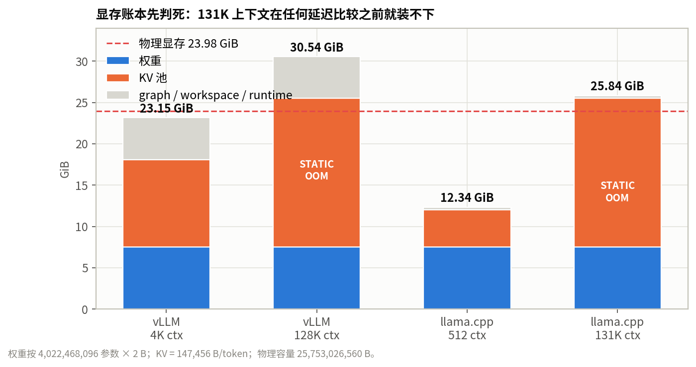
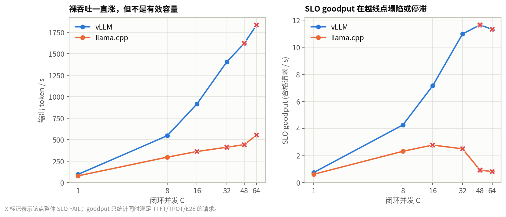
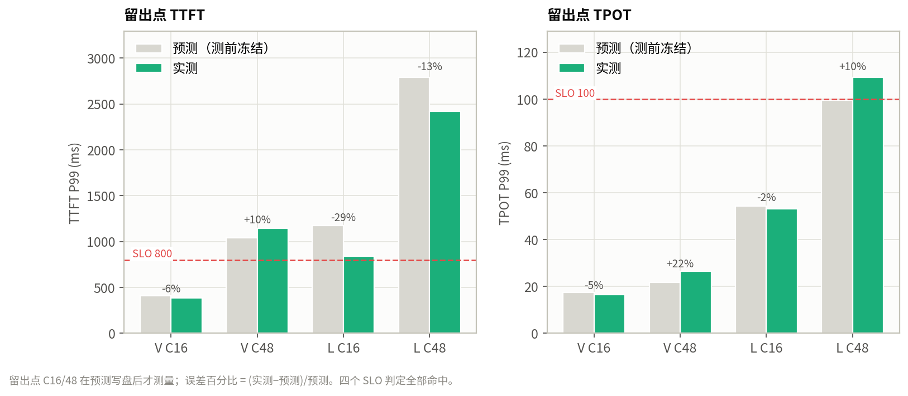
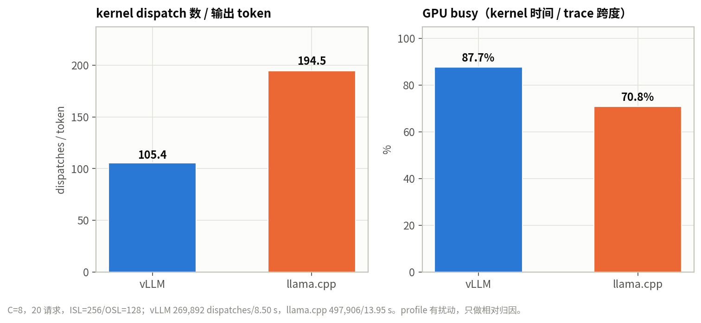

# 第 8 章 推理框架的系统取舍、Profile 与性能分析

## 本章导读

> 把同一个 4B 参数模型放到同一张显卡上，发送完全相同的一组请求，仅仅把推理服务从 llama.cpp 换成 vLLM，首 token 延迟和满足服务目标的最大并发数就可能相差数倍。如果只把两个框架的峰值吞吐并排做成排行榜，我们依然不知道这些差距究竟来自计算内核更快、发射次数更少、调度策略不同，还是因为两个框架在权重格式、上下文预算和 KV 缓存池大小上本来就做了不同的工程取舍。
>
> 作为第 1 篇的收口章，本章把前面几章分散建立的 Roofline 下界（第 1 章）、真机剖析（第 2 章）、显存账本（第 3 章）与排队容量（第 7 章）汇合到真实的框架横评中。8.1 先拆解推理框架内部的四条系统取舍轴，并交代控制变量的测量契约与 TPOT 修正口径。8.2 在做任何延迟测试前先算静态显存账，并用真机 OOM 探针与解析筛选器的负结果说明预筛模型的边界。8.3 在同一张 RX 7900 XTX 上执行并发扫描，对比裸吞吐与 SLO 有效吞吐的背离，并用 Little 定律追查延迟去向。8.4 用低并发三点拟合经验幂律，在测前冻结的留出点上检验粗筛能力与外推局限。8.5 用框架级内核 Profile 观察派活次数、GPU 忙碌比例与算子占比，并串起前几章的模型解释全部差异。8.6 审计跨框架比较中的不等价变量，给出带有明确边界的选型决策。章末实验与练习提供离线存档的核对步骤。

## 教学目标

- 能从执行路径、算子融合、调度批处理与 KV 缓存组织四个维度解释推理框架的系统取舍，并说明为何不能仅凭裸吞吐比较框架优劣。
- 能在压测前先用静态显存账本排除不可行的长上下文配置，并区分解析筛选器在静态容量判定与高并发延迟预测上的可靠性边界。
- 能结合 P99 延迟、单请求不合格率、SLO 有效吞吐与 Little 定律，从并发扫描数据中确定工程安全水位与首次违约点。
- 能用低并发三点拟合经验幂律并在测前冻结的留出点上评估误差，解释小样本外推为何只能用于粗筛而不能替代真机验收。
- 能解读框架级内核 Profile 中的发射密度、GPU 忙碌比例与算子耗时占比，并在列明全部不等价变量的前提下作出严谨的选型结论。

## 8.1 推理框架的系统取舍与测量契约

同一个模型在不同推理引擎里跑出截然不同的速度与容量，并不是因为某一个框架掌握了神秘的矩阵乘法，而是因为推理框架必须在四条相互牵制的系统轴上做工程取舍：执行路径、算子融合、调度批处理与缓存组织。[Harvard MLSysBook：ML Frameworks](https://mlsysbook.ai/vol1/07_frameworks/07_frameworks.html) · [Model Serving](https://mlsysbook.ai/vol1/13_model_serving/13_model_serving.html)

### 执行路径与算子融合

第 1 章和第 2 章已经展示过 PyTorch eager 模式的瓶颈：每生成 1 个 token，CPU 都要把 30 多层网络拆成上千个小 kernel 逐个派发给 GPU。每次派发都要经过主机端框架调度、参数打包与驱动提交；当单步解码的计算量很小时，GPU 干完一个活只需几微秒，却要等 CPU 花十几微秒才能派来下一个活，导致显卡有一半时间都在空转。

为了压低这段发射空档，现代推理框架通常走两条互补的路线。第一条是**图捕获（CUDA Graph / HIP Graph）与编译**：在服务启动预热时，引擎针对若干固定批大小先跑一遍前向计算，把整串 kernel 的调用顺序和参数地址录制成一张静态执行图缓存在显存里；到了线上推理，CPU 只需要发出极少数次“重放整张图”的指令，GPU 就会按图索骥连续跑完所有层，几乎消除了层间的 CPU 发射间隙。第二条是**算子融合（kernel fusion）**：把相邻的归一化、残差加法、位置编码（RoPE）和 KV 写入合并进同一个内核，既减少了中间结果写回显存再读出的流量，也直接砍掉了大量零碎的 kernel 数量。

图捕获并不是免费午餐。引擎需要为不同批大小录制并保留多份图结构与固定地址的中间工作区，这会额外吃掉数 GiB 的显存。因此，在显存紧张的单卡设备上，是否开启图捕获、录制多少档批大小，本质上是一笔**用显存容量换发射效率**的系统交易——8.2 节的显存账本里，vLLM 的图与运行时预留高达 5.05 GiB 而 llama.cpp 只有 0.35 GiB，背后正是这道取舍。

### 调度策略与缓存组织

请求到达服务端的时刻不同，输入和输出长度也各不相同。推理引擎如何安排谁先算、谁和谁拼成一批，以及怎么给每条请求分配 KV 缓存，直接决定了高并发下的尾延迟与容量上限。

在调度侧，**连续批处理**（continuous batching）允许每轮前向结束后立刻把已经生成完毕的请求移出批次，马上把等待队列里的新请求补进来，避免短请求陪着长请求一起空等。[Orca (OSDI 2022)](https://www.usenix.org/conference/osdi22/presentation/yu) 当队列里出现长输入请求时，如果一轮之内强行做完它的全部 Prefill，正在解码的老请求就会遇到一次明显的停顿；**分块预填充**（chunked prefill）把长输入切成若干小块，每轮只塞进一部分与老请求的 Decode 一起计算，用少量首 token 延迟换取更平稳的输出间隔。[Sarathi-Serve (OSDI 2024)](https://www.usenix.org/system/files/osdi24-agrawal.pdf)

在缓存组织侧，不同框架的切法差异非常明显。vLLM 采用**统一分页 KV 池**（PagedAttention）：启动时把显存预算内剩余的全部空间划成一个大池子并切成固定大小的块，哪条请求变长了就按需从池子里多领几块，请求一结束立刻归还给池子。[PagedAttention / vLLM (SOSP 2023)](https://arxiv.org/abs/2309.06180) 相比之下，llama.cpp 服务端在配置 `--parallel`（并发槽位数）与总上下文 `--ctx-size` 时，通常按固定槽位预先切分上下文预算（例如本章配置的 64 个槽位、每槽 512 token，合计 32,768 token）。假设此时有两条请求同时到达，一条只需要 100 token，另一条需要 800 token：在统一分页池里，两条请求合计只占 900 token，可以轻松共存；而在每槽 512 token 的固定切分下，短请求浪费了 412 token 的槽位空间，长请求却可能因为越过单槽上限而无法直接放入。反过来，固定槽位的内存布局简单、运行时几乎没有额外预留，在低并发或短定长场景下非常轻量。

### 控制变量的测量契约与 TPOT 陷阱

既然四条轴相互耦合，拿一张只写着“最高 tok/s”的榜单对比两个框架是没有意义的。要让横评结果可核对、可归因，必须先固定硬件、模型、请求长度、采样参数和服务目标（SLO），形成一份**测量契约**。[Harvard MLSysBook：Benchmarking](https://mlsysbook.ai/vol1/12_benchmarking/12_benchmarking.html)

| 契约项 | 固定取值 |
| --- | --- |
| 硬件 | AMD Radeon RX 7900 XTX（23.98 GiB，`gfx1100`，宿主 GPU0，实验期间独占） |
| 模型 | Qwen3-4B（4,022,468,096 参数，36 层，隐藏维 2560，32 查询头 / 8 键值头，单头维度 128） |
| 负载 | 闭环压测，输入 256 token / 输出 128 token，`ignore_eos`，`temperature=0`，`top_p=1`，`seed=42` |
| 样本量 | 每档并发预热 2 条后正式发送 200 条请求 |
| 服务目标（SLO） | TTFT P99 $\le 800\;\text{ms}$，TPOT P99 $\le 100\;\text{ms}$，E2EL P99 $\le 15{,}000\;\text{ms}$，单点不合格率 $\le 1\%$ |
| 延迟口径 | $\mathrm{TTFT} = t_{\text{首 token}} - t_{\text{发出}}$；$\mathrm{TPOT} = (\mathrm{E2EL} - \mathrm{TTFT}) / (n_{\text{out}} - 1)$；$\mathrm{E2EL} = t_{\text{完成}} - t_{\text{发出}}$ |
| 吞吐口径 | 裸输出吞吐（tok/s）与满足全部单请求 SLO 的有效吞吐（goodput，req/s）分开报告 |

测量逐 token 平均耗时（TPOT）时，有一个在流式接口（SSE）压测中极易踩中的口径陷阱。假设服务端一共生成了 5 个输出 token，第 1 个 token 在 50 ms 到达客户端，最后 1 个 token 在 130 ms 到达客户端。按第 7 章的定义，生成后续 4 个 token 用了 $130 - 50 = 80\;\text{ms}$，真实的 TPOT 应当是 $80 / 4 = 20\;\text{ms}$。但如果服务端在高负载或网络缓冲下把中间几个 token 打包合并发送，客户端全程只收到 3 个 SSE 数据块（首块 50 ms、次块 90 ms、末块 130 ms），如果压测脚本误把“数据块数减一”当成“输出间隔数”，就会算出 $(130 - 50) / (3 - 1) = 40\;\text{ms}$——凭空高估了一倍。

实际压测中，vLLM 和 llama.cpp 都会出现多 token 合并进同一个 SSE 数据块的情况（仅在 vLLM 并发 1 的 200 条请求中，就有 23 条请求的数据块数少于实际输出 token 数）。因此，本章放弃早期按 SSE 块间隔计算的旧读数，全部采用由原始请求记录 `requests.jsonl` 按 $(\mathrm{E2EL} - \mathrm{TTFT}) / (\text{completion\_tokens} - 1)$ 重算的修正口径 `tpot_corrected_ms`（见 `results/framework/analysis.json`）。以 vLLM 并发 1 为例，修正前按块间隔算出的 TPOT P99 是 14.22 ms，按真实输出 token 数修正后为 **10.19 ms**——一个口径偏差就能把单流延迟高估近四成。

## 8.2 先算容量账，再跑延迟压测

面对一组候选部署配置，新手常犯的错误是直接把所有配置挨个起服务、跑压测，结果在长上下文配置上白白耗费大量时间等待崩溃或超时。正确的工程顺序应当是**显存先行**：先用第 3 章的容量公式筛掉静态显存装不下的候选，只把真正能装进显卡的配置送进延迟压测。

### 静态显存如何一票否决长上下文

根据[第 3 章](/part1-modeling/chapter3/) 3.1.2 节的 GQA 缓存公式，Qwen3-4B 有 36 层、8 个键值头、单头维度 128，在 BF16/F16（每元素 2 字节）下，每保存 1 个 token 的 KV 缓存需要：

$$
m_{\mathrm{kv}} = 2 \times 36 \times 8 \times 128 \times 2 = 147{,}456\;\text{B} = 144\;\text{KiB/token}.
$$

如果业务方提出要在单张 23.98 GiB 的 RX 7900 XTX 上开启 131,072 token（128K）上下文，我们可以立刻在纸上算出两笔硬账：单条 131K 请求的 KV 缓存就需要 $131{,}072 \times 144\;\text{KiB} = 18.00\;\text{GiB}$；而模型本身的 F16/BF16 权重（约 40.22 亿参数 × 2 字节）已经占去约 7.49 GiB。仅仅这两项相加就达到 **25.49 GiB**，哪怕不留任何图捕获、激活工作区或驱动上下文空间，也已经超过了 23.98 GiB 的物理上限。



把本章关心的四组候选配置排成同一张静态显存账本，可行与不可行一目了然：

| 候选配置 | 权重（GiB） | KV 缓存（GiB） | 图 / 工作区 / 运行时（GiB） | 账本合计（GiB） | 静态容量判定 |
| --- | ---: | ---: | ---: | ---: | --- |
| vLLM，4K 上下文，并发 48 | $7.49$ | $10.61$ | $5.05$ | $23.15$ | 物理容量内 |
| vLLM，128K 上下文，并发 1 | $7.49$ | $18.00$ | $5.05$ | $30.54$ | 超容量 |
| llama.cpp，512 上下文/槽，并发 48 | $7.49$ | $4.50$ | $0.35$ | $12.34$ | 物理容量内 |
| llama.cpp，131K 上下文，并发 1 | $7.49$ | $18.00$ | $0.35$ | $25.84$ | 超容量 |

这张账本依据的是配置参数与第 3 章 KV 几何，用来做启动前的可行性筛选，不能直接等同于进程运行时的显存采样（实际服务启动后，vLLM 预分配显存恒定在约 20.20 GiB，llama.cpp 在 13.5 GB 左右波动，差值来自 `gpu-memory-utilization` 预算比例、分配器块对齐与运行时空闲块）。

为了验证“静态超容量会在哪个环节失败”，我们用同一份 F16 GGUF 权重配合 `--ctx-size 131072` 在 RX 7900 XTX 上做了一次真机失败探针（日志见 `results/framework/llamacpp-memory-fail/probe.log`）。服务根本没有启动 HTTP 监听，更没有机会收到任何一条压测请求，而是在初始化 KV 缓存缓冲区时直接报错退出：

```text
n_ctx_seq (131072) > n_ctx_train (40960) -- possible training context overflow
ggml_backend_cuda_buffer_type_alloc_buffer: allocating 18432.00 MiB on device 0: cudaMalloc failed: out of memory
failed to allocate ROCm0 buffer of size 19327352832
```

报错中申请失败的 `18432.00 MiB`（`19,327,352,832 B`）与上面手算出的 `18.00 GiB` 逐字节完全相等，失败发生在模型初始化函数 `llama_init_from_model`。这给出了比任何模拟器警告都更直接的结论：**对于超长上下文候选，首次破坏的约束是静态显存，延迟曲线根本没有机会出现。**

### 解析筛选器能信什么、不能信什么

在跑真机之前，我们还用离线解析筛选器（`results/screen-qwen4b-7900xtx-v2/`）对这四组候选做了一遍自动预筛。筛选器给四个候选全判了 `FAIL`，但把它的报错原因和真机实测逐项核对，会看到截然不同的两面：

| 候选配置 | 筛选器结论 | 首次破坏的约束 | 与真机实测对照 |
| --- | --- | --- | --- |
| vLLM，4K / C48 | FAIL | 解析 TTFT P99 = 66,029 ms > 800 ms | 严重失真（真机实测 1,147.30 ms） |
| llama.cpp，512 / C48 | FAIL | 解析 TTFT P99 = 66,029 ms > 800 ms | 严重失真（真机实测 2,421.73 ms） |
| vLLM，131K / C1 | FAIL | 固定显存需求 32.79 GB > 25.75 GB | 有效（与静态容量不足方向一致） |
| llama.cpp，131K / C1 | FAIL | 固定显存需求 27.75 GB > 25.75 GB | 有效（与真机 OOM 探针一致） |

为什么同一个工具，在 131K 静态显存上判断得非常准，到了并发 48 的延迟预测却算出离谱的 66 秒（比真机高出二十到五十倍）？原因就在两类计算的物理本质不同。静态显存只做**确定性加法**（权重加 KV 加预留），不需要猜测请求在时间轴上怎么重叠，所以解析账本非常稳健；而高并发延迟取决于批处理内权重被复用了多少次、Prefill 与 Decode 如何混批推进。当前解析后端没有充分建模批内权重复用，把 48 条并发请求近似成了几十次彼此独立的整网权重扫描，耗时自然被放大了数十倍。

保留这组负结果比藏起来更有教学价值。它提醒我们：使用性能模拟器或筛选器时，不能把它当成全能黑盒，而要**分项检验、分项采信**——在本章的筛选器里，静态显存判定可以放心用来砍掉不可行配置，高并发延迟数字则必须交回真机压测或校准后的离散事件模型。

## 8.3 裸吞吐与有效容量的背离

筛掉不可行的长上下文配置后，我们在同一张 RX 7900 XTX 上对 vLLM（KV 池 77,248 token，约 10.61 GiB）和 llama.cpp（64 槽位 × 512 token = 32,768 token，约 4.50 GiB）执行闭环并发扫描。为了排除前缀复用干扰，两个服务均关闭了前缀缓存，每条请求的输入彼此独立。

### 为什么裸吞吐还在涨，服务却已经不可用

当客户端把在途并发上限 $C$ 从 1 依次推高到 8、32、64 时，每一步前向计算都会把更多请求打包进同一个批次。正如第 1 章分析的那样，线性层权重复用次数随批大小上升，GPU 的整体输出速率（裸输出吞吐，单位 tok/s）会一路走高。但站在等待回答的单个用户视角，批大小变大后，每步的 KV 读取和计算时间都在变长，新请求进队列后还要等前面正在处理的批次腾出计算额度。于是会出现一个极具迷惑性的分叉：服务端总产出还在继续攀升，越来越多用户的首 token 延迟却已经越过可接受的红线。

四档主扫描的实测数据清楚呈现了这一分叉（数据见 `results/framework/analysis.json`）：

| 框架与并发 $C$ | TTFT P99（ms） | TPOT P99（ms） | E2EL P99（ms） | 裸输出（tok/s） | SLO 有效吞吐（req/s） | 合格请求数 | 整档判定 |
| --- | ---: | ---: | ---: | ---: | ---: | ---: | --- |
| vLLM · $C=1$ | $40.24$ | $10.19$ | $1{,}330.00$ | $96.43$ | $0.753$ | $200 / 200$ | PASS |
| vLLM · $C=8$ | $206.05$ | $14.25$ | $1{,}877.16$ | $546.79$ | $4.272$ | $200 / 200$ | PASS |
| vLLM · $C=32$ | $780.35$ | $20.74$ | $2{,}920.09$ | $1{,}406.22$ | $10.986$ | $200 / 200$ | PASS |
| vLLM · $C=64$ | $1{,}564.51$ | $30.30$ | $4{,}948.88$ | $1{,}834.59$ | $11.323$ | $158 / 200$ | FAIL |
| llama.cpp · $C=1$ | $124.86$ | $12.55$ | $1{,}693.72$ | $79.79$ | $0.623$ | $200 / 200$ | PASS |
| llama.cpp · $C=8$ | $778.33$ | $32.47$ | $4{,}900.64$ | $297.29$ | $2.323$ | $200 / 200$ | PASS |
| llama.cpp · $C=32$ | $1{,}867.03$ | $86.37$ | $12{,}015.42$ | $412.89$ | $2.500$ | $155 / 200$ | FAIL |
| llama.cpp · $C=64$ | $3{,}859.00$ | $112.41$ | $17{,}146.44$ | $553.48$ | $0.822$ | $38 / 200$ | FAIL |




对比左右两张图就能看出为什么不能拿裸吞吐当容量指标。vLLM 的裸输出从并发 1 的 96.43 tok/s 一路涨到并发 64 的 1,834.59 tok/s；llama.cpp 也从 79.79 tok/s 持续涨到 553.48 tok/s。但一旦按 SLO 逐条核对每条请求是否合格，两者的有效产出立刻出现拐点：

在 vLLM 上，并发 64 的 TPOT P99（30.30 ms）与 E2EL P99（4,948.88 ms）都远低于门槛，但首 token 延迟 TTFT P99 冲到了 1,564.51 ms，200 条请求里有 42 条首 token 超时（不合格率 21%，远高于 1% 的上限）。并发翻倍付出的是整档违约的代价，换来的 SLO 有效吞吐却只从 10.986 req/s 微增到 11.323 req/s（仅涨 3.1%）。

在 llama.cpp 上，违约来得更早、塌陷更剧烈。并发 8 时 TTFT P99 已经达到 778.33 ms，紧贴 800 ms 红线；到了并发 32，虽然 TPOT P99（86.37 ms）和 E2EL P99（12,015.42 ms）都还在各自门槛以内，TTFT P99 却已翻倍越线至 1,867.03 ms，45/200 条请求超时不合格。继续推到并发 64，TTFT（3,859.00 ms）、TPOT（112.41 ms）和 E2EL（17,146.44 ms）三项 P99 同时越线，200 条里只剩 38 条合格，有效吞吐从 2.500 req/s 暴跌至 0.822 req/s——还不到并发 8 时的三分之一。

结合 8.4 节的留出测点，两个框架在本契约下的工程安全水位与首次违约边界可以明确画出来：

| 框架 | 最大已测通过点 | 首次违约点 | 裸吞吐最高测点 | 工程安全水位 |
| --- | ---: | ---: | ---: | --- |
| vLLM | $C=32$ | $C=48$（留出点） | $C=64$ | $C=32$（有效吞吐 $10.986\;\text{req/s}$） |
| llama.cpp | $C=8$ | $C=16$（留出点，仅超 $38.66\;\text{ms}$） | $C=64$ | $C=8$（有效吞吐 $2.323\;\text{req/s}$） |

### 用 Little 定律和容量账追查延迟去向

看到高并发延迟陡升后，紧接着要问两个机制问题：并发翻倍多出来的在途请求究竟变成了什么？高并发违约是不是因为 KV 显存装不下触发了抢占？

第一个问题可以直接用[第 7 章](/part1-modeling/chapter7/)的 **Little 定律**核对。在闭环压测的稳态窗口里，客户端始终维持 $C$ 条在途请求，完成速率为 $X$（req/s），那么平均每条请求的端到端逗留时间约为 $\bar W \approx C / X$。拿主扫描的并发 32 和 64 代入算一遍：vLLM 在并发 32 时的完成速率为 10.986 req/s，$32 / 10.986 \approx 2.91\;\text{s}$（实测 E2EL P50 为 2.71 s）；并发翻倍到 64 时，完成速率只从 10.986 涨到 14.333 req/s（仅增 30%），于是平均逗留时间被迫拉长到 $64 / 14.333 \approx 4.47\;\text{s}$（实测 E2EL P50 为 3.98 s、P99 为 4.95 s）。llama.cpp 呈现完全相同的规律：并发 32 时 $32 / 3.226 \approx 9.92\;\text{s}$（实测 P50 为 9.39 s），并发 64 时完成速率只涨到 4.324 req/s，平均逗留时间拉长到 $64 / 4.324 \approx 14.80\;\text{s}$（实测 P50 为 14.47 s）。当服务接近吞吐天花板时，继续塞入并发不会让服务器处理得快一倍，只会让每条请求在系统里多等一倍的时间。

第二个问题可以用监控指标和第 3 章容量账交叉排除。在 vLLM 的全部压测档位中，服务端暴露的 `vllm:num_preemptions_total` 增量始终为 **0**，没有发生一次因显存不足导致的请求抢占。而在 llama.cpp 这边，64 条定长请求（每条输入 256 + 输出 128 = 384 token）同时在途所需的总 KV 缓存是 $64 \times 384 = 24{,}576\;\text{tokens}$，仍然小于它预先分配好的 32,768 token 总槽位容量。由于 llama.cpp 服务端没有暴露与 vLLM 直接等价的抢占计数器，我们不妄下断言它内部是否发生过任何缓存置换，但容量账已经证明：**显存池本身装得下全部 64 条定长请求，观察到的高并发尾延迟恶化首先来自准入排队与每步计算时间的拉长，而不是显存装不下导致的反复抢占。**

## 8.4 低并发粗筛与外推边界

实际工程调优中，把每档并发都跑满 200 条请求既花时间又占显卡。主扫描里的并发 64 在分析时已经见过真实结果，不能用来证明“事前预测能力”。因此，本节专门测试一个实用的工程问题：如果只花较少成本测完 $C \in \{1, 8, 32\}$ 三档低中并发，能不能用一条简单的经验曲线，在实测之前就猜中 $C=16$ 和 $C=48$ 哪一档能过、哪一档会违约？

### 用低并发三点拟合经验幂律

观察图中的延迟增长趋势，在双对数坐标下，首 token 延迟与单 token 间隔随并发数大致呈线性上升。我们只取 $C \in \{1, 8, 32\}$ 三个已测点（明确把已经看过的 $C=64$ 排除在拟合与验收之外），分别为两个框架拟合两条经验幂律：

$$
\log(\mathrm{TTFT}_{99}) = a_{\mathrm{T}} + b_{\mathrm{T}} \log C,
\qquad
\log(\mathrm{TPOT}_{99}) = a_{\mathrm{P}} + b_{\mathrm{P}} \log C.
$$

因为每条请求的输出长度固定为 128 token（含 127 个输出间隔），端到端延迟 P99 可近似合成为 $\mathrm{E2EL}_{99} = \mathrm{TTFT}_{99} + 127 \times \mathrm{TPOT}_{99}$。为了守住“预测先于测量”的验证纪律，脚本先把并发 16 与 48 的预测值写入 `prediction-holdout.json` 冻结（时间戳 `2026-11-23T04:22:20Z`），之后才在真机上执行留出压测并生成验收文件 `holdout-analysis.json`（时间戳 `04:30:53Z`）。



| 框架与并发 | TTFT P99 预测 → 实测（误差） | TPOT P99 预测 → 实测（误差） | E2EL P99 预测 → 实测（误差） | SLO 预测 → 实测 |
| --- | ---: | ---: | ---: | --- |
| vLLM · $C=16$ | $408.74 \to 386.20$（$-5.5\%$） | $17.40 \to 16.57$（$-4.8\%$） | $2{,}618.59 \to 2{,}178.94$（$-16.8\%$） | PASS → PASS |
| vLLM · $C=48$ | $1{,}039.92 \to 1{,}147.30$（$+10.3\%$） | $21.72 \to 26.57$（$+22.3\%$） | $3{,}798.02 \to 4{,}033.74$（$+6.2\%$） | FAIL → FAIL |
| llama.cpp · $C=16$ | $1{,}173.08 \to 838.66$（$-28.5\%$） | $54.42 \to 53.18$（$-2.3\%$） | $8{,}084.38 \to 7{,}124.30$（$-11.9\%$） | FAIL → FAIL |
| llama.cpp · $C=48$ | $2{,}789.04 \to 2{,}421.73$（$-13.2\%$） | $99.43 \to 109.23$（$+9.9\%$） | $15{,}416.86 \to 14{,}858.43$（$-3.6\%$） | FAIL → FAIL |

四个留出点的通过/失败判定全部命中：预测正确指出并发 16 时 vLLM 通过而 llama.cpp 失败，并发 48 时两者均失败。四点平均绝对百分比误差（MAPE）分别为 TTFT 14.38%、TPOT 9.816% 和 E2EL 9.623%。

### 为什么四点全中也不能替代真机验收

尽管 SLO 判定实现了 4/4 全中，但这组数字里藏着三条非常清楚的警告，说明经验幂律只适合做**选点粗筛**，绝不能直接用来签发线上 SLA 容量。

第一，**统计自由度极低**。用 3 个数据点拟合 2 个参数（截距和斜率），只剩下 1 个自由度，根本不足以做严格的统计显著性检验；预测文件里附带的误差区间只是按残差标准差算出的经验启发式带，不能当成数学上的置信区间。

第二，**阈值附近的边缘点对噪声高度敏感**。llama.cpp 在并发 16 实测 TTFT P99 为 838.66 ms，只比 800 ms 的红线高出 38.66 ms，200 条请求里其实有 196 条都合格了。如果换一组随机到达顺序或轻微的系统抖动，它完全可能落回 800 ms 以下。因此，把并发 16 记作“边缘违约”远比宣称“模型精准锁定了违约边界”诚实。

第三，**靠近排队拐点时，幂律会系统性低估非线性加速**。在 vLLM 并发 48 上，预测 TPOT P99 为 21.72 ms，实测却冲到了 26.57 ms（低估 22.3%）。因为第 7 章已经证明，排队延迟在利用率逼近 1 时呈双曲线急剧抬头，而简单幂律假设双对数坐标下斜率恒定，一旦跨过拐点就会跟不上真实曲线的翘头速度。

因此，低并发三点拟合的真正价值在于**缩小搜索范围**：它帮你快速圈出“vLLM 的边界大概在 32 到 48 之间，llama.cpp 的边界大概在 8 到 16 之间”，省去盲目扫全图的成本；但最终上线前，仍必须在目标安全水位上用真机实测一锤定音。

## 8.5 用框架级 Profile 看清时间花在哪里

压测数据回答了“谁在什么并发下违约”，但并没有打开引擎黑盒。要弄清 vLLM 和 llama.cpp 在同一张显卡上为什么会拉开几倍差距，必须借助内核级性能剖析（Profile）去看 GPU 时间线里到底发生了什么。

### 派活次数、GPU 忙碌比例与算子构成

想象一条 GPU 执行时间线：如果把整段测量时间看作一根长条，GPU 真正执行计算内核（kernel）的区间是涂黑的“干活段”，两个相邻内核之间的空白则是“发呆空档”。把所有涂黑的干活段加起来，除以整条时间线的总跨度，就得到 **GPU 忙碌比例（GPU busy）**；而在同样输出 1 个 token 的前提下，时间线上被切成了多少段零碎的干活块，就是**每输出 token 的内核发射次数（dispatches / token）**。

我们在并发 8、20 条请求（输入 256 / 输出 128）下分别采集了两个框架的轨迹：vLLM 通过内置 `/start_profile` 接口调用 `torch.profiler`，llama.cpp 使用 `rocprofv3 1.4.1` 进程附加追踪，按原始 trace 哈希生成的摘要保存在 `results/framework/profile-summary.json` 中。牢记第 2 章建立的测量纪律：开启剖析工具本身会引入逐核记录开销并拉长墙钟时间，而且两个框架的插桩路径不同，因此这里只拿 Profile 结果做**相对结构归因**，不用它的总跨度替代 8.3 节的低开销压测延迟。



| Profile 指标（$C=8$，20 请求） | vLLM | llama.cpp |
| --- | ---: | ---: |
| 总 kernel 发射次数（dispatches） | $269{,}892$ | $497{,}906$ |
| 追踪窗口总跨度 | $8.50\;\text{s}$ | $13.95\;\text{s}$ |
| GPU kernel 执行时间合计 | $7{,}456.09\;\text{ms}$ | $9{,}871.50\;\text{ms}$ |
| GPU 忙碌比例（kernel 时间 / 跨度） | $87.73\%$ | $70.77\%$ |
| 每输出 token 的 kernel 发射次数 | $105.4$ | $194.5$ |
| GEMM 执行时间占比 | $89.18\%$ | $89.32\%$ |
| Attention 执行时间占比 | $6.25\%$ | $4.83\%$ |
| Norm / RoPE 执行时间占比 | $1.45\%$ | $3.25\%$ |

把这张表从上往下读，三条关键事实非常清晰。第一，在生成同样数量的输出 token 时，llama.cpp 派发了近 50 万次 kernel（平均每输出 1 个 token 派发 194.5 次），而 vLLM 凭借 `torch.compile`、HIP Graph 与更深度的算子融合，只派发了约 27 万次（每输出 1 个 token 105.4 次）。发射密度相差 1.84 倍，直接把 llama.cpp 的 GPU 忙碌比例拉低到 70.77%，意味着接近三成时间显卡都在等活干；vLLM 则把 GPU 忙碌比例维持在 87.73%。

第二，两个框架的 GPU 算子构成惊人地一致：**GEMM（矩阵乘）都占了约 89% 的 GPU 执行时间，Attention 只占 5%–6%**。这打破了一个常见误解——在这种 256/128 的短上下文、解码主导的负载里，注意力机制并不是第一瓶颈，两个框架的差距不能简单推给“谁的 FlashAttention 写得更好”，而是落在矩阵乘有效效率、小算子融合（注意 Norm/RoPE 占比 vLLM 仅 1.45%，llama.cpp 为 3.25%）以及整体发射密度上。

第三，借助 vLLM 轨迹中的阶段注解，还可以把它的 GPU 时间线进一步切开，观察不同执行阶段的饱和度：

| vLLM 阶段注解 | 出现次数 | kernel 数 | kernel 总时间（ms） | 注解跨度（ms） | 阶段 GPU 忙碌比例 |
| --- | ---: | ---: | ---: | ---: | ---: |
| `prefill` | $5$ | $2{,}255$ | $158.40$ | $233.60$ | $67.81\%$ |
| `decode` | $635$ | $258{,}998$ | $6{,}295.36$ | $7{,}188.32$ | $87.58\%$ |
| `mixed chunked prefill` | $3$ | $1{,}353$ | $385.45$ | $397.91$ | $96.87\%$ |

在 vLLM 里，绝大部分步数都在执行解码（635 次），图捕获把解码阶段的 GPU 忙碌比例推到了 87.58%；而当调度器把分块预填充和解码合并在同一轮执行（`mixed chunked prefill`）时，每轮的计算密度大幅提高，GPU 忙碌比例更是飙升到 **96.87%**。

### 把第 1、3、7 章的模型合起来解释整张账

把前面几章的解析模型拿回来对照本章数据，整个第 1 篇的知识链条就完全闭环了。

先看**第 1 章的 Roofline 下界**。在并发 1 单流解码时，每生成 1 个 token 都要把 Qwen3-4B 约 8.04 GB 的 BF16/F16 权重从显存完整扫过一遍。RX 7900 XTX 的标称显存带宽是 960 GB/s，因此单步解码的物理访存下界为 $8.04 / 960 \approx 8.38\;\text{ms/token}$。对照 8.3 节实测：vLLM 并发 1 的修正 TPOT P99 为 10.19 ms，折合有效带宽约 790 GB/s，达到标称带宽的 **82%**；llama.cpp 为 12.55 ms，折合有效带宽约 641 GB/s，达到标称带宽的 **67%**。低并发下 vLLM 更快，并不是一句泛泛的“实现更好”，而是可以落到实实在在的权重扫描带宽利用率差距上。

再看**第 3 章的显存与 KV 账本**。同样服务 256/128 定长请求（每条 384 token），vLLM 的 77,248 token 统一池理论上能装下约 201 条请求，实际受 `max-num-seqs=64` 限制，相当于相对并发 64 留出了超过 3 倍的缓存余量；而 llama.cpp 的 32,768 token 总槽位池最多对应约 85 条，相对并发 64 只剩 1.33 倍余量。虽然两者在并发 64 时都没有撞上静态 OOM，但缓存余量更紧张的一方，在面对波动长度和并发调度时回旋空间更小。

最后看**第 7 章的排队与混批调度**。前面已经用 Little 定律算过，并发从 32 翻倍到 64 后，新增在途请求几乎全部变成了更长的排队与逗留时间，且 P99 涨得比 P50 快得多，说明尾部请求同时承受了准入等待和预填充/解码的相互干扰。vLLM 的分块预填充把混合阶段的 GPU 忙碌比例推到 96.87%，大幅提高了有效并发水位（$C=32$ 对比 $C=8$），但它改变不了硬件吞吐上限——一旦并发推到 64，排队积压依然会把 TTFT P99 推过 800 ms 的红线。

## 8.6 跨框架比较的混淆变量与选型方法

做完上面一整套压测和 Profile，最容易滑向一个草率的结论：“既然 vLLM 在这张卡上达标并发是 llama.cpp 的 4 倍，那一定是 vLLM 的连续批处理调度器比 llama.cpp 强 4 倍。”在系统评测里，这是一个典型的**混淆变量归因错误**。

### 为什么不能把框架差距全归功于调度器

当你把推理服务从 llama.cpp 切换到 vLLM 时，你并不是在实验室里“只换了调度器这一颗螺丝”，而是同时更换了整套软件栈：模型权重从 F16 GGUF 换成了 BF16 Hugging Face；底层算子库和图执行路径从 ggml 融合核换成了 PyTorch 编译加 HIP Graph；KV 缓存从 32,768 token 的固定槽位换成了 77,248 token 的统一分页池；甚至连 HTTP 协议解析、流式分块和采样器代码都完全不同。

为了防止读者把“整套配置差异”误读成“单一组件能力”，任何负责任的框架横评都必须附上一份**不等价项账本**，把同时变动的变量全部摊在台面上：

| 不等价维度 | vLLM 配置 | llama.cpp 配置 | 对实验结果的影响 |
| --- | --- | --- | --- |
| 权重格式 | BF16 Hugging Face | F16 GGUF | 字节量相近，但张量布局与调用的底层矩阵核不同 |
| 服务接口层 | vLLM OpenAI Server | llama.cpp OpenAI 兼容层 | 请求解析、流式分块封装与采样路径不同 |
| 单序列上下文上限 | `max-model-len=4096`，64 并发 | 64 槽位 × 512 token | 每条请求可用的最大上下文与槽位切分方式不同 |
| KV 缓存池 | 77,248 token（10.61 GiB） | 32,768 token（4.50 GiB） | 缓存容量分母与高并发余量不同 |
| 执行路径 | `torch.compile` + HIP Graph + 分块预填充 | 融合 kernel 路径，未见同等图捕获 | 每 token 发射次数与 GPU 忙碌比例差异的主因之一 |
| 前缀缓存 | 关闭 | `--no-cache-prompt` | 本章负载无共享前缀，不影响当前排序 |
| 注意力后端 | 默认 SDPA / Flash 路径 | `--flash-attn on` | 短上下文下仅占 GPU 时间 5%–6%，影响较小 |
| 采样实现 | vLLM 采样器 | llama.cpp 采样器 | 温度设 0 消除了随机性，但实现代码不同 |

摊开这张账本后，严谨的结论写法就很清楚了：我们能说**“在本章冻结的 RX 7900 XTX、Qwen3-4B、256/128 短上下文与各自常规部署配置下，vLLM 的 SLO 有效容量高于 llama.cpp”**，而不能说“vLLM 的调度器单独带来了 4 倍容量”。如果想单独测量调度器的贡献，必须固定同一套权重格式、底层算子与上下文预算，只替换调度策略——那是受控消融实验，而非端到端框架横评。

### 按约束条件做选型与声明结论边界

落到工程选型时，脱离具体约束谈“谁更好”没有意义。把本章全部实测证据按业务约束压缩成决策参考：

| 应用场景（单卡 24 GiB，Qwen3-4B，256/128，无共享前缀） | 建议选择 | 实测依据与约束 |
| --- | --- | --- |
| 要求满足 800/100/15,000 ms SLO，追求高并发有效容量 | 选 vLLM，工程安全水位设在 $C=32$ | $C=32$ 为最大已测通过点（goodput $10.986\;\text{req/s}$），$C=48$ 首次违约 |
| 仅需低并发（$C \le 8$），两者均可部署 | 两者均达标，vLLM 延迟余量更大 | vLLM $C=8$ TTFT P99 为 206 ms；llama.cpp 为 778 ms，已紧贴 800 ms 上限 |
| 要求支持 131K 超长上下文（F16/BF16） | 当前单卡配置不可行 | 仅 KV 缓存就需 18.00 GiB，真机初始化直接 OOM；需量化 KV、缩短上下文或换更大显存 |
| 离线批处理、只追求最大化裸吞吐且不设 TTFT 门槛 | 两者均可推至 $C=64$ | vLLM 裸输出达 $1{,}835\;\text{tok/s}$，llama.cpp 达 $553\;\text{tok/s}$ |
| 存在大量共享长前缀、多轮对话或 INT4/FP8 量化 | 本章数据不能直接外推 | 本章关闭了前缀缓存且未测试量化或 SGLang 等方案，需在目标场景重新实测 |

最后要诚实划清本章的边界：所有结论仅适用于 RX 7900 XTX、Qwen3-4B BF16/F16、短定长无共享前缀负载与冻结的 SLO 门槛；每档 200 条请求算出的 P99 仍有抽样波动，不能直接等同于线上长期 SLA 承诺。本章没有测试 INT4/FP8 量化是否会反转两个框架的排序（llama.cpp 的量化内核生态是其传统强项），也没有覆盖面向前缀复用的 SGLang（RadixAttention）、多卡并行或预填充/解码分离（DistServe）部署。[SGLang (NeurIPS 2024)](https://arxiv.org/abs/2312.07104) · [DistServe (OSDI 2024)](https://www.usenix.org/system/files/osdi24-zhong-yinmin.pdf)

至此，第 1 篇从单算子 Roofline、真机 Profile、显存账本、量化、通信、并行、排队论到推理框架的建模基础已经全部搭完。进入第 2 篇后，我们将把这些模型与分析工具带入端侧受限资源、单机 SLA 容量规划和多节点智能体工作流的真实系统设计任务中。

## 实验：框架横评、留出检验与 Profile 归因

本实验复现本章的四项核心验证：静态显存筛选与 OOM 日志核对、并发扫描与 TPOT 口径修正、留出幂律检验，以及内核级 Profile 归因。如果手边没有 RX 7900 XTX 或双框架服务环境，可直接读取 `code/part1-modeling/chapter8/results/framework/` 下的离线存档完成全部计算与检查。

### 步骤 1：核对显存账本与 131K OOM 探针

进入仓库的 `code/part1-modeling/chapter8` 目录。打开真机失败探针日志 `results/framework/llamacpp-memory-fail/probe.log`，定位 `allocating 18432.00 MiB` 与 `failed to allocate ROCm0 buffer of size 19327352832` 两行，并与 8.2 节公式算出的 $131{,}072 \times 144\;\text{KiB}$ 逐字节核对。随后查看 `results/screen-qwen4b-7900xtx-v2/artifacts/checks.csv`，对比静态显存失败与并发 48 解析延迟（66 秒）两类结果的可靠性差异。

### 步骤 2：重算修正后的 TPOT 与并发容量表

运行离线分析脚本（纯 CPU 即可从原始 `requests.jsonl` 重建 `analysis.json`）：

```bash
cd code/part1-modeling/chapter8
python3 analyze_framework.py
```

打开 `results/framework/analysis.json`，完成两项核对：

1. 在 `points.vllm` 的并发 1 记录中，比较 `tpot_stream_chunk_ms_old.p99`（14.22 ms）与 `tpot_corrected_ms.p99`（10.19 ms），并查看 `stream_chunk_token_mismatch_requests`（23 条请求出现多 token 合并进同一 SSE 数据块）。
2. 遍历 `points.vllm` 与 `points.llamacpp` 的四个并发档，核对 `slo_passed_requests`、`slo_failure_reason_counts` 与 `slo_goodput_requests_per_s`，确认两个框架在并发 32 和 64 各自是哪几项指标超标。

### 步骤 3：核对留出预测与实测误差

运行留出预测与留出验收分析脚本（基于已有存档）：

```bash
python3 predict_holdout.py
python3 analyze_holdout.py
```

打开 `results/framework/holdout-analysis.json`，检查 `prediction_generated_at` 早于 `generated_at` 的时间顺序，并读取 `rows` 中四个留出点的 `error_pct` 与 `summary.mape_pct`，核对 llama.cpp $C=16$ 超出 800 ms 阈值的具体毫秒数（38.66 ms）。

### 步骤 4：读取框架级 Profile 摘要

运行摘要生成脚本或直接打开 `results/framework/profile-summary.json`：

```bash
python3 summarize_profiles.py
```

比较 `vllm` 与 `llama` 节点下的总 kernel 发射数、每输出 token 发射数、GPU 忙碌比例以及 GEMM / Attention / Norm 占比，验证短上下文解码负载下 GEMM 占绝对主导的结论。

## 练习

1. 在 Qwen3-4B（36 层，8 个键值头，单头维度 128）上，若改用 FP8 存储 KV 缓存（每元素 1 字节），131,072 token 的单请求 KV 缓存占用会从 18.00 GiB 降到多少？加上 7.49 GiB 的 BF16 权重和 5.05 GiB 的 vLLM 运行时开销，能否装进 23.98 GiB 的 RX 7900 XTX？
2. 某条请求输出了 128 个 token，测得 TTFT 为 50 ms，E2EL 为 1,320 ms。流式传输期间由于网络与服务端合并，客户端一共只收到 90 个 SSE 数据块（首块在 50 ms，末块在 1,320 ms）。分别计算按“修正后的真实 token 口径”和“旧流式块间隔口径”得到的 TPOT，并求旧口径相对真实口径高估了多少百分比。
3. 在 8.3 节主扫描表中，vLLM 在 $C=64$ 时 200 条请求里有 158 条通过单请求 SLO，请求完成速率为 14.333 req/s，裸输出吞吐为 1,834.59 tok/s。验证其 SLO 有效吞吐（goodput）约为 11.323 req/s，并说明为什么即使有效吞吐比 $C=32$（10.986 req/s）高出 3.1%，$C=64$ 仍被判为 FAIL。
4. 沿用 8.3 节数据。用 Little 定律估算 llama.cpp 在 $C=8$（完成速率 $2.323\;\text{req/s}$）与 $C=32$（完成速率 $3.226\;\text{req/s}$）下的平均客户端逗留时间 $\bar W$。并发数扩大为 4 倍，完成速率和平均逗留时间分别扩大了多少倍？
5. 在 8.4 节中，仅用 $C \in \{1, 8, 32\}$ 三个点拟合出的幂律在四个留出点上实现了 4/4 的 SLO 判定命中。有人据此认为“既然 4/4 全中，以后上新硬件只需测三个低并发点，就可以直接签发线上 SLA 容量，无需实测目标并发”。指出这个推论的两处漏洞。
6. 在 8.5 节 $C=8$ 的 Profile 表中，llama.cpp 的每输出 token kernel 发射数是 vLLM 的 1.84 倍（194.5 vs 105.4），同时两者的 GEMM 时间占比都约为 89%。能否由此得出结论“llama.cpp 的 GEMM 算子比 vLLM 慢 1.84 倍”？应该如何正确解读这两组数字？
7. 某团队想测试“vLLM 的连续批处理调度器是否比 llama.cpp 的调度器更优秀”，于是直接用 BF16 Hugging Face 权重运行 vLLM（KV 池 77,248 token、开启 HIP Graph），用 Q4_K_M GGUF 权重运行 llama.cpp（KV 池 32,768 token、无图捕获），测得 vLLM 延迟更低后宣布“vLLM 调度器完胜”。指出该实验设计至少混淆了哪四个不等价变量。

::: details 参考答案

1. KV 精度减半至 1 字节后，每 token KV 占用减半为 72 KiB，131,072 token 的 KV 缓存降至 **9.00 GiB**。加上 7.49 GiB 权重与 5.05 GiB 运行时开销，合计 $9.00 + 7.49 + 5.05 = 21.54\;\text{GiB} < 23.98\;\text{GiB}$，从静态账本看已经落回物理显存上限以内（实际仍需留出驱动余量并实测验证）。
2. 修正口径：$\mathrm{TPOT}_{\text{新}} = (1320 - 50) / (128 - 1) = 1270 / 127 = 10.00\;\text{ms}$。旧块间隔口径：$\mathrm{TPOT}_{\text{旧}} = (1320 - 50) / (90 - 1) = 1270 / 89 \approx 14.27\;\text{ms}$。旧口径高估了 $(14.27 - 10.00) / 10.00 = 42.7\%$。
3. 合格比例 $p = 158 / 200 = 0.79$，有效吞吐 $= 14.333 \times 0.79 \approx 11.323\;\text{req/s}$。$C=64$ 仍判为 FAIL 是因为 SLO 要求整档 TTFT P99 $\le 800\;\text{ms}$ 且不合格率 $\le 1\%$，而该档 TTFT P99 达到 1,564.51 ms、42/200 条请求超时（不合格率 21%），两项硬约束均已违约。
4. $C=8$ 时 $\bar W \approx 8 / 2.323 \approx 3.44\;\text{s}$；$C=32$ 时 $\bar W \approx 32 / 3.226 \approx 9.92\;\text{s}$。并发数扩大 4 倍后，完成速率仅扩大约 $3.226 / 2.323 \approx 1.39\times$，而平均逗留时间扩大了约 $9.92 / 3.44 \approx 2.88\times$，说明大部分新增并发转化成了排队与逗留时间。
5. 漏洞一：3 个点拟合 2 个参数只剩 1 个自由度，且 llama.cpp $C=16$ 的实测 TTFT P99（838.66 ms）仅超出阈值 38.66 ms，在阈值附近存在较高的误判风险。漏洞二：随着并发逼近排队拐点，延迟增长呈非线性加速（如 vLLM $C=48$ 的 TPOT 误差已达 $+22.3\%$），简单幂律无法可靠外推高并发拐点，只能做粗筛、不能替代目标水位的真机验收。
6. 不能。每输出 token 的 dispatch 次数多，反映的是执行路径拆分更细、小算子融合与图捕获程度更低，从而增加了 CPU 发射间隔、压低了 GPU 忙碌比例（70.77% vs 87.73%），并不意味着单个 GEMM 内核本身慢 1.84 倍；GEMM 均占约 89% 只说明两个框架在 GPU 实际计算时间里都以矩阵乘为主，短上下文下注意力并非首要瓶颈。
7. 至少混淆了四个不等价变量：① **权重格式与量化精度**（BF16 vs Q4_K_M 4-bit）；② **KV 缓存池大小与容量余量**（77,248 vs 32,768 token）；③ **执行路径与图捕获**（开启 HIP Graph vs 无图捕获）；④ **算子内核库与服务接口层实现**（vLLM 与 llama.cpp 各自的矩阵乘内核、注意力后端与 HTTP/采样路径）。

:::
