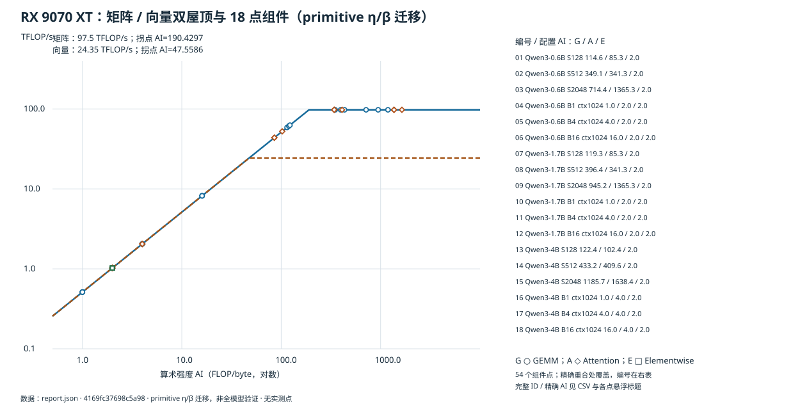
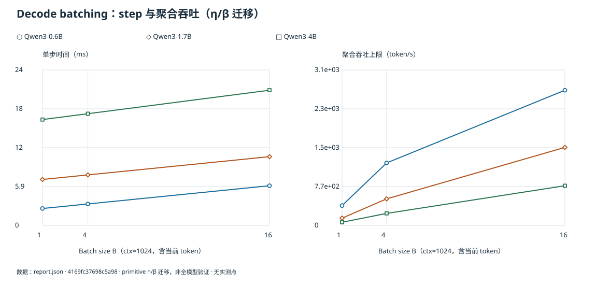
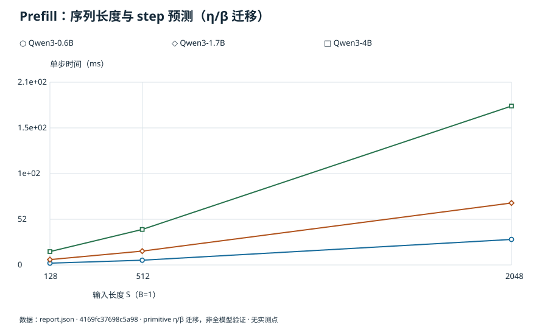
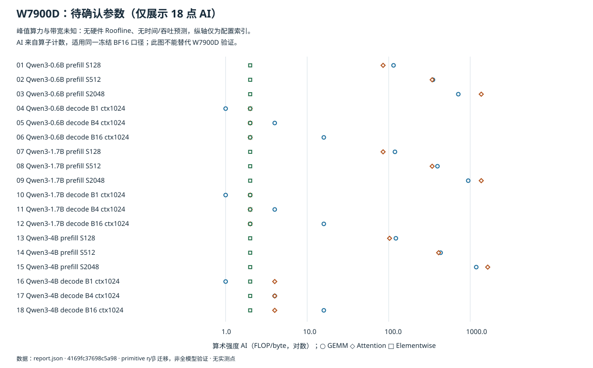

# 第 1 章：18 点 primitive η/β 迁移 实验报告

协议 `hello_mlsys_ch1_eta_beta_transfer_v1`；创建于 `2026-11-20T05:46:38.191Z`。

**解析预测完成；不代表课程的历史实测、先预测后测量纪律或 W7900D 硬件验收已完成。**

- η/β 从 primitive 迁移到 dense 全模型，属于域外假设；无新 GPU 实测或全模型硬件PASS。
- 本次 stored_at 是当前运行时间，不证明早于课程已有实测；未来测量须另行关联 prediction_id。
- 本协议使用 full-square attention；默认服务模拟器和既有 Profile 仍使用原口径。
- GEMM 激活及 elementwise 是 plan 中公开的流量假设，并非从课程近似时间反推的效率。
- W7900D 算力/带宽待确认；AI 示意不是该硬件的 Roofline 或时间预测。
- 本章时间不包含排队、launch、通信或容量/OOM 判定；带宽受限不等于显存装不下。
- 来源是导入的课程历史参考或显式测试夹具；未执行新的 GPU 采集，hardware_validated=false。
- 拟合仅使用原始 fit 标记的 GEMM 与流式 LN/Softmax；留出点不参与重拟合。
- 原始预测时间戳不证明测量前已落盘；源脚本在全部留出测量结束后统一保存，缺少独立留出测量起止时间。
- 原始 Attention S512 按 nominal 访存侧选分支；此处另列双侧重算 max，保留原值不覆盖。
- eta 来自大 GEMM，beta 来自流式 LN/Softmax；迁移到全模型、向量计算或 Attention 是域外假设。
- 事件计时不能识别 CPU T_launch 或框架开销；patch 不修改 launch_overhead_us / framework_overhead_us。
- 本导入不替代 whole-stage Profile、native PP 通信或 Workspace，不授予 TP/PP/缓存/swap/混合批处理硬件有效性。
- 同一 GEMM η 同时用于矩阵/向量计算是显式迁移假设；向量计算峰值效率并未单独识别。
- 课程 B/C 近似表的 reconciliation 保留 nominal 基线；不能用校准后结果反标近似表的计数正确性。

## 计数与瓶颈

图中保留全部54个 primitive η/β 迁移 组件点；精确重合的 marker 会覆盖，编号与配置在右表，完整数值见 [components.csv](components.csv)。
每个组件先选矩阵/向量峰值，取 max(compute, memory)，step 再求和；全局 AI 不用于判定。

| 模型 | Phase | B | S / ctx | GEMM | Attention | Elementwise | Step (ms) | 聚合 token/s |
| --- | --- | ---: | ---: | --- | --- | --- | ---: | ---: |
| Qwen3-0.6B | prefill | 1 | 128 | memory | memory | memory | 2.035712 | 62877.26 |
| Qwen3-0.6B | prefill | 1 | 512 | compute | compute | memory | 5.356751 | 95580.33 |
| Qwen3-0.6B | prefill | 1 | 2048 | compute | compute | memory | 28.827562 | 71043.12 |
| Qwen3-0.6B | decode | 1 | 1024 | memory | memory | memory | 2.557664 | 390.98 |
| Qwen3-0.6B | decode | 4 | 1024 | memory | memory | memory | 3.246464 | 1232.11 |
| Qwen3-0.6B | decode | 16 | 1024 | memory | memory | memory | 6.001664 | 2665.93 |
| Qwen3-1.7B | prefill | 1 | 128 | memory | memory | memory | 6.049792 | 21157.75 |
| Qwen3-1.7B | prefill | 1 | 512 | compute | compute | memory | 15.647207 | 32721.49 |
| Qwen3-1.7B | prefill | 1 | 2048 | compute | compute | memory | 69.989388 | 29261.58 |
| Qwen3-1.7B | decode | 1 | 1024 | memory | memory | memory | 6.950336 | 143.88 |
| Qwen3-1.7B | decode | 4 | 1024 | memory | memory | memory | 7.639808 | 523.57 |
| Qwen3-1.7B | decode | 16 | 1024 | memory | memory | memory | 10.397696 | 1538.80 |
| Qwen3-4B | prefill | 1 | 128 | memory | memory | memory | 15.114240 | 8468.83 |
| Qwen3-4B | prefill | 1 | 512 | compute | compute | memory | 40.113607 | 12763.75 |
| Qwen3-4B | prefill | 1 | 2048 | compute | compute | memory | 179.484435 | 11410.46 |
| Qwen3-4B | decode | 1 | 1024 | memory | memory | memory | 16.007632 | 62.47 |
| Qwen3-4B | decode | 4 | 1024 | memory | memory | memory | 16.894528 | 236.76 |
| Qwen3-4B | decode | 16 | 1024 | memory | memory | memory | 20.442112 | 782.70 |

Prefill token/s 是输入处理率；decode token/s 是生成速率，二者不可混作同一服务吞吐。

固定 ctx 后，batching 复用 GEMM 权重，但 KV 扫描仍随 B 增长。

固定 B=1；长序列的 full-square attention 计算项增长。

## W7900D：待确认参数

参数未知，无法画有数值意义的该硬件屋顶线；此图只展示同一 18 点的 AI，纵轴不是吞吐。

η/β 迁移报告中，下表保留校准前 nominal 基线；上面的18点与曲线使用校准后时间。

## 手算与近似表对账

| 0.6B 配置 | 课程约数 ms | 本协议精确 ms | 差值 ms | 一位小数相同 |
| --- | ---: | ---: | ---: | --- |
| qwen3_0_6b_prefill_s128 | 1.5 | 1.628570 | +0.128570 | 否 |
| qwen3_0_6b_prefill_s512 | 2.7 | 2.712782 | +0.012782 | 是 |
| qwen3_0_6b_prefill_s2048 | 14.0 | 14.551406 | +0.551406 | 否 |
| qwen3_0_6b_decode_b1 | 2.1 | 2.046131 | -0.053869 | 否 |
| qwen3_0_6b_decode_b4 | 2.6 | 2.597171 | -0.002829 | 是 |
| qwen3_0_6b_decode_b16 | 4.9 | 4.801331 | -0.098669 | 否 |

这些差异属于公式、流量假设与近似表口径，**不标作硬件测量误差或校准通过**。

- 时间对账使用课程算例 B/C 的约数，未将其当作标定目标或测量数据。
- 0.6B 精确 P_linear=440401920、P_linear+P_head=595984384；课程写约440M/596M。
- prefill 激活流量系数与 elementwise 是明确假设；各组件求和可能无法复现近似表的单步舍入。
- prefill LM head=omitted；课程主项省略末 token head，任务表泛称包含 head。
- 不对 FlashAttention 统一乘1.13：原文13%是外部算子测例比值，非本模型冻结公式。
- 原文 F=4*L*q_heads*head_dim*S²、额外 D=4*L*q_heads*S²，故极限为 head_dim=128；不能同时得到0.5。

## Primitive 直觉练习

| 算子 | FLOPs | Bytes | AI | 判定 | t_compute ms | t_memory ms | t ms |
| --- | ---: | ---: | ---: | --- | ---: | ---: | ---: |
| matmul_4096_bf16 | 137438953472 | 100663296 | 1365.333333 | compute | 1.409630 | 0.196608 | 1.409630 |
| layernorm_2048_1024_bf16 | 8388608 | 8388608 | 1.000000 | memory | 0.000345 | 0.016384 | 0.016384 |
| attention_flash_s512_28_layers | 60129542144 | 176160768 | 341.333333 | compute | 0.616713 | 0.344064 | 0.616713 |
| attention_naive | 60129542144 | 645922816 | 93.090909 | memory | 0.616713 | 1.261568 | 1.261568 |

## 可复现底稿

- report data SHA256：`4169fc37698c5a981f1783be3b6b8c99521b9745299fa719b27721d3d6393b06`
- plan SHA256：`d3378bc69b3af2fe25a47bc0a4cd652812f7d6fda586a700bc9e13993ce4923a`
- formulas SHA256：`3a19dbb63080e7354c098d2bbf5f32f468a4cfd352bf31e9791ae42a0000a1e7`
- 课程原文：[7df2dae493eb / 第 1 章](https://github.com/amdjiahangpan/hello-mlsys/blob/7df2dae493eb30c0f7e845b6d587b905288c0d7a/docs/part1-modeling/chapter1/index.md)；SHA256 `0c0c01a90d35b1b107cc88ccd2c48e776de141bb698356d4b8696baa401ec231`。
- [report.json](report.json) 保存全部公式、plan、逐点 prediction_id / stored_at、模型输入 hash。
- 以上图、表和 CSV 都从该 report 对象生成；未读取或重标课程已有测量为本次实验。
