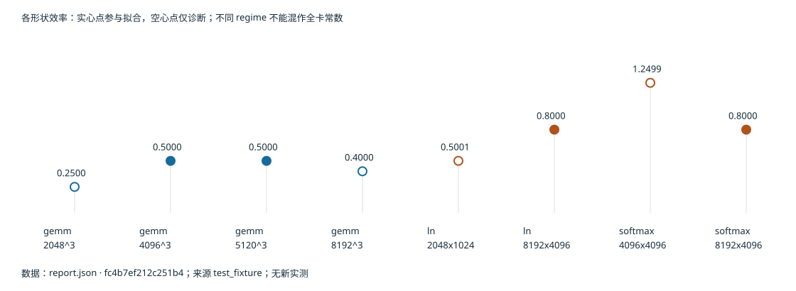

# 课程 η/β 导入与复算

来源 `test_fixture`；raw SHA256 `1f22d360512ff23dbcb0b7e0fbba913ede387612faadfd32fe2d5bf5194c5d6a`。

应用系数：η=0.5000，β=0.8000。

| 点 | 参与拟合 | 单点效率 |
| --- | --- | ---: |
| gemm_2048^3 | False | 0.2500 |
| gemm_4096^3 | True | 0.5000 |
| gemm_5120^3 | True | 0.5000 |
| gemm_8192^3 | False | 0.4000 |
| ln_2048x1024 | False | 0.5001 |
| ln_8192x4096 | True | 0.8000 |
| softmax_4096x4096 | False | 1.2499 |
| softmax_8192x4096 | True | 0.8000 |

| 留出点 | 源预测 ms | max复算 ms | 源测量 ms | 源误差 % | max复算误差 % | 瓶颈 |
| --- | ---: | ---: | ---: | ---: | ---: | --- |
| gemm_6144 | 4.75750 | 4.75750224 | 4.85265 | +2.0 | +2.000 | compute → compute |
| ln_16384x4096 | 0.52429 | 0.52428800 | 0.51380 | -2.0 | -2.000 | memory → memory |
| softmax_16384x4096 | 0.52429 | 0.52428800 | 0.54002 | +3.0 | +3.001 | memory → memory |
| attn_mha16_s512 | 0.01638 | 0.02202547 | 0.03276 | +100.0 | +48.737 | memory → compute |
| attn_mha16_s1024 | 0.08810 | 0.08810189 | 0.13215 | +50.0 | +49.997 | compute → compute |

误差=(measured/prediction−1)×100；正值表示预测偏乐观。源测量只是导入声明，未晋升本库实测。

- 来源是导入的课程历史参考或显式测试夹具；未执行新的 GPU 采集，hardware_validated=false。
- 拟合仅使用原始 fit 标记的 GEMM 与流式 LN/Softmax；留出点不参与重拟合。
- 原始预测时间戳不证明测量前已落盘；源脚本在全部留出测量结束后统一保存，缺少独立留出测量起止时间。
- 原始 Attention S512 按 nominal 访存侧选分支；此处另列双侧重算 max，保留原值不覆盖。
- eta 来自大 GEMM，beta 来自流式 LN/Softmax；迁移到全模型、向量计算或 Attention 是域外假设。
- 事件计时不能识别 CPU T_launch 或框架开销；patch 不修改 launch_overhead_us / framework_overhead_us。
- 本导入不替代 whole-stage Profile、native PP 通信或 Workspace，不授予 TP/PP/缓存/swap/混合批处理硬件有效性。

`calibration_patch.json` 仅供显式审阅/应用；未修改任何实验、Profile、launch、PP或Workspace。

导入时间 `2026-11-20T05:46:37.914Z`；data SHA256 `fc4b7ef212c251b4a77aff63bcf052dcd84a6f73d3277a5258089612a1dd632a`。
